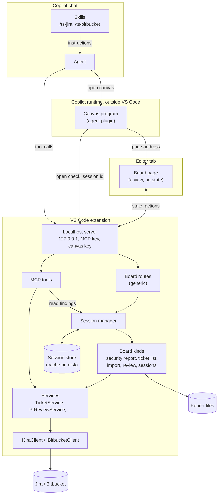
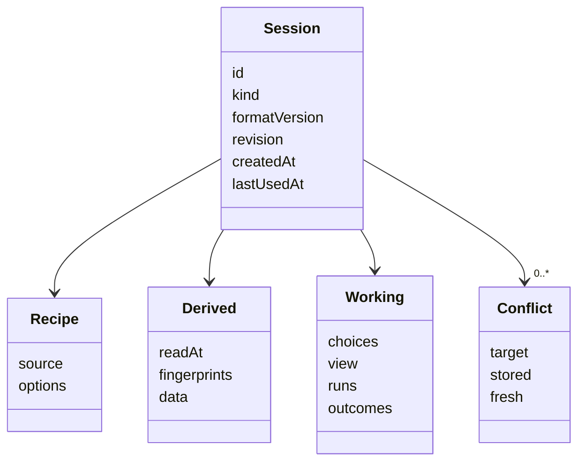
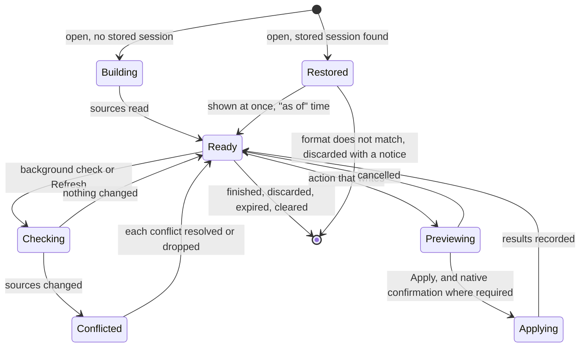
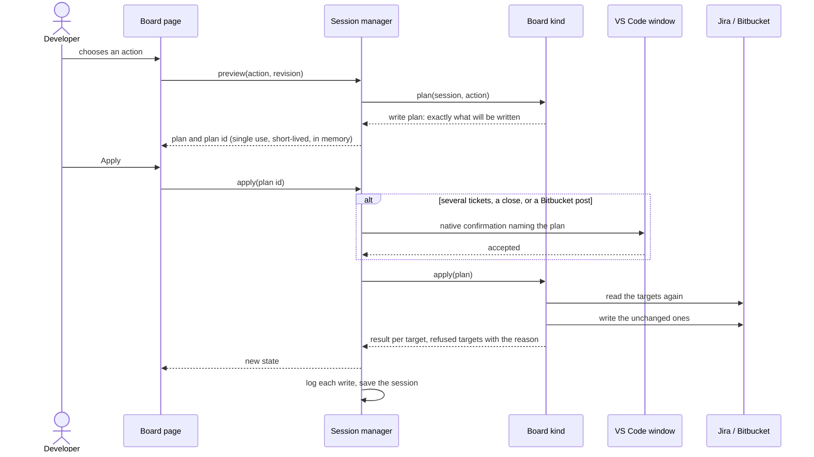

# Boards and sessions: target architecture

Status: **proposed, waiting for the maintainer's approval**. No board code is written before that (R47 of [`the boards plan`](../plans/2026-11-11-2234-feat-boards-replace-chat-participants-plan.md)).

This page describes how Ticket Sidekick is built once the chat participants are gone: where state lives, how a canvas shows it, how a write happens, and how to add a feature. It is kept current with the code. The reasons behind earlier choices, and the options that were rejected, stay in [`copilot-harness-migration.md`](copilot-harness-migration.md); new decisions are logged there from D7 on and summarised in [section 11](#11-decisions-made-for-this-design).

---

## 1. The idea in one paragraph

A chat participant used to own a multi-step flow: it kept the flow's state in `workspaceState` and showed it as chat text. Now the **extension owns a session** for each piece of work, a **board** (a canvas page) shows that session and sends actions to it, and the **agent** only opens boards and calls tools. The session is cached on disk so a reload or restart continues the same work. Jira, Bitbucket and the report file stay the truth; the cache is checked against them and never trusted for a write.

---

## 2. Layers



The existing rule holds unchanged: services depend on the client interfaces only, and everything below the server stays free of `vscode` so Vitest can load it. `src/mcp/register.ts` remains the one place that wires `vscode` in.

| Layer | Responsibility | Must not |
| --- | --- | --- |
| Skill | Tells the agent which tool to call or which board to open | Carry logic or state |
| Agent | Opens a board, passes what the developer said, calls tools, reads review findings | See a board's rows (R11, R17), choose rows, or write through a board |
| Canvas program | Finds the window that holds the chat's folder and returns the page address | Hold credentials or session data |
| Board page | Shows the session it is given and sends actions | Keep state, decide anything, or talk to Jira |
| Board routes | Authenticate, route to the session manager, serialise actions per session | Know any board kind's rules |
| Session manager | Creates, loads, saves, expires sessions; runs background checks; issues and redeems write plans | Know Jira or Bitbucket |
| Board kind | The rules of one board: build, reduce, reconcile, plan, apply | Import `vscode` or another board kind |
| Services, clients | Jira and Bitbucket business logic and HTTP, as today | Know sessions or boards |

---

## 3. What a session holds

Every board works with three kinds of information. The session keeps them apart, because they have different truths.

| Part | Examples (Veracode import) | Truth | Stored |
| --- | --- | --- | --- |
| **Recipe** | Kind, report path, project, template | The developer's request | Yes |
| **Derived** | Parsed rows, dedup matches, stale tickets, ticket descriptions read for comparison; for a review, the findings | Report file, Jira, Bitbucket, or a model run | Yes, with the time and fingerprint of what it was derived from |
| **Working** | Merged rows, picked actions, selections, current screen, filters, a merge run with its finished and pending steps, results so far | Nowhere else | Yes |



- **`id`** is derived from the kind and the normalised source, so there is one session per source (R54): the same report file, query, PR or project always maps to the same session.
- **`revision`** increases with every change. The page sends the revision it last saw; an action based on an older revision is refused and the page reloads the state.
- **`fingerprints`** identify what the derived data came from: a report file's size, modification time and content hash; a PR's head commit; for Jira reads, the time.

---

## 4. Life of a session



### 4.1 Opening

1. The agent opens a canvas with the recipe: a project, a query and an optional proposed change, a report path, a PR link.
2. The canvas program finds the window that holds the chat's folder and asks its **open check**. The window validates the recipe and answers with the session ID, or with a reason.
3. The canvas program returns the page address, which carries the canvas key and the session ID. The agent learns only "opened" or the reason.
4. The page loads and asks for the session's state. A stored session is shown at once with its "as of" time; otherwise the board kind builds it from the sources.

### 4.2 Freshness and conflicts (R55, R56)

- After showing a stored session, the manager asks the board kind to **check** the sources in the background. Refresh runs the same check on demand.
- The board kind's `reconcile` compares stored and fresh data and returns the updated derived data plus a list of **conflicts**: working state whose target changed or disappeared.
- A board shows a banner with the count, marks each conflict in place, can show the stored and the fresh value, and offers **resolve** (accept the fresh state and redo or keep the choice) or **drop** per conflict.
- A PR review is never re-run by a check. The check only compares the PR's head commit and sets "the PR has moved since this review"; re-running is the developer's choice.

### 4.3 Writing (R3, R39, R57)



- A write needs a **plan ID** that only `preview` issues. The manager keeps it in memory, tied to the session revision, and redeems it once. A request that carries only the canvas key cannot write a risky change without the native confirmation, which no page or script can click.
- **Risky** means: more than one ticket, closing a ticket, or anything posted to Bitbucket. The board kind's plan states it; the manager enforces it.
- Before writing, the board kind reads each target again and refuses the ones that changed since the session last read them. A refused target becomes a conflict.
- Multi-step runs (a ticket merge) are working state: each step is recorded as pending, done, failed or skipped before the next one starts, so a restart continues at the right step and never repeats a done one.
- Every write is logged through `logDiag` (R5).

### 4.4 The cache (R53, R58, R59)

| Aspect | Design |
| --- | --- |
| Place | One JSON file per session in the extension's storage folder for the workspace (`ExtensionContext.storageUri`), under `sessions/`. Outside the repository, removed by VS Code with the workspace's data. |
| Why not `workspaceState` | It loads every value into memory at start and is meant for small values; an import session can be megabytes. |
| Writing | After each change, debounced, to a temporary file that is then renamed, so a crash never leaves a half-written session. |
| Contents | Never credentials. Vulnerability rows, ticket text and PR findings are stored, as decided; the manual says so and names the clear command. |
| Format | Each board kind has a `formatVersion`. A file whose version differs is deleted when found and the board says the stored session was discarded. No migration code. |
| Expiry | At start and once a day, sessions not used for `ticketSidekick.sessions.retentionDays` (default 14) are deleted. |
| Removal | Finish or Discard on the board, Delete on the sessions board, and the command "Ticket Sidekick: Clear stored sessions". |
| Size | A session over a fixed limit is kept in memory only, and the board says it will not survive a restart. |

### 4.5 Restart

The Copilot runtime brings a canvas back with its old address. The canvas program's existing repair asks the window for a fresh address and reopens the canvas with the same instance ID, which carries the session ID. The page then loads the stored session as in 4.1. If the window does not return, the canvas is closed; the session stays in the cache and is reachable from the sessions board.

---

## 5. A board kind

A board kind is the only place that knows one board's rules. It is a plain object, free of `vscode`, registered with the session manager.

| Member | Purpose |
| --- | --- |
| `kind`, `formatVersion`, `title` | Identity and cache version |
| `validate(input)` | Turns the agent's open input into a recipe, or a reason. Used by the open check. |
| `sourceKey(recipe)` | The normalised source the session ID is derived from |
| `build(recipe, deps)` | Reads the sources and returns the derived data and initial working state |
| `check(session, deps)` | Reads the sources again and returns fresh derived data |
| `reconcile(session, fresh)` | Returns the session with fresh data and the list of conflicts |
| `reduce(session, action)` | **Pure.** Applies a non-writing action (select, merge rows, pick an action, filter, change screen) and returns the new working state or a refusal |
| `plan(session, action)` | **Pure.** Returns the write plan for a writing action: targets, what is written, and whether it is risky |
| `apply(plan, session, deps)` | Reads the targets again, writes, and returns the result per target |
| `view(session)` | The data the page gets: never more than it shows |
| `summary(session)` | The row on the sessions board: source, counts, nothing sensitive beyond that |

`reduce`, `plan` and `reconcile` being pure is what keeps the boards testable as scenarios in Vitest, the way `sessionState.ts` is today. The existing import, cleanup and review logic moves behind these members; its parsers, builders and services are reused, and only the reply parsing and chat rendering are dropped.

Planned kinds: `security-report`, `ticket-list` (also cleanup), `import` (Veracode, Waltz, email, as descriptors like today), `review`, `sessions`.

---

## 6. Page and server

All boards use one set of routes under the canvas key, so a new board adds no route code.

| Route | Purpose |
| --- | --- |
| `GET /board/<kind>/` and its assets | The page: static files shipped with the extension |
| `GET /board/<kind>/state?s=<id>&rev=<n>` | The session's view. With `rev`, waits until the revision changes or a timeout passes, so the page learns of background results without a timer. |
| `POST /board/<kind>/action` | A non-writing action with the revision it is based on |
| `POST /board/<kind>/refresh` | Runs the check now |
| `POST /board/<kind>/preview` | Returns a write plan and its plan ID |
| `POST /board/<kind>/apply` | Redeems a plan ID |
| `POST /board/<kind>/save` | For boards that export: writes a file through VS Code's save dialog |

- The existing guard stays: `Host` check, `Origin` check, the canvas key in the path, a strict content policy, JSON bodies only, no caching.
- Actions on one session are processed one after another.
- Two tabs on the same session show the same state; neither is "the old one".
- Pages share one small client module (load state, send action, render banner, conflicts, preview and Apply) and one style built on VS Code Elements. A board supplies its table and controls.

---

## 7. What the agent can do

| Need | Mechanism |
| --- | --- |
| Single-ticket work | MCP tools, each write behind the tool approval dialog |
| Show a list, change several tickets, import a report, review a PR, see the security report | Open the matching board; the answer is "opened" or a reason |
| Talk about a review | `bitbucket_read_findings` reads findings from the review's session |
| Typed commands | `/ts-jira` and `/ts-bitbucket` map one typed command to one tool call or one canvas |

The agent has no canvas actions. Tool descriptions and skills tell it to open the ticket list board for lists and multi-ticket changes (R44).

---

## 8. Security model

| Threat | Answer |
| --- | --- |
| Another machine or user reaches the server | Bound to `127.0.0.1`, random port, keys required on every request |
| A web page calls the server | `Host` and `Origin` checks, no CORS headers, JSON bodies only |
| A process of the same user reads the canvas key | It can read board state, as it can read the session files. It cannot make a risky write: that needs the native confirmation. It cannot write anything without a plan ID from a preview. |
| A prompt-injected agent | Same as above; in addition the agent gets no rows from a board and has no canvas actions |
| Stale cache leads to a wrong write | Targets are read again before every write and changed ones are refused |
| Session files leak data | They sit in VS Code's per-workspace extension storage with the user's file permissions, hold no credentials, expire, and can be cleared with one command |

---

## 9. Module layout

```text
src/
  sessions/            vscode-free
    sessionTypes.ts    Session, Recipe, Derived, Working, Conflict, WritePlan
    sessionId.ts       id from kind and source
    sessionStore.ts    files: load, save (atomic), list, delete, expire
    sessionManager.ts  open, state, action, check, preview, apply, plan ids, per-session queue
    boardKind.ts       the BoardKind interface and the registry
  boards/
    boardRoutes.ts     the generic routes of section 6
    securityReport/    one folder per board kind: kind.ts, and what only it needs
    ticketList/
    import/
    review/
    sessionsBoard/
  canvas/              the canvas foundation: routes, window notes, open decision, restore repair, launcher
  mcp/                 the MCP server and tools, as today
  services/, jira/, bitbucket/, utils/, templates/   unchanged
canvas-pages/          page sources: shared client and style, one folder per board
```

`src/participant/` shrinks with each step and is gone after step 3. Pure helpers that boards still need move out of it into `src/boards/<kind>/` or `src/utils/` before their participant code is deleted.

---

## 10. Adding a feature

**A new MCP tool** (a single read or write the agent calls)
1. Add the service method behind the client interface, with fixture and tests, as today.
2. Add the tool in `src/mcp/jiraTools/` or the Bitbucket equivalent, with its name in the tool-name module and its entry in the catalog.
3. A write tool uses the shared duplicate guard and the approval dialog.
4. Add its row to `docs/manual/copilot-tools.md` and, if it has a typed form, to the `/ts-jira` or `/ts-bitbucket` skill. The guard tests fail until both exist.

**A new skill**
1. Add `skills/<name>/SKILL.md` and its `contributes.chatSkills` entry.
2. Keep it to instructions: which tool or board, in which order. No logic the tools do not enforce.

**A new board**
1. Decide what is recipe, derived and working state. If there is no working state and the data is cheap to read, it is still a session, just a small one.
2. Write the board kind in `src/boards/<kind>/` with scenario tests for `reduce`, `plan` and `reconcile`.
3. Register it; add its canvas to the canvas program and the plugin description.
4. Build the page from the shared client and style.
5. Add a browser test of the page against a stubbed server.
6. Add the typed command to the skill, the manual page, and a line in `CLAUDE.md`.

**A new action on an existing board**
1. Add it to the board kind's `reduce` (no write) or `plan` and `apply` (write), with tests.
2. Add the control to the page.
3. If it changes stored data, raise the board kind's `formatVersion`.

---

## 11. Decisions made for this design

Logged in full, with rejected alternatives, in `copilot-harness-migration.md` from D7.

| # | Decision | Decided by |
| --- | --- | --- |
| D7 | The extension owns a session per board run; the page is a view | Maintainer |
| D8 | A session is stored in full: recipe, derived data and working state | Maintainer |
| D9 | The stored session is a cache: shown at once, checked in the background, never trusted for a write | Maintainer |
| D10 | One session per source; expiry after unused days, a clear command, a sessions board | Maintainer |
| D11 | Risky board writes need a native VS Code confirmation | Maintainer |
| D12 | Session files live in the extension's per-workspace storage folder, one file per session, not in `workspaceState` | Proposed here |
| D13 | The session ID is derived from kind and source and travels in the canvas instance ID and page address | Proposed here |
| D14 | A write needs a single-use plan ID issued by a preview | Proposed here |
| D15 | One generic set of board routes; board kinds are plain objects with pure `reduce`, `plan` and `reconcile` | Proposed here |
| D16 | The page learns of changes by a waiting state request, not by a timer or a push channel | Proposed here |
| D17 | A stored session of another format is discarded, never migrated | Maintainer |

---

## 12. Points to confirm before code

- **D12 to D16** are my proposals and need your yes or a change.
- **Not observed yet:** that the Copilot runtime hands a restored canvas its instance ID or open input back. If it does not, a restored canvas is closed and the session is reopened from the sessions board.
- **Not verifiable outside your machine:** canvas start in a real Copilot chat, the proxy behaviour, and real Jira and Bitbucket Data Center. Code built before those checks is covered by unit and browser tests only.
