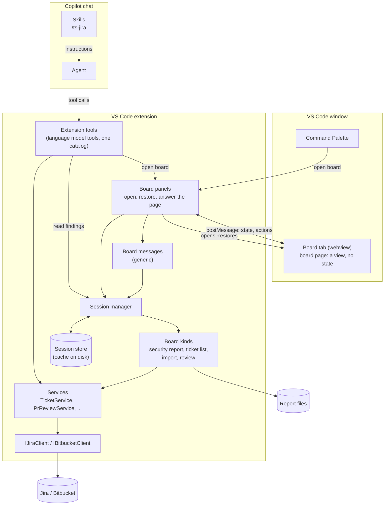
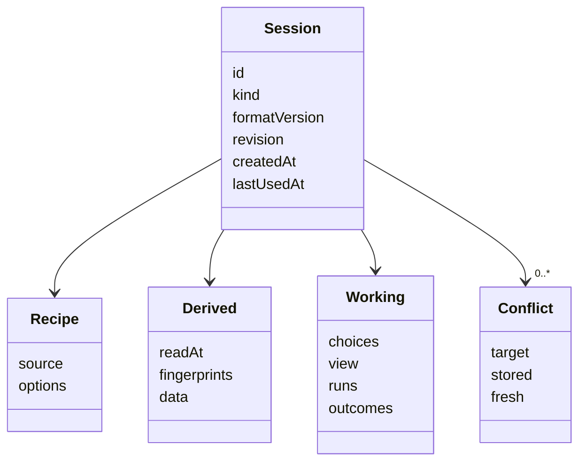
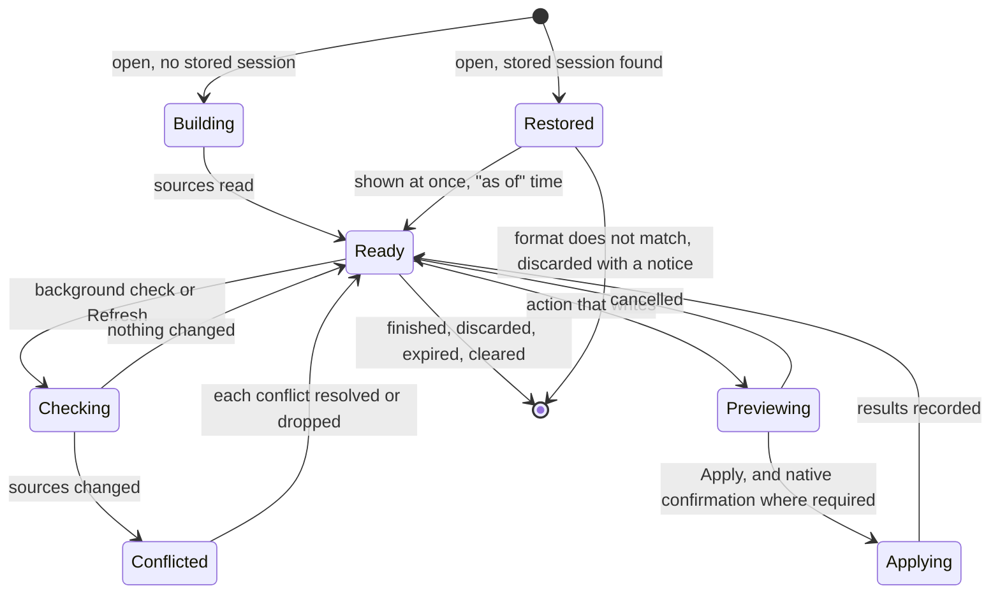
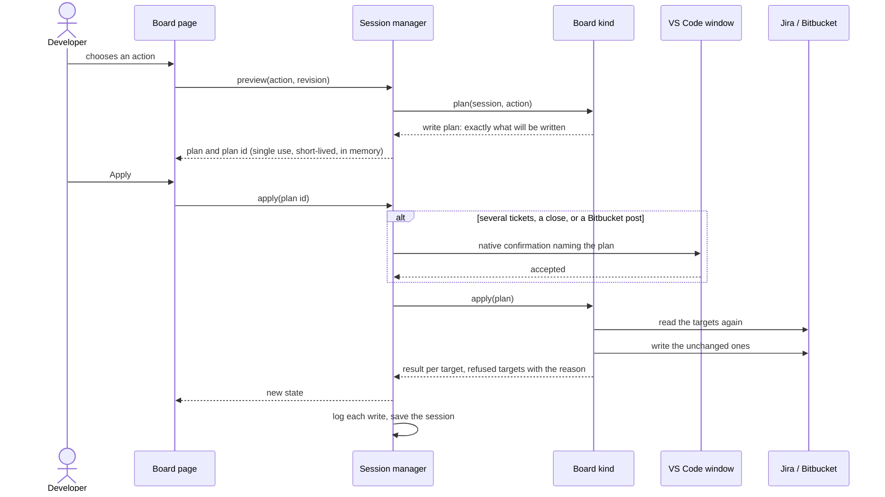

# Boards and sessions: target architecture

Status: **approved by the maintainer on 2026-11-12** (R47 of [the boards plan](../plans/2026-11-11-2234-feat-boards-replace-chat-participants-plan.md)); revised on 2026-11-13 to the one route that is built: **extension tools and editor views**. Section 0 says what is built.

This page describes how Ticket Sidekick is built once the chat participants are gone: where state lives, how a board shows it, how a write happens, and how to add a feature. It is kept current with the code and is the page a planning session should start from.

> **Read this first.** There is **no MCP server, no canvas, no agent plugin and no local HTTP server** in Ticket Sidekick. Copilot reaches the tools as VS Code language model tools ("extension tools"), and a board is a webview in an editor tab that talks to the extension over VS Code's message channel. Older documents describe the removed routes: [`copilot-harness-migration.md`](copilot-harness-migration.md) and the plans dated 2026-11-05 and 2026-11-09 are history, each marked as superseded at its top. Do not plan against them. The `@jira` and `@bitbucket` chat participants are **deprecated**: they still run what has no board yet and are removed when it has.

---

## 0. Where this design stands

- **Tools:** the Jira tool catalog (`src/tools/jiraTools/`) is registered with VS Code as language model tools by `src/tools/registerJiraTools.ts`. That is the only route; no setting chooses one. Decision D21.
- **Host:** a board is a webview in an editor tab the extension opens (`src/boards/boardPanels.ts`). The tab loads the page from the extension's own files and the page talks to the extension with `postMessage`. Decisions D18 and D20.
- **Removed on 2026-11-13:** the MCP server with its lifecycle, keys, request guard and diagnostics command; the `ticketSidekick.jira.toolsFrom` setting; the local HTTP server and the `http.noProxy` requirement; the canvas program, the agent plugin and the `@github/copilot-sdk` and `@modelcontextprotocol/sdk` dependencies. Why: an organisation's Copilot policy blocked the MCP server while extension tools got through, VS Code 1.146 did not register an extension's canvas, and two routes for the same tools was a switch nobody wanted to operate.
- **Built:** the session core, the board message handling, the security report board, the ticket list board (search, bulk move, bulk field update), the sessions board, and of the plan's step 1 tools R40 to R42, plus spell check (R28) and template from a ticket (R29) as `/ts-jira-spell-check` and `/ts-jira-template` with their tools.
- **Open points:** the full list, with the requirement each belongs to and the participant flow it blocks, is in [`migration-status.md`](migration-status.md).
- **Not built:** cleanup on the ticket list board (R9), the import board, the PR review board with its Bitbucket tool additions, and the removal of the deprecated `@jira` and `@bitbucket` participants.

## 1. The idea in one paragraph

A chat participant used to own a multi-step flow: it kept the flow's state in `workspaceState` and showed it as chat text. Now the **extension owns a session** for each piece of work, a **board** (a page in an editor tab) shows that session and sends actions to it, and the **agent** only opens boards and calls tools. The session is cached on disk so a reload or restart continues the same work. Jira, Bitbucket and the report file stay the truth; the cache is checked against them and never trusted for a write.

---

## 2. Layers



The existing rule holds unchanged: services depend on the client interfaces only, and the tool catalog, board messages, sessions and board kinds stay free of `vscode` so Vitest can load them. Three files wire `vscode` in: `src/tools/registerJiraTools.ts`, `src/boards/registerBoards.ts` and `src/boards/boardPanels.ts`.

| Layer | Responsibility | Must not |
| --- | --- | --- |
| Skill | Tells the agent which tool to call or which board to open | Carry logic or state |
| Agent | Asks for a board through the open-board tool, passes what the developer said, calls tools, reads review findings | See a board's rows (R11, R17), choose rows, or write through a board |
| Board panels | Open a board's editor tab for a tool call or a command, write its document, answer the page's messages, restore it after a restart | Know any board kind's rules |
| Board page | Shows the session it is given and sends actions | Keep state, decide anything, or talk to Jira |
| Board messages | Check a page's request, route it to the session manager for the tab's own session, word refusals | Know any board kind's rules, or take the session from the page |
| Session manager | Creates, loads, saves, expires sessions; runs background checks; issues and redeems write plans | Know Jira or Bitbucket |
| Board kind | The rules of one board: build, reduce, reconcile, plan, apply | Import `vscode` or another board kind |
| Services, clients | Jira and Bitbucket business logic and HTTP, as today | Know sessions or boards |

---

## 3. What a session holds

Every board works with three kinds of information. The session keeps them apart, because they have different truths.

| Part | Examples (Veracode import) | Truth | Stored |
| --- | --- | --- | --- |
| **Recipe** | Kind, report path, project, template | The developer's request | Yes |
| **Derived** | Parsed rows, dedup matches, stale tickets, ticket descriptions read for comparison; for a review, the findings | Report file, Jira, Bitbucket, or a model run | Yes, with the time and fingerprint of what it was derived from |
| **Working** | Merged rows, picked actions, selections, current screen, filters, a merge run with its finished and pending steps, results so far | Nowhere else | Yes |



- **`id`** is derived from the kind and the normalised source, so there is one session per source (R54): the same report file, query, PR or project always maps to the same session.
- **`revision`** increases with every change. The page sends the revision it last saw; an action based on an older revision is refused and the page reloads the state.
- **`fingerprints`** identify what the derived data came from: a report file's size, modification time and content hash; a PR's head commit; for Jira reads, the time.

---

## 4. Life of a session



### 4.1 Opening

1. The agent calls the open-board tool, or the developer runs a Command Palette command, with the recipe: a project, a query and an optional proposed change, a report path, a PR link.
2. The board panels ask the session manager to open the board. The board kind validates the recipe; the manager derives the session ID from kind and source and creates or restores the session.
3. The extension opens an editor tab, or brings the board's existing tab forward. The tab is a webview; the extension writes its document, which loads the board's page script, the shared client and the style from the extension folder. Its content policy lets scripts load from those files only. The agent learns only "opened" or the reason.
4. The page posts a request for the session's state. A stored session is shown at once with its "as of" time; otherwise the board kind builds it from the sources.

### 4.2 Freshness and conflicts (R55, R56)

- After showing a stored session, the manager asks the board kind to **check** the sources in the background. Refresh runs the same check on demand.
- The board kind's `reconcile` compares stored and fresh data and returns the updated derived data plus a list of **conflicts**: working state whose target changed or disappeared.
- A board shows a banner with the count, marks each conflict in place, can show the stored and the fresh value, and offers **resolve** (accept the fresh state and redo or keep the choice) or **drop** per conflict.
- A PR review is never re-run by a check. The check only compares the PR's head commit and sets "the PR has moved since this review"; re-running is the developer's choice.

### 4.3 Writing (R3, R39, R57)



- A write needs a **plan ID** that only `preview` issues. The manager keeps it in memory, tied to the session revision, and redeems it once. A page cannot write a risky change without the native confirmation, which no page or script can click.
- **Risky** means: more than one ticket, closing a ticket, or anything posted to Bitbucket. The board kind's plan states it; the manager enforces it.
- Before writing, the board kind reads each target again and refuses the ones that changed since the session last read them. A refused target becomes a conflict.
- Multi-step runs (a ticket merge) are working state: each step is recorded as pending, done, failed or skipped before the next one starts, so a restart continues at the right step and never repeats a done one.
- Every write is logged through `logDiag` (R5).

### 4.4 The cache (R53, R58, R59)

| Aspect | Design |
| --- | --- |
| Place | One JSON file per session in the extension's storage folder for the workspace (`ExtensionContext.storageUri`), under `sessions/`. Outside the repository, removed by VS Code with the workspace's data. |
| Why not `workspaceState` | It loads every value into memory at start and is meant for small values; an import session can be megabytes. |
| Writing | After each change, debounced, to a temporary file that is then renamed, so a crash never leaves a half-written session. |
| Contents | Never credentials. Vulnerability rows, ticket text and PR findings are stored, as decided; the manual says so and names the clear command. |
| Format | Each board kind has a `formatVersion`. A file whose version differs is deleted when found and the board says the stored session was discarded. No migration code. |
| Expiry | At start and once a day, sessions not used for `ticketSidekick.sessions.retentionDays` (default 14) are deleted. |
| Removal | Finish or Discard on the board, Delete on the sessions board, and the command "Ticket Sidekick: Clear stored sessions". |
| Size | A session over a fixed limit is kept in memory only, and the board says it will not survive a restart. |

### 4.5 Restart

VS Code restores a board's tab with the window and hands back the small state the page stored with `setState`: board kind, session ID and title. The board panels check that state, write the tab's document again, and the page loads the stored session as in 4.1. A tab whose state is not a board's is closed. `onWebviewPanel:ticketSidekick.board` is an activation event, so a restored tab starts the extension.

---

## 5. A board kind

A board kind is the only place that knows one board's rules. It is a plain object, free of `vscode`, registered with the session manager.

| Member | Purpose |
| --- | --- |
| `kind`, `formatVersion`, `title(recipe)` | Identity and cache version |
| `validate(input, deps)` | Turns the open input into a recipe, or the reason the board cannot open |
| `sourceKey(recipe)`, `sourceLabel(recipe)` | The normalised source the session ID is derived from, and its short description for the sessions board |
| `initialWorking(recipe)`, `reopen?(session, recipe)` | The working state of a new session, and of a session asked for again with a new request (for example another proposed change) |
| `read(recipe, deps)` | Reads the sources. Used to build a new session and to check a stored one |
| `reconcile(session, fresh)` | **Pure.** Lays the stored working state over a fresh reading and returns the conflicts |
| `reduce(session, action)` | **Pure.** Applies a non-writing action (select, merge rows, pick an action, filter, change screen) and returns the new working state or a refusal |
| `plan?(session, action)` | **Pure.** Returns the write plan for a writing action: targets, what is written, and whether it is risky. Kinds without writes omit it |
| `apply?(session, plan, deps)` | Reads the targets again, writes the unchanged ones, and returns the result per target |
| `exportFile?(session, format, deps)` | A file the developer saves from the board |
| `view(session)` | The data the page gets: never more than it shows |

The interface is `BoardKind` in `src/sessions/boardKind.ts`.

`reduce`, `plan` and `reconcile` being pure is what keeps the boards testable as scenarios in Vitest, the way `sessionState.ts` is today. The existing import, cleanup and review logic moves behind these members; its parsers, builders and services are reused, and only the reply parsing and chat rendering are dropped.

Built kinds: `security-report`, `ticket-list`. Planned: cleanup on `ticket-list`, `import` (Veracode, Waltz, email, as descriptors like today), `review`. The sessions board is not a kind: it lists sessions and has its own requests.

---

## 6. Page and extension

A board page posts requests to its tab and gets one reply per request; there is no HTTP anywhere. All boards share one set of requests (`src/boards/boardMessages.ts`), so a new board adds no handling code.

```text
page  → extension   { id, op, body }
extension → page    { id, ok: true, data }  or  { id, ok: false, status, error }
```

| Request (`op`) | Purpose |
| --- | --- |
| `state` with optional `tick`, `wait` | The session's view. With `tick`, the reply waits until the state changes or the wait passes, so the page learns of background results without a timer |
| `action` with `revision`, `action` | A non-writing action with the revision it is based on |
| `refresh` | Runs the check now |
| `preview` with `revision`, `action` | Returns a write plan and its plan ID |
| `apply` with `planId` | Redeems a plan ID |
| `save` with `format` | For boards that export: writes a file through VS Code's save dialog |
| `discard` | Deletes the session |
| `list`, `delete`, `delete-all`, `open` | The sessions board only: list stored sessions, delete one or all, reopen one in its own tab |

- **The tab names the session, not the page.** `BoardPanels` binds each tab's message listener to the board kind and session ID it opened the tab with. A request carries no session ID, and one a page adds is not read, so a page cannot reach another session.
- `status` on a refusal follows HTTP numbers because the shared client tells cases apart by them: 400 malformed, 404 gone, 409 changed meanwhile, 500 unexpected (fixed sentence to the page, detail to the log).
- Actions on one session are processed one after another.
- Two tabs cannot show the same session: opening it again brings the existing tab forward.
- Pages are plain files in `board-pages/`, copied to `out/board-pages` with the VS Code Elements bundle. They share one client module (`shared/board.js`: load state, send action, render banner, conflicts, preview and Apply) and one style that uses VS Code's own `--vscode-*` theme variables. A board supplies `page.js` with its table and controls; the extension writes the HTML document (`boardPanelHtml.ts`).

---

## 7. What the agent can do

| Need | Mechanism |
| --- | --- |
| Single-ticket work | The Jira tools: VS Code language model tools registered from one catalog. A tool that is not read-only shows a confirmation with every value it will write (`prepareInvocation`) |
| Show a list, change several tickets, import a report, review a PR, see the security report | Open the matching board; the answer is "opened" or a reason |
| Talk about a review | `bitbucket_read_findings` reads findings from the review's session |
| Typed commands | `/ts-jira` (and later `/ts-bitbucket`) maps one typed command to one tool call |

The agent cannot act on a board; it can only ask for one to be opened. Tool descriptions and skills tell it to open the ticket list board for lists and multi-ticket changes (R44).

---

## 8. Security model

| Threat | Answer |
| --- | --- |
| Another machine, user or process reaches a board | There is nothing to reach: no port is open. A board is a webview; only its own page can post to it |
| A web page or injected content runs script in a board | The tab's content policy allows scripts from the extension's own files only, no inline script, nothing from the network. Pages write Jira, Bitbucket and report text with `textContent`, never as HTML |
| A board page is tricked into acting on another session | The tab, not the page, names the session (section 6) |
| A script in the page writes to Jira | Nothing is written without a plan ID from a preview, and a risky write needs the native confirmation, which no page or script can click |
| A prompt-injected agent | The agent gets no rows from a board and has no way to act on one; its own write tools each show a confirmation |
| Stale cache leads to a wrong write | Targets are read again before every write and changed ones are refused |
| Session files leak data | They sit in VS Code's per-workspace extension storage with the user's file permissions, hold no credentials, expire, and can be cleared with one command |

---

## 9. Module layout

```text
src/
  sessions/            vscode-free
    sessionTypes.ts    Session, Recipe, Derived, Working, Conflict, WritePlan
    sessionId.ts       id from kind and source
    sessionStore.ts    files: load, save (atomic), list, delete, expire
    sessionManager.ts  open, state, action, check, preview, apply, plan ids, per-session queue
    boardKind.ts       the BoardKind interface and the registry
  boards/
    boardMessages.ts   the requests of section 6 (vscode-free)
    boardPanelHtml.ts  the tab's document and content policy (pure)
    boardPanels.ts     the editor tabs: open, answer the page, restore (imports vscode)
    registerBoards.ts  wires it to vscode: store folder, confirmation, save dialog, retention, commands
    securityReport/    one folder per board kind: kind.ts, and what only it needs
    ticketList/
    import/            planned
    review/            planned
  tools/
    toolDefinition.ts  ToolDefinition, defineTool, callTool, ToolFailure (vscode-free)
    jiraTools/         the Jira tool catalog, one module per tool, names in toolNames.ts (vscode-free)
    jiraToolConfirmation.ts  what a write tool asks before it runs (pure)
    jiraToolManifest.ts      the package.json entries, generated from the catalog
    registerJiraTools.ts     registers the catalog with vscode.lm and builds the tool dependencies (imports vscode)
    bitbucketTools.ts        the Bitbucket language model tools
  services/, jira/, bitbucket/, utils/, templates/   unchanged
  participant/         deprecated: @jira and @bitbucket, removed step by step
board-pages/           page sources: shared client and style, one folder per board; copied to out/board-pages
skills/                /ts-jira, /ts-jira-create, /ts-jira-brief
```

`src/participant/` holds the deprecated chat participants. It shrinks with each step and is gone after step 3. Nothing new is added there. Pure helpers that boards still need move out of it into `src/boards/<kind>/` or `src/utils/` before their participant code is deleted.

---

## 10. Adding a feature

**A new tool** (a single read or write the agent calls)
1. Add the service method behind the client interface, with fixture and tests, as today.
2. Add the tool in `src/tools/jiraTools/` with `defineTool`, its name in `toolNames.ts` and its entry in `catalog.ts`. Mark it `readOnlyHint` only if it changes nothing; every other tool gets the confirmation automatically.
3. A write tool uses the shared duplicate guard (`writeGuard.ts`).
   Run `node scripts/sync-jira-tools.mjs`, which writes the tool into `package.json`'s `contributes.languageModelTools`; a test fails while they differ.
4. Add its row to `docs/manual/copilot-tools.md` and `docs/manual/agent-mode-tools.md` and, if it has a typed form, to the `/ts-jira` or `/ts-bitbucket` skill. The guard tests fail until both exist.

**A new skill**
1. Add `skills/<name>/SKILL.md` and its `contributes.chatSkills` entry.
2. Keep it to instructions: which tool or board, in which order. No logic the tools do not enforce.

**A new board**
1. Decide what is recipe, derived and working state. If there is no working state and the data is cheap to read, it is still a session, just a small one.
2. Write the board kind in `src/boards/<kind>/` with scenario tests for `reduce`, `plan` and `reconcile`.
3. Register it in `registerBoards.ts`, add it to the open-board tool's `board` values and its inputs, and add a Command Palette command.
4. Add `board-pages/<kind>/page.js`, built from the shared client and style. The folder name is the kind's name; no HTML file is needed.
5. Cover the kind's requests in a test like `boardMessages.test.ts`.
6. Add the typed command to the skill, the manual page, and a line in `CLAUDE.md`.

**A new action on an existing board**
1. Add it to the board kind's `reduce` (no write) or `plan` and `apply` (write), with tests.
2. Add the control to the page.
3. If it changes stored data, raise the board kind's `formatVersion`.

---

## 11. Decisions made for this design

Logged in full, with rejected alternatives, in `copilot-harness-migration.md` from D7.

| # | Decision | Decided by |
| --- | --- | --- |
| D7 | The extension owns a session per board run; the page is a view | Maintainer |
| D8 | A session is stored in full: recipe, derived data and working state | Maintainer |
| D9 | The stored session is a cache: shown at once, checked in the background, never trusted for a write | Maintainer |
| D10 | One session per source; expiry after unused days, a clear command, a sessions board | Maintainer |
| D11 | Risky board writes need a native VS Code confirmation | Maintainer |
| D12 | Session files live in the extension's per-workspace storage folder, one file per session, not in `workspaceState` | Approved |
| D13 | The session ID is derived from kind and source; the tab holds it and VS Code hands it back on restore | Approved |
| D14 | A write needs a single-use plan ID issued by a preview | Approved |
| D15 | One generic set of board requests; board kinds are plain objects with pure `reduce`, `plan` and `reconcile` | Approved |
| D16 | The page learns of changes by a waiting state request, not by a timer or a push channel | Approved |
| D17 | A stored session of another format is discarded, never migrated | Maintainer |
| D18 | A board's page is hosted in an editor tab opened by the extension | Maintainer |
| D19 | Superseded by D21 (was: tools over MCP or as extension tools, chosen by a setting) | Maintainer |
| D20 | A board page is loaded by the webview itself and talks to the extension over the webview message channel; the local server, its keys and the `http.noProxy` requirement are removed, and so is the canvas route | Maintainer |
| D21 | The Jira tools are VS Code language model tools only; the MCP server and the `toolsFrom` setting are removed | Maintainer |
| D22 | `@jira` and `@bitbucket` are deprecated now and documented as such; they are removed when the import and review boards exist | Maintainer |

---

## 12. Not yet observed

- A VS Code restart with a board open, in a real VS Code. The restore path is unit-tested against a stubbed VS Code (`boardPanels.test.ts`).
- Copilot choosing the tools in a real chat is confirmed by the maintainer on their machine, not by an automated test. In a real VS Code the smoke suite calls the tools directly, sees a board tab open, and sees its page get an answer from the extension.
- Real Jira and Bitbucket Data Center behind the boards.
