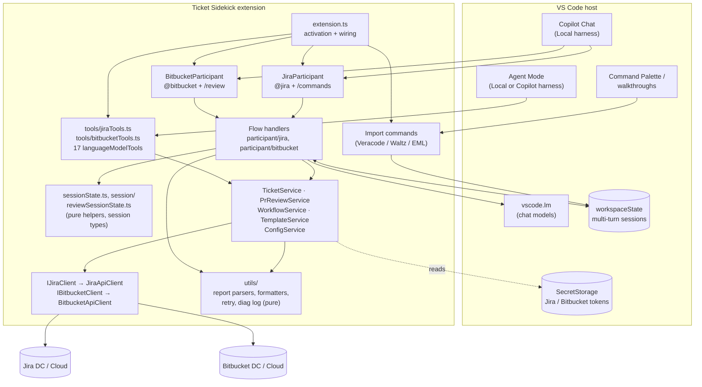
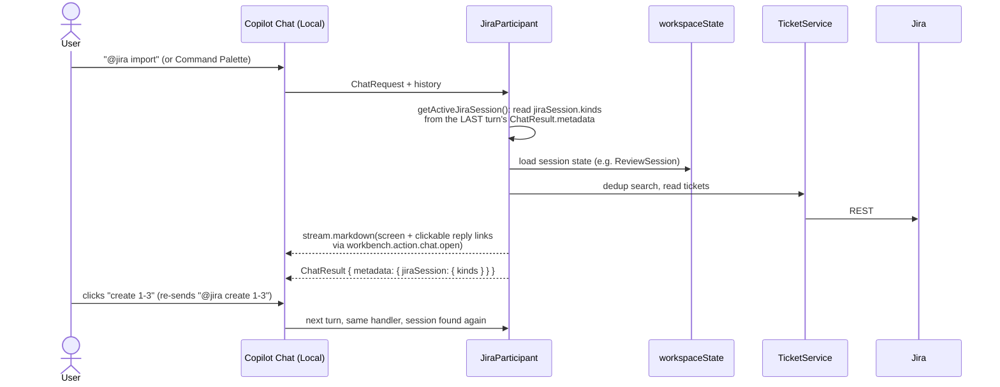
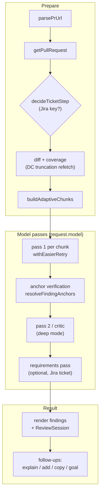
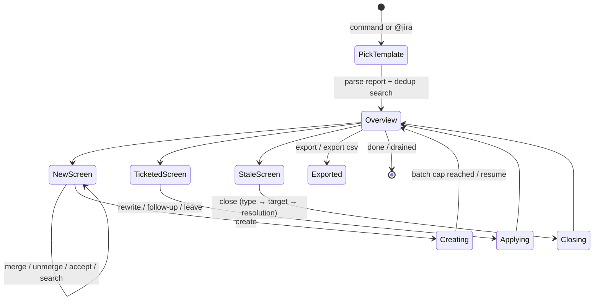
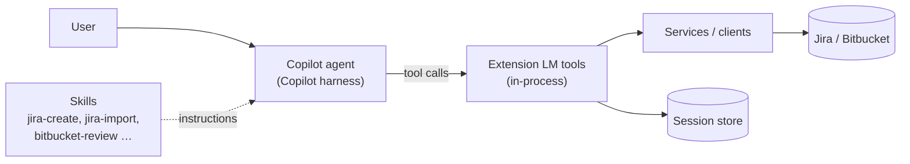
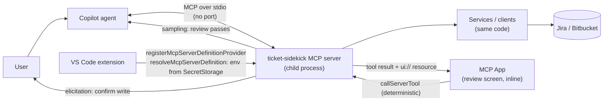
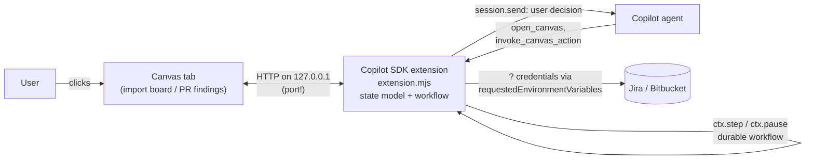
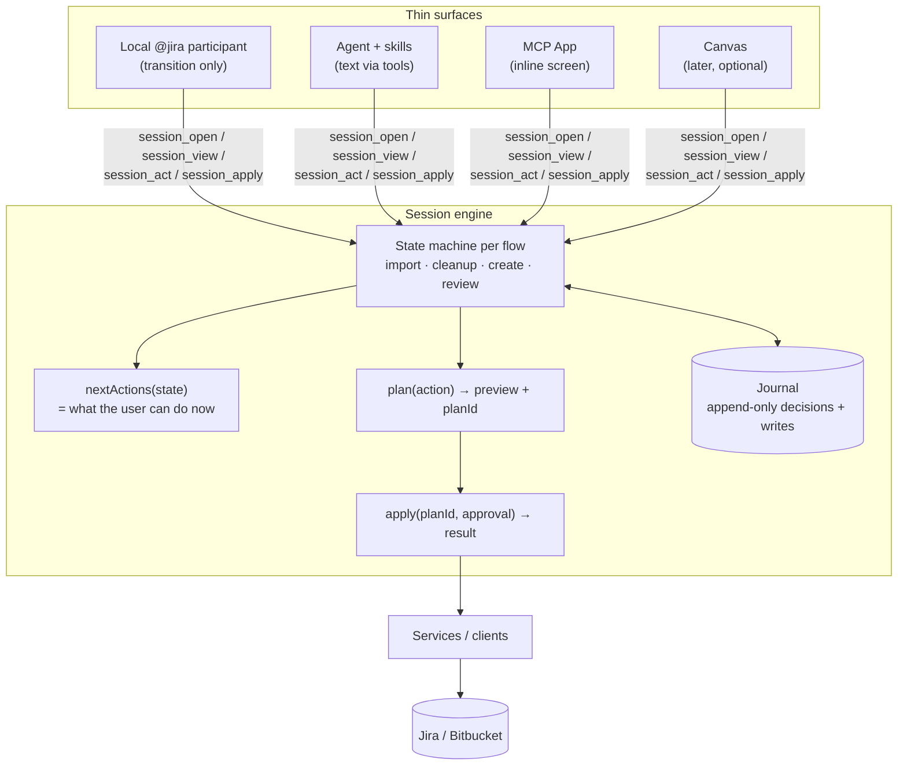

# Copilot harness migration: current design, deprecations, and options

Status: **Draft for discussion**. No decision is recorded here yet.
Date: 2026-11-05. Based on VS Code 1.144 docs and `@github/copilot-sdk` 1.0.28.

This document explains why Ticket Sidekick has to change, what the extension looks like today, which parts the new Copilot harness no longer supports, and which architectures could replace them. It ends with a recommendation, a phased path, and the spikes that must run before anything is planned in detail.

Every external fact is marked **[doc]** (stated in official docs or SDK types, linked under [Sources](#sources)) or **[unverified]** (an inference that a spike must confirm).

---

## 1. Why this matters

VS Code now runs a chat session on one of several **agent harnesses**: the engine that drives the model, the context, and the tool calls for that session. You pick it per session in **Session Target**.

| Harness | Runs in | Status for us |
| --- | --- | --- |
| **Copilot** | A separate process (the *Agent Host*), built on the Copilot SDK and shared with Copilot CLI and the GitHub Copilot app | The default for new sessions (`chat.defaultToCopilotHarness`) **[doc]**. Canvases only exist here **[doc]**. |
| **Local** | VS Code's extension host (the classic Copilot Chat) | Called a *legacy editor harness option* **[doc]**. This is where `@jira` and `@bitbucket` run today. |

The migration guide states:

> Chat participants, including extension-provided `@participant` integrations, are deprecated and are not supported in the Copilot harness. The Chat Participant API remains available for Local harness compatibility, but new integrations should not depend on it. **[doc]**

What we observed: typing `@jira` in a new chat moves the session to the Local harness. That works only while Local is allowed. An organisation can turn it off with `vscode.temporaryAllowLocalHarness: false` (since 1.143) **[doc]**. In a managed banking environment, that switch is the real deadline, not a VS Code release date. The docs give no removal date.

---

## 2. Current architecture

### 2.1 Components and layers

The three-layer rule (`Participant → Service → IClient`) is the most valuable asset for the migration. Services, clients and the pure utils don't import any participant API, so they carry over unchanged.

Rough size per layer (lines of TypeScript):

| Layer | Lines | Fate under the Copilot harness |
| --- | ---: | --- |
| Participants + handlers (`participant/*.ts`, `participant/jira/`, `participant/bitbucket/`) | ~15,000 | Most of it depends on the participant API and must be re-hosted |
| Session helpers (`participant/session/`) | ~5,300 | Pure; parsing and screen logic partly reusable, turn-detection logic obsolete |
| Tools (`tools/`) | ~1,400 | Keep (they already work in the Copilot harness) |
| Services, clients, templates | ~3,900 | Keep unchanged |
| Utils (parsers, formatters, retry, logging) | ~6,500 | Keep unchanged |

### 2.2 How a participant turn works today

Multi-turn flows (imports, cleanup, guided create, PR review follow-ups) depend on the participant owning the conversation:

Our code decides each step deterministically. The model is used only for narrow jobs (intent parsing, content generation, the review passes). That's a strength, and it is exactly what the Copilot harness removes: there, the **agent** owns the loop and our code is reached only through tools.

### 2.3 Bitbucket review pipeline

The pipeline makes **its own model calls** through `request.model` (wrapped by `tokenMeter.ts`). A language model tool gets no `request.model`, so this is the hardest part to move.

### 2.4 Report import session (Veracode / Waltz / EML)

This state lives in `workspaceState` and is found again through the chat history metadata. The **state model** itself (groups, rows, chosen actions, batch cursor) is good domain design. Only the way it is *hosted* (participant turns plus history metadata) is deprecated.

---

## 3. What becomes deprecated

| Mechanism | Used for | Under the Copilot harness | Fate |
| --- | --- | --- | --- |
| `contributes.chatParticipants`, `vscode.chat.createChatParticipant` | `@jira`, `@bitbucket` | Not supported **[doc]** | Replace |
| Slash commands (`/create`, `/review`, …) | Entry points | Go with the participant | Re-express as **skills** (explicitly invocable) **[doc]** |
| `ChatResponseStream` (`markdown`, `progress`, `button`, `reference`) | Every screen | Only reachable from a participant | Replace with tool results, MCP Apps, or a canvas |
| `ChatResult.metadata` + `chatContext.history` session detection | "Is a session still active?" | No participant turns, so no metadata | Replace with **explicit session ids** owned by our code |
| `followupProvider` chips | Next-step suggestions | Participant-only | Replace with `nextActions` in tool results / UI buttons |
| Clickable reply links (`workbench.action.chat.open` → `@jira …`) | Discrete choices on screens | They target a participant | Replace with UI buttons or explicit tool calls |
| `request.model` + `tokenMeter.ts` | Review passes, intent parsing, content generation | No request model in tools | Replace with **MCP sampling**, `vscode.lm.selectChatModels` inside a tool **[unverified]**, or agent-side reasoning |
| `disambiguation` metadata | Auto-routing to `@jira` | Participant-only | Replace with tool/skill descriptions |
| `languageModelTools` (17 tools) | Agent Mode | **Supported** while the VS Code window is connected **[doc]** | Keep and extend |
| `SecretStorage` | Tokens | Reachable only from extension code | Keep; must not be copied into files |
| `workspaceState` | Session storage | API still works for extension code | Optional; see the session engine in §6.4 |
| Command Palette import commands | Start imports | Still work, but currently hand off to `@jira` | Re-target to the new session entry point |

What does **not** change: `TicketService`, `PrReviewService`, `WorkflowService`, `TemplateService`, `ConfigService`, both API clients, every parser and formatter in `utils/`, and the vscode-free test suites around them.

---

## 4. Constraints for the target design

1. **Local only, no listening ports.** Not even on loopback. Processes talk over stdio (or, if ever needed, an OS pipe), never over TCP.
2. **Credentials stay in OS-encrypted storage.** No tokens in `.mcp.json`, settings, or workspace files.
3. **Writes are deterministic and confirmed.** Our code computes what to write; the user approves it; the model only chooses *when*. An approval gate must be enforced in our code, not by prompt wording.
4. **Works in the Copilot harness**, with a Local fallback during the transition.
5. **Jira and Bitbucket stay independent**, as today.
6. **Testable without VS Code** (Vitest), as today.
7. **Auditable.** A banking reviewer should be able to see who decided what, and what was written to Jira or Bitbucket.

---

## 5. Building blocks available

| Building block | What it gives us | Runs where | Ports | Credentials | Harness support |
| --- | --- | --- | --- | --- | --- |
| **Extension LM tools** (`languageModelTools`) | Typed actions with `prepareInvocation` confirmation | Extension host, in-process | None | SecretStorage directly | Copilot harness while the window is connected **[doc]** |
| **Skills** (contributed by the extension or a plugin) | Slash-command-like workflows; instructions loaded on demand; `disable-model-invocation: true` for explicit-only | Instructions only | None | n/a | Recommended replacement for slash commands **[doc]** |
| **Custom agent** | A persistent "Jira specialist" or "PR reviewer" role with a tool list | Instructions only | None | n/a | Supported **[doc]** |
| **MCP server over stdio** (`McpStdioServerDefinition` from `registerMcpServerDefinitionProvider`, or portable `.mcp.json`) | Tools, resources, prompts, **elicitation**, **sampling**, **MCP Apps** | Child process spawned by VS Code | **None (stdio)** | Env injected by the extension at `resolveMcpServerDefinition` | Portable config: yes **[doc]**. Extension-provided servers forwarded to the Copilot harness: **[unverified]** |
| **MCP sampling** | The server asks the client's model for a completion, under the user's model-access rules | Through the MCP client | None | n/a | Supported in VS Code **[doc]**; in the Copilot harness **[unverified]** |
| **MCP elicitation** | The server pauses and asks the user a structured question (accept / decline / cancel) | Through the MCP client | None | n/a | Supported in VS Code **[doc]**; in the Copilot harness **[unverified]** |
| **MCP Apps** | Interactive HTML returned by a tool, inline in chat; `callServerTool` calls our tools directly | Sandboxed iframe | None (`ui://` resource) | Never in the UI | Recommended for participant migration **[doc]**; inline display only **[doc]** |
| **Canvas** (Copilot SDK `createCanvas`) | Editor-tab surface; agent-callable `actions`; `session.send` back to chat | Separate Node process (`extension.mjs`) | **Renders from `url`**: in practice a loopback HTTP server **[doc + samples]** | `requestedEnvironmentVariables` (user-approved env) **[doc]** | Copilot harness only; Preview; types marked `@experimental` **[doc]** |
| **Dynamic Workflows** (Copilot SDK `defineWorkflow`) | Durable runs: `ctx.step` (memoised), `ctx.pause` (checkpoint), `ctx.agent(prompt, { schema })`, `parallel`, `pipeline`, progress phases | Same SDK extension process | None by itself | As above | `@experimental` **[doc]** |

Two consequences:

- **Canvas conflicts with constraint 1.** `CanvasProviderOpenResult` has only `url`, `title` and `status`, and the samples start `createServer().listen(0, "127.0.0.1")`. A spike must check whether a non-HTTP URL (for example `file:` or `data:`) is accepted. Until then, a canvas means opening a loopback port.
- **A Copilot SDK extension can't reach SecretStorage.** It runs outside VS Code. Credentials would arrive as environment variables the user approves, which is weaker than today.

---

## 6. Options

All options share one rule: **services and clients stay as they are**. The options differ in where the conversation, the state and the UI live.

### Option A: Extension tools + skills (in-process, no MCP)

Turn each participant workflow into a set of task-oriented tools in the existing extension, plus one skill per former slash command.

- **For:** smallest step; no new process; SecretStorage stays reachable; `prepareInvocation` confirmations; fully testable.
- **Against:** text-only screens rendered by the agent, which may paraphrase or reorder them. No buttons. Review passes need model access inside a tool **[unverified]**. Works only while a VS Code window is connected.

### Option B: Extension-launched stdio MCP server (+ skills, MCP Apps, elicitation, sampling)

Move the tool surface into an MCP server that the extension starts as a **child process over stdio**. No port is opened. The extension remains the launcher and the credential source.

- **For:** Microsoft's recommended path for participant authors **[doc]**. Real interactive screens (MCP Apps) whose buttons call our tools *directly*, with no model turn in between. Elicitation gives a server-enforced confirmation step. Sampling gives the review pipeline model access under the user's model rules. The same server can later run in Copilot CLI or the GitHub Copilot app.
- **Against:** a second process to build, bundle and debug. The token is passed as an environment variable, which is visible to processes of the same OS user. MCP Apps show inline only, so long screens scroll away. Several pieces are unverified in the Copilot harness (see §8).
- **Credential variants:** (1) env injection at `resolveMcpServerDefinition` (documented pattern); (2) the server reads the OS keychain itself (no env, but a native dependency); (3) a one-time token over an OS pipe (no TCP, but more moving parts). (1) is the baseline; (2) is the hardened variant.

### Option C: Canvas-centred stateful process (the "living board")

Your idea: instead of hiding state behind chat turns, make the **artifact** the centre. A long-lived process holds the import (or review) as a state model, renders it as a canvas, and derives the next actions from it. Both the user (clicking) and the agent (`invoke_canvas_action`) change the same state.

- **For:** the best fit for the domain. The import review really is a board, and PR findings really are a list across files. The state persists across turns, sessions and handoffs, and `nextActions` can be shown permanently instead of as chips that scroll away. Dynamic Workflows add durable steps and pause points.
- **Against:** violates "no ports" unless a non-HTTP URL works. It is Preview and `@experimental`. It needs a separate runtime, distributed as an agent plugin under `.github/extensions` or `~/.copilot/extensions` rather than through the Marketplace. Credentials would move from SecretStorage to user-approved environment variables. It works in neither the Local harness nor browser clients **[doc]**.
- **Safer variant C′:** the canvas is **display and decision capture only**. It never holds credentials and never writes to Jira. Decisions go back through `session.send` to the agent, which calls our tools (A or B) to do the writes. That keeps credentials and approvals in one place, at the cost of one model turn per decision.

### Option D (recommended direction): a surface-agnostic session engine + thin surfaces

This takes the core of your canvas idea (a stateful process that derives the next actions) but hosts it where it fits our constraints. It runs inside our own code, and any surface can drive it.

How it works:

1. **Explicit session ids.** `import_open(reportPath)` returns `{ sessionId, view, nextActions }`. Every later call carries the `sessionId`. No chat-history archaeology.
2. **The engine owns control flow.** Each flow is an explicit state machine: the current `stateDiagram` from §2.4 becomes code instead of being spread across handlers.
3. **`nextActions(state)`** is computed, never stored. A text surface lists the actions, an MCP App shows them as buttons, a canvas as a toolbar. This replaces follow-up chips and clickable reply links in one place.
4. **Plan → preview → apply** for every write. `session_act` returns a plan (tickets to create, fields to rewrite) with a `planId`. `session_apply(planId)` executes it only after approval (tool confirmation or MCP elicitation). The model can't skip the gate, because `apply` refuses an unapproved plan.
5. **A journal, not just a snapshot.** Decisions and writes are appended (who, when, what, Jira keys). The current state is derived from it. This gives resume after a crash or window close, an audit trail, and idempotent batch creation (a replayed `apply` sees what it already wrote).
6. **Storage:** the journal lives where the surface host can read it: `workspaceState`/`globalStorageUri` for in-extension hosting, or a file under the extension's storage directory for an MCP process. It never goes into the repository (report data can be sensitive), and it never contains credentials.

Surfaces then become thin and replaceable: **Local participant now → tools + skills (A) → MCP App (B) → canvas (C′) once it is stable and port-free.** One engine, one test suite.

---

## 7. Concepts from published design guidance

| Concept | Source | Applied to Ticket Sidekick |
| --- | --- | --- |
| **Task-oriented tools, not API wrappers.** Design around what the user wants to accomplish; consolidate chains of calls. | Anthropic "Writing effective tools for agents"; Microsoft MCP development best practices; Workato tool design | `import_open`, `import_decide_group`, `review_open_pr`, not `jira_search` + `jira_create` × N. The 17 existing CRUD tools stay as building blocks. |
| **Decision-ready, compact results.** Return summaries, ids and pagination, not raw dumps; offer `concise` / `detailed`. | Anthropic; Microsoft; Workato | Every engine result: `{ view, nextActions, counts, page }`. Full descriptions only on request. |
| **Actionable errors.** Errors should tell the agent how to recover. | Anthropic; Workato | `JiraApiError` status → "token expired: run *Ticket Sidekick: Set Data Center Token*". |
| **Own your control flow; unify execution and business state; launch / pause / resume.** | 12-Factor Agents (factors 5, 6, 8) | The session engine (§6.4): explicit state machine, journal-derived state, resumable by id. |
| **Contact humans with tool calls.** A human question is a structured step, not free text. | 12-Factor Agents (factor 7); MCP elicitation | Approvals via tool confirmation / elicitation; choices (issue type, resolution) as enumerated options, never guessed. |
| **Preview first, enforce the gate on the server.** Reads run freely; writes return a plan and wait. Fail closed. | Community MCP safety patterns; Codex CLI elicitation policy | Plan → preview → apply (§6.4, step 4). Destructive actions (close, merge) always need an approved plan. |
| **Shared artifact as source of truth.** Human and agent edit the same surface; progress is visible as changes to it. | GitHub "Working with canvas extensions" | The engine's state *is* the artifact. A canvas, if adopted, is one view of it. |
| **Deterministic pipeline, LLM inside bounded steps with schemas.** | Copilot SDK Dynamic Workflows (`ctx.agent(prompt, { schema })`, `ctx.step`) | Keep the review pipeline deterministic; each pass is a schema-checked model step (sampling or workflow agent). |
| **Progressive disclosure.** Load long instructions only when needed. | VS Code skills docs | One skill per workflow, holding today's help text and command catalogue (`jiraCommands.ts`, `importCommands.ts`). |

---

## 8. Comparison

| Criterion | A: tools + skills | B: stdio MCP | C: canvas process | C′: canvas as view | **D: engine + thin surfaces** |
| --- | --- | --- | --- | --- | --- |
| No listening ports | ✅ | ✅ | ❌ (loopback HTTP) | ❌ | ✅ (canvas surface optional) |
| Credentials in SecretStorage | ✅ | ⚠️ env handoff | ❌ env from user | ✅ (canvas holds none) | ✅ |
| Copilot harness | ✅ **[doc]** | ⚠️ **[unverified]** for extension-provided | ✅ | ✅ | ✅ via A or B |
| Local fallback during transition | ✅ | ✅ | ❌ | ❌ | ✅ (participant as a surface) |
| Deterministic writes + enforced approval | ⚠️ tool confirm | ✅ elicitation + plan | ⚠️ | ✅ via tools | ✅ plan → apply |
| Rich, persistent review screens | ❌ | ⚠️ inline only | ✅ | ✅ | ✅ when a rich surface is added |
| Review pipeline model access | ⚠️ **[unverified]** | ✅ sampling | ✅ workflow agent | n/a | depends on host |
| Works outside VS Code (CLI, Copilot app) | ❌ | ✅ (portable server) | ✅ | ✅ | ✅ if hosted in B |
| Maturity | Stable APIs | Stable MCP; harness parts unverified | Preview, `@experimental` | Preview | Built on A/B |
| Effort | Low–medium | Medium–high | High | Medium | Medium (engine), then per surface |

---

## 9. Recommendation and phased path

**Direction: Option D.** Build the session engine first, host it behind extension tools (A) for the Jira basics, and add an MCP App surface (B) for the import and review screens once the spikes pass. Treat the canvas (C′) as a later, optional view, introduced only once it can render without opening a port.

| Phase | Content | Exit condition |
| --- | --- | --- |
| **0. Spikes** | Run S1–S6 below | Each spike answered with a recorded yes/no |
| **1. Jira basics in the Copilot harness** | Skills over the existing 17 tools (view, search, comment, field, move, guided create) | A Copilot-harness user can do today's core `@jira` commands |
| **2. Session engine** | Extract the import state machine, `nextActions`, plan → apply and the journal into vscode-free code; the Local participant becomes its first surface (no user-visible change) | Existing import tests pass against the engine |
| **3. Imports without the participant** | Engine tools + skills; optional MCP App review screen | Veracode/Waltz/EML imports work end-to-end in the Copilot harness |
| **4. Bitbucket review** | Pipeline as engine flow; model access via sampling or in-tool LM (per S3/S4) | Review parity: quick, smart, deep, follow-ups |
| **5. Optional canvas view** | C′ if S5 shows a port-free rendering path | Board view reads the same engine state |
| **6. Retire participants** | Remove `chatParticipants` when Local disappears for our users | No participant code left |

### Spikes (phase 0)

| # | Question | Why it matters |
| --- | --- | --- |
| S1 | Does an MCP server registered through `registerMcpServerDefinitionProvider` appear in a **Copilot-harness** session, with env injected in `resolveMcpServerDefinition`? | Decides whether Option B keeps the extension as credential source |
| S2 | Do **MCP Apps** and **elicitation** render and work in Copilot-harness sessions in the editor window? | Rich screens and server-enforced approval |
| S3 | Does **MCP sampling** work from a stdio server in the Copilot harness, and how does model choice and access look? | Review pipeline in Option B |
| S4 | Can an **extension LM tool** call `vscode.lm.selectChatModels` + `sendRequest` during a Copilot-harness session? | Review pipeline in Option A |
| S5 | Does a canvas accept a **non-HTTP URL** (`file:`, `data:`, `vscode-webview:`)? | Whether a canvas can ever meet "no ports" |
| S6 | Do our organisation's managed settings plan `vscode.temporaryAllowLocalHarness: false`, and when? | Urgency and order of phases |

---

## 10. Open questions

- Should the Jira and Bitbucket engines live in one MCP server or two? Two servers would preserve today's independence rule at process level.
- Where should the journal live for an MCP-hosted engine, given that report data can be sensitive and must not land in the repository?
- How much of the hand-written screen text (`importScreens.ts`, `importCommands.ts`) should survive as tool-result text versus move into an MCP App?
- Do we keep the 17 CRUD tools public once task-oriented tools exist, or narrow them to reduce the agent's choice?

---

## Sources

- VS Code docs: [Choose an agent harness](https://github.com/microsoft/vscode-docs/blob/main/docs/agents/run/agent-harnesses.md), [Move from the Local to the Copilot harness](https://github.com/microsoft/vscode-docs/blob/main/docs/agents/run/move-to-copilot.md), [Migrate customizations](https://github.com/microsoft/vscode-docs/blob/main/docs/agent-customization/migrate-customizations.md) ("Replace chat participants", "If you maintain a participant"), [Agent Host](https://github.com/microsoft/vscode-docs/blob/main/docs/agents/concepts/agent-host.md), [Tools](https://github.com/microsoft/vscode-docs/blob/main/docs/agents/run/tools.md), [Use canvases with agents](https://github.com/microsoft/vscode-docs/blob/main/docs/agents/run/canvases.md), [MCP configuration reference](https://github.com/microsoft/vscode-docs/blob/main/docs/agents/reference/mcp-configuration.md)
- VS Code API: [MCP developer guide](https://github.com/microsoft/vscode-docs/blob/main/api/extension-guides/ai/mcp.md) (stdio, sampling, elicitation, MCP Apps, `registerMcpServerDefinitionProvider`), [Language model tools](https://github.com/microsoft/vscode-docs/blob/main/api/extension-guides/ai/tools.md)
- Release notes: [1.142](https://github.com/microsoft/vscode-docs/blob/main/release-notes/v1_142.md), [1.143](https://github.com/microsoft/vscode-docs/blob/main/release-notes/v1_143.md), [1.144](https://github.com/microsoft/vscode-docs/blob/main/release-notes/v1_144.md)
- GitHub: [Working with canvas extensions](https://github.com/github/docs/blob/main/content/copilot/how-tos/github-copilot-app/working-with-canvas-extensions.md); sample canvas [backlog-swipe-triage](https://github.com/github/awesome-copilot/tree/main/extensions/backlog-swipe-triage)
- Copilot SDK: [`@github/copilot-sdk` 1.0.28 on npm](https://www.npmjs.com/package/@github/copilot-sdk) (`dist/canvas.d.ts`, `dist/workflow.d.ts`, `dist/extension.d.ts`)
- MCP Apps: [specification](https://modelcontextprotocol.github.io/ext-apps/api/), [SDK and examples](https://github.com/modelcontextprotocol/ext-apps)
- Design guidance: [Anthropic: Writing effective tools for agents](https://www.anthropic.com/engineering/writing-tools-for-agents), [Microsoft MCP development best practices](https://microsoft.github.io/mcp-azure-security-guide/adoption/development-best-practices), [Workato: MCP server tool design](https://docs.workato.com/en/mcp/mcp-server-tool-design.html), [12-Factor Agents](https://github.com/humanlayer/12-factor-agents), [MCP confirmation / dry-run safety pattern example](https://cappylab.github.io/discord-mcp/architecture/confirmation/)
