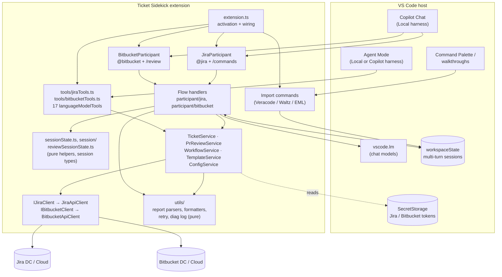
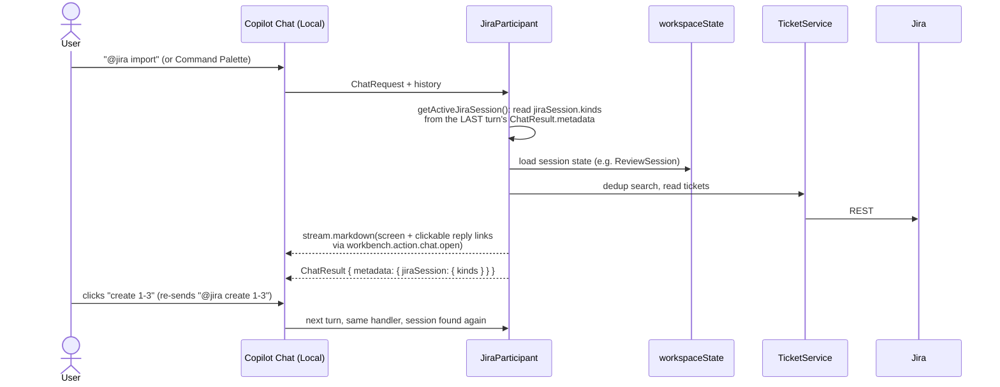
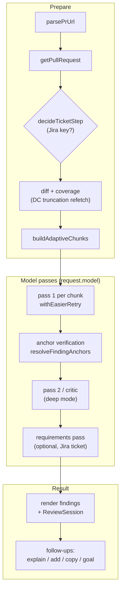
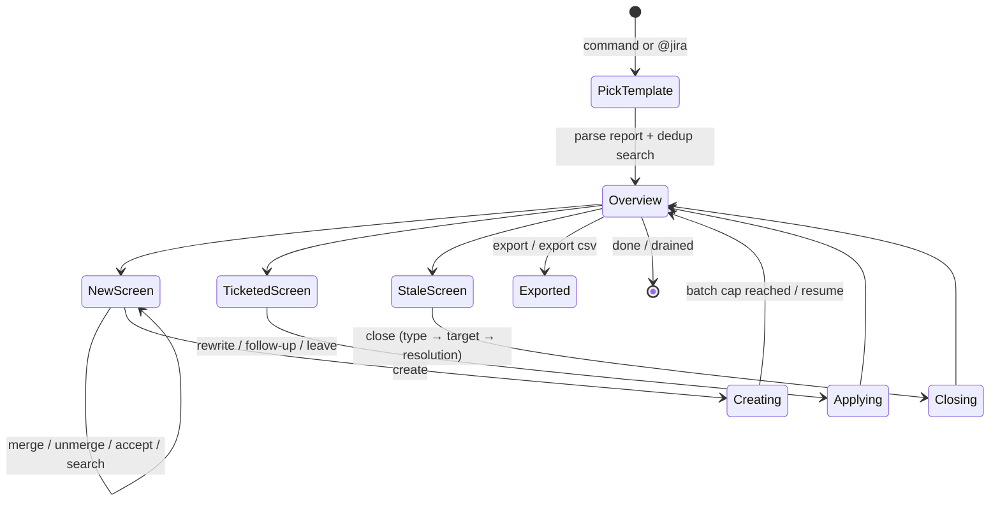
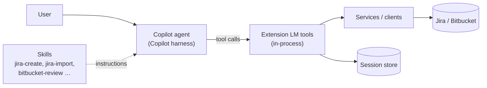
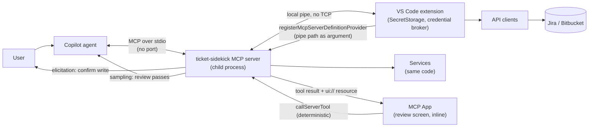
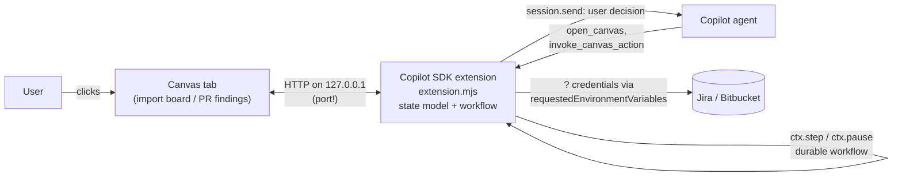
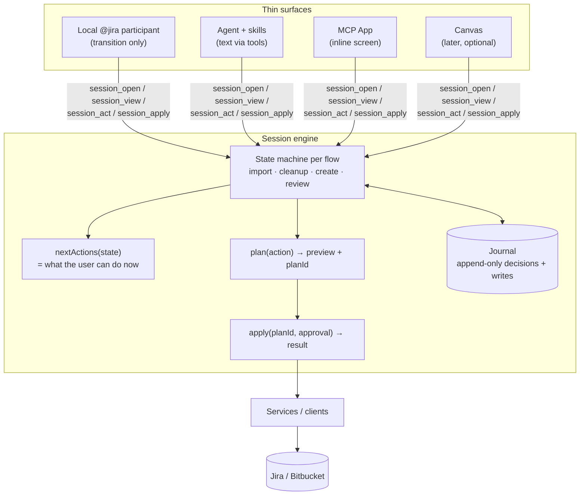
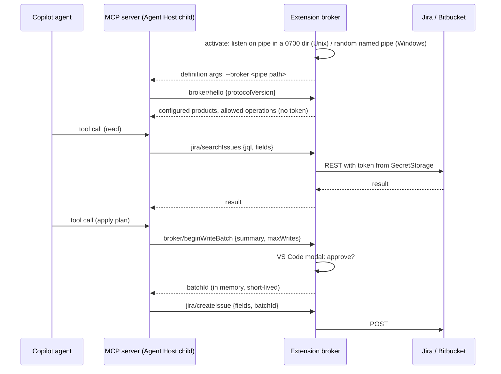
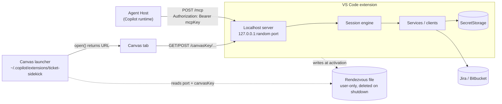

# Copilot harness migration: current design, deprecations, and options

Status: **Draft for discussion**. Decisions made so far are recorded in [§11](#11-decision-log).
Date: 2026-11-05. Based on VS Code 1.144 docs and `@github/copilot-sdk` 1.0.28.

This document explains why Ticket Sidekick has to change, what the extension looks like today, which parts the new Copilot harness no longer supports, and which architectures could replace them. It ends with a recommendation, a phased path, and the spikes that must run before anything is planned in detail.

Every external fact is marked **[doc]** (stated in official docs or SDK types, linked under [Sources](#sources)), **[source]** (read in VS Code's source code) or **[unverified]** (an inference that a spike must confirm).

---

## 1. Why this matters

VS Code now runs a chat session on one of several **agent harnesses**: the engine that drives the model, the context, and the tool calls for that session. You pick it per session in **Session Target**.

| Harness | Runs in | Status for us |
| --- | --- | --- |
| **Copilot** | A separate process (the *Agent Host*), built on the Copilot SDK and shared with Copilot CLI and the GitHub Copilot app | The default for new sessions (`chat.defaultToCopilotHarness`) **[doc]**. Canvases only exist here **[doc]**. |
| **Local** | VS Code's extension host (the classic Copilot Chat) | Called a *legacy editor harness option* **[doc]**. This is where `@jira` and `@bitbucket` run today. |

The migration guide states:

> Chat participants, including extension-provided `@participant` integrations, are deprecated and are not supported in the Copilot harness. The Chat Participant API remains available for Local harness compatibility, but new integrations should not depend on it. **[doc]**

What we observed: typing `@jira` in a new chat moves the session to the Local harness. That works only while Local is allowed. An organisation can turn it off with `vscode.temporaryAllowLocalHarness: false` (since 1.143) **[doc]**. In a managed banking environment, that switch is the real deadline, not a VS Code release date. The docs give no removal date.

---

## 2. Current architecture

### 2.1 Components and layers

The three-layer rule (`Participant → Service → IClient`) is the most valuable asset for the migration. Services, clients and the pure utils don't import any participant API, so they carry over unchanged.

Rough size per layer (lines of TypeScript):

| Layer | Lines | Fate under the Copilot harness |
| --- | ---: | --- |
| Participants + handlers (`participant/*.ts`, `participant/jira/`, `participant/bitbucket/`) | ~15,000 | Most of it depends on the participant API and must be re-hosted |
| Session helpers (`participant/session/`) | ~5,300 | Pure; parsing and screen logic partly reusable, turn-detection logic obsolete |
| Tools (`tools/`) | ~1,400 | Keep (they already work in the Copilot harness) |
| Services, clients, templates | ~3,900 | Keep unchanged |
| Utils (parsers, formatters, retry, logging) | ~6,500 | Keep unchanged |

### 2.2 How a participant turn works today

Multi-turn flows (imports, cleanup, guided create, PR review follow-ups) depend on the participant owning the conversation:

Our code decides each step deterministically. The model is used only for narrow jobs (intent parsing, content generation, the review passes). That's a strength, and it is exactly what the Copilot harness removes: there, the **agent** owns the loop and our code is reached only through tools.

### 2.3 Bitbucket review pipeline

The pipeline makes **its own model calls** through `request.model` (wrapped by `tokenMeter.ts`). A language model tool gets no `request.model`, so this is the hardest part to move.

### 2.4 Report import session (Veracode / Waltz / EML)

This state lives in `workspaceState` and is found again through the chat history metadata. The **state model** itself (groups, rows, chosen actions, batch cursor) is good domain design. Only the way it is *hosted* (participant turns plus history metadata) is deprecated.

---

## 3. What becomes deprecated

| Mechanism | Used for | Under the Copilot harness | Fate |
| --- | --- | --- | --- |
| `contributes.chatParticipants`, `vscode.chat.createChatParticipant` | `@jira`, `@bitbucket` | Not supported **[doc]** | Replace |
| Slash commands (`/create`, `/review`, …) | Entry points | Go with the participant | Re-express as **skills** (explicitly invocable) **[doc]** |
| `ChatResponseStream` (`markdown`, `progress`, `button`, `reference`) | Every screen | Only reachable from a participant | Replace with tool results, MCP Apps, or a canvas |
| `ChatResult.metadata` + `chatContext.history` session detection | "Is a session still active?" | No participant turns, so no metadata | Replace with **explicit session ids** owned by our code |
| `followupProvider` chips | Next-step suggestions | Participant-only | Replace with `nextActions` in tool results / UI buttons |
| Clickable reply links (`workbench.action.chat.open` → `@jira …`) | Discrete choices on screens | They target a participant | Replace with UI buttons or explicit tool calls |
| `request.model` + `tokenMeter.ts` | Review passes, intent parsing, content generation | No request model in tools | Replace with **MCP sampling** **[source]** or `vscode.lm.selectChatModels` inside a tool **[doc]** (see S3/S4) |
| `disambiguation` metadata | Auto-routing to `@jira` | Participant-only | Replace with tool/skill descriptions |
| `languageModelTools` (17 tools) | Agent Mode | **Supported** while the VS Code window is connected **[doc]** | Keep and extend |
| `SecretStorage` | Tokens | Reachable only from extension code | Keep; must not be copied into files |
| `workspaceState` | Session storage | API still works for extension code | Optional; see the session engine in §6.4 |
| Command Palette import commands | Start imports | Still work, but currently hand off to `@jira` | Re-target to the new session entry point |

What does **not** change: `TicketService`, `PrReviewService`, `WorkflowService`, `TemplateService`, `ConfigService`, both API clients, every parser and formatter in `utils/`, and the vscode-free test suites around them.

---

## 4. Constraints for the target design

1. **Local only; a listening port only on loopback and only with a key.** A TCP port is allowed when it is bound to `127.0.0.1` only and every request must carry a random per-session key (D2). Nothing may be reachable from the network.
2. **Credentials stay in OS-encrypted storage.** No tokens in `.mcp.json`, settings, or workspace files.
3. **Writes are deterministic and confirmed.** Our code computes what to write; the user approves it; the model only chooses *when*. An approval gate must be enforced in our code, not by prompt wording.
4. **Works in the Copilot harness**, with a Local fallback during the transition.
5. **Jira and Bitbucket stay independent**, as today.
6. **Testable without VS Code** (Vitest), as today.
7. **Auditable.** A banking reviewer should be able to see who decided what, and what was written to Jira or Bitbucket.

---

## 5. Building blocks available

| Building block | What it gives us | Runs where | Ports | Credentials | Harness support |
| --- | --- | --- | --- | --- | --- |
| **Extension LM tools** (`languageModelTools`) | Typed actions with `prepareInvocation` confirmation | Extension host, in-process | None | SecretStorage directly | Copilot harness while the window is connected **[doc]** |
| **Skills** (contributed by the extension or a plugin) | Slash-command-like workflows; instructions loaded on demand; `disable-model-invocation: true` for explicit-only | Instructions only | None | n/a | Recommended replacement for slash commands **[doc]** |
| **Custom agent** | A persistent "Jira specialist" or "PR reviewer" role with a tool list | Instructions only | None | n/a | Supported **[doc]** |
| **MCP server over stdio** (`McpStdioServerDefinition` from `registerMcpServerDefinitionProvider`, or portable `.mcp.json`) | Tools, resources, prompts, **elicitation**, **sampling**, **MCP Apps** | Child process launched by the Copilot runtime in the **Agent Host**, not by the window **[source]** | **None (stdio)** | Credential broker over a local pipe (§6.5); the token never leaves the extension | Extension-provided servers are forwarded (`ClientForwarded`) from the session's active window **[source]** |
| **MCP sampling** | The server asks the client's model for a completion, under the user's model-access rules | Through the MCP client | None | n/a | Supported in the Copilot harness: each request is confirmed as an `mcp_sampling` tool call (once / always for this server / skip); the SDK picks the model **[source]** |
| **MCP elicitation** | The server pauses and asks the user a structured question (accept / decline / cancel) | Through the MCP client | None | n/a | Supported in the Copilot harness (`onElicitationRequest`, `form` and `url` modes, source = MCP server name) **[source]** |
| **MCP Apps** | Interactive HTML returned by a tool, inline in chat; `callServerTool` calls our tools directly | Sandboxed iframe | None (`ui://` resource) | Never in the UI | Enabled in Copilot-harness sessions (`enableMcpApps: true`) **[source]**; inline display only **[doc]** |
| **Canvas** (Copilot SDK `createCanvas`) | Editor-tab surface; agent-callable `actions`; `session.send` back to chat | Separate Node process (`extension.mjs`) | **Renders only an `http:`/`https:` URL**: in practice a loopback HTTP server **[source]** | `requestedEnvironmentVariables` (user-approved env) **[doc]** | Copilot harness only; Preview; types marked `@experimental` **[doc]** |
| **Dynamic Workflows** (Copilot SDK `defineWorkflow`) | Durable runs: `ctx.step` (memoised), `ctx.pause` (checkpoint), `ctx.agent(prompt, { schema })`, `parallel`, `pipeline`, progress phases | Same SDK extension process | None by itself | As above | `@experimental` **[doc]** |

Two consequences:

- **Canvas conflicts with constraint 1 (confirmed from source).** `CanvasProviderOpenResult` has only `url`, `title` and `status`. The agent-host protocol defines the canvas `url` as an "absolute HTTP(S) source URL", and VS Code's renderer ([`agentHostCanvas.ts`](https://github.com/microsoft/vscode/blob/main/src/vs/workbench/contrib/canvases/common/agentHostCanvas.ts)) accepts a source only when its scheme is `http` or `https` and it has an authority. Anything else is dropped with the warning "Unsupported canvas source", and a unit test checks that a `file:` URL is rejected. So a canvas always needs an HTTP server: a loopback one (what every sample does, `createServer().listen(0, "127.0.0.1")`), or a remotely hosted page. `file:`, `data:` and webview URIs are not options. A loopback server can also be reached by any local process of any user, so it would need at least an unguessable per-instance token in the URL.
- **A Copilot SDK extension can't reach SecretStorage.** It runs outside VS Code. Credentials would arrive as environment variables the user approves, which is weaker than today.

---

## 6. Options

All options share one rule: **services and clients stay as they are**. The options differ in where the conversation, the state and the UI live.

### Option A: Extension tools + skills (in-process, no MCP)

Turn each participant workflow into a set of task-oriented tools in the existing extension, plus one skill per former slash command.

- **For:** smallest step; no new process; SecretStorage stays reachable; `prepareInvocation` confirmations; fully testable.
- **Against:** text-only screens rendered by the agent, which may paraphrase or reorder them. No buttons. Review passes can call `vscode.lm` inside the tool, since the Language Model API is window-level and documented for non-chat code such as commands **[doc]**. Works only while a VS Code window is connected.

### Option B: Extension-launched stdio MCP server (+ skills, MCP Apps, elicitation, sampling)

Move the tool surface into an MCP server that the extension starts as a **child process over stdio**. No port is opened. The extension remains the launcher and the credential source.

- **For:** Microsoft's recommended path for participant authors **[doc]**. Real interactive screens (MCP Apps) whose buttons call our tools *directly*, with no model turn in between. Elicitation gives a server-enforced confirmation step. Sampling gives the review pipeline model access under the user's model rules. The same server can later run in Copilot CLI or the GitHub Copilot app.
- **Against:** a second process to build, bundle and debug, plus the broker protocol (§6.5). MCP Apps show inline only, so long screens scroll away. The server works only while a VS Code window with the extension is open, because the broker lives there.
- **Credentials: the credential broker (chosen direction, §6.5).** The extension keeps the tokens in SecretStorage and performs every Jira/Bitbucket call; the MCP server reaches it over a local pipe. Rejected alternatives: environment variables (visible to same-user processes, inherited by children); the server reading the OS keychain itself (a native dependency, only worth it outside VS Code); MCP OAuth (the spec defines it for HTTP servers only and tells stdio servers to read the environment).

### Option C: Canvas-centred stateful process (the "living board")

Your idea: instead of hiding state behind chat turns, make the **artifact** the centre. A long-lived process holds the import (or review) as a state model, renders it as a canvas, and derives the next actions from it. Both the user (clicking) and the agent (`invoke_canvas_action`) change the same state.

- **For:** the best fit for the domain. The import review really is a board, and PR findings really are a list across files. The state persists across turns, sessions and handoffs, and `nextActions` can be shown permanently instead of as chips that scroll away. Dynamic Workflows add durable steps and pause points.
- **Against:** violates "no ports": the renderer only loads `http:`/`https:` URLs (see §5). It is Preview and `@experimental`. It needs a separate runtime, distributed as an agent plugin under `.github/extensions` or `~/.copilot/extensions` rather than through the Marketplace. Credentials would move from SecretStorage to user-approved environment variables. It works in neither the Local harness nor browser clients **[doc]**.
- **Safer variant C′:** the canvas is **display and decision capture only**. It never holds credentials and never writes to Jira. Decisions go back through `session.send` to the agent, which calls our tools (A or B) to do the writes. That keeps credentials and approvals in one place, at the cost of one model turn per decision.

### Option D (recommended direction): a surface-agnostic session engine + thin surfaces

This takes the core of your canvas idea (a stateful process that derives the next actions) but hosts it where it fits our constraints. It runs inside our own code, and any surface can drive it.

How it works:

1. **Explicit session ids.** `import_open(reportPath)` returns `{ sessionId, view, nextActions }`. Every later call carries the `sessionId`. No chat-history archaeology.
2. **The engine owns control flow.** Each flow is an explicit state machine: the current `stateDiagram` from §2.4 becomes code instead of being spread across handlers.
3. **`nextActions(state)`** is computed, never stored. A text surface lists the actions, an MCP App shows them as buttons, a canvas as a toolbar. This replaces follow-up chips and clickable reply links in one place.
4. **Plan → preview → apply** for every write. `session_act` returns a plan (tickets to create, fields to rewrite) with a `planId`. `session_apply(planId)` executes it only after approval (tool confirmation or MCP elicitation). The model can't skip the gate, because `apply` refuses an unapproved plan.
5. **A journal, not just a snapshot.** Decisions and writes are appended (who, when, what, Jira keys). The current state is derived from it. This gives resume after a crash or window close, an audit trail, and idempotent batch creation (a replayed `apply` sees what it already wrote).
6. **Storage:** the journal lives where the surface host can read it: `workspaceState`/`globalStorageUri` for in-extension hosting, or a file under the extension's storage directory for an MCP process. It never goes into the repository (report data can be sensitive), and it never contains credentials.

Surfaces then become thin and replaceable: **Local participant now → tools + skills (A) → MCP App (B) → canvas (C′) only if constraint 1 is relaxed to allow a token-protected loopback server.** One engine, one test suite.

### 6.5 Credential broker (credentials for Option B, not chosen)

> Superseded by D1: the extension serves MCP itself over a key-protected localhost port (§6.6), so it reads SecretStorage directly and needs no broker. Kept for reference, in case a portless MCP channel becomes a requirement again.

The MCP server never holds a token. The extension is the only process that reads SecretStorage, and it performs every Jira and Bitbucket call on the server's behalf.

- **Shape:** the broker is a remote `IJiraClient` / `IBitbucketClient`. The server uses `BrokeredJiraClient implements IJiraClient`, so `TicketService` and `PrReviewService` stay unchanged and the three-layer rule holds. The protocol has one operation per interface method (29 Jira, 7 Bitbucket).
- **Transport:** JSON-RPC 2.0 with Content-Length framing (`vscode-jsonrpc`, which also brings `$/cancelRequest`). The extension listens with `net.createServer().listen(path)`, the server connects. No TCP port.
- **Validation:** an allowlist of operations, no generic HTTP passthrough, parameters schema-checked, size limits. The base URL comes from the extension's settings only; `downloadAttachment(content)` must check that the URL's scheme and host match the configured Jira base URL, or a crafted URL would carry the token to a foreign host.
- **Writes:** every write carries a `batchId` from `broker/beginWriteBatch`, which shows a VS Code modal. Neither the agent nor the MCP server can skip it.
- **Errors:** HTTP failures keep their status (`data.status`), so the server rebuilds `JiraApiError` / `BitbucketApiError`. A dropped pipe during a write is reported as "outcome unknown", never as failed; the session engine's dedup settles it on resume.
- **Access control:** on Unix, the socket lives in a `0700` directory. On Windows, libuv creates the pipe with default security attributes and `FILE_FLAG_FIRST_PIPE_INSTANCE` ([libuv `src/win/pipe.c`](https://github.com/libuv/libuv/blob/v1.x/src/win/pipe.c)); the default named-pipe permissions give full control to the creating user, SYSTEM and administrators and only read access to everyone else, so other users can't send requests or create a rogue instance of the same name. Same-user processes can connect, but they can't obtain the token and still hit the allowlist and the write modal. That is the trust level SecretStorage has today.
- **Lifetime:** the broker lives with the window's extension host. If no window is open, the server answers with an actionable error. Nothing secret goes into `args` (visible to other users on Linux) or `env`.

### 6.6 Localhost server in the extension (decided direction)

One HTTP server inside the VS Code extension serves the MCP endpoint (including MCP Apps) and the canvas page. It reads SecretStorage and runs the session engine in-process, so there is no second process and no broker.

Security rules (defaults chosen during the discussion; the prototype confirms them):

| Rule | Detail |
| --- | --- |
| Bind | `127.0.0.1` explicitly, port `0` (random). Never `0.0.0.0` or `localhost` (which may resolve to another interface). |
| Keys | Two independent 256-bit keys from `crypto.randomBytes`, one for MCP and one for the canvas, held in memory only and new at every activation. Compared in constant time. Always required; there is no setting to turn them off (D2). |
| MCP key | Sent as `Authorization: Bearer` from the server definition's `headers` (forwarded to the Agent Host, [`agentHostMcpServerSupport.ts`](https://github.com/microsoft/vscode/blob/main/src/vs/workbench/contrib/chat/browser/agentSessions/agentHost/agentHostMcpServerSupport.ts)). When the key rotates, `onDidChangeMcpServerDefinitions` fires and the runtime relaunches at the next turn boundary. |
| Canvas key | Part of the URL path (`/<canvasKey>/…`): the only thing the canvas host passes on. The agent-host protocol already requires canvas URLs to be redacted from logs and never reused after a restart. |
| Request checks | `Host` must be exactly `127.0.0.1:<port>` (blocks DNS rebinding); `Origin` must be absent (Agent Host) or our own origin (canvas page), otherwise 403, as the MCP transport spec requires. No CORS headers, so other web origins can't read responses. Size and rate limits per request. |
| Rendezvous file | Port and canvas key only (never Jira/Bitbucket tokens), in a user-only location, overwritten at each activation and deleted on deactivation. The launcher reads it in `open()`. |
| Writes | Canvas: a click shows the plan as a preview in the canvas and a second **Apply** click executes it. Agent tool calls: the VS Code modal (D4). |

The canvas launcher is a small Copilot SDK extension (`extension.mjs`) that declares the canvases and returns the extension's URL from `open()`. The extension installs it on request (D5).

---

## 7. Concepts from published design guidance

| Concept | Source | Applied to Ticket Sidekick |
| --- | --- | --- |
| **Task-oriented tools, not API wrappers.** Design around what the user wants to accomplish; consolidate chains of calls. | Anthropic "Writing effective tools for agents"; Microsoft MCP development best practices; Workato tool design | `import_open`, `import_decide_group`, `review_open_pr`, not `jira_search` + `jira_create` × N. The 17 existing CRUD tools stay as building blocks. |
| **Decision-ready, compact results.** Return summaries, ids and pagination, not raw dumps; offer `concise` / `detailed`. | Anthropic; Microsoft; Workato | Every engine result: `{ view, nextActions, counts, page }`. Full descriptions only on request. |
| **Actionable errors.** Errors should tell the agent how to recover. | Anthropic; Workato | `JiraApiError` status → "token expired: run *Ticket Sidekick: Set Data Center Token*". |
| **Own your control flow; unify execution and business state; launch / pause / resume.** | 12-Factor Agents (factors 5, 6, 8) | The session engine (§6.4): explicit state machine, journal-derived state, resumable by id. |
| **Contact humans with tool calls.** A human question is a structured step, not free text. | 12-Factor Agents (factor 7); MCP elicitation | Approvals via tool confirmation / elicitation; choices (issue type, resolution) as enumerated options, never guessed. |
| **Preview first, enforce the gate on the server.** Reads run freely; writes return a plan and wait. Fail closed. | Community MCP safety patterns; Codex CLI elicitation policy | Plan → preview → apply (§6.4, step 4). Destructive actions (close, merge) always need an approved plan. |
| **Shared artifact as source of truth.** Human and agent edit the same surface; progress is visible as changes to it. | GitHub "Working with canvas extensions" | The engine's state *is* the artifact. A canvas, if adopted, is one view of it. |
| **Deterministic pipeline, LLM inside bounded steps with schemas.** | Copilot SDK Dynamic Workflows (`ctx.agent(prompt, { schema })`, `ctx.step`) | Keep the review pipeline deterministic; each pass is a schema-checked model step (sampling or workflow agent). |
| **Progressive disclosure.** Load long instructions only when needed. | VS Code skills docs | One skill per workflow, holding today's help text and command catalogue (`jiraCommands.ts`, `importCommands.ts`). |

---

## 8. Comparison

| Criterion | A: tools + skills | B: stdio MCP | C: canvas process | C′: canvas as view | **D: engine + thin surfaces** |
| --- | --- | --- | --- | --- | --- |
| No listening ports (original constraint; relaxed to "loopback + key" by D1–D2) | ✅ | ✅ | ❌ (loopback HTTP) | ❌ | ✅ (canvas surface optional) |
| Credentials in SecretStorage | ✅ | ✅ via broker | ❌ env from user | ✅ (canvas holds none) | ✅ |
| Copilot harness | ✅ **[doc]** | ✅ forwarded **[source]** | ✅ | ✅ | ✅ via A or B |
| Local fallback during transition | ✅ | ✅ | ❌ | ❌ | ✅ (participant as a surface) |
| Deterministic writes + enforced approval | ⚠️ tool confirm | ✅ elicitation + plan | ⚠️ | ✅ via tools | ✅ plan → apply |
| Rich, persistent review screens | ❌ | ⚠️ inline only | ✅ | ✅ | ✅ when a rich surface is added |
| Review pipeline model access | ✅ `vscode.lm` **[doc]** | ✅ sampling **[source]** | ✅ workflow agent | n/a | depends on host |
| Works outside VS Code (CLI, Copilot app) | ❌ | ✅ (portable server) | ✅ | ✅ | ✅ if hosted in B |
| Maturity | Stable APIs | Stable MCP; harness support present in source | Preview, `@experimental` | Preview | Built on A/B |
| Effort | Low–medium | Medium–high | High | Medium | Medium (engine), then per surface |

---

## 9. Recommendation and phased path

**Direction: Option D on the localhost server of §6.6.** Build the session engine first, host it behind extension tools (A) for the Jira basics, then serve MCP (with MCP Apps) and an extension-hosted canvas page from the extension's key-protected localhost server for the import and review screens.

| Phase | Content | Exit condition |
| --- | --- | --- |
| **0. Spikes** | S1–S5 answered from source and docs; confirm S1–S4 and S7 hands-on with a throw-away server, answer S6 with the organisation | A minimal broker + MCP App prototype runs in a Copilot-harness session on a managed machine |
| **1. Jira basics in the Copilot harness** | Skills over the existing 17 tools (view, search, comment, field, move, guided create) | A Copilot-harness user can do today's core `@jira` commands |
| **2. Session engine** | Extract the import state machine, `nextActions`, plan → apply and the journal into vscode-free code; the Local participant becomes its first surface (no user-visible change) | Existing import tests pass against the engine |
| **3. Imports without the participant** | Engine tools + skills; optional MCP App review screen | Veracode/Waltz/EML imports work end-to-end in the Copilot harness |
| **4. Bitbucket review** | Pipeline as engine flow; model access via sampling or in-tool LM (per S3/S4) | Review parity: quick, smart, deep, follow-ups |
| **5. Optional canvas view** | C′, only if the "no ports" constraint is relaxed for a token-protected loopback server (S5 showed there is no port-free path) | Board view reads the same engine state |
| **6. Retire participants** | Remove `chatParticipants` when Local disappears for our users | No participant code left |

### Spikes (phase 0)

| # | Question | Answer |
| --- | --- | --- |
| S1 | Does an MCP server registered through `registerMcpServerDefinitionProvider` reach a **Copilot-harness** session? | **Answered from source: yes.** Extension-provided servers resolve to `ClientForwarded`: VS Code projects the definition's `command`, `args` and `env` and hands them to the Agent Host, whose Copilot runtime launches the process ([`agentHostMcpServerSupport.ts`](https://github.com/microsoft/vscode/blob/main/src/vs/workbench/contrib/chat/browser/agentSessions/agentHost/agentHostMcpServerSupport.ts), [`agentHostLocalCustomizations.ts`](https://github.com/microsoft/vscode/blob/main/src/vs/workbench/contrib/chat/browser/agentSessions/agentHost/agentHostLocalCustomizations.ts), [`copilotSessionLauncher.ts`](https://github.com/microsoft/vscode/blob/main/src/vs/platform/agentHost/node/copilot/copilotSessionLauncher.ts)). The **static** definition from `provideMcpServerDefinitions` is forwarded; `${input:…}`/`${command:…}` variables block forwarding, `cwd` and `envFile` are not portable. The session's **active window** supplies the definitions; when the session's owner changes, the runtime relaunches at the next turn boundary ([Agent Host `AGENTS.md`](https://github.com/microsoft/vscode/blob/main/src/vs/platform/agentHost/AGENTS.md)). So the broker's pipe path goes into `args` at provide time, with absolute paths. |
| S2 | Do **MCP Apps** and **elicitation** work in Copilot-harness sessions? | **Answered from source: yes.** Normal sessions launch with `enableMcpApps: true` and an `onElicitationRequest` handler ([`copilotSessionLauncher.ts`](https://github.com/microsoft/vscode/blob/main/src/vs/platform/agentHost/node/copilot/copilotSessionLauncher.ts)); the SDK's `ElicitationContext` carries the MCP server name and supports `form` and `url` modes. The host also proxies tools, resources and sampling for MCP Apps. |
| S3 | Does **MCP sampling** work from a stdio server in the Copilot harness? | **Answered from source: yes.** Each request appears as an `mcp_sampling` confirmation (allow once, always allow this server, skip); "always" is stored per server identity in `mcpSamplingAllowedServers`. Unattended requests are rejected unless the server was approved; the SDK picks the model ([Agent Host `AGENTS.md`](https://github.com/microsoft/vscode/blob/main/src/vs/platform/agentHost/AGENTS.md)). For a multi-pass review that means one approval per server, then silent calls. |
| S4 | Can an **extension LM tool** use `vscode.lm`? | **Answered from docs: yes.** The Language Model API is window-level and documented for commands, tasks and other non-chat code ([Language Model API guide](https://github.com/microsoft/vscode-docs/blob/main/api/extension-guides/ai/language-model.md)); extension tools run in the window's extension host. |
| S6 | Do our organisation's managed settings plan `vscode.temporaryAllowLocalHarness: false`, and when? | **Open: only the organisation can answer.** Decides urgency and the order of phases. |
| S7 | If the organisation turns on **MCP server sandboxing** (`sandboxMcpServers` in the resolved sandbox policy), may the server still connect to the broker's Unix socket or named pipe? | **Open.** Sandbox rules restrict file and network access, and a socket connect may count as either. Test on a managed machine. |

---

## 10. Open questions

- Should the Jira and Bitbucket engines live in one MCP server or two? Two servers would preserve today's independence rule at process level.
- Where should the journal live for an MCP-hosted engine, given that report data can be sensitive and must not land in the repository?
- How much of the hand-written screen text (`importScreens.ts`, `importCommands.ts`) should survive as tool-result text versus move into an MCP App?
- Do we keep the 17 CRUD tools public once task-oriented tools exist, or narrow them to reduce the agent's choice?

## 11. Decision log

| # | Decision | Chosen | Rejected alternatives and why |
| --- | --- | --- | --- |
| D1 | Where the MCP server lives | **Inside the VS Code extension, over HTTP on `127.0.0.1`.** It shares the localhost server with the canvas page. First chosen as "prototype both", then revised once the canvas made the localhost server necessary anyway. | Stdio process + pipe broker (§6.5): a second process, a second protocol and open spike S7, with no gain once a port exists. |
| D2 | Access key on the localhost port | **Always on**, random per activation, in memory only, no setting | Optional key: adds a way to weaken the setup. Loopback only: any local user (VDI, terminal servers) and browser pages could reach the port. |
| D3 | Canvas data path | **Extension-hosted page.** The extension serves the canvas page and its data; a thin launcher returns the URL, found through a user-only rendezvous file | Display-only canvas (C′): one model turn per click, and large imports flow through the model. No canvas: loses the persistent board. |
| D4 | Approval for writes started on the canvas | **Click + confirm step**: preview of the plan in the canvas, then **Apply**. Agent-initiated writes still need the VS Code modal. | Always the modal: a second prompt after a deliberate click. Click only: a mis-click writes to Jira. |
| D5 | Distribution of the canvas launcher | **Installed by the extension, opt-in.** A command **Ticket Sidekick: Enable canvas** copies the launcher to `~/.copilot/extensions/ticket-sidekick` and **Disable** removes it. The onboarding walkthrough has a step for it. A startup check shows a notification when canvases are enabled (`chat.canvases.enabled`) but the launcher is missing or outdated, explaining what it is for (Enable / Not now / Don't ask again). | Separate agent plugin: two installs and a second release channel. Repository scope: every repository needs a copy, and versions drift. |

### Still to settle in the prototype

- The Agent Host does not persist the forwarded `Authorization` header (it omits header values in `/mcp show`, but persistence is not verified).
- A managed sandbox policy (`allowLocalNetwork`, `sandboxMcpServers`) does not block the Agent Host's or the launcher's connection to `127.0.0.1`.
- Several VS Code windows: one server per window, so the rendezvous file needs one entry per window, and the launcher must pick the window that owns the session.
- Where exactly the rendezvous file lives on each OS, and how "user-only" is enforced on Windows (an ACL on the folder rather than `0600`).
- S6 (the organisation's Local-harness plans) stays open.

---

## Sources

- VS Code docs: [Choose an agent harness](https://github.com/microsoft/vscode-docs/blob/main/docs/agents/run/agent-harnesses.md), [Move from the Local to the Copilot harness](https://github.com/microsoft/vscode-docs/blob/main/docs/agents/run/move-to-copilot.md), [Migrate customizations](https://github.com/microsoft/vscode-docs/blob/main/docs/agent-customization/migrate-customizations.md) ("Replace chat participants", "If you maintain a participant"), [Agent Host](https://github.com/microsoft/vscode-docs/blob/main/docs/agents/concepts/agent-host.md), [Tools](https://github.com/microsoft/vscode-docs/blob/main/docs/agents/run/tools.md), [Use canvases with agents](https://github.com/microsoft/vscode-docs/blob/main/docs/agents/run/canvases.md), [MCP configuration reference](https://github.com/microsoft/vscode-docs/blob/main/docs/agents/reference/mcp-configuration.md)
- VS Code API: [MCP developer guide](https://github.com/microsoft/vscode-docs/blob/main/api/extension-guides/ai/mcp.md) (stdio, sampling, elicitation, MCP Apps, `registerMcpServerDefinitionProvider`), [Language model tools](https://github.com/microsoft/vscode-docs/blob/main/api/extension-guides/ai/tools.md), [Language Model API guide](https://github.com/microsoft/vscode-docs/blob/main/api/extension-guides/ai/language-model.md)
- Release notes: [1.142](https://github.com/microsoft/vscode-docs/blob/main/release-notes/v1_142.md), [1.143](https://github.com/microsoft/vscode-docs/blob/main/release-notes/v1_143.md), [1.144](https://github.com/microsoft/vscode-docs/blob/main/release-notes/v1_144.md)
- GitHub: [Working with canvas extensions](https://github.com/github/docs/blob/main/content/copilot/how-tos/github-copilot-app/working-with-canvas-extensions.md); sample canvas [backlog-swipe-triage](https://github.com/github/awesome-copilot/tree/main/extensions/backlog-swipe-triage)
- VS Code source (MCP in the Agent Host): [`agentHostMcpServerSupport.ts`](https://github.com/microsoft/vscode/blob/main/src/vs/workbench/contrib/chat/browser/agentSessions/agentHost/agentHostMcpServerSupport.ts), [`agentHostLocalCustomizations.ts`](https://github.com/microsoft/vscode/blob/main/src/vs/workbench/contrib/chat/browser/agentSessions/agentHost/agentHostLocalCustomizations.ts), [`copilotSessionLauncher.ts`](https://github.com/microsoft/vscode/blob/main/src/vs/platform/agentHost/node/copilot/copilotSessionLauncher.ts), [Agent Host `AGENTS.md`](https://github.com/microsoft/vscode/blob/main/src/vs/platform/agentHost/AGENTS.md)
- Node/libuv: [libuv `src/win/pipe.c`](https://github.com/libuv/libuv/blob/v1.x/src/win/pipe.c) (named pipe creation)
- MCP spec 2025-11-25: [Authorization](https://github.com/modelcontextprotocol/modelcontextprotocol/blob/main/docs/specification/2025-11-25/basic/authorization.mdx) (stdio servers read credentials from the environment), [Elicitation](https://github.com/modelcontextprotocol/modelcontextprotocol/blob/main/docs/specification/2025-11-25/client/elicitation.mdx) (no secrets in form mode)
- VS Code source: [`agentHostCanvas.ts`](https://github.com/microsoft/vscode/blob/main/src/vs/workbench/contrib/canvases/common/agentHostCanvas.ts) (canvas source scheme check) and [its test](https://github.com/microsoft/vscode/blob/main/src/vs/workbench/contrib/canvases/test/common/agentHostCanvas.test.ts); agent-host protocol [`channels-canvas/state.ts`](https://github.com/microsoft/vscode/blob/main/src/vs/platform/agentHost/common/state/protocol/channels-canvas/state.ts)
- Copilot SDK: [`@github/copilot-sdk` 1.0.28 on npm](https://www.npmjs.com/package/@github/copilot-sdk) (`dist/canvas.d.ts`, `dist/workflow.d.ts`, `dist/extension.d.ts`)
- MCP Apps: [specification](https://modelcontextprotocol.github.io/ext-apps/api/), [SDK and examples](https://github.com/modelcontextprotocol/ext-apps)
- Design guidance: [Anthropic: Writing effective tools for agents](https://www.anthropic.com/engineering/writing-tools-for-agents), [Microsoft MCP development best practices](https://microsoft.github.io/mcp-azure-security-guide/adoption/development-best-practices), [Workato: MCP server tool design](https://docs.workato.com/en/mcp/mcp-server-tool-design.html), [12-Factor Agents](https://github.com/humanlayer/12-factor-agents), [MCP confirmation / dry-run safety pattern example](https://cappylab.github.io/discord-mcp/architecture/confirmation/)
