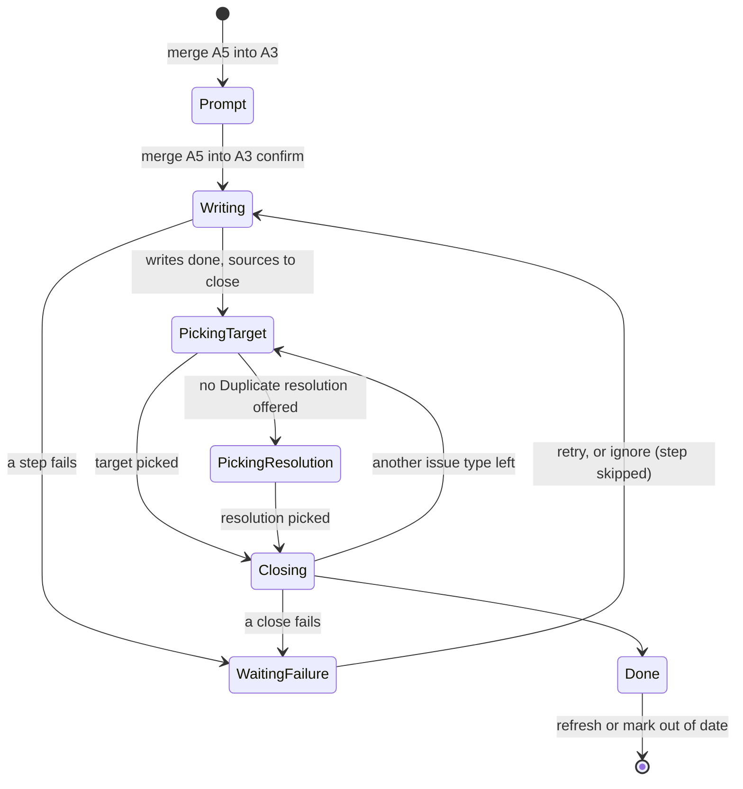
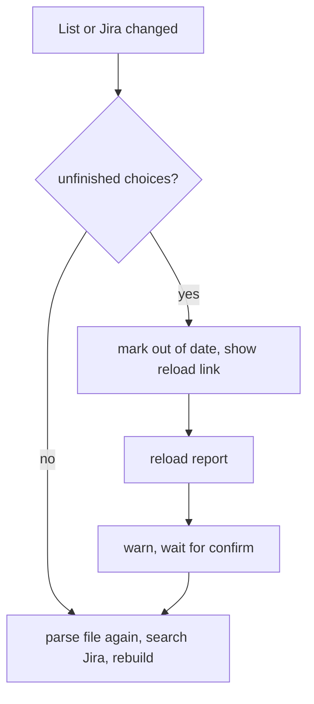

# Waltz ticket merge - Plan

## Goal Capsule

- **Objective:** When a Waltz import shows several tickets for the same piece of work, the user combines them in one confirmed step, and a later scan of Jira shows which ticket took over the items.
- **Means:** A `merge <source…> into <survivor>` reply on the Waltz review, composed from the existing rewrite, link and close machinery (KTD1, KTD3).
- **Authority:** The Product Contract wins on behavior; a KTD wins on mechanism within it. `docs/report-import.md` stays the developer reference and is updated with the code. The user manual (`README.md`, `docs/manual/`) is updated for the new reply, the reload option and the changed ignore-list behavior.
- **Stop conditions:** Stop and ask if `JiraIssue.fields.issuelinks` cannot show an existing Duplicate link (KTD8), or if the rebuild cannot be factored out of `continueAfterImportIssueType` without changing what a first import shows (KTD9).
- **Execution profile:** Code. Test-first for the pure helpers and reply grammar (U2, U3); the handler units follow the mocking convention of `src/test/reportImportTicketedActions.test.ts`. Run `npm run compile` and `npm test` before any commit.

Product Contract preservation: changed: R7, R9. The user chose, at planning time, to always ask for the target status instead of closing automatically from a cleanup rule, so R9 no longer falls back to the stepped close only when a piece is missing. All other R, F and AE IDs and their meaning are unchanged.

---

## Product Contract

### Summary

On the Waltz review's overview and Already ticketed screens, the user replies `merge A5 A6 into A3` (or with ticket keys) to combine tickets. One confirmation shows the tickets and the plan. The survivor is rewritten once from the items of all tickets, and each other ticket is linked as Duplicate of it, marked as merged in its summary and description, and closed with resolution Duplicate. The review then refreshes itself, and the overview gets a reload option. The same refresh keeps the screens in step with the ignore list.

### Problem Frame

Two Waltz tickets for the same piece of work cannot be combined today. The user closes one by hand in Jira, links it, and edits both texts. The next import then has nothing that says which ticket took over the items, so a later scan cannot tell.

The open review also goes stale. Removing an entry from the ignore list leaves its items hidden until the next import, and a merge would leave the cancelled ticket listed as a target.

### Requirements

**The merge reply**

- R1. On the overview and the Already ticketed screen, `merge <source…> into <survivor>` combines tickets. Each side is an `A` id or a ticket key, several sources may name one survivor, and an `A` id stands for the ticket its row points to, so every row of that ticket is covered.
- R2. The reply is not offered on the New and Stale screens. There, `merge` with row numbers keeps combining New rows and `add … to <KEY>` is unchanged; the new form is answered with a pointer to the overview.
- R3. The bare command writes nothing. It shows each ticket's key, summary and status, the planned steps, any warning or fallback (R9, R10), and one link that confirms.
- R4. A reply naming the same ticket on both sides, or an id or key that cannot be resolved, is refused with nothing written.

**What the merge writes**

- R5. The survivor's summary, description and labels are rewritten once, as the existing rewrite does, from the report rows ticketed to the survivor and to every source. Labels are the union. A comment names the absorbed tickets, the findings added, and recorded findings the report no longer covers.
- R6. Each source gets a Duplicate link to the survivor, its summary prefixed `[Merged into <KEY>]`, and a description banner naming the survivor, with the original body kept below. Its marker labels stay.
- R7. Each source is then closed with resolution Duplicate. The user picks the target status once per issue type among the sources.
- R8. Steps run in this order: survivor rewrite and comment, then for each source the link and rewrite, with each close last.

**Missing pieces and risky pairs**

- R9. A missing Duplicate link type falls back to a Relates link with a warning. A missing Duplicate resolution leaves the resolution to a pick from the project's list. The confirmation names any fallback before the user clicks.
- R10. The confirmation warns about a resolved survivor, about a ticket not created by an import (listing the findings a rewrite would drop), and about an already-resolved source, which skips only the close. The user decides by clicking.
- R11. When a step fails, the merge stops and reports every ticket with its link, the failed step and the error, and offers retry or ignore. Ignore skips that step and continues, and the final report lists what is missing.

**Staying in step**

- R12. After a merge, the merged rows show a result in place, and the review refreshes itself when that loses none of the user's unfinished choices (New merges, exclusions, pending Already-ticketed picks). Otherwise the overview marks the screens out of date and offers the reload.
- R13. The overview offers **reload report**. It re-reads the same report file, re-runs the Jira searches, and rebuilds all screens. It warns that unfinished choices are lost and waits for a confirming link, and it asks for a file when the original is gone.
- R14. After `accept` or `unaccept`, the same refresh rule applies, so an item removed from the ignore list appears in New when it is still in the report and not ticketed.
- R15. A later import needs no stored merge record. The survivor carries the combined labels and is the open target, and the resolved source is never the target.

**Scope**

- R16. Waltz only. Veracode and email imports are unchanged.

### Key Decisions

- The user names the survivor with `into`. (session-settled: user-directed — chosen over a proposed default and over always keeping the newest: the target after `into` survives, with no guessing.) Governs R1.
- The cancelled ticket is rewritten with a prefix and banner and keeps its body. (session-settled: user-directed — chosen over replacing the body and over link and comment only: the original detail stays and a scan shows where it went.) Governs R6.
- The shape is a ticket-level reply. (session-settled: user-directed — chosen over a per-row action in the Action column and over stored merge records: it extends the existing rewrite and close machinery with the least new surface.) Governs R1, R15.
- The screens are the overview and Already ticketed only. (session-settled: user-directed — chosen over also offering it on Stale and on New: a stale ticket has no items to hand over, and New rows join a ticket through `add … to <KEY>`.) Governs R2.
- A failed step stops with retry or ignore. (session-settled: user-directed — chosen over a silent retry and over rollback: Jira writes cannot be undone cleanly.) Governs R11.
- Ignore skips the failed step and continues with the rest. (session-settled: user-directed — chosen over abandoning the merge and over skipping only the close.) Governs R11.
- The close always asks for the target status. (session-settled: user-directed — chosen over closing automatically from a cleanup rule and over auto-picking a single candidate: guessing which status is final is worse than one question.) Governs R7, R9.
- Missing Jira pieces fall back and say so. (session-settled: user-approved — proposed with refusal as the alternative: projects differ in link types and resolutions.) Governs R9.
- Risky pairs warn and the user decides. (session-settled: user-approved — proposed with blocking as the alternative.) Governs R10.
- Many tickets merge into one survivor in one reply. (session-settled: user-approved — proposed over one pair per reply: related tickets often come in threes and the survivor is then rewritten once.) Governs R1, R5.
- Merge state lives only in Jira. (session-settled: user-approved — proposed over a table note and over a stored file: the survivor's labels already steer later imports.) Governs R15.
- Reload re-reads the same file after a warning. (session-settled: user-approved — proposed over a file picker each time and over re-applying choices: row ids shift, so choices could land on the wrong row.) Governs R13.
- The refresh is automatic when nothing is lost, and covers the ignore list too. (session-settled: user-approved — proposed over always asking for a reload and over a separate plan: the user expects results in step with the list.) Governs R12, R14.
- The reply keeps the verb `merge`. (session-settled: user-approved — proposed over `duplicate … of …` and `close … into …`: the form always has `into` plus an `A` id or key, so it cannot be mistaken for the row merge.) Governs R1, R2.

### Key Flows

- F1. Merge related tickets
  - **Trigger:** The user sees related tickets on the Already ticketed screen or the overview.
  - **Steps:** The user sends `merge A5 A6 into A3`. The review shows the tickets, the plan, and any warning or fallback. The user clicks the confirming link. The survivor is rewritten, each source is linked and rewritten, the user picks the target status for each issue type, and the sources are closed. The review refreshes or marks itself out of date.
  - **Outcome:** One open ticket holds all items. Each other ticket is closed as Duplicate and says where its items went.
  - **Covered by:** R1, R3, R5, R6, R7, R8, R12

### Acceptance Examples

- AE1. **Covers R5, R6, R7.** Given tickets PROJ-12 and PROJ-15 for two components of one library family, when the user confirms `merge A5 into A3` where A3 is PROJ-12, then PROJ-12 lists both components, PROJ-15 is linked as Duplicate, titled `[Merged into PROJ-12] …`, and closed with resolution Duplicate.
- AE2. **Covers R11.** Given the link step fails for one source, when the merge stops, then the report lists every ticket with its link, names the failed step and error, and offers retry or ignore. After ignore, the remaining steps run and the final report says the link is missing.
- AE3. **Covers R9.** Given a project with no Duplicate resolution, when the user views the confirmation, then it states that the resolution is picked from the project's list, and the merge does not skip the close.
- AE4. **Covers R2.** Given the New screen, when the user sends `merge 2 4`, then rows 2 and 4 combine as today. When the user sends `merge PROJ-12 into PROJ-40` there, then no change is made and the reply points to the overview.
- AE5. **Covers R14.** Given an accepted component that is in the report and has no ticket, when the user sends `unaccept` for it and no choices are pending, then the component appears in New without a new import.
- AE6. **Covers R12, R13.** Given the user has excluded New rows and then merges two tickets, when the merge ends, then the overview marks the screens out of date, and the reload link warns that the exclusions are lost before it runs.

### Scope Boundaries

**Deferred for later**

- Merging stale tickets, and merging directly from the New screen by key.
- A stored record of merged pairs, and a note on Already-ticketed rows saying a ticket absorbed others.
- Re-applying the user's row choices after a reload.
- Merge for the Veracode and email imports.

### Dependencies / Assumptions

- The Jira project allows a Duplicate link and a Duplicate resolution, or the fallbacks in R9 apply.
- The report file is still at the path chosen for the import when a refresh or reload runs (KTD9).
- The cancelled ticket's marker labels stay, so a resolved ticket still maps to its findings.

### Outstanding Questions

**Deferred to Planning**

- Whether a re-sent `merge … confirm` after a lost run record can duplicate the survivor comment; U5 decides how far to guard (KTD4).

### Sources / Research

- `docs/report-import.md` — "Finding folding" (`add … to <KEY>`, `rewrite` on Already ticketed), "Already-ticketed rows: per-row actions", "Stale-ticket detection and inline close", and "Accepted CVEs and components (Waltz)".
- `docs/plans/2026-10-05-1912-feat-report-import-finding-folding-plan.md`, `docs/plans/2026-10-20-1847-feat-waltz-accepted-components-plan.md`, `docs/plans/2026-10-21-0814-feat-ticketed-screen-paging-plan.md` — adjacent plans.
- `src/participant/jira/importAccept.ts` — `unacceptEntry` leaves hidden rows hidden until the next import; this is the gap R14 closes.
- `src/services/TicketService.ts` — `rewriteTicket`, `linkIssues` (Relates only today) and `transitionAlongPath` (accepts a resolution).

---

## Planning Contract

### Key Technical Decisions

- KTD1. **The merge is a ticket-level reply with its own grammar, matched before any generic handler.** `parseOverviewReply` and `parseTicketedGroupReply` (`src/participant/session/importReplies.ts`) recognize `merge <refs> into <ref>` and the same plus a trailing `confirm`, ahead of the `<row> <action>` matcher and the exit and cancel words, per `docs/solutions/logic-errors/confirm-cancel-word-list-broadening-swallows-domain-name-collisions.md`. `parseNewGroupReply` and `parseStaleGroupReply` answer the form with `invalid` and a pointer to the overview, so `merge 2 4` keeps its row meaning (AE4). A new optional descriptor capability `ticketMerge` (Waltz supplies it, Veracode and email omit it, like `accepted`) switches the grammar on and carries the importer's wording hooks. Realizes R1, R2, R16.
- KTD2. **The confirmation is stateless.** The bare command reads each ticket with `TicketService.getIssue`, builds the prompt and warnings in a pure `buildMergePrompt`, and offers one link that resends the command plus `confirm`; clicking is the confirmation, as `add … as rewrite` works today. Sides resolve against `allRows`: an `A` id (finished rows included) to `ticketedTargetKey(row)`, a Jira key as typed. At most `BATCH_LIMIT` sources per reply. Ticket text read from Jira is passed through `neutralizeMarkdownLinks`, and keys are linked with `formatKeyLink` (`docs/solutions/logic-errors/cleanup-review-table-issue-keys-not-linked-unlike-every-other-review-table.md`). Realizes R3, R4.
- KTD3. **An interrupted or waiting merge is recorded on the review session.** `ReviewSession.mergeRun` holds the survivor, the sources, the ordered steps with their status and error, and what the run waits for (a retry-or-ignore choice, a target status, a resolution). `handleImportReviewReply` interprets the run's own replies (`retry`, `ignore`, a numbered or named pick, `cancel`) before the screen's vocabulary, so no new session kind or router entry is needed. (session-settled: user-approved — chosen over fully stateless links that carry the step to skip: those commands get long and break on edited text.) Realizes R7, R11.
- KTD4. **Steps are written to be repeated.** Order: survivor rewrite, survivor comment, then per source the link and the source rewrite, then the closes. A step recorded `done` is not run again; a failed or pending one is retried. The source rewrite applies the prefix and banner only when absent. The link step first checks the source's `issuelinks` for an existing link to the survivor. The survivor comment is the one step that cannot be checked cheaply, so a lost run record followed by a re-sent `confirm` can post it twice; this is tolerated (see Outstanding Questions). Realizes R8, R11.
- KTD5. **The survivor rewrite reuses `planRewrite` and `writeRewrite`.** `planRewrite(session, descriptor, survivorKey, labels, sourceRows)` already rebuilds from the rows that point to the survivor plus extra rows, and reports the recorded findings the rebuilt text no longer covers. The comment is a short preface naming the absorbed tickets (importer wording hook on `ticketMerge`) followed by `fold.buildComment(combinedSourceItem, droppedKeys)`. Realizes R5.
- KTD6. **Marking a source is one new `TicketService` write.** `markTicketMerged(key, survivorKey)` reads the ticket and writes summary and description in one `updateIssue`. The summary becomes `[Merged into <KEY>] 
`, clamping the old summary with `clampSummary(old, '', 255 − prefix length)` from `src/utils/reportImport.ts` so the 255-character limit trims only the old summary, and an existing merged prefix is replaced. The description gets a wiki banner naming the survivor above the unchanged body, added once. Realizes R6.
- KTD7. **The close reuses the stale-close helpers, with the resolution fixed.** The sources are grouped by issue type through `buildStaleTicketGroups` (`src/participant/jira/cleanupHandler.ts`), so each group carries its cleanup rules and workflow graph. The target pick lists the rules' target states and the reachable statuses (`buildStaleTargetOptions`, `parseStaleTargetPick`) and is always asked, once per issue type. A rule contributes its target state, not its resolution. The resolution is Duplicate when `getResolutions()` offers it; otherwise the existing resolution pick (`parseResolutionSelection`, including `none`) runs. Transitions run through `transitionTickets` and `planStaleTransitions`, with the same skip notes for a ticket already there or without a path. (session-settled: user-directed — chosen over a rule-driven automatic close and a single-candidate auto-pick: one question beats guessing which status is final.) Realizes R7, R9.
- KTD8. **Link types are read, not guessed.** A new `IJiraClient.getIssueLinkTypes()` (`GET /rest/api/2/issueLinkType`) lets the confirmation name the Relates fallback up front. `TicketService.linkIssues(fromKey, toKey, typeName = 'Relates')` gains the type, and the merge calls it with `Duplicate`: the source is the `fromKey`, so Jira shows "duplicates" on the source and "is duplicated by" on the survivor. A link that still fails is a normal failed step. (session-settled: user-approved — chosen over attempting Duplicate and falling back after the failure: the confirmation must name the fallback before the click.) Realizes R6, R9.
- KTD9. **The review stores the report path, and one function rebuilds the review.** `ImportTemplateSelectionSession` and `ReviewSession` gain `reportFilePath`, set by `openReportFilePicker` and by `registerReportImportCommand` (`src/extension.ts`) through `buildImportTemplateSession`. The body of `continueAfterImportIssueType` from the dedup search to the stale check moves into a function that takes items, raw items, issue type, template name and fields and returns the review session; the first import and every refresh call it. A refresh parses the file again with `descriptor.parseAndFilter`, keeps the issue type, template, fields, outcomes and view, clamps the three page indexes, and clears `outOfDate`. The stale groups need only `getResolutions` (`buildStaleTicketGroups` takes a `Pick<IJiraClient, 'getResolutions'>`), which the handler already reaches through `TicketService.getResolutions`, so no new client parameter is threaded into the review handlers. The session schema version rises from 11 to 12, which expires in-flight reviews with the existing message. (session-settled: user-approved — chosen over keeping the parsed items in the session and over a Jira-only refresh: the first grows with the report and the second cannot bring un-ignored items back.) Realizes R12, R13, R14.
- KTD10. **A pure rule decides refresh or mark.** `hasUnfinishedChoices(session)` is true when a New row is excluded, a New row is merged (`memberIds`), or an unfinished Already-ticketed row's `action` differs from the `defaultAction` that `buildReviewRows` now records on it. After a merge and after `unaccept`, a false result refreshes at once and a true one sets `ReviewSession.outOfDate`. `accept` keeps its in-place narrowing, which already leaves the screens in step. Realizes R12, R14.
- KTD11. **Reload is a two-step reply.** `reload report` shows the warning and a link that sends `reload report confirm`; the confirm runs the KTD9 refresh. It is accepted on the overview and, like the accepted-list replies, on the only screen of a single-group import. The overview shows an out-of-date line with the link while `outOfDate` is set. A missing or unparsable file is reported and the session stays as it was. Realizes R13.
- KTD12. **Rows and outcomes record the merge.** `TicketedRowResult` gains `{ status: 'done', action: 'merge', into }`, shown as "merged into KEY" in the Action cell; the survivor's rows are marked as rewritten. `ImportOutcomes` gains `merged` and `mergeFailed`, shown in the overview and the done summary. A ticket counts as foreign for the R10 warning when it lacks `descriptor.stale.markerLabel`. Realizes R6, R10, R12.

### High-Level Technical Design

The merge run is a small state machine on the review session. The prompt step is stateless and has no record. Layout and wording are directional.

After the run, and after `unaccept`, the refresh decision (KTD10) is:

### System-Wide Impact

- The review session schema changes (version 12), so a review open during the upgrade is told to re-run the import.
- The review handlers keep their signatures; the rebuild and the merge close use `TicketService` alone.
- Jira gets new writes on tickets Ticket Sidekick did not necessarily create: a rewrite, a link, a transition and comments. Every one is gated by the confirmation click, and the prompt lists what a rewrite drops.
- Tools in `src/tools/` are untouched: no Language Model tool is added, so `docs/manual/agent-mode-tools.md` and its sync test stay as they are.

### Risks

- A rewrite replaces a ticket's description from the report. For a ticket not created by an import the loss can be large, so R10 lists the dropped findings before the click and the survivor comment repeats them.
- Closing needs a discovered workflow graph (`@jira discover workflow`). A source with no graph cannot be closed and is reported as skipped with the usual hint, never as a silent success.
- The survivor comment can be posted twice after a lost run record (KTD4); a duplicate comment is harmless and visible.

---

## Implementation Units

### U1. Jira link-type read, typed link, and source marking

- **Goal:** The Jira layer can list link types, link two tickets with a chosen type, and mark a ticket as merged.
- **Requirements:** R6, R9. KTD6, KTD8.
- **Dependencies:** none.
- **Files:** `src/jira/IJiraClient.ts`, `src/jira/JiraApiClient.ts`, `src/test/mocks/MockJiraClient.ts`, `src/test/fixtures/issue-link-types.json`, `src/services/TicketService.ts`, `src/test/TicketService.test.ts`, `src/test/JiraApiClient.test.ts`.
- **Approach:**
  - Add `getIssueLinkTypes()` to `IJiraClient`, implement it in `JiraApiClient` with `fetchWithRetry` and `JiraApiError`, and return the fixture from `MockJiraClient`, shaped like Jira's real `issueLinkTypes` response (`name`, `inward`, `outward`).
  - Add `TicketService.getLinkTypeNames()` and a `typeName` parameter on `linkIssues`, defaulting to `Relates` so the follow-up flow is unchanged.
  - Add `TicketService.markTicketMerged(key, survivorKey)` and `TicketService.hasLinkBetween(key, otherKey)` (reads `issuelinks`), logging through the injected `onDiag`.
- **Execution note:** Test-first. Capture the real `issueLinkType` response shape in the fixture before writing the parser.
- **Patterns to follow:** `getResolutions` and `linkIssues` in `src/services/TicketService.ts`; the "Adding a new Jira operation" checklist in `CLAUDE.md`.
- **Test scenarios:**
  - `getIssueLinkTypes` returns the names from a fixture with `Duplicate`, `Relates` and `Blocks`.
  - `linkIssues('PROJ-15', 'PROJ-12', 'Duplicate')` calls `createIssueLink('PROJ-12', 'PROJ-15', 'Duplicate')`, and the default call still sends `Relates`.
  - `markTicketMerged` on a ticket titled `Netty` writes `[Merged into PROJ-12] Netty` and a description with the banner above the old body, in one `updateIssue` call.
  - `markTicketMerged` called twice writes nothing the second time, and a ticket already prefixed for another survivor gets the new prefix, not two.
  - A summary of 255 characters comes back at 255 characters with the original trimmed, not the prefix.
  - `hasLinkBetween` is true when `issuelinks` holds an outward or inward link to the other key and false otherwise.
  - Error path: a 403 from the link-type endpoint surfaces as a `JiraApiError` with `status` 403.
- **Verification:** Existing `linkIssues` callers pass unchanged; the new methods are covered by the mock and the API-client tests.

### U2. Pure merge helpers and session shape

- **Goal:** The vscode-free pieces of the merge exist and are tested: reference resolution, plan, warnings, summary and banner text, run record, and the refresh rule.
- **Requirements:** R3, R4, R9, R10, R12. KTD2, KTD3, KTD10, KTD12.
- **Dependencies:** none.
- **Files:** `src/utils/ticketMerge.ts` (new), `src/participant/session/importTypes.ts`, `src/test/ticketMerge.test.ts` (new), `src/test/sessionImportReview.test.ts`.
- **Approach:**
  - `ticketMerge.ts`: `resolveMergeSides(allRows, refs)` returns survivor key and source keys or a refusal reason (same ticket on both sides, unknown id, malformed key, over `BATCH_LIMIT`); `buildMergePlan` lists the steps for a run; `mergedSummary` and `mergedBanner` build the text KTD6 writes; `hasUnfinishedChoices(session)` implements KTD10.
  - `importTypes.ts`: add `MergeRun`, the `merge` result variant, `merged` and `mergeFailed` outcomes, `ReviewSession.mergeRun`, `outOfDate` and `reportFilePath`, `defaultAction` on ticketed rows, and bump `CURRENT_SESSION_SCHEMA_VERSION` to 12 with a comment line in the existing history.
  - `buildReviewRows` in `src/utils/reportImport.ts` records `defaultAction` from `deriveTicketedActions`.
- **Execution note:** Test-first.
- **Patterns to follow:** `findPartialRewrites` and `buildAddPrompt` for pure session helpers; the schema-bump comment history in `importTypes.ts`.
- **Test scenarios:**
  - `resolveMergeSides` maps `A5` and `A6` to their targets and keeps `PROJ-40` as typed, upper-casing a lower-case key.
  - It refuses `A3 into A3`, an `A9` that is not a row, `NOTAKEY`, and 51 sources, each with a reason and no result.
  - Two `A` ids that point to the same ticket collapse to one source.
  - `mergedSummary` prefixes once, replaces a prefix naming another survivor, and keeps the total within 255.
  - `mergedBanner` is added once and keeps the old body intact, including a body that starts with a wiki heading.
  - `hasUnfinishedChoices` is false for a fresh session, true after an excluded New row, true with a merged row, true with an Already-ticketed row moved off its `defaultAction`, and false when only finished rows differ.
  - Error path: a session built before this change (no `defaultAction`) is expired by the schema version, not mis-read.
- **Verification:** `npm test` passes the new file; the schema constant is 12 and the history comment names this change.

### U3. Reply grammar, vocabulary and screen lines

- **Goal:** The new replies parse on the right screens only, and the overview and screens show the new wording.
- **Requirements:** R1, R2, R3, R11, R13. KTD1, KTD3, KTD11.
- **Dependencies:** U2.
- **Files:** `src/participant/session/importReplies.ts`, `src/participant/session/importScreens.ts`, `src/test/sessionImportFolding.test.ts`, `src/test/reportImportOverview.test.ts`.
- **Approach:**
  - New `ImportReplyAction` kinds: `mergePrompt`, `merge` (confirmed), `mergeRun` (a run reply: `retry`, `ignore`, `pick`, `cancel`), `reloadPrompt`, `reload`.
  - Parse `merge … into …` on overview and ticketed before the generic matchers, answer it with `invalid` plus the overview pointer on New and Stale, and add `reload report` and `reload report confirm` to the overview and to a single-group screen. Gate all of it on a new `canMergeTickets` context flag.
  - Extend `describeImportReplyVocabulary`, and add to `buildImportOverview` the out-of-date line with a reload link and the merged and failed counts; extend `formatTicketedRowResult` and `buildImportDoneSummary`.
- **Execution note:** Test-first; the disjointness test is the main proof.
- **Patterns to follow:** `parseFoldReply` and `parseAddReply` for strict token parsing; `cmdLink` for clickable replies.
- **Test scenarios:**
  - Covers AE4. On New, `merge 2 4` is a row merge and `merge PROJ-12 into PROJ-40` is `invalid` with the overview pointer.
  - On the overview, `merge A5 A6 into A3` is `mergePrompt` and the same plus `confirm` is `merge`; `merge A5 into` and `merge into A3` are `invalid` with a usage line.
  - On Already ticketed, `merge A5 into A3` is not read as a `<row> <action>` and `A5 leave` still sets an action.
  - A run reply `ignore` or `retry` parses only while a run is waiting; with no run it falls to the screen's vocabulary.
  - `reload report` and `reload report confirm` parse on the overview and on a single-group screen, and not on New, Ticketed or Stale of a multi-group import.
  - With `canMergeTickets` false (Veracode), none of the new forms parses.
  - The overview with `outOfDate` shows the out-of-date line and reload link, and without it shows neither; a merged row shows "merged into PROJ-12" in its Action cell.
  - The done summary lists merged and failed merges only when non-zero.
- **Verification:** The existing reply and vocabulary tests pass unchanged apart from the added context flag.

### U4. One rebuild function, stored report path, and refresh

- **Goal:** The review can rebuild itself from the stored file, and `unaccept` uses that to keep the screens in step.
- **Requirements:** R12, R13, R14. KTD9, KTD10, KTD11.
- **Dependencies:** U2, U3.
- **Files:** `src/participant/jira/reportImportHandler.ts`, `src/participant/jira/waltzHandler.ts`, `src/participant/jira/veracodeHandler.ts`, `src/participant/jira/importAccept.ts`, `src/participant/jira/importReviewScreen.ts`, `src/extension.ts`, `src/test/reportImportHandler.test.ts`, `src/test/reportImportAcceptedHandler.test.ts`, `src/test/reportImportRefresh.test.ts` (new).
- **Approach:**
  - Carry the file path: `openReportFilePicker` returns it, `buildImportTemplateSession` stores it, `registerReportImportCommand` passes the picked path, and the review session copies it.
  - Extract the build from `continueAfterImportIssueType` into one function that returns the review session or the all-hidden result, then call it from the first import and from a new `refreshReview`. `refreshReview` re-reads the file with `descriptor.parseAndFilter`, reports a missing file or parse failure without touching the session, and keeps outcomes, view and the clamped page indexes.
  - Handle `reload` and `reloadPrompt` in `handleImportReviewReply`, pass `buildStaleTicketGroups` a `getResolutions` taken from `TicketService`, and make `unacceptEntry` return the session so the handler can apply KTD10.
- **Execution note:** Characterization first. Pin what a first Waltz import and a first Veracode import render today, then move the code, so the extraction cannot change them.
- **Patterns to follow:** the `sessionWasSuperseded` guard at the top of `handleImportReviewReply`; the `afterGroupAction` and `Object.assign(session, …)` pattern in the dispatcher.
- **Test scenarios:**
  - A first Waltz import renders the same overview and stores `reportFilePath`, whether started from the command or from chat.
  - Covers AE5. With an accepted component in the report and no ticket, `unaccept` with no pending choices refreshes and the component appears in New.
  - Covers AE6. With an excluded New row, `unaccept` sets `outOfDate` and does not read the file; the overview shows the reload link.
  - `reload report` shows the warning and the confirm link and writes nothing; `reload report confirm` rebuilds, keeps `outcomes` and the issue type, and clears `outOfDate`.
  - A page index beyond the new last page is clamped after a refresh that shrinks the list.
  - Error path: the stored file is gone, so the reply says so, asks for a file, and the session is unchanged.
  - Error path: the Jira search fails for every chunk, so the refresh keeps the existing "could not check for already-ticketed" warning and still renders.
  - A review stored at schema 11 is answered with the existing expiry message.
- **Verification:** `reportImportHandler.test.ts` passes with its first-import expectations unchanged.

### U5. The merge flow

- **Goal:** `merge … into …` runs end to end on the Waltz review: prompt, writes, target pick, close, failure handling, row marking and refresh.
- **Requirements:** R1–R12, R15, R16. KTD2–KTD8, KTD12.
- **Dependencies:** U1, U2, U3, U4.
- **Files:** `src/participant/jira/importMerge.ts` (new), `src/participant/jira/reportImportHandler.ts`, `src/participant/jira/reportImportTypes.ts`, `src/participant/jira/waltzHandler.ts`, `src/test/reportImportMerge.test.ts` (new), `src/test/waltzMergeWording.test.ts` (new).
- **Approach:**
  1. `showMergePrompt`: resolve the sides, read each ticket, read link types and resolutions, and stream `buildMergePrompt` with warnings (resolved survivor, foreign ticket with dropped findings, resolved source) and fallbacks (Relates, resolution pick); write nothing.
  2. `runMerge`: create the `MergeRun` from `buildMergePlan`, then run pending steps in order, saving the session after each: survivor rewrite via `planRewrite` and `writeRewrite`, survivor comment, per source `linkIssues` (skipped when `hasLinkBetween`) and `markTicketMerged`.
  3. On a failed step, stop and stream the failure report: every ticket as a link, the failed step, the error, and `retry` and `ignore` links.
  4. After the writes, build the stale-style groups for the sources, ask the target (and the resolution only when Duplicate is not offered) for each issue type, and close through `transitionTickets` with resolution Duplicate.
  5. Finish: mark source rows `merge` and survivor rows rewritten, update outcomes, stream the final report listing anything skipped, clear the run, then apply the KTD10 rule.
  - Add the `ticketMerge` capability type to `reportImportTypes.ts` and supply it from `waltzHandler.ts` with the comment preface and banner wording. Dispatch `mergePrompt`, `merge` and `mergeRun` in `handleImportReviewReply`, with a run's replies tried first.
- **Execution note:** Start with failing tests for the happy path and the link-failure path (AE1, AE2), then add the close ask.
- **Patterns to follow:** `addToTicket` and `showAddPrompt` in `src/participant/jira/importAddToTicket.ts`; `startTargetPick` and `runStaleTransitions` in `src/participant/jira/importStaleClose.ts`; `docs/solutions/workflow-issues/vscode-mock-testing-convention-not-checked-before-inventing-new-one.md` for the vscode mock.
- **Test scenarios:**
  - Covers AE1. Confirming `merge A5 into A3` rewrites PROJ-12 with both components and the union of labels, posts one comment naming PROJ-15, links PROJ-15 as Duplicate, marks it `[Merged into PROJ-12] …`, asks the target, and closes it with resolution Duplicate.
  - `merge A5 A6 into A3` rewrites the survivor once and posts one comment, however many sources.
  - The bare command writes nothing, links each key, and neutralizes a ticket summary containing a Markdown link.
  - Covers AE2. A failed link stops the run, reports all tickets with links and the error, and `retry` runs only the failed and later steps; `ignore` skips the link, continues, closes, and the final report lists the missing link.
  - Covers AE3. With no Duplicate resolution offered, the prompt says the resolution is picked, and after the target pick the resolution pick appears with `none` allowed.
  - Two sources of different issue types get two target picks in turn; picking `back` or `cancel` stops before any close and keeps the done steps.
  - A resolved survivor, a ticket without the marker label, and an already-resolved source each add their warning; the resolved source skips only the close.
  - A source with no workflow graph is reported as skipped with the discover-workflow hint, and the other sources still close.
  - Rows: source rows show "merged into PROJ-12", the survivor's rows show rewritten, and `outcomes.merged` counts the sources.
  - Integration: after a merge with no pending choices the review refreshes and the next screen shows the survivor as the only target; with an excluded New row it marks out of date instead.
  - Covers R16. With the Veracode descriptor, `merge A1 into A2` is `invalid` and nothing is read.
  - Error path: a stale run (the review superseded by a newer import) is closed without writing, using the existing superseded message.
- **Verification:** A full merge against `MockJiraClient` leaves the recorded calls in the order of R8.

### U6. Documentation and vocabulary

- **Goal:** Developers and users can find the new behavior, and the shared vocabulary names it.
- **Requirements:** all, as documentation. KTD1–KTD12.
- **Dependencies:** U5.
- **Files:** `docs/report-import.md`, `CLAUDE.md`, `README.md`, `docs/manual/report-imports.md`, `CONCEPTS.md`, `docs/known-limitations.md`.
- **Approach:**
  - `docs/report-import.md`: a "Merging tickets (Waltz)" section (grammar, steps, failure handling, the run record, refresh and reload) and a line in the Accepted section that `unaccept` now refreshes the review.
  - `CLAUDE.md`: one line in the key-files table for `importMerge.ts` and `ticketMerge.ts`, plus the new `TicketService` methods and the session schema version; keep it an index.
  - `README.md` and `docs/manual/report-imports.md`: the `merge` reply, the confirmation, retry and ignore, the target question, **reload report**, and that removing an ignore-list entry now brings the item back at once.
  - `CONCEPTS.md`: a **Ticket merge** entry (survivor, source, merged marker) using the existing entry style.
  - `docs/known-limitations.md`: add a register row only if a limitation survives implementation (the possible duplicate comment on a lost run record), following the file's convention.
- **Test expectation:** none -- documentation only; `src/test/userDocsSync.test.ts` keeps guarding settings, commands and tools, none of which change.
- **Verification:** `npm test` passes `userDocsSync.test.ts`, and each new reply word appears in the README or manual page.

---

## Verification Contract

| Gate | Command | Applies to |
|---|---|---|
| Type check | `npm run compile` | every unit |
| Unit tests | `npm test` | every unit; green before every commit |
| Targeted runs | `npx vitest run src/test/ticketMerge.test.ts src/test/sessionImportFolding.test.ts src/test/reportImportMerge.test.ts src/test/reportImportRefresh.test.ts src/test/TicketService.test.ts` | U1–U5 while developing |
| Docs sync | `npx vitest run src/test/userDocsSync.test.ts` | U6 |

Chat flows and real Jira writes are not covered by `npm test` or `npm run test:e2e`. One manual check against a Jira sandbox covers the Duplicate link direction, the Duplicate resolution, the target pick, and a project without a Duplicate link type; it extends the open check in KL13 of `docs/known-limitations.md`.

## Definition of Done

- Every R in the Product Contract is true in behavior, and AE1–AE6 each have a covering test.
- A first Waltz and a first Veracode import render exactly as before U4.
- `merge 2 4` on New and every Already-ticketed `<row> <action>` reply parse as before.
- No source can be closed with a resolution other than Duplicate, or without the target question.
- `npm run compile` and `npm test` are green, and `docs/report-import.md`, `CLAUDE.md`, the README and the manual describe the final behavior.
- Experimental or abandoned code from approaches that did not pan out is removed from the diff.
