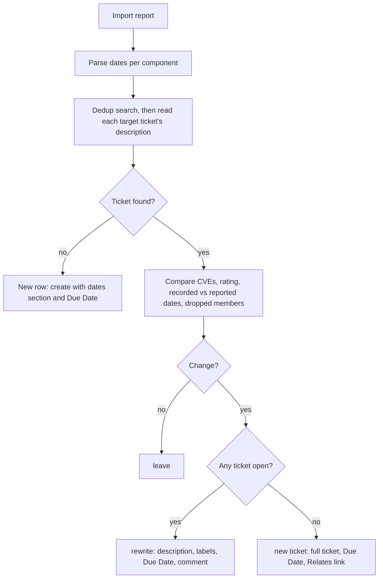

# Waltz remediation due dates - Plan

## Goal Capsule

- **Objective:** A Waltz ticket shows the dates by which its component must be fixed and the report's plan status, the Jira Due Date carries the same date, and a newer OSS report brings both up to date.
- **Authority:** The Product Contract wins on behavior. `docs/report-import.md` stays the developer reference and is updated with the code. The user manual (`README.md`, `docs/manual/report-imports.md`) is updated for the new ticket content, the Due Date and the changed Already ticketed actions. `CONCEPTS.md` is updated for the new action name and the date terms.
- **Open blockers:** None. The implementer needs no access to the real sample reports; every fixture is invented (see KTD13).
- **Execution profile:** Code, to be implemented in a separate session from the planning one. Test-first for the date helpers and the parser. Run `npm run compile` and `npm test` before any commit.

---

## Product Contract

### Summary

The Waltz import reads each component's policy date, planned date, attestation date and plan status from the OSS report. A new ticket gets a "Remediation dates" section and a Jira Due Date. A newer report refreshes existing tickets through `rewrite`, which is now the default for an open ticket whose dates or findings changed. For a ticket whose component is fully resolved, the default is a new linked ticket. `update` and `re-create` are removed for Waltz. No overdue count is shown: the dates and the report's own plan status are enough.

### Problem Frame

The OSS report says by when each vulnerable component has to be fixed. The import drops all of it, so a ticket gives no due date and Jira's own overdue filters and dashboards cannot see these tickets.

Three observations from real exports shape the design:

- The report's overrun number is 0 for a component that has no remediation plan, even when its plan is past its deadline. A copy of that number would hide the components that need attention most. The report's own plan-status column says so directly, so the plan uses that column and not the overrun.
- Dates move between exports. A date written to a ticket once goes stale.
- Some components, mostly lower-rated or newly reported ones, come without any dates.

Dates therefore have to be stored with the ticket, shown with the date of the report they came from, and refreshed when a newer report is imported. Today the importer can refresh an existing ticket only through labels and a comment, so a new date would never reach it.

### Requirements

**What the ticket shows**

- R1. The import reads these `ComponentRemediations` columns for each component: Expected Remediation (the policy date), Remediation Target Date (the planned date, present only on rows with action `Remediate`), Attested Rem Plan Due By (the attestation date), and Reason, where plan invalid (the plan status). It also reads the report's "Extracted On" value from `ReportDetails`. It does not read the overrun-days column.
- R2. Dates are handled as calendar dates (`YYYY-MM-DD`), whether the cell holds text or a date value.
- R3. A new ticket's description gets a "Remediation dates" section with the policy date, the planned date when present, the attestation date when present, and the plan status when the report gives one. The plan status is labelled "As of <extraction date>". No overrun or days-overdue number is shown anywhere.
- R4. The plan status is the report's own reason text (for example Overdue or Unplanned), shown as written. The import does not work out overdue itself.
- R5. A component without dates shows "Not reported yet" in place of the dates. In a folded or merged ticket's table, that component's date cells read n/a.
- R6. A folded or merged ticket lists every member's dates and plan status in its overview table, one row per component.

**The Jira Due Date**

- R7. The Due Date is the planned date, or the policy date when there is no planned date. A folded or merged ticket takes the earliest of its members' dates, and no Due Date is set when no member has a date.
- R8. When Jira refuses the Due Date, the ticket is still created or rewritten without it, the result warns, and the dates stay in the description.
- R9. Creating a ticket, `rewrite`, and the Waltz ticket merge all write the dates section and the Due Date.

**Refreshing from a newer report**

- R10. The Already ticketed screen detects an open or resolved ticket whose component has a new CVE, a higher rating, or dates that differ from the dates in the ticket's description, or from which a member of a folded or merged ticket has dropped out of the report (a member that is only filtered out by the rating or action settings, or accepted, has not dropped out). The dates compared are the policy date, the planned date and the attestation date; the plan status is not compared. A ticket created before this feature has no recorded dates, so it counts as changed whenever the report has dates for it, open or resolved. A component that is still in the report is still open work, so a resolved ticket for it gets a new ticket by default.
- R11. For an open ticket with a detected change, `rewrite` is the default action. When the report has a date for the ticket's group it writes the Due Date from the report, including over a date edited by hand in Jira, and the user manual and the result message say so; when the report has no date, the Due Date is left as it is.
- R12. For a component whose tickets are all resolved and which has a detected change, the default action is `new ticket`. It creates a full ticket with the component's current findings and dates, linked Relates to the resolved ticket, with the summary suffix ` (follow-up to <KEY>)`.
- R13. For Waltz, a row offers `rewrite`, `leave`, and `new ticket` when every ticket is resolved. `update` and `re-create` are removed, and today's `follow-up` becomes `new ticket`. An open ticket with no record labels (a baseline) defaults to `rewrite`; a resolved one defaults to `new ticket`. A row with no change keeps `leave` as its default. When any row pointing to an open ticket defaults to `rewrite`, every row pointing to that ticket defaults to `rewrite`, because `rewrite` rebuilds a whole ticket.
- R14. A change row shows the dates recorded on the ticket next to the dates in the report, so importing an older report over a newer one is visible before the user applies it.
- R15. A component that disappears from the report is handled by the existing Stale flow, which does nothing with dates.
- R16. `add … to <KEY>` with `as comment` adds a dates line for the added components and leaves the Due Date alone. `as rewrite` recomputes the Due Date.
- R17. Veracode and email imports are unchanged.

### Key Decisions

- **The ticket shows the policy date and the planned date, and the Due Date follows the planned one.** (session-settled: user-directed — chosen over a single date: the planned date is the team's commitment and the policy date is the fallback.) Governs R3, R7.
- **The overdue information is the report's plan status, shown next to the dates and with no count.** (session-settled: user-directed — chosen over an overdue-days number or column: showing the dates is enough.) Governs R3, R4.
- **The plan status is labelled with the extraction date.** The label stays true for an old report. It is left off when the report has no extraction date. Governs R3, R4.
- **A folded or merged ticket takes the earliest member date.** The ticket is due when its most urgent component is. Governs R6, R7.
- **A refused Due Date does not stop the write.** Some projects keep the field off the screen. Governs R8.
- **A newer report refreshes existing tickets, not only new ones.** (session-settled: user-directed — chosen over new tickets only: the user wants dates refreshed when the report changes.) Governs R10, R11.
- **The refresh is a `rewrite`, not a due-date-only update.** (session-settled: user-directed — chosen over a lightweight Due Date update: a component is atomic, so its dates and CVEs are handled together.) Governs R11, R13.
- **A new CVE on an open ticket defaults to `rewrite` too.** (session-settled: user-directed — chosen over keeping `update` as the default: handling a component's CVEs apart from the rest makes no sense.) Governs R11, R13.
- **`update` is removed for Waltz.** (session-settled: user-directed — chosen over keeping it as a selectable action: `rewrite` covers it.) Governs R13.
- **A resolved component gets a new ticket.** (session-settled: user-directed — chosen over rewriting the resolved ticket or re-creating it: a new version, or the same version after a resolution, is new work that must be seen.) Governs R12.
- **The new ticket is linked to the resolved one.** (session-settled: user-directed — chosen over an unlinked ticket: the history stays traceable.) Governs R12.
- **`re-create` is dropped for Waltz and `follow-up` is renamed `new ticket`.** (session-settled: user-approved — proposed over keeping both: they would now differ only by the link.) Governs R13.
- **A leaving member counts as a change.** (session-settled: user-directed — chosen over flagging only and over leaving it to the Stale flow: a stale Due Date would otherwise point at a component the ticket no longer covers.) Governs R10.
- **The dates a ticket already carries are read from its description.** (session-settled: user-directed — chosen over a record label and over the Jira Due Date field: the check is not critical, so reading the text back is good enough.) Governs R10, R14.
- **A ticket without recorded dates counts as changed once the report has dates, whether it is open or resolved.** (session-settled: user-directed — chosen over leaving a resolved one unchanged: a component still in the report is still open work, so a resolved ticket for it needs a new one.) Governs R10, R13.
- **A rewrite overwrites a hand-edited Due Date.** (session-settled: user-directed — chosen over keeping a manual date and over asking per row: the importer stores no record to tell an edit from a stale value, and one rule is easier to state.) Governs R11.
- **The Stale close leaves dates alone.** (session-settled: user-directed — chosen over clearing the Due Date or noting it in the close comment: no component remains, so no new date exists to write.) Governs R15.

### Key Flows

- F1. Refresh tickets from a newer report
  - **Trigger:** The user imports a newer OSS report for components that already have tickets.
  - **Steps:** The Already ticketed screen lists tickets whose dates or findings changed, with the recorded and reported dates. Open tickets default to `rewrite`, tickets with only resolved targets default to `new ticket`. The user adjusts rows and applies.
  - **Outcome:** Open tickets hold the current description and Due Date. A resolved component has a new linked ticket.
  - **Covered by:** R10, R11, R12, R13, R14

### Acceptance Examples

The dates below are illustrative.

- AE1. **Covers R3, R7.** Given a `Remediate` component with policy date 2026-11-30 and planned date 2026-12-15, when its ticket is created, then the description shows both dates and the Due Date is 2026-12-15.
- AE2. **Covers R3, R7.** Given a component with a policy date and no planned date, when its ticket is created, then the Due Date is the policy date.
- AE3. **Covers R3, R4.** Given a component with no remediation action, a attestation date of 2026-09-20, the report's plan status "Overdue" and the report extracted on 2026-10-22, when its ticket is created, then the section shows the attestation date 2026-09-20 and the plan status "Overdue" labelled "As of 2026-10-22", and no day count.
- AE4. **Covers R5, R7.** Given a Medium component with no dates, when its ticket is created, then the section reads "Not reported yet" and no Due Date is set.
- AE5. **Covers R6, R7.** Given a folded ticket for components dated 2026-12-15, 2026-11-30 and none, when it is created, then its table lists all three and the Due Date is 2026-11-30.
- AE6. **Covers R8.** Given a project whose screen has no Due Date field, when a ticket is created, then it is created without it, the result warns, and the description still shows the dates.
- AE7. **Covers R10, R11.** Given an open ticket created before this feature and a report that now has dates for its component, when the user imports the report, then the row is a change and defaults to `rewrite`, which adds the dates section and sets the Due Date.
- AE8. **Covers R10, R11, R14.** Given an open ticket whose recorded planned date is 2026-12-15 and a report that says 2027-01-31, when the report is imported, then the row shows both dates and defaults to `rewrite`, and the rewrite sets the Due Date to 2027-01-31 even if someone had moved it in Jira.
- AE9. **Covers R10, R11.** Given a folded ticket for components A, B and C where A set the Due Date, and a report without A, when it is imported, then the row defaults to `rewrite`, and the rewritten ticket drops A and takes the earliest date of B and C.
- AE10. **Covers R12, R13.** Given a component whose only ticket is resolved and whose report now lists a new CVE, when the report is imported, then the default is `new ticket`, which creates a full ticket linked Relates to the resolved one and `update` and `re-create` are not offered.
- AE11. **Covers R15.** Given an open ticket whose component is gone from the report, when the user closes it from the Stale screen, then its Due Date is not touched.
- AE12. **Covers R10, R13.** Given a resolved ticket created before this feature, a component that is still in the report with dates, and no new CVE or rating rise, when the report is imported, then the row shows a change and defaults to `new ticket`, and `rewrite` and `leave` are still offered.
- AE13. **Covers R13.** Given a folded ticket for components A, B and C where only A has a new CVE, when the report is imported, then A, B and C all default to `rewrite`, and Apply writes the ticket once.

### Scope Boundaries

**Deferred for later**

- A due-date column in the review tables.
- An overrun or days-overdue number or column, in a ticket or on a screen.
- A setting to turn the Due Date write off.
- Protection for a Due Date edited by hand in Jira, such as keeping it or asking per row.
- Medium and Low components, which carried no dates in the exports seen. They show "Not reported yet" until Waltz supplies dates.
- Date handling in the Stale close: clearing the Due Date or noting it in the close comment.
- Veracode and email imports. `update` and `re-create` stay there.

### Dependencies / Assumptions

- The column meanings come from real exports, not from Waltz documentation. Expected Remediation is the policy date. Remediation Target Date is the planned date and is present on `Remediate` rows only. Attested Rem Plan Due By is the attestation date shown in Waltz (the import first called it the plan deadline). Reason, where plan invalid holds a short word, `Overdue` or `Unplanned` in the exports seen, and is blank when the plan is valid. Dates in those exports are text in `YYYY-MM-DD` form, and Extracted On is text in `YYYY-MM-DD HH:mm` form. The parser also accepts real date cells.
- Rows that repeat one component carried identical dates in every export checked, so the existing keep-the-first-row rule loses nothing.
- Jira's standard `duedate` field is available through the create and edit calls and may be missing from a project's screen (R8). It has not been tried against a live Jira instance; see the manual check in the Verification Contract.
- A resolved ticket whose component still appears with a new CVE, a higher rating or different dates gets `new ticket` as its default, as R12 states. So does a resolved ticket with no recorded dates once the report has dates for the component.
- This plan builds on `docs/plans/2026-10-21-0949-feat-waltz-ticket-merge-plan.md`, which is already implemented (`src/participant/jira/importMerge.ts`, `src/utils/ticketMerge.ts`). The merge and `rewrite` share one write function, so the dates section and the Due Date reach both through one change.

### Outstanding Questions

**Deferred to Planning**

- None. The four questions left open by the brainstorm are decided in the Planning Contract: how recorded dates are read (KTD1), duplicate component rows (Dependencies / Assumptions), the wording of the action and the change cell (KTD7 for the action wording, U4 for the change cell), and how Extracted On is parsed and what a missing sheet does (KTD2).

**Open for the user to confirm**

- None. Every decision in this plan is settled.

### Sources / Research

- The real sample exports were reviewed locally for column names and cell formats only. They contain internal identifiers, so they are not named or quoted here and must not be committed; every fixture in this plan is invented.
- `docs/report-import.md` — "Already-ticketed rows: per-row actions", "Finding folding", "Merging tickets (Waltz)", and "Stale-ticket detection and inline close".
- `src/utils/waltzReport.ts` — `componentRemediationsSchema` reads three columns today; `cellToString` turns date cells into ISO timestamps; `describeWaltzChange` works from `oss-cve-*` and `oss-rating-*` labels only.
- `src/participant/jira/waltzHandler.ts` — `buildTicketFields` writes labels and description and no Due Date. No `duedate` handling exists in `src`.
- `docs/plans/2026-10-21-0949-feat-waltz-ticket-merge-plan.md` — adjacent plan for merge and rewrite.

---

## Planning Contract

**Product Contract preservation:** Restructured and changed. The requirement IDs are kept. R1, R3, R4, R5, R6, R10 and R13 were reworded after the brainstorm: the overrun column was dropped at the user's direction, the plan status now comes from the report's own column, a ticket without recorded dates counts as changed once the report has dates (open or resolved), and AE12 and AE13 were added. The Problem Frame, Assumptions and Sources were reworded so that they carry no figures or names from the real reports.

### Key Technical Decisions

- KTD1. **Recorded dates are read back from the ticket's description, fetched per target ticket.** The dedup search cannot carry the description: on Jira Cloud it goes through the v3 search endpoint, which returns `description` as an ADF object, while the v2 issue read (`TicketService.getIssue`) returns the wiki string on both flavors. So after the dedup search, `buildImportReview` picks each already-ticketed item's target ticket (`pickTargetTicket`) and reads each distinct target once through `getIssue`, with bounded concurrency (8, as the update runner uses), and stores the text on that ticket's `DedupTicket.description`. This runs only for descriptors that opt in (Waltz). A read that fails logs a warning and leaves the description `undefined` (unread), which is distinct from `null` (read, but empty): the date comparison is skipped for rows of that ticket, so they change only for a new CVE, a higher rating or a dropped member, and `buildImportReview` sets `degraded` so the existing degraded-review notice applies. The read text is kept on the review session by ticket key, and the rebuilds after `accept component`, `unaccept` and `reload report` reuse it, re-reading only tickets this session wrote or created. A pure reader `parseRecordedDates` in `src/utils/waltzDates.ts` pulls the policy date, planned date and attestation date out of the "Remediation dates" section or, on a folded ticket, out of the overview-table row of the row's own component. The reader is lenient: it trims cells, matches column titles case-insensitively, and treats no section, an unreadable table or a missing description as "no recorded dates", never an error. The section's headings and column titles are shared constants used by both the builder and the reader, and a round-trip test builds a description and reads it back, so a change to the wording or to `markdownToJiraWiki` output fails a test. (session-settled: user-directed — chosen over a record label and over the Jira Due Date field: the check is not critical.) Realizes R10, R14.
- KTD2. **Dates travel as `YYYY-MM-DD` strings from the parser to Jira.** No `Date` object is kept, so no time zone can shift a day. `toCalendarDate` accepts a `Date` cell (read through its UTC parts) and a string whose first ten characters are a valid calendar date, so both `2026-12-15` and `2026-10-22 14:30` work. Anything else is read as no date. "Extracted On" is read from the `ReportDetails` sheet, which is a short list of label and value pairs with no header row: the label sits in the first column and the value in the second column of the same row (for example `Extracted On:` and `2026-10-22 14:30`). The reader scans every row, ignores the trailing colon and the case of the label, and reads the value as text or as a date cell. A missing sheet, row or unreadable value gives `reportDate: null`, and the plan status then shows without an "As of" label. The four new `ComponentRemediations` columns are optional in the schema, so an older export without them still parses. Realizes R1, R2.
- KTD3. **One new leaf module holds the date logic.** `src/utils/waltzDates.ts` (vscode-free) owns the types, `toCalendarDate`, `effectiveDueDate` (planned date, else policy date), `earliestDueDate` (smallest string over a group), `diffRemediationDates`, the section constants and `parseRecordedDates`. `waltzReport.ts` imports it. `WaltzComponent` gains an optional `remediation` object, so every existing fixture and helper keeps compiling. Realizes R2, R7, R10.
- KTD4. **Three dates are compared; the plan status is not.** A date change is a difference in the policy date, the planned date or the attestation date, where an absent value on one side and a date on the other counts as a difference. The plan status moves with the clock the way the overrun does, so comparing it would flag unchanged rows. Realizes R10, R14.
- KTD5. **The Due Date is written only when a date exists, and is never cleared.** `buildTicketFields` for Waltz sets `fields.duedate` after the template fields spread, so a template cannot override the report, and only when `earliestDueDate` over the row's `sourceGroup` is not null. A group with no date leaves the ticket's Due Date as it is, on create and on rewrite alike. Realizes R7, R9, R11.
- KTD6. **A refused Due Date is retried once without it, inside `TicketService`.** The result of `buildTicketFields` and of `tracking.buildFollowUp` gains an optional `optionalFields: string[]` naming the fields Jira may refuse. `createTicket` and `rewriteTicket` take it, and when Jira answers 400 with an `errors` object that names one of those fields (Jira's shape for a field missing from the screen is `{"errors":{"duedate":"..."}}`), they log a warning through `onDiag` and repeat the call once without the named fields; both calls are all-or-nothing on Jira's side, so the retry cannot double-write. The result carries `droppedFields`, and the caller streams one warning line per ticket. Any other error is rethrown unchanged. The detection helper `refusedFieldsOf` lives in `src/utils/jiraFieldErrors.ts` so it is testable without `vscode`. Realizes R8, R9.
- KTD7. **The action policy is descriptor-driven, and the internal id `follow-up` stays.** Waltz supplies `changeTracking.deriveActions(change, anyOpen)` and `changeTracking.actionLabels` (`follow-up` shown as `new ticket`); `buildReviewRows` uses `deriveActions` in place of `deriveTicketedActions` when present, so Veracode keeps its five actions and its wording. The presence of `deriveActions` is also the switch that turns on Waltz-only review behavior in the shared code (the dropped-member pass and the dropped-label removal of KTD10, and the shared default of KTD8), so Veracode rows and writes are untouched. The id `follow-up` is kept for stored sessions, results and the shared `TicketedAction` type. The reply parser accepts `new ticket`, `new-ticket` and `newticket` for it, only after a row id or `all`, which keeps the words clear of the confirm and cancel handling (`docs/solutions/logic-errors/confirm-cancel-word-list-broadening-swallows-domain-name-collisions.md`). Row links read `new ticket`. A Waltz row never offers `update` or `re-create`, and typing one gets the existing "not offered for this row" answer. The vocabulary hint and the done summary use the labels, and leave out the `update tickets` and `re-create tickets` shortcuts when no row can use them. Realizes R13.
- KTD8. **Rows that share a target ticket share a default.** `rewrite` rebuilds a whole ticket and `findPartialRewrites` stops an Apply that covers only some of its rows, so a default of `rewrite` on one row alone would make the first Apply fail. After the rows and their changes exist, one post-pass sets every unfinished row of a target ticket to `rewrite` when any of them defaults to it, and records that as the row's `defaultAction`, so the merge plan's `hasUnfinishedChoices` keeps working. Realizes R13, AE13.
- KTD9. **`new ticket` is a full ticket.** For Waltz, `buildFollowUp` builds the summary with `buildFollowUpSummary` (the `(follow-up to <KEY>)` suffix), the full record labels plus the template's labels, and `buildDescriptionWiki` for the whole component with its dates, plus the Due Date; the link to the resolved ticket stays Relates through `linkIssues`. The guard in `createForTicketedRow` that refuses a follow-up without new findings moves into the descriptor, because `new ticket` is also offered on a row with no change. Realizes R12.
- KTD10. **A member counts as dropped only when it is absent from the unfiltered report, and a rewrite removes its label.** The parse keeps the dedup keys of every component in the report before the rating/action filters and before the accepted-component drop (`reportKeys`, carried on the session). A pure post-pass over the Already-ticketed rows reads each target ticket's `oss-dep-*` labels from the dedup map, subtracts the dedup keys of the rows that point to that ticket and every key in `reportKeys`, and treats the remainder as dropped members. A member that is merely filtered out by a stricter setting, or accepted, is not dropped: it triggers no default `rewrite` and loses no label. Every unfinished row of that ticket carries `droppedMembers: n` in its change, and its actions are derived again. Today `rewriteTicket` only adds labels, so a truly dropped member's `oss-dep-*` label would stay on the ticket and flag the same change on every later import. For Waltz, `rewriteTicket` therefore takes a `removeLabels` list, and `writeRewrite` passes the keys `planRewrite` returns minus every key in `reportKeys`, so the labels of filtered or accepted members stay and the others leave in the same write. (The description a rewrite builds still covers only the rows present, as `rewrite` does today; the existing rewrite comment keeps listing what `planRewrite` reports.) Realizes R10, AE9.
- KTD11. **The rewrite comment names what changed in the dates.** The comment for a `rewrite` row lists each changed date as `policy 2026-12-31 → 2027-03-31` and states the Due Date that was set, so a reader of the ticket sees why it moved. The `add … as comment` comment carries the added components' dates through the shared overview table and writes no Due Date. Realizes R11, R16.
- KTD12. **The review session schema version rises from 12 to 13.** Rows now carry `dates` and `droppedMembers` in their change, and `follow-up` means something different for Waltz, so an import review open during the upgrade is told to start again, with the existing message. `src/participant/session/importTypes.ts` keeps its version history comment.
- KTD13. **Fixtures and docs use invented data only.** Component names such as `example-lib:1.2.3`, CVE ids in the `CVE-2099-xxxx` range, and dates in 2026 and 2027 made up for the test. Reports for tests are built in memory with ExcelJS in a helper (`src/test/helpers/waltzWorkbook.ts`), so no binary file is committed and the helper can write both text and real date cells. Nothing from the real exports, including their names, identifiers and the header of the column that carries an internal term, enters code, tests or docs. The importer never reads that column.

### High-Level Technical Design

Directional. Wording and layout are for the implementer to settle against the real converter output.

**Description section** (Markdown source, converted by `markdownToJiraWiki`). A single-component ticket gets a section after "Max Vuln Rating":

```text
### Remediation dates
| Policy date | Planned date | Attestation date | Plan status (as of 2026-10-22) |
| 2026-11-30  | 2026-12-15   | 2026-09-20    | Overdue                        |
```

With no dates and no status the section is the single line "Not reported yet." A folded ticket adds the same four columns to its overview table, one row per component, and the per-component sections do not repeat them.

**Defaults and offered actions** for an Already-ticketed Waltz row, after KTD8 has aligned rows that share a ticket:

| Situation | Offered | Default |
|---|---|---|
| No change | `rewrite`, `leave`; plus `new ticket` when every ticket is resolved | `leave` |
| Change, some ticket open | `rewrite`, `leave` | `rewrite` |
| Change, every ticket resolved | `rewrite`, `leave`, `new ticket` | `new ticket` |
| Baseline (no record labels), some ticket open | `rewrite`, `leave` | `rewrite` |
| Baseline, every ticket resolved | `rewrite`, `leave`, `new ticket` | `new ticket` |

A "change" is a new CVE, a higher rating, a date difference (KTD4) or a dropped member. A baseline counts as a change.



### System-Wide Impact

- The dedup search is unchanged, so its page size and field list stay as they are. For Waltz, one extra Jira read per distinct target ticket follows it, up to 8 at a time. A report with a few hundred already-ticketed rows adds a few hundred reads; Veracode and email add none.
- `TicketService.createTicket` and `rewriteTicket` gain optional parameters and result fields; every existing caller compiles and behaves as before.
- Veracode review rows, screens and wording are unchanged. Their tests are the guard for the shared code paths touched in `reportImport.ts`, `importScreens.ts` and `importReplies.ts`.
- The merge flow writes the survivor through `writeRewrite`, so its Due Date is the earliest over the combined group with no merge-specific code.
- No Language Model tool is added or changed, so `docs/manual/agent-mode-tools.md` and its sync test stay as they are. No setting is added.

### Risks

- A rewrite replaces a ticket's description from the report, including any text the team added by hand. This is how `rewrite` already behaves and the manual says so; the rewrite comment records what changed. Making it the default for open tickets raises how often it happens.
- Reading dates back from text is the weakest link. A hand-edited section reads as "no recorded dates", which on an open ticket defaults to `rewrite` and restores the section, so the failure is harmless and self-healing. On Jira Cloud the wiki the v2 read returns is re-rendered from the stored document, so spacing can differ from what was written; the reader trims cells and matches titles case-insensitively, and the manual check includes a Cloud read-back after a rewrite. The round-trip test is the guard against a wording change breaking it silently.
- A report with no dates for a component never clears a Due Date already on its ticket (KTD5). After a rewrite the description says "Not reported yet" while Jira keeps the old Due Date. This is deliberate and confirmed by the user, because a missing date in a newer export is more likely a gap than a decision, and the change cell shows the date that went away.
- On the first import after the upgrade, open tickets whose components now have dates all default to `rewrite`, and resolved tickets whose components are still reported all default to `new ticket`. That can be a long list. Apply runs at most `BATCH_LIMIT` (50) actions per reply, and the manual should say to repeat Apply and to review the `new ticket` rows before applying.
- A date format other than `YYYY-MM-DD` is read as no date and shown as not reported. That is quiet on the ticket, where it shows as "Not reported yet", so the parser also logs how many cells it could not read (U1).
- The Due Date write and its refusal fallback have not been tried on a live Jira instance (Data Center or Cloud), and the exact error text differs between flavors. Detection keys on the field name in `errors`, not on the text. A manual check is in the Verification Contract and a register row is added in U7.

---

## Implementation Units

### U1. Date primitives and report parsing

- **Goal:** The parser returns each component's dates, plan status and the report date, and the pure date helpers exist and are tested.
- **Requirements:** R1, R2, R7. KTD2, KTD3, KTD13.
- **Dependencies:** none.
- **Files:** `src/utils/waltzDates.ts` (new), `src/utils/waltzReport.ts`, `src/participant/jira/waltzHandler.ts`, `src/extension.ts`, `src/test/helpers/waltzWorkbook.ts` (new), `src/test/waltzDates.test.ts` (new), `src/test/waltzReport.test.ts`.
- **Approach:**
  - In `waltzDates.ts`, define `RemediationDates` (`policyDate`, `plannedDate`, `attestationDate`, each `string | null`) and `WaltzRemediation` (those plus `planStatus` and `reportDate`). Add `toCalendarDate`, `effectiveDueDate`, `earliestDueDate`, `diffRemediationDates` and `hasAnyDate`. `toCalendarDate` validates the month and day by building the date in UTC and comparing the parts, so `2026-02-30` is rejected.
  - In `waltzReport.ts`, add four optional columns to `componentRemediationsSchema` and its row type: `Expected Remediation`, `Remediation Target Date`, `Attested Rem Plan Due By`, `Reason, where plan invalid`. A `Date` cell must reach `toCalendarDate` as a `Date`, not as the ISO string `cellToString` makes; read these cells through a small reader that keeps the `Date`, or apply `toCalendarDate` to the ISO string's first ten characters (UTC, so the two agree).
  - Add `readReportDate(workbook)` for the `ReportDetails` sheet (KTD2): scan every row, take the first column as the label and the second as the value. Set `remediation` on each component, with the same `reportDate` on all of them. Keep the keep-the-first-row rule for repeated components.
  - Count the date cells that hold a value `toCalendarDate` cannot read, and log the count once per parse through an optional `onDiag?: DiagLogger` (the `vscode`-free type in `src/utils/diagTypes.ts`) added as a third parameter of `parseWaltzReport`; the log line carries the count and the column names, never a cell value. Both callers pass it, bound to `logDiag('jira.waltz', ...)`: `readAndFilterWaltzFile` in `src/participant/jira/waltzHandler.ts` and the command-triggered parse in `src/extension.ts`. (session-settled: user-directed — chosen over leaving it out: a format change in a newer export should be visible in the output channel, not only as "Not reported yet" on tickets.)
  - `src/test/helpers/waltzWorkbook.ts` builds an in-memory `.xlsx` buffer with `ComponentRemediations`, optional `VersionInstances`, `Vulnerabilities` and `ReportDetails` sheets from plain objects (`ReportDetails` as label and value pairs in columns one and two, no header row), writing dates as text or as real date cells on request. ExcelJS's `Buffer` typing needs the same `as any` the parser uses; keep it in the helper.
- **Execution note:** Test-first for `toCalendarDate` and the parser.
- **Patterns to follow:** `cellToString`, `headerIndex` and `readNamedSheet` in `src/utils/waltzReport.ts`; the `makeComponent` helper in `src/test/waltzReport.test.ts`.
- **Test scenarios:**
  - `toCalendarDate('2026-12-15')` is `2026-12-15`; `'2026-10-22 14:30'` is `2026-10-22`; a `Date` for 2026-12-15 UTC is `2026-12-15`; `'15.12.2026'`, `'2026-02-30'`, `''` and `null` are `null`.
  - `effectiveDueDate` returns the planned date when both exist, the policy date when only that exists, `null` when neither.
  - `earliestDueDate` over members dated 2026-12-15, 2026-11-30 and none is `2026-11-30`, and over no dated member is `null`.
  - `diffRemediationDates` lists only the dates that differ, treats an absent date against a present one as a difference, and returns an empty list for equal values.
  - A workbook with the four columns as text gives the right fields; the same data as real date cells gives identical output.
  - A report without the four columns still parses, with all dates `null`.
  - A report whose `ReportDetails` has `Extracted On:` gives `reportDate` `2026-10-22`; a report with no such sheet, or no such row, gives `null`.
  - Two rows for one component keep the first row's dates.
  - A report with two cells holding `15.12.2026` and one holding a valid date calls `onDiag` once with count 2 and no cell value in the details; a report with no unreadable cell does not call it.
  - A `Remediate` row has a planned date and a row with no action has none (data shaped like the real columns).
- **Verification:** The existing parser tests pass unchanged, and `parseWaltzReport` on the old `sample-report.xlsx` fixture returns components with null dates.

### U2. Ticket content: the dates section, the folded table and the reader

- **Goal:** A new, rewritten or merged ticket's description shows the dates, and the same text can be read back into dates.
- **Requirements:** R3, R4, R5, R6, R9, AE1–AE5. KTD1, KTD3.
- **Dependencies:** U1.
- **Files:** `src/utils/waltzReport.ts`, `src/utils/waltzDates.ts`, `src/test/waltzReport.test.ts`, `src/test/waltzDates.test.ts`.
- **Approach:**
  - Add the section constants (heading, column titles) to `waltzDates.ts`. Add `pushDatesSection` to `buildDescriptionWiki` after "Max Vuln Rating" for a single component, and give `pushComponentDetail` a flag so the folded per-component sections leave the dates out. Values pass `sanitizeCellText`; dates are validated strings; absent cells read `n/a`; with nothing to show the section is "Not reported yet." The plan-status column title carries "(as of <date>)" when a report date exists.
  - Add the four columns to `pushFoldedTable`. `buildFoldedCommentWiki` uses the same table, so an `add … to <KEY>` comment shows the added components' dates.
  - Add `parseRecordedDates(wiki, componentName)` to `waltzDates.ts`. Find the table whose header holds the "Policy date" column title. On a folded ticket match the data row whose first cell equals `sanitizeCellText(componentName)`; on a single-component ticket take the only data row. Accept a cell only if it matches `^\d{4}-\d{2}-\d{2}$` after trimming. Match column titles case-insensitively and ignore extra spacing in cells, because Jira Cloud re-renders the wiki it returns. Return `null` when no table is found or no row matches. Adapt the cell splitting to what `markdownToJiraWiki` really emits; the round-trip tests decide.
  - Export `waltzDueDate(group)` (the group's `earliestDueDate`) for U3.
- **Patterns to follow:** `pushComponentDetail`, `pushFoldedTable` and the `sanitizeCellText` discipline in `docs/solutions/security-issues/waltz-oss-report-markdown-injection-in-jira-wiki-converter.md`.
- **Test scenarios:**
  - Covers AE1. A component with policy 2026-11-30 and planned 2026-12-15 shows both in the section, and the section comes after the rating.
  - Covers AE3. A component with an attestation date, plan status `Overdue` and report date 2026-10-22 shows the attestation date, the status, the "as of 2026-10-22" label and no day count (assert that no number-of-days wording appears).
  - Covers AE4. A component with no dates and no status shows "Not reported yet." and no table.
  - A component with dates but no report date shows the status column without an "as of" label.
  - Covers AE5. A fold of three components (two dated, one not) lists all three rows, the undated row has `n/a` cells, and no per-component section repeats the dates.
  - A plan status of `Over|due **x**` or a status containing a Jira macro is neutralized like any other cell.
  - Round trip: `parseRecordedDates(buildDescriptionWiki(c), c.nameVersion)` equals the component's three dates, for a dated, a partly dated and an undated component; and for each member of a three-member fold read by name.
  - A description that is only the old pre-feature text, an empty string, a hand-edited table and a name that is not in the table each give `null`.
  - A cell holding text instead of a date reads as `null` for that date only.
  - A description whose table has extra spaces in cells and different capitalization in the column titles reads the same dates as the original.
  - The size-budget stepping (`fitWiki`) still keeps the dates: the last level's overview table lists every component with its dates.
  - A folded comment from `buildFoldedCommentWiki` for added components includes their dates.
- **Verification:** All existing description and fold tests still pass, with their expected strings updated only where the new section or columns appear.

### U3. The Jira Due Date write with a refusal fallback

- **Goal:** Create, rewrite, `add … as rewrite` and merge write the Due Date, and a refusal never blocks the ticket.
- **Requirements:** R7, R8, R9, AE2, AE5, AE6. KTD5, KTD6.
- **Dependencies:** U2.
- **Files:** `src/utils/jiraFieldErrors.ts` (new), `src/services/TicketService.ts`, `src/participant/jira/reportImportTypes.ts`, `src/participant/jira/waltzHandler.ts`, `src/participant/jira/importCreate.ts`, `src/participant/jira/importAddToTicket.ts`, `src/participant/jira/importTicketedActions.ts`, `src/participant/jira/importMerge.ts`, `src/test/jiraFieldErrors.test.ts` (new), `src/test/TicketService.test.ts`, `src/test/reportImportHandler.test.ts`, `src/test/reportImportMerge.test.ts`, `src/test/helpers/reportImportHarness.ts`.
- **Approach:**
  - `refusedFieldsOf(err, names)` returns the names that a `JiraApiError` with status 400 lists under `errors` in its JSON body; any other error, a missing or non-JSON body gives `[]`.
  - `createTicket` and `rewriteTicket` take the optional field names (KTD6). `CreatedTicket` and the rewrite result gain `droppedFields?: string[]`. Log the warning through the injected `onDiag`.
  - `rewriteTicket` accepts extra fields to write (`duedate`) next to summary, description and labels.
  - The type of `buildTicketFields`'s result (and of `buildFollowUp`'s) gains `optionalFields?: string[]`. Waltz's `buildTicketFields` adds `duedate` and `optionalFields: ['duedate']` only when `waltzDueDate(row.sourceGroup)` is not null (KTD5).
  - `createOne` forwards `optionalFields` and, on `droppedFields`, streams one warning naming the ticket and saying the dates are in the description, and logs it. `writeRewrite` forwards `duedate` and `optionalFields`, returns `droppedFields`, and its three callers (`addToTicket` as rewrite, `rewriteTicketedGroup`, the merge survivor step) show the same warning. `createForTicketedRow` (the `new ticket` path) forwards `buildFollowUp`'s `optionalFields` to `createTicket` and shows the same warning, so a refused Due Date never stops a `new ticket` either.
- **Execution note:** Test-first. Build the 400 bodies in tests from the documented Jira shape: `{"errorMessages":[],"errors":{"duedate":"Field 'duedate' cannot be set. It is not on the appropriate screen, or unknown."}}`.
- **Patterns to follow:** `createTicket` and `rewriteTicket` in `src/services/TicketService.ts`, the `JiraApiError` body handling in `src/jira/JiraApiClient.ts`, and `MockJiraClient` for failure injection.
- **Test scenarios:**
  - `refusedFieldsOf` returns `['duedate']` for that body, `[]` for a 400 about `summary` only, for a 500, for a non-JSON body and for a non-Jira error, and both names when two optional fields are refused.
  - `createTicket` with `duedate` sends it; with a 400 naming `duedate` it repeats once without it, returns the key and `droppedFields: ['duedate']`; a 400 naming `summary` is rethrown with no second call; a second failure after the retry is rethrown.
  - `rewriteTicket` behaves the same for the PUT, and its labels and description are written in the retried call.
  - Covers AE2. A component with only a policy date creates a ticket with `duedate` equal to it.
  - Covers AE5. A fold's ticket carries the earliest member date; a fold with no dated member sends no `duedate` key at all, and a template's own `duedate` is overridden when the report has a date and kept when it has none.
  - Covers AE6. In the handler harness, a refusal produces a created ticket, a warning line and a diagnostics warning, and the description still shows the dates.
  - A refused `duedate` on a `new ticket` row still creates the ticket, links it Relates to the resolved one, and shows the warning.
  - `rewrite`, `add … as rewrite` and the merge survivor step each write the Due Date from the combined group, and each shows the warning when it is refused. A rewrite of a group with no date does not send `duedate`.
  - `add … as comment` writes no `duedate`.
- **Verification:** Existing `TicketService`, handler and merge tests pass unchanged; the Veracode and email create paths send no `optionalFields`.

### U4. Change detection and default actions: dates, dropped members, shared defaults

- **Goal:** The Already ticketed screen finds a date change and a dropped member, shows recorded and reported dates, and Waltz rows get their offered actions and defaults.
- **Requirements:** R10, R13, R14, AE7, AE8, AE9, AE12, AE13. KTD1, KTD4, KTD7, KTD8, KTD10.
- **Dependencies:** U1, U2, U3.
- **Files:** `src/utils/reportImport.ts`, `src/utils/waltzReport.ts`, `src/services/TicketService.ts`, `src/participant/jira/reportImportTypes.ts`, `src/participant/jira/reportImportHandler.ts`, `src/participant/jira/importAddToTicket.ts`, `src/participant/jira/waltzHandler.ts`, `src/participant/session/importScreens.ts`, `src/test/waltzReport.test.ts`, `src/test/reportImport.test.ts`, `src/test/TicketService.test.ts`, `src/test/sessionImportReview.test.ts`, `src/test/reportImportHandler.test.ts`.
- **Approach:**
  - `DedupTicket` gains `description?: string | null`. The descriptor opts in to reading recorded dates (a `changeTracking` flag, set by Waltz). After the dedup search, `buildImportReview` calls a helper that picks each item's target with `pickTargetTicket` (exported for this), reads each distinct target once through `getIssue` at most 8 at a time (KTD1), and sets the description on that ticket. A failed read is logged as a warning and leaves the description unset. The search's field list and page size do not change.
  - `RowChange`'s findings variant gains `dates?: Array<{ date: 'policy' | 'planned' | 'attestation'; from: string | null; to: string | null }>` and `droppedMembers?: number`. Both hold validated or numeric values only.
  - `RowChangeTracking.describe` gets an optional third argument `{ targetDescription: string | null }`, and `buildReviewRows` passes it from the target ticket. `describeWaltzChange` and `describeWaltzRowChange` use it: when the third argument is absent no dates are compared (so existing callers and tests are unaffected); the baseline check still comes first; recorded dates come from `parseRecordedDates`; otherwise `diffRemediationDates(recorded, reported)` fills `dates`, so a target with no recorded dates and a dated report is a change whether it is open or resolved. A change with only `dates` has `newIds: []` and no rating rise.
  - Add the dropped-member post-pass (KTD10) as a pure exported function in `reportImport.ts`, called from `buildImportReview` only for descriptors that supply `changeTracking.deriveActions`, so Veracode is untouched. It needs the dedup map, `dedupKeyOf`, `labelToDedupKey`, each row's item and the session's `reportKeys` (the dedup keys of every component in the report before the rating/action filters and the accepted drop, recorded at parse time in `waltzHandler.ts`), and it re-derives each affected row's actions through `deriveActions`.
  - Action policy hook (KTD7, KTD8): add `deriveActions` to `ImportChangeTracking` and make `buildReviewRows` use `tracking.deriveActions ?? deriveTicketedActions`. Add `deriveWaltzActions(change, anyOpen)` to `waltzReport.ts` per the design table, and set it on the Waltz descriptor. After the dropped-member pass, run the alignment post-pass: for each target ticket, when any unfinished row defaults to `rewrite`, set every unfinished row of that ticket that offers `rewrite` to `rewrite` and record it as `defaultAction`.
  - Dropped labels leave the ticket (KTD10): `TicketService.rewriteTicket` takes an optional `removeLabels` list that it removes in the same write, and `writeRewrite` passes the `droppedKeys` from `planRewrite` when the descriptor supplies `deriveActions`.
  - `formatRowChange` renders `dates` as `policy 2026-11-30→2027-02-28`, `planned none→2026-12-15`, with `none` for an absent side, and `droppedMembers` as `−1 component`, joined with the existing parts. Every part passes through `safeCellText`; the dates are already validated.
- **Execution note:** Test-first.
- **Patterns to follow:** `describeWaltzChange` and `buildReviewRows` in the files above; `formatRowChange` tests in `src/test/sessionImportReview.test.ts`.
- **Test scenarios:**
  - Covers AE7. An open ticket with CVE and rating labels but a pre-feature description, and a report with dates, is a change with `recorded` all null.
  - Covers AE8. A ticket whose section says planned 2026-12-15 and a report that says 2027-01-31 gives one `dates` entry `planned 2026-12-15→2027-01-31`, and the cell reads exactly that.
  - Covers AE12. A resolved ticket with a pre-feature description, the same CVEs and rating, and a dated report is a change with all recorded dates null, and its default is `new ticket`.
  - A resolved ticket whose section has recorded dates and a report with different ones is a change.
  - Equal dates give no change. A report with no dates against a ticket with a recorded date is a change `policy 2026-11-30→none`. A report with no dates against a ticket with no recorded dates is no change.
  - A changed plan status alone is no change.
  - A baseline ticket stays `baseline`, with no `dates` field.
  - Covers AE9. Ticket T holds labels for components A, B and C, rows exist for B and C only: both rows carry `droppedMembers: 1`. With rows for A, B and C there is no dropped member. A component that is filtered out by the rating or action settings, or accepted, but still present in the unfiltered report is not dropped: no `droppedMembers`, no default `rewrite` from it, and its label stays on a later rewrite.
  - Descriptions are read once per distinct target ticket, at most 8 at a time. A failed read logs a warning, sets `degraded`, and skips the date comparison for that ticket's rows (unread, not "no recorded dates"): such a row is a change only for a new CVE, a higher rating or a dropped member. A rebuild after `accept component` or `reload report` reuses the stored text and reads only tickets the session wrote. Veracode and email make no extra reads, and the dedup search's fields are unchanged.
  - One test per row of the design table for `deriveWaltzActions`, asserting both the offered list (in order) and the default.
  - Covers AE13. A folded ticket with rows A, B, C where only A changed: all three default to `rewrite`, `defaultAction` matches, and one Apply rewrites the ticket once and posts one comment. A target with one row on `rewrite` and another set to `leave` by the user is stopped by the existing partial-rewrite check with nothing written.
  - After a rewrite that dropped member A, the ticket no longer carries A's `oss-dep-*` label, and a second import against that ticket shows no dropped member and no change. `rewriteTicket` with `removeLabels` removes exactly those labels in one write.
  - A Veracode review (it has `fold` and `changeTracking` but no `deriveActions`) gets no dropped-member pass, no alignment, no description reads and no label removal.
  - A description that contains markdown links or pipes, read back from Jira, never reaches a screen as anything but validated dates.
  - `formatRowChange` keeps its existing outputs for rows without the new fields.
- **Verification:** Existing change-tracking and dedup tests pass unchanged for Veracode.

### U5. `new ticket`, action labels and the reply words

- **Goal:** Waltz rows show and accept `new ticket`, creating a full linked ticket; `update` and `re-create` are gone for Waltz.
- **Requirements:** R12, R13, AE10. KTD7, KTD9, KTD12.
- **Dependencies:** U3, U4.
- **Files:** `src/utils/waltzReport.ts`, `src/utils/reportImport.ts`, `src/participant/jira/reportImportTypes.ts`, `src/participant/jira/waltzHandler.ts`, `src/participant/jira/importTicketedActions.ts`, `src/participant/session/importScreens.ts`, `src/participant/session/importReplies.ts`, `src/participant/session/importTypes.ts`, `src/test/waltzReport.test.ts`, `src/test/reportImport.test.ts`, `src/test/reportImportTicketedActions.test.ts`, `src/test/sessionImportReview.test.ts`, `src/test/sessionImportFolding.test.ts`.
- **Approach:**
  - Add `actionLabels` to `ImportChangeTracking` and set it on the Waltz descriptor (`follow-up` shown as `new ticket`).
  - Replace Waltz's `buildFollowUp` with the full-ticket version (KTD9). Move the "no new findings" guard in `createForTicketedRow` into the Veracode path (a descriptor flag or the Veracode `buildFollowUp` itself), so Waltz can create on any row that offers `new ticket`.
  - Thread the labels: `ImportScreenOptions` gains the action labels, `ticketedActionCell` shows the label and sends `<id> <label>`, `formatTicketedRowResult` and the done summary say "new ticket" for Waltz, `TICKETED_ACTION_WORDS` accepts the three spellings, and `describeImportReplyVocabulary` leaves out shortcuts no row offers (the context gets the offered actions).
  - Leave the `update` code and Waltz's record-label hooks in place; Veracode still uses `update`, and the rewrite and `add … as comment` paths still use the record labels.
  - Bump `CURRENT_SESSION_SCHEMA_VERSION` to 13 and extend its history comment.
- **Execution note:** Test-first for the reply words and the new-ticket creation.
- **Patterns to follow:** `ticketedActionCell`, `TICKETED_ACTION_WORDS`, and the schema-bump comment history in `importTypes.ts`.
- **Test scenarios:**
  - Covers AE10. A resolved ticket with a new CVE defaults to `new ticket`; applying it creates a full ticket with the whole component's description, the dates and the Due Date, the summary suffix ` (follow-up to PROJ-1)`, and a Relates link; `update` and `re-create` are not offered, and typing `A1 update` is refused.
  - `new ticket` on a resolved row with no change (user-chosen) creates the ticket instead of failing with "no new findings".
  - A failed link keeps the ticket, warns, and marks the result `linkMissing`, as today.
  - Replies: `A2 new ticket`, `a2 new-ticket`, `A2 newticket` and `all new ticket` set `follow-up` when offered and are `invalid` when not; the word `new ticket` with no row id is not read as an action.
  - The row links read `new ticket`, the vocabulary hint and the done summary use the label, and neither mentions `update tickets` or `re-create tickets` for a Waltz review.
  - Veracode: its five actions, defaults, links, wording and shortcuts are unchanged (the existing suites pass without edits).
  - A stored session at version 12 is expired with the existing message.
- **Verification:** `npm test` is green with the Veracode suites untouched.

### U6. Rewrite comment, add-to-ticket and merge wiring

- **Goal:** The comments explain date changes and every write path is covered end to end.
- **Requirements:** R9, R11, R15, R16, AE8, AE9, AE11. KTD11.
- **Dependencies:** U3, U5.
- **Files:** `src/utils/waltzReport.ts`, `src/participant/jira/reportImportTypes.ts`, `src/participant/jira/importTicketedActions.ts`, `src/participant/jira/importAddToTicket.ts`, `src/test/waltzReport.test.ts`, `src/test/reportImportTicketedActions.test.ts`, `src/test/reportImportMerge.test.ts`.
- **Approach:**
  - Give `fold.buildComment` an optional third argument carrying the date changes and the Due Date written, and have `buildFoldedCommentWiki` print them above the table. `rewriteTicketedGroup` collects them from the rows' `change.dates` and from what `writeRewrite` wrote. A comment for a rewrite that changed nothing but dates still reads sensibly (it currently says no components were added).
  - Confirm that `add … as comment` and the merge survivor step need no further change beyond U3 and U2; add the tests that show it.
  - Each streamed result line for a `rewrite` that wrote a Due Date says that the date was set from the report and replaces any date edited by hand (R11). U7 uses the same wording in the manual.
- **Patterns to follow:** `buildFoldedCommentWiki` and `rewriteTicketedGroup`.
- **Test scenarios:**
  - Covers AE8. A rewrite of a row whose planned date moved from 2026-12-15 to 2027-01-31 sets `duedate` 2027-01-31 even though the ticket's own Due Date differs, and the comment says `planned 2026-12-15 → 2027-01-31` and `Due Date set to 2027-01-31`.
  - Covers AE9. A rewrite of a folded ticket after member A left drops A from the description, lists A's label as dropped in the comment, and sets the Due Date to the earlier of B and C.
  - A rewrite with no date change and no new CVE posts the "rewritten from the latest report" comment without date lines.
  - A merge of source ticket S into survivor T sets T's Due Date to the earliest date over both, and leaves S's Due Date alone.
  - `add … as comment` adds the dates in the comment and sends no `duedate` write.
  - The result line of a `rewrite` that wrote a Due Date carries the notice that it replaces a hand-edited date; a rewrite that wrote no Due Date (a group with no date) does not.
  - Covers AE11. Closing an open ticket from the Stale screen sends no `duedate` and adds no date text to the close comment.
  - Comment text built from dates and statuses is neutralized, including a status that looks like a link.
- **Verification:** The existing rewrite and merge tests pass with only their expected comment text updated.

### U7. Documentation and vocabulary

- **Goal:** Developers and users can find the new behavior, and the shared vocabulary names it.
- **Requirements:** all, as documentation. KTD1–KTD13.
- **Dependencies:** U6.
- **Files:** `docs/report-import.md`, `README.md`, `docs/manual/report-imports.md`, `CONCEPTS.md`, `CLAUDE.md`, `docs/known-limitations.md`.
- **Approach:**
  - `docs/report-import.md`: in the Waltz section, the new columns and the section layout, the Due Date rule and the refusal fallback; in "Already-ticketed rows: per-row actions", the Waltz action policy (design table), the date and dropped-member detection, the alignment rule and the first-import behavior; a note that Waltz reads each target ticket's description after the dedup search, and why (Cloud's search returns a different format).
  - `docs/manual/report-imports.md` and `README.md`: what a Waltz ticket now shows; that the Due Date is the planned date, else the policy date; that a rewrite sets the Due Date from the report even over a manual edit; the three actions and their defaults; that `update` and `re-create` are Veracode-only; and a line telling users to repeat Apply on the first import after the upgrade. Wording stays free of any real report data.
  - `CONCEPTS.md`: the **Remediation dates** entry and the **Follow-up ticket** adjustment (for Waltz a full ticket called `new ticket`) were added with this plan; revisit both wording-wise once the code lands.
  - `CLAUDE.md`: one line each for `src/utils/waltzDates.ts` and `src/utils/jiraFieldErrors.ts`, and a short mention of the new descriptor fields in the `reportImportHandler.ts` row; keep it an index.
  - `docs/known-limitations.md`: add a row for the unverified Due Date write on a live Jira, and one for the description-based date reading, following the file's convention. Update KL2's text if the number of exports reviewed is mentioned.
- **Test expectation:** none -- documentation only; `src/test/userDocsSync.test.ts` keeps guarding settings, commands and tools, none of which change.
- **Verification:** `npm test` passes `userDocsSync.test.ts`; each new reply word and action label appears in the manual, and a search of the repo for the real report's identifiers and internal terms finds nothing.

---

## Verification Contract

| Gate | Command | Applies to |
|---|---|---|
| Type check | `npm run compile` | every unit |
| Unit tests | `npm test` | every unit; green before every commit |
| Targeted runs | `npx vitest run src/test/waltzDates.test.ts src/test/waltzReport.test.ts src/test/jiraFieldErrors.test.ts src/test/TicketService.test.ts src/test/reportImport.test.ts src/test/reportImportTicketedActions.test.ts src/test/reportImportMerge.test.ts src/test/sessionImportReview.test.ts src/test/sessionImportFolding.test.ts` | U1–U6 while developing |
| Docs sync | `npx vitest run src/test/userDocsSync.test.ts` | U7 |
| Confidentiality scan | A search of tracked and staged files for the sample folder names, the application id and the internal term (which the author holds privately) finds nothing; `git status` shows no sample report staged | before every commit |

Chat flows and real Jira writes are not covered by `npm test` or `npm run test:e2e`. One manual check against a Jira sandbox covers: a create and a rewrite that set the Due Date, a project whose screen lacks the field (the refusal fallback and its warning), a Data Center and a Cloud instance if both are available, a read-back of a rewritten Waltz ticket on Cloud to confirm that the recorded dates still parse, and a `new ticket` with its Relates link. It extends the open check in KL13 of `docs/known-limitations.md`.

## Definition of Done

- Every R in the Product Contract is true in behavior, and AE1–AE13 each have a covering test.
- A first Veracode import and every Veracode Already-ticketed reply render and behave exactly as before.
- A Waltz report without the new columns, or without a `ReportDetails` sheet, still imports.
- No overrun or days-overdue number appears in any ticket, comment, screen or doc.
- A refused Due Date never stops a create, a rewrite or a merge, and the user sees a warning.
- `npm run compile` and `npm test` are green, and `docs/report-import.md`, `CLAUDE.md`, the README, the manual, `CONCEPTS.md` and `docs/known-limitations.md` describe the final behavior.
- The confidentiality scan is clean, and no fixture, test, comment or doc contains a name, identifier, count or date taken from the real exports.
- Experimental or abandoned code from approaches that did not pan out is removed from the diff.
