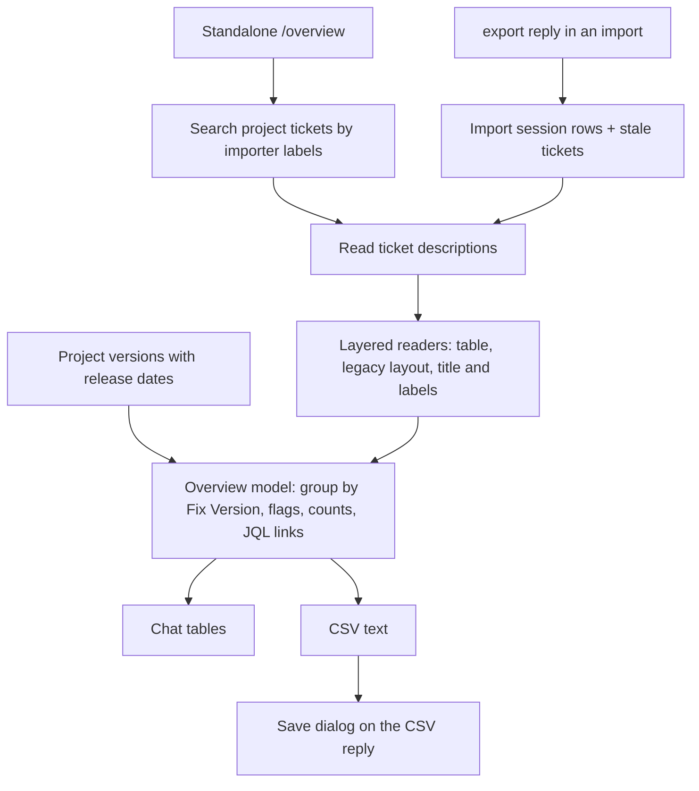

# Security Overview Export - Plan

## Goal Capsule

- **Objective:** A team member can see, for all open Veracode and Waltz items, which Jira ticket owns each, when it is due and which release should carry the fix, and can spot tickets with no release or a deadline the release misses.
- **Product authority:** The requirements below. The export reads Jira Fix Version and Due Date as the source of truth for release and deadline.
- **Open blockers:** None.

## Product Contract

### Summary

An overview export groups open Veracode and Waltz items by Jira Fix Version, with a final table for items not assigned to a release. Each row is one ticket, with its Due Date and a flag when the deadline is passed or falls before the release. It shows in chat and saves as a CSV. It starts from an `export` reply in a Veracode or Waltz import (one report, compared with Jira) or from a standalone Jira-only command that lists both tools together.

To make Veracode and Waltz tickets readable without their report, every ticket the import creates or rewrites also carries a table with one row per finding or component, and the export reads it back. Veracode's Already-ticketed actions become the same three as Waltz's (`rewrite`, `leave`, `new ticket`), so a changed ticket is always rebuilt with its table.

### Problem Frame

Veracode and Waltz findings are tracked as Jira tickets, but nobody can see in one place which items are due when, which ticket owns each and which release should carry the fix. Tickets with no release, or a Due Date earlier than the release date, are found by hand.

A Veracode ticket does not keep a finding's file, line and module in a form that can be read back. A folded ticket's overview table joins path, file and line into one cell, and the module appears only in per-finding sections that are the first thing dropped when a ticket is too big. A Jira-only view of Veracode locations is therefore not possible today.

### Actors

- A1. A developer or support engineer who reviews the open security backlog and plans fixes against releases.

### Key Decisions

- **Jira Fix Version is the release.** The Waltz "Fixed Version" (the component version that resolves a CVE) and affected versions are not part of the export. Governs R1, R4. (session-settled: user-directed — chosen over Waltz fixed version and affected version: the team plans fixes against its own releases.)
- **"Due before release" is the warning, not "due after release".** A Due Date earlier than the release date means the release ships after the deadline. Governs R4. (session-settled: user-directed — chosen over flagging a Due Date after the release: that fix lands in time.)
- **Report and Jira are compared in an import export; the standalone command is Jira-only and covers both tools.** Governs R6, R7. (session-settled: user-directed — chosen over a report-only export and over one tool per standalone export: grouping by release matters more than grouping by tool.)
- **Both entry points ship.** Governs R6, R7. (session-settled: user-directed — chosen over an import-only or standalone-only entry point.)
- **JQL uses `resolution is EMPTY`.** It matches the rest of the project. Governs R5. (session-settled: user-directed — chosen over `resolution = Unresolved`.)
- **Every ticket gets the table, single-finding ones included.** One reader then covers all new and rewritten tickets. Governs R13, R14. (session-settled: user-directed — chosen over tables only for folded tickets: two layouts would need two readers.)
- **The table is display-sanitized, and an exact raw-data block is deferred.** Text fields may differ slightly from the report, so the reader marks them approximate. Governs R15. (session-settled: user-directed — chosen over a raw JSON block in the description or a hidden issue property: smaller first version, and the reader's layers allow adding it later.)
- **Veracode's CSV has one row per finding.** File and line are how people scan findings, and per-row output filters and sorts in Excel. Governs R9. (session-settled: user-approved — chosen over a `;`-joined location column or aligned columns: sorting and filtering by file and line.)
- **Veracode and Waltz offer the same Already-ticketed actions.** Both offer `rewrite`, `leave` and `new ticket`, so every change rebuilds the ticket and its table is always current. Governs R18, R19. (session-settled: user-directed — chosen over keeping Veracode's `update`, `follow-up` and `re-create`, and over a Veracode `new ticket` that carries only the new findings: one policy for both importers.)

### Requirements

**Overview tables**

- R1. The overview has one table per Jira Fix Version that has assigned tickets, ordered by release date, and a final **Not assigned to a release** table for tickets with no Fix Version (and, in an import export, for report items with no ticket).
- R2. Each table states its counts: Assigned (tickets in that Fix Version), Overdue, Due before release and No Due Date.
- R3. A row is one ticket, so a folded or merged ticket is one row with no member sub-line. Columns: item, rating or severity, ticket key with its Jira status, Due Date and flag. An import export adds a **Report match** column (tracked, stale, or in report with no ticket). The standalone export adds a **Source** column (Veracode or Waltz) and has no Report match. Rows sort by flag (overdue first, then due before release), then by Due Date.
- R4. A ticket is **overdue** when its Due Date is earlier than today. It is **due before release** when its Due Date is earlier than its Fix Version's release date. Overdue takes precedence when both apply. A Due Date after the release date is not flagged, and a Fix Version without a release date is never flagged.
- R5. Each table links to the matching list in Jira using JQL with `resolution is EMPTY`. The standalone export filters by the importers' labels and the Fix Version (or `fixVersion is EMPTY`). An import export uses an explicit key list, so stale tickets are included and the list matches the table. A table that holds items with no ticket says how many, since no list can show them.

**Entry points and delivery**

- R6. In a Veracode or Waltz import, an `export` reply on the overview builds the export for that one report, compared with Jira (tracked, stale, in report with no ticket).
- R7. A standalone command builds the export from Jira alone, with Veracode and Waltz tickets together in the same tables.
- R8. The result is a chat summary first, then a CSV on request, saved through a file dialog.

**CSV content**

- R9. For Veracode, the CSV has one row per finding: ticket key, status, Due Date, Fix Version, release date, flag, issue id, severity, CWE id, CWE name, module, path, file, line, function, Report match (import export only) and Detail source. A folded ticket's findings repeat the ticket columns.
- R10. For Waltz, the CSV has one row per ticket: the same ticket columns, rating, remediation action, the four remediation dates, and a Members column of the component names joined by `;`.
- R11. Every CSV row has a **Detail source** value saying where its detail came from: report, table, legacy layout, or title and labels.
- R12. CSV cells that start with `=`, `+`, `-` or `@` are neutralized so a spreadsheet cannot run them. Jira- and report-sourced text in chat tables is neutralized like other untrusted text in the chat.

**Ticket records**

- R13. Every Veracode ticket the import creates or rewrites, including single-finding tickets, carries a findings table with Issue ID, Severity, CWE id, CWE name, Module, Path, File, Line and Function as separate cells. The table stays complete when the ticket's other text is shortened for size.
- R14. Every Waltz ticket the import creates or rewrites, including single-component tickets, carries a components table with name and version, rating, remediation action and the four remediation dates.
- R15. A reader turns the ticket text back into per-finding or per-component data in layers: the table first, then the older layouts (single-finding Location block, previous folded table, Waltz "Remediation dates" section), then title and labels only. Issue id, CWE id, severity, line, rating and dates are exact. Text fields are marked approximate, because the import's sanitizer changes unusual characters. A table whose ids do not match the ticket's `veracode-issue-<id>` labels counts as edited and is reported. An unreadable row falls back field by field.
- R16. The standalone export reads each ticket's description, 8 at a time like the Waltz import does. A read that fails leaves that ticket at the title and labels level.
- R17. Tickets created before the tables existed are read best-effort and are not migrated in bulk. A rewrite upgrades them.

**Import actions**

- R18. On the Already-ticketed screen, Veracode offers the same actions as Waltz: `rewrite`, `leave` and `new ticket`. `update`, `follow-up` and `re-create` are removed for Veracode.
- R19. A Veracode `new ticket` is a complete new ticket with the finding's current content, linked to the resolved ticket and titled `… (follow-up to PROJ-123)`. It is offered only when every ticket for the finding is resolved, as for Waltz.

### Key Flows

- F1. Export from an import
  - **Trigger:** The user has loaded a Veracode or Waltz report and replies `export` on the import overview.
  - **Actors:** A1
  - **Steps:** The import's existing match of report rows to tickets is reused. Release tables and the Not assigned table are built from the tickets' Fix Version and Due Date plus the report-only items. The chat shows the summary and offers the CSV.
  - **Outcome:** One report's items by release, with Report match, flags and Jira links.
  - **Covered by:** R1, R2, R3, R4, R5, R6, R8

- F2. Standalone Jira-only export
  - **Trigger:** The user runs the standalone command.
  - **Actors:** A1
  - **Steps:** Jira is searched for unresolved tickets with the Veracode or Waltz labels. Each ticket's description is read for detail. Tables are built as in F1 with a Source column.
  - **Outcome:** Both tools' tickets by release, with flags and Jira links.
  - **Covered by:** R1, R2, R3, R4, R5, R7, R8, R16

### Acceptance Examples

- AE1. **Covers R4.** Given today is 2026-10-22 and a ticket in Fix Version 2026.11 (released 2026-11-15) has Due Date 2026-11-01, when the overview is built, the ticket is flagged due before release. With Due Date 2026-12-01 it carries no flag.
- AE2. **Covers R4.** Given a ticket with Due Date 2026-10-10 in Fix Version 2026.11, it is flagged overdue (not due before release), and the table's Overdue count includes it.
- AE3. **Covers R1, R3.** Given a Veracode import with a report finding that has no ticket, when the user replies `export`, the finding appears in the Not assigned to a release table with Report match "in report, no ticket", and its table count says it has no Jira list.
- AE4. **Covers R3, R9.** Given a folded Veracode ticket with 7 findings, the chat table shows one row for it, and the CSV has 7 rows with the ticket key repeated and each finding's file and line.
- AE5. **Covers R10.** Given a merged Waltz ticket with 7 components, the CSV has one row whose Members column lists the 7 component names joined by `;`.
- AE6. **Covers R15, R11.** Given an older single-finding Veracode ticket with no table, the export reads the file and line from its Location block and sets Detail source to legacy layout. If the Location block is also gone, the row shows only the file from the title and labels' ids, with Detail source "title and labels".
- AE8. **Covers R18, R19.** Given a Veracode import where a finding's only ticket is resolved, the Already-ticketed row offers `rewrite`, `leave` and `new ticket`. For a finding whose ticket is still open, `new ticket` is not offered.
- AE7. **Covers R12.** Given a file name that starts with `=`, the CSV cell is neutralized so a spreadsheet does not evaluate it.

### Success Criteria

- A reader can answer "what blocks release X?" and "which tickets have no release?" from one export without opening Jira.
- The same Jira-only export gives file and line for every Veracode finding on a ticket created after this change, without the report.

### Scope Boundaries

**Deferred for later**

- Excel (`.xlsx`) output. The first version ships CSV.
- An exact raw-data block (a `{code}` JSON block in the description, or a hidden issue property) for text fields the sanitizer changes.
- Changing tickets from the overview, such as setting Fix Versions or Due Dates.
- Bulk migration of old tickets to the new tables.
- Scheduled or recurring exports.

**Outside this work**

- Changing the Waltz Already-ticketed actions, which stay as they are.

- Sources other than Veracode and Waltz.
- The Waltz "Fixed Version" and CVE details beyond what the tickets already record.

### Dependencies / Assumptions

- Jira exposes Fix Versions with release dates for the projects involved. A version without a date is shown but never flagged.
- The Jira search cannot return Veracode descriptions in a usable form on every instance (on Jira Cloud they come back as ADF), so a per-ticket read is assumed.
- The description size budget (about 30,000 characters) still applies to the added tables.

### Outstanding Questions

**Deferred to Planning**

- A slimmer last-resort table for a very large fold that exceeds the description budget even with only the table.
- The CSV delimiter and encoding: a comma-separated file opens in one column in Excel with a German locale, while a semicolon suits that locale but not others.

### Sources / Research

- `docs/report-import.md` and `docs/manual/report-imports.md`: the overview hub, Already ticketed / Stale split, folding, and the Waltz Due Date and remediation dates.
- `src/utils/veracodeReport.ts`: the finding fields, the folded overview table (Issue ID, Severity, CWE, Location, Function) and the sanitizers.
- `src/utils/waltzReport.ts` and `src/utils/waltzDates.ts`: the existing recorded-dates reader with its round-trip test, which the new readers can follow.
- `src/utils/reportImport.ts`: the JQL used by the dedup and stale searches (`resolution is EMPTY`) and the size budgets.

---

## Planning Contract

Product Contract preservation: unchanged, except additions made before planning started: R18, R19, AE8 and the Key Decision on Veracode actions. The Outstanding Questions on Fix Version multiplicity, the command name and extra Jira-only items became Assumptions below.

### Key Technical Decisions

- KTD1. **Table layouts and their readers live in pure, `vscode`-free modules that share column-title constants with the builders.** This follows `src/utils/waltzDates.ts`, whose builder and reader are guarded by a round-trip test. Governs R13, R14, R15.
- KTD2. **The reader returns one record per finding or component, each tagged with a detail source (`table`, `legacy`, `title-labels`) and an approximate flag on text fields.** Numeric fields, ids, ratings and dates are exact because the import validates them at parse time. The report source is added by the import export. Governs R11, R15.
- KTD3. **One pure overview model serves both entry points.** The entry points differ only in how they assemble its input: Jira tickets alone, or Jira tickets plus the import session's rows. Flags, counts, ordering, JQL links, chat text and CSV text are all derived in the model and its renderers. Governs R1 to R5, R9 to R12.
- KTD4. **Release dates come from the project's version list (`getProject`), not from the tickets.** `JiraProjectVersion` gains an optional release date, which the real API response already carries. A Fix Version missing from the list, or listed without a date, is never flagged. Governs R4.
- KTD5. **A table's Jira link uses an explicit key list when it has a bounded number of keys and falls back to the label-based query with a note above that.** The import export always starts from keys so stale tickets are included. The cap is fixed in U5 from Jira's practical JQL length. Governs R5.
- KTD6. **The CSV reply rebuilds the export instead of storing it.** This follows the project's stateless two-step replies and avoids a session schema bump. A rebuild costs another round of Jira reads. Governs R8.
- KTD7. **The Waltz-only review behaviors currently keyed on having an action policy become separate descriptor capabilities.** Reading target descriptions and the dropped-member pass stay Waltz-only. The action policy and the shared `rewrite` default apply to both importers. Governs R18, R19.
- KTD8. **Detail reads for the standalone export reuse the bounded concurrency of the Waltz description reads (8 at a time).** A failed read leaves that ticket at the title and labels layer and is counted in the summary. Governs R16.
- KTD9. **CSV cells are quoted per RFC 4180, and any cell starting with `=`, `+`, `-` or `@` is prefixed so a spreadsheet cannot evaluate it.** Chat tables pass Jira and report text through the chat neutralizers already used by `@jira`. Governs R12.

### Assumptions

- A ticket with several Fix Versions appears once, in the table of its earliest release (undated versions last), and its other releases are listed in the item cell.
- The standalone command is `@jira /overview`.
- An import export shows only the tickets its report matched plus the stale ones. Other tickets with the same labels are not listed.
- The standalone export is scoped to one project: a key in the prompt, else the resolved default project. When neither exists it asks, as other `@jira` flows do.

### High-Level Technical Design

Both entry points assemble the same input and share one model. This diagram is the authoritative shape of the data flow.

### System-Wide Impact

- The shared report-import code serves Veracode, Waltz and email. Splitting the capability switches (KTD7) must leave Waltz and email behavior byte-for-byte as it is.
- Veracode users lose `update`, `follow-up` and `re-create`. The manual, the Already-ticketed screen hints and the stored action words all change.
- Every Veracode and Waltz ticket written after this change has a larger description. Ticket descriptions stay under the existing 30,000-character budget (`MAX_DESCRIPTION_CHARS` in `src/utils/reportImport.ts`).
- The standalone export adds Jira load: one search, one project fetch and one read per ticket.
- No session schema field changes, so in-flight sessions are not expired.

### Risks & Dependencies

- A very large fold may not fit the budget even with only the findings table. U1 and U2 keep every finding in the table and decide the slimmer last-resort layout when a real size is hit.
- The new Waltz table must not change what the date comparison reads. Mitigated by the existing round-trip and change-detection suites staying unmodified and green.
- Veracode `rewrite` overwrites hand edits to the description. The manual says so, as it does for Waltz.
- The reader trusts Jira text that anyone can edit. Mismatched ids are reported as an edited ticket, and nothing from a ticket is ever interpreted as markup or a formula.
- Version-list requests need the project key. A ticket whose project cannot be read shows its Fix Version without a flag.

### Documentation / Operational Notes

- Update `README.md` (command tables), `docs/manual/report-imports.md`, `docs/report-import.md`, `docs/jira-flows.md`, `CLAUDE.md` and `docs/known-limitations.md` (U8). `src/test/userDocsSync.test.ts` enforces the README's slash command table.

---

## Implementation Units

### U1. Veracode findings table: builder and reader

- **Goal:** Every Veracode description carries a complete findings table, and a reader turns any Veracode ticket text back into per-finding records.
- **Requirements:** R13, R15, R17
- **Dependencies:** none
- **Files:**
  - Create `src/utils/veracodeFindingsTable.ts` (column constants, reader)
  - Modify `src/utils/veracodeReport.ts` (folded and single-flaw builders use the table)
  - Create `src/test/veracodeFindingsTable.test.ts`
  - Modify `src/test/veracodeReport.test.ts`
- **Approach:**
  - Put the column titles (Issue ID, Severity, CWE, CWE name, Module, Path, File, Line, Function) in one exported constant list used by builder and reader.
  - The builder writes the table at the top of single and folded descriptions, with path, file and line as separate cells. The existing per-finding sections stay.
  - The table is the last thing `fitWiki` drops, as the folded overview table is today.
  - The reader tries the table, then the previous folded overview table (split its Location cell at the last colon), then the single-finding Location block with its `Issue <id>` heading, then the ticket title and `veracode-issue-<id>` labels.
  - Each record carries a detail source and marks text fields approximate; ids, CWE id, severity and line are exact.
  - A table whose ids differ from the labels' ids returns an edited flag.
- **Patterns to follow:** `src/utils/waltzDates.ts` (shared constants, lenient reader, round-trip test), `src/utils/veracodeReport.ts` (sanitizers, `fitWiki`).
- **Execution note:** Start with the round-trip test between the builder and the reader.
- **Test scenarios:**
  - Covers AE6. A single-finding description from the previous builder (no table) reads back its module, file, line and function as `legacy`, with ids from the labels.
  - A folded description with 7 findings built by the new builder reads back 7 records with exact ids, CWE ids, severities and lines, source `table`.
  - A file name containing `|` or a stray `-` is sanitized in the ticket, and the reader returns it as written and marks it approximate.
  - A table with one id missing from the labels returns the edited flag and still returns the readable rows.
  - A description with no table and no Location block returns the file from the title and the ids from the labels, source `title-labels`.
  - A folded description shortened to the last fit level still contains every finding row.
  - Header rows in a different case or order are matched by title.
- **Verification:** The round-trip test passes for single and folded groups, and the existing Veracode report tests pass with their expectations updated only where the description layout changed.

### U2. Waltz components table: builder and reader

- **Goal:** Every Waltz description carries a components table, and a reader turns any Waltz ticket text back into per-component records.
- **Requirements:** R14, R15, R17
- **Dependencies:** none
- **Files:**
  - Create `src/utils/waltzComponentsTable.ts` (column constants, reader)
  - Modify `src/utils/waltzReport.ts` (single-component description gets the table)
  - Modify `src/utils/waltzDates.ts` only if the shared date column constants need to be exported differently
  - Create `src/test/waltzComponentsTable.test.ts`
  - Modify `src/test/waltzReport.test.ts`
- **Approach:**
  - Check which columns the folded overview table already has and add Rating and Remediation action where they are missing.
  - A single-component ticket gets a one-row table with the same columns, and the table replaces its separate "Remediation dates" section.
  - `parseRecordedDates` keeps reading both layouts and returns the same values as before.
  - The reader follows U1's layers: table, then the old dates section and title, then title and labels (`oss-rating-<rating>`, `oss-cve-<id>`).
- **Patterns to follow:** `src/utils/waltzDates.ts`, `src/utils/waltzReport.ts` (`pushDatesSection`, folded table builder).
- **Test scenarios:**
  - A single-component description built by the new builder reads back name and version, rating, action and the four dates, source `table`.
  - Covers AE5. A merged description with 7 components reads back 7 records.
  - `parseRecordedDates` returns the same dates for an old single description, an old folded description and a new single description.
  - A description with only the old "Remediation dates" section reads as `legacy` with the name and rating from the title.
  - A description with no table reads the rating and CVE ids from the labels, source `title-labels`.
  - The Waltz change-detection suite passes without edits.
- **Verification:** `src/test/waltzChangeDetection.test.ts` and `src/test/waltzDates.test.ts` pass unmodified, plus the new round-trip.

### U3. Veracode Already-ticketed actions aligned with Waltz

- **Goal:** Veracode offers `rewrite`, `leave` and `new ticket`, with the same rules as Waltz.
- **Requirements:** R18, R19
- **Dependencies:** U1
- **Files:**
  - Modify `src/utils/veracodeReport.ts` (action policy, complete-ticket new-ticket builder)
  - Modify `src/participant/jira/veracodeHandler.ts` (descriptor)
  - Modify `src/participant/jira/reportImportTypes.ts`, `src/participant/jira/importTicketedActions.ts`, `src/participant/jira/importAddToTicket.ts`, `src/participant/jira/reportImportHandler.ts` (separate the capability switches, KTD7)
  - Modify `src/test/veracodeReport.test.ts`, `src/test/reportImportTicketedActions.test.ts`, `src/test/reportImportHandler.test.ts`
- **Approach:**
  - Veracode supplies its own action policy and action labels. A change on an open ticket defaults to `rewrite`, no change defaults to `leave`, and `new ticket` is offered only when every ticket for the finding is resolved.
  - The new-ticket builder returns a complete ticket with the finding's current content, titled `… (follow-up to <KEY>)`, linked to the resolved one.
  - Introduce explicit descriptor capabilities for the behaviors currently tied to having a policy: reading target descriptions and the dropped-member pass stay Waltz-only; the action policy, the full-ticket follow-up and the shared `rewrite` default apply to both.
  - Remove the Veracode-only `update` comment and summary-rewrite builders once nothing else calls them. The `add … to <KEY>` comment builder stays.
- **Patterns to follow:** `deriveWaltzActions` and `buildFollowUp` in `src/utils/waltzReport.ts`, descriptor wiring in `src/participant/jira/waltzHandler.ts`.
- **Test scenarios:**
  - Covers AE8. A Veracode row whose ticket is open and has new findings defaults to `rewrite` and offers `rewrite`, `leave` only.
  - Covers AE8. A Veracode row whose only ticket is resolved offers `rewrite`, `leave` and `new ticket`.
  - A Veracode `new ticket` creates a complete ticket with the follow-up title and a link to the resolved ticket.
  - `update`, `follow-up` and `re-create` typed on a Veracode row are rejected with the current usage line.
  - A Waltz row behaves exactly as before, including description reads and the dropped-member pass.
  - An email import is unaffected.
- **Verification:** All report-import suites pass, with Waltz and email tests unmodified.

### U4. Jira data for the overview

- **Goal:** The service can list a project's unresolved importer tickets with Fix Versions and Due Dates, read their descriptions, and return the project's versions with release dates.
- **Requirements:** R4, R5, R7, R16
- **Dependencies:** none
- **Files:**
  - Modify `src/jira/IJiraClient.ts` (release date on `JiraProjectVersion`)
  - Modify `src/services/TicketService.ts`
  - Modify `src/test/mocks/MockJiraClient.ts`, `src/test/fixtures/project-PROJ.json`
  - Modify `src/test/TicketService.test.ts`
- **Approach:**
  - Add a service method that searches with `project`, `resolution is EMPTY` and the two marker labels (`veracode`, `oss-dependency`), requesting Fix Versions, Due Date, status and labels, paged with the existing `fetchAllPages`.
  - Add a service method that returns the project's versions with release dates from `getProject`.
  - Add a bounded-concurrency description read that returns the text per key and records failures.
  - The service imports `IJiraClient` only.
- **Patterns to follow:** `readTargetDescriptions` and `findStaleTickets` in `src/utils/reportImport.ts`.
- **Test scenarios:**
  - A project with Veracode and Waltz tickets returns both, each with Fix Versions, Due Date and status.
  - A page boundary (more tickets than one page) returns all tickets once.
  - A ticket with no Fix Version and no Due Date returns empty values, not errors.
  - One failing description read leaves the other tickets' text intact and reports the failure.
  - A project version without a release date returns no date.
  - An auth failure (401) on the search propagates as an auth error.
- **Verification:** `src/test/TicketService.test.ts` passes.

### U5. Overview model and renderers

- **Goal:** One pure module turns tickets and report items into the grouped overview, its Jira links, chat text and CSV text.
- **Requirements:** R1 to R5, R9 to R12
- **Dependencies:** U1, U2, U4
- **Files:**
  - Create `src/utils/securityOverview.ts` (model, flags, counts, JQL, chat text)
  - Create `src/utils/securityOverviewCsv.ts` (CSV text)
  - Create `src/test/securityOverview.test.ts`, `src/test/securityOverviewCsv.test.ts`
- **Approach:**
  - Input: tickets (key, status, labels, Due Date, Fix Versions, description, source), the version list, an injectable "today", and optionally report items for the import export (new rows with no ticket).
  - Output: Fix Version tables ordered by release date, a Not assigned table, per-table counts and flags (R4), and Jira links (KTD5).
  - Veracode CSV rows come from the reader's per-finding records; Waltz CSV rows come from tickets.
  - The Detail source column takes the lowest-fidelity layer used by that row; the import export reports `report` for items still in the report.
  - Chat text passes Jira and report values through `neutralizeMarkdownLinks`.
  - Fix the JQL key-list cap here.
- **Patterns to follow:** `src/participant/session/importScreens.ts` for table rendering, `buildChatCommandLink` in `src/participant/session/` for reply links.
- **Test scenarios:**
  - Covers AE1. Due 2026-11-01, release 2026-11-15, today 2026-10-22: flagged due before release; due 2026-12-01: no flag.
  - Covers AE2. Due 2026-10-10 in a later release: flagged overdue only, and the Overdue count includes it.
  - A Fix Version with no release date is listed and never flagged.
  - A ticket with two Fix Versions appears once, in the earlier release, and lists the other.
  - Covers AE3. A report-only item lands in the Not assigned table with Report match "in report, no ticket", and the table says how many have no ticket.
  - Covers AE4. A folded Veracode ticket is one chat row and 7 CSV rows with the ticket key repeated.
  - Covers AE5. A merged Waltz ticket is one CSV row with the 7 names joined by `;`.
  - Covers AE7. A file name starting with `=` is prefixed in the CSV and quoted when it holds commas or quotes.
  - A table with more keys than the cap gets the label-based link and a note.
  - A table link contains `resolution is EMPTY`.
  - Markdown link syntax inside a Jira summary is neutralized in the chat text.
  - No tickets at all returns an empty-state message and a header-only CSV.
- **Verification:** Both new suites pass.

### U6. Standalone `/overview` command

- **Goal:** `@jira /overview` builds the Jira-only overview for both tools and offers the CSV.
- **Requirements:** R7, R8, R12, R16
- **Dependencies:** U5
- **Files:**
  - Modify `package.json` (chat participant command)
  - Modify `src/participant/jira/llmHelpers.ts` (operation and command mapping)
  - Modify `src/participant/JiraParticipant.ts` (route)
  - Create `src/participant/jira/overviewHandler.ts`
  - Modify `src/participant/session/sessionTypes.ts` and `src/participant/sessionState.ts` barrel only if a reply kind is stored
  - Create `src/test/overviewHandler.test.ts`; modify `src/test/llmHelpers.test.ts`
- **Approach:**
  - Resolve the project from the prompt or the default (`resolveProjectKey`), ask when none.
  - Stream a progress line, run U4's search, version fetch and bounded description reads, build the model, stream the tables, and add a CSV link as a clickable reply through `trustedChatMarkdown`.
  - The CSV reply (KTD6) rebuilds the export and writes it through a save dialog, then reports the saved path.
  - Log through `logDiag` with scope `jira.overview`.
  - A failed read count and a skipped-flag note appear in the summary.
- **Patterns to follow:** `src/participant/jira/loadHandler.ts` (file writes), `src/participant/jira/uploadHandler.ts` (file and ticket resolution), `src/participant/jira/workflowHandler.ts` (thin handler).
- **Test scenarios:**
  - `@jira /overview PROJ` streams the tables and a CSV link for a project with tickets.
  - No project in the prompt and no default asks which project.
  - The CSV reply writes the chosen file and reports its path; cancelling the dialog writes nothing and says so.
  - A search failure shows the error and writes nothing.
  - 3 of 40 description reads failing shows a count and still renders the tables.
  - `mapCommandToOperation('overview')` returns the new operation.
- **Verification:** `src/test/overviewHandler.test.ts` and `src/test/llmHelpers.test.ts` pass, and `src/test/bundleSmoke.test.ts` still passes.

### U7. `export` reply in a report import

- **Goal:** On an import's overview, `export` shows that one report's items by release, and `export csv` saves the CSV.
- **Requirements:** R1 to R3, R6, R8, R9, R10
- **Dependencies:** U5, U3
- **Files:**
  - Modify `src/participant/session/importScreens.ts` (reply word, hints)
  - Modify `src/participant/session/importReplies.ts` (reply parsing)
  - Modify `src/participant/jira/reportImportHandler.ts` (dispatch)
  - Create `src/participant/jira/importExport.ts` (assemble model input from the session)
  - Create `src/test/reportImportExport.test.ts`; modify `src/test/reportImportOverview.test.ts`
- **Approach:**
  - `export` works on the overview and on a single-group import's only screen, like `accepted`.
  - The input is the session's Already-ticketed targets, stale tickets and New rows (rows with no ticket), with Report match values per row (tracked, stale, in report with no ticket).
  - Ticket data comes from one search by key list plus the bounded description reads, and the version list from U4.
  - The chat shows the summary and a CSV link; `export csv` rebuilds and saves.
  - Accepted-hidden items are not listed.
- **Patterns to follow:** the `accepted` and `reload report` replies in `src/participant/session/importReplies.ts` and `src/participant/jira/reportImportHandler.ts`.
- **Test scenarios:**
  - Covers AE3. A Veracode import with one report-only finding shows it in the Not assigned table.
  - A Waltz import with a stale ticket shows it with Report match "stale".
  - `export` on the New screen of a multi-group import is answered with the usage line that names where it works.
  - `export csv` writes a file with one row per Veracode finding and one per Waltz ticket.
  - A failed Jira read still renders the tables from session data and says what is missing.
  - The reply does not change the session's rows, pages or outcomes.
- **Verification:** `src/test/reportImportExport.test.ts` and the existing import suites pass.

### U8. Documentation and register

- **Goal:** The user manual, developer docs and register describe the new behavior.
- **Requirements:** all requirements (user-visible changes)
- **Dependencies:** U1 to U7
- **Files:**
  - Modify `README.md` (command tables), `docs/manual/report-imports.md`, `docs/report-import.md`, `docs/jira-flows.md`, `CLAUDE.md`, `docs/known-limitations.md`
- **Approach:**
  - Manual: the overview export (both entry points, flags, tables, CSV columns, Detail source), the findings and components tables, the Veracode actions that changed and the hand-edit warning for `rewrite`.
  - Developer docs: the reader layers and the Veracode action policy.
  - `CLAUDE.md`: add a row for each new module and update the Veracode actions description.
  - Register: add one entry for display-sanitized table text, with the raw-data block as the future fix.
- **Test scenarios:** Test expectation: none -- documentation. `src/test/userDocsSync.test.ts` covers the README command table.
- **Verification:** `src/test/userDocsSync.test.ts` passes.

---

## Verification Contract

| Gate | Command | Applies to |
| --- | --- | --- |
| Type check | `npm run compile` | every unit |
| Unit tests | `npm test` | every unit; must be green before each commit (project rule) |
| Focused suites while building | `npx vitest run --config vitest.config.mts src/test/<file>` | the new and changed suites named in each unit |
| Docs sync | `src/test/userDocsSync.test.ts` inside `npm test` | U6, U8 |
| Bundle smoke | `src/test/bundleSmoke.test.ts` inside `npm test` | U6 |

The e2e smoke suite (`npm run test:e2e`) runs in CI and is not needed locally.

## Definition of Done

- Every requirement R1 to R19 is traceable to a passing test or a documented change, and every AE is covered by a test scenario.
- `npm run compile` and `npm test` are green, with the Waltz and email test files unmodified except where a unit lists them.
- The manual, `README.md`, `docs/report-import.md`, `docs/jira-flows.md`, `CLAUDE.md` and `docs/known-limitations.md` match the behavior.
- Code made unused by U3 (Veracode `update`, `follow-up` and `re-create` builders) is removed, and no abandoned experimental code remains.
