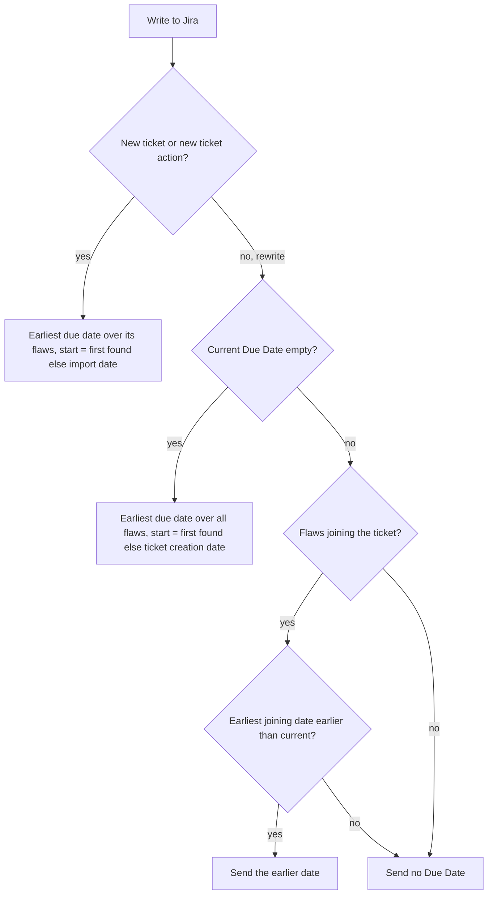

# Veracode SLA due dates - Plan

## Goal Capsule

- **Objective:** A Veracode ticket carries the due date the company's remediation policy gives its flaws, as the Jira Due Date, so deadlines can be filtered, flagged and exported like those of Waltz tickets.
- **Means:** A per-severity day table in settings, applied to each flaw's first-found date through the Due Date mechanics the Waltz import already has (KTD3, KTD4).
- **Authority:** The Product Contract wins on behavior. `docs/report-import.md` stays the developer reference. The user manual (`README.md`, `docs/manual/report-imports.md`, `docs/manual/settings-reference.md`) is updated for the new setting, the ticket content and the changed Already ticketed behavior. `CONCEPTS.md`, `CLAUDE.md` and `docs/known-limitations.md` are updated with the code.
- **Open blockers:** None.
- **Execution profile:** Code, implemented in a separate session. Test-first for the date helpers, the write paths and the detection pass. `npm run compile` and `npm test` pass before any commit. Builds on `docs/plans/2026-10-22-1929-feat-waltz-due-dates-plan.md`, which is implemented; reuse its mechanics instead of building parallel ones.

---

## Product Contract

### Summary

A new setting maps each Veracode severity to a number of days, shipped with Very High 14 and High 28. A flaw's due date is the date Veracode first found it plus the days for its severity. A ticket gets its Due Date once, the earliest due date of its flaws, and later imports leave it alone. Flaws that join an existing ticket can only move the date earlier. The Already ticketed screen offers `rewrite` to set the Due Date on open tickets that have none. `@jira /overview` and the import `export` show the same dates and flags they already show for Waltz.

### Problem Frame

The company's remediation policy sets a deadline per severity. A Veracode ticket carries none of it: it is created with no Due Date, so Jira's overdue filters and dashboards cannot see it, and `@jira /overview` counts every Veracode ticket under "no due date".

The Veracode Detailed Report records when each flaw was first found, and the policy clock starts then. An old flaw can therefore already be past its deadline on the day its ticket is created, which is the information the team needs. Tickets that already exist are the larger share of the work, so a feature that only dates new tickets would leave most of the backlog unflagged.

A date edited by hand in Jira usually records an agreed extension. The importer must not overwrite it on every import.

### Requirements

**The policy table**

- R1. A setting maps each Veracode severity to a number of days. It ships with Very High 14, High 28 and 0 for Medium, Low, Very Low and Informational.
- R2. A severity at 0, or with a value that is not a whole number of zero or more, gets no due date. With every severity at 0, imports behave as they do today.

**The due date**

- R3. A flaw's due date is its first-found date plus the configured days for its severity. The first-found date is the calendar date Veracode records in the report.
- R4. A flaw whose report entry has no readable first-found date uses the creation date of its ticket as its start: the import date for a new ticket, the Jira creation date for an existing one.
- R5. A due date already in the past is written as it is.
- R6. A folded ticket takes the earliest due date of its flaws, each flaw counted with its own severity and first-found date. A fold in which no flaw has a due date gets none.

**On the ticket**

- R7. A new ticket's Jira Due Date is the ticket's due date (R6), and its description shows each flaw's first-found date and due date.
- R8. When Jira refuses the Due Date, the ticket is still created or rewritten without it, the result warns, and the dates stay in the description.
- R9. Creating a ticket and `new ticket` write the Due Date. `add … to <KEY>` with `as comment` adds the dates of the added flaws to the comment and leaves the Due Date alone. A `rewrite` writes it as R10, R11 and R18 say.

**Backfill and refresh**

- R10. The Already ticketed screen counts an open ticket as changed for dates when its Jira Due Date is empty and the policy gives its flaws a due date. A ticket that has any Due Date is never changed for dates.
- R11. For an open ticket changed under R10, `rewrite` is the default action. It sets the Due Date to the earliest due date of the ticket's flaws.
- R12. A date alone does not change a ticket whose targets are all resolved. Such a ticket keeps its existing handling.
- R13. Once a ticket has a Due Date, a later import does not recalculate or overwrite it, whether the date came from the policy or from a hand edit. A later change to the table does not reach existing tickets.
- R14. A ticket whose flaws have no due date (R2) is never flagged under R10 and never has its Due Date cleared.
- R18. When flaws join an existing ticket through a rewrite (`add … to <KEY>` with `as rewrite`, or new findings on the ticket), its Due Date becomes the earlier of its current date and the earliest due date of the joining flaws. A rewrite that adds no flaws leaves the Due Date as it is, and a Due Date is never moved later.

**Overview and export**

- R15. `@jira /overview` shows Veracode tickets with the overdue and due-before-release flags, with no change to the overview itself.
- R16. The import `export` and `export csv` give a report-only Veracode row its due date and the overdue flag, using the same columns and rendering as Waltz. A report-only row has no Fix Version, so it never gets the due-before-release flag.

**Unchanged**

- R17. Waltz and email imports behave as before. Veracode's other actions, wording and screens stay as they are.

### Key Decisions

- **The date comes from a company table in settings, not from the report.** Chosen over using Veracode's own grace-period dates and over a report-first fallback: the written policy is the authority, and it works with any report. Governs R1, R3.
- **The table ships with defaults: Very High 14, High 28, the rest 0.** Chosen over an empty table: all six severity names are visible in the Settings screen so nobody types them, and the numbers are easy to change. Governs R1, R2.
- **The clock starts at the flaw's first-found date.** Chosen over the import date and the report date: the policy runs from discovery, and counting from the import would hand out extra time on a late or repeated import. Governs R3, R4.
- **A flaw without a first-found date starts at its ticket's creation date.** Chosen over no due date and over the date of each import: the flaw still gets a date, and the date does not move between imports. A report field that dates these flaws, if one turns up, would replace the fallback. Governs R4.
- **A Due Date is set once.** Chosen over recalculating on every import: a hand-edited date records an agreed extension, and recalculating would overwrite it every time. Governs R10, R13.
- **Flaws joining a ticket can only move its Due Date earlier.** Chosen over recomputing from the combined set: the ticket is due when its most urgent flaw is, and a join must not push a deadline out. Governs R18.
- **Existing tickets are backfilled through the Already ticketed screen.** Chosen over new tickets only and over a separate command: one place, one set of actions. Governs R10, R11.
- **The backfill action is `rewrite`.** Chosen over a Due-Date-only action and over a new command: Veracode and Waltz keep one action set. The cost is that `rewrite` replaces hand-added description text; the manual says so. Governs R11.
- **A date gap alone does not make a resolved ticket a change.** A resolved ticket's Due Date has no use, and treating it as a change would create a new ticket for every resolved ticket that predates the feature. Governs R12.
- **A folded ticket takes its earliest flaw date.** The ticket is due when its most urgent flaw is. Governs R6.
- **A refused Due Date does not stop the write.** Some projects keep the field off the screen. Governs R8.
- **Overview and export reuse the Waltz rendering.** The only Veracode change is that its rows now carry a due date. Governs R15, R16.

### Key Flows

- F1. Create tickets with policy dates
  - **Trigger:** The user imports a Veracode report.
  - **Steps:** Each flaw gets a due date from its first-found date and severity. Folded flaws take the earliest. New tickets are created with the Due Date and the dates in the description.
  - **Outcome:** New tickets show the policy deadline in Jira, overdue ones included.
  - **Covered by:** R3, R4, R5, R6, R7, R8
- F2. Backfill existing tickets
  - **Trigger:** The user imports a report whose flaws already have open tickets with no Due Date.
  - **Steps:** The Already ticketed screen lists those tickets as changed, defaulting to `rewrite`. The user adjusts rows and applies.
  - **Outcome:** Those tickets hold the policy Due Date and the current description; tickets that already had a date are untouched.
  - **Covered by:** R10, R11, R12, R13, R14

### Acceptance Examples

The dates and day counts below are invented. AE1, AE4, AE5 and AE8 use configured values, not the defaults.

- AE1. **Covers R3, R5, R7.** Given Very High set to 30 days and a Very High flaw first found on 2026-09-01, when its ticket is created on 2026-10-23, then the Due Date is 2026-10-01, already past, and the description shows both dates.
- AE2. **Covers R2, R14.** Given Low at 0 and a Low flaw, when its ticket is created, then no Due Date is sent.
- AE3. **Covers R2, R17.** Given every severity at 0, when a report is imported, then no ticket gets a Due Date and the Already ticketed screen flags nothing for dates.
- AE4. **Covers R4.** Given a flaw with no readable first-found date and High set to 60 days, when its ticket is created on 2026-10-23, then its due date is 2026-12-22.
- AE5. **Covers R6.** Given a fold of a flaw due 2026-12-01, one due 2026-11-15 and one whose severity is at 0, when the ticket is created, then the Due Date is 2026-11-15.
- AE6. **Covers R8.** Given a project whose screen has no Due Date field, when a ticket is created, then it is created without it, the result warns, and the description still shows the dates.
- AE7. **Covers R10, R11.** Given an open ticket created before this feature with an empty Due Date and a table that gives its flaws a date, when the report is imported, then the row shows a change and defaults to `rewrite`, which sets the Due Date to the earliest policy date of its flaws.
- AE8. **Covers R10, R13.** Given an open ticket with Due Date 2026-12-01 and a table that now gives its flaws 2026-11-01, when the report is imported, then the row is not a change for dates.
- AE9. **Covers R12.** Given a resolved ticket with no Due Date, no new flaw and a table that gives its flaws a date, when the report is imported, then the date alone does not change the row.
- AE10. **Covers R9.** Given an `add … to <KEY>` with `as comment`, when it is applied, then the comment lists the added flaws' dates and the ticket's Due Date is not written.
- AE11. **Covers R16.** Given a New row whose due date is before today, when the user replies `export`, then the row shows its due date and the overdue flag and carries no due-before-release flag.
- AE12. **Covers R15.** Given a Veracode ticket created with a Due Date before today's date, when `@jira /overview` runs, then it shows the overdue flag.
- AE13. **Covers R4, R13.** Given an open ticket created on 2026-10-23 for a flaw with no readable first-found date, High set to 60 days and the ticket's Due Date 2026-12-22, when the same report is imported on 2026-11-20, then the row is not a change.
- AE14. **Covers R1, R3.** Given the shipped table and a High flaw first found on 2026-10-01, when its ticket is created, then the Due Date is 2026-10-29.
- AE15. **Covers R18.** Given a ticket with Due Date 2026-12-01, when a flaw due 2026-11-01 joins it through `add … to <KEY>` with `as rewrite`, then the Due Date becomes 2026-11-01; when the joining flaw is due 2027-01-15, or no flaw joins, the Due Date stays 2026-12-01.

### Scope Boundaries

**Deferred for later**

- Using Veracode's own grace-period dates from the report, alone or as a fallback.
- Finding a report field that dates flaws with no first-found timestamp, to replace the creation-date fallback (R4).
- A Due-Date-only action, so a backfill can leave the description alone.
- Re-applying a changed table to tickets that already have a Due Date.
- Clearing a Due Date, and date handling in the Stale close.
- A due-date column in the review tables.

**Outside this plan**

- Waltz and email imports.
- A Due Date for resolved tickets.

### Dependencies / Assumptions

- The Detailed Report records a first-found timestamp on each flaw (`date_first_occurrence`, for example `2026-05-01T10:00:00.000-0000` in `src/test/fixtures/veracode/sample-report.xml`). It has been seen only in the fixtures and a test report, not across real reports; flaws without it fall back per R4.
- The Waltz Due Date mechanics are implemented and shared: `dueDateFields` in `src/utils/waltzReport.ts`, `refusedFieldsOf` in `src/utils/jiraFieldErrors.ts`, the optional-field retry in `TicketService.createTicket`/`rewriteTicket`, and `deriveRewriteActions` in `src/utils/reportImport.ts`, which Veracode already uses.
- Veracode's overview export currently returns no due date (`dueDateOf: () => null` in `src/participant/jira/veracodeHandler.ts`, commented "a Veracode report carries no dates"); R16 replaces that.
- The Due Date write and its refusal fallback are unverified against a live Jira instance; KL17 in `docs/known-limitations.md` tracks that and is extended to Veracode.

### Sources / Research

- `docs/plans/2026-10-22-1929-feat-waltz-due-dates-plan.md` — the Waltz design this plan reuses; its refusal and resolved-ticket rules are the model for R8 and R12.
- `docs/report-import.md` — "Already-ticketed rows: per-row actions", "Finding folding", "Ticket tables and readers" and "Security overview".
- `src/participant/jira/veracodeHandler.ts` — `buildTicketFields`, `changeTracking` and `overviewExport` of the Veracode descriptor.
- `src/utils/securityOverview.ts` — `flagFor`, `localDate` and the Jira links that overview and export share.
- `src/utils/veracodeReport.ts` — the flaw model, which does not yet read the first-found date.

---

## Planning Contract

**Product Contract preservation:** Changed, at the user's direction during planning. R1, R2, R9, R10, R11 and R13 changed meaning (shipped defaults; a Due Date is set once and never overwritten; backfill covers only tickets with an empty Due Date); R18 and AE14, AE15 are new; AE2, AE3, AE5, AE7 and AE8 were reworded to match. The shipped-defaults and set-once Key Decisions replace the earlier "no built-in day counts" and rewrite-overwrites decisions. The Outstanding Questions section was removed because KTD3, KTD4, KTD5 and KTD7 answer all four. All other R, F and AE IDs and their meaning are unchanged.

### Key Technical Decisions

- KTD1. **Dates travel as `YYYY-MM-DD` strings.** A new vscode-free leaf, `src/utils/veracodeDates.ts`, holds the severity-name table, `resolveSlaDays`, `addCalendarDays` (UTC arithmetic, calendar days), `flawDueDate`, `groupDueDate` (earliest, null when none has one) and `earlierOf`. It reuses `toCalendarDate` from `src/utils/waltzDates.ts` rather than moving it, so a timestamp keeps the date as written in the report (first ten characters) and no time zone can shift a day. Extracting a neutral date module can follow. Callers pass the fallback start in (the import date from `localDate()` in `src/utils/securityOverview.ts`, or a ticket's creation date), so the module needs no clock. Realizes R3, R4, R5, R6.
- KTD2. **The parser reads the first-found date onto the flaw.** `VeracodeFlaw` gains an optional `firstFoundDate` set from the `date_first_occurrence` attribute in `parseVeracodeReport`; it is optional so existing literals and fixtures compile. An unreadable or missing value is null and falls back per R4. Realizes R3, R4.
- KTD3. **The setting is `ticketSidekick.veracode.slaDays`.** An object whose six properties are the severity names from `SEVERITY_LABELS` (`Very High`, `High`, `Medium`, `Low`, `Very Low`, `Informational`), each an integer with minimum 0, `additionalProperties` false, default Very High 14, High 28, the rest 0. `resolveSlaDays` is lenient: names match ignoring case and surrounding spaces, 0 means no date, and an unknown key or an invalid value is ignored and returned in a list. `veracodeHandler.ts` reads the setting once per import and logs that list once through `logDiag` at warn level, naming the keys and the valid names, so a typo is never silent. Realizes R1, R2.
- KTD4. **A rewrite decides its own Due Date through a descriptor hook.** The descriptor gains an optional `rewriteDueDate({ regenItem, joiningItem, currentDueDate, ticketCreated })` returning the value to write, or null to leave the field alone; when present, `writeRewrite` uses it instead of the Due Date in `buildTicketFields`. Veracode returns the earliest due date over the whole ticket when `currentDueDate` is empty, the earlier of the current and the joining flaws' earliest when that is earlier, and null otherwise (R11, R13, R18, R14). `buildTicketFields` gains an optional third argument carrying the ticket's creation timestamp, so the description's dates and the creation-time Due Date use the same fallback start; a new ticket's start is the import date. Waltz sets neither, so its overwrite behavior is untouched. Callers that already read the ticket (`rewriteTicketedGroup`, the `add … to <KEY>` rewrite) pass `created`, the current Due Date and the joining item they already hold. Realizes R4, R9, R11, R13, R14, R18.
- KTD5. **Backfill detection is one shared post-pass over the built rows.** The dedup search requests `duedate` next to `resolution` and `created`; `DedupTicket` gains `dueDate`. A new pure function in `src/utils/reportImport.ts`, enabled by an optional `changeTracking.dueDateBackfill` capability that only Veracode sets, marks every row whose target ticket is open and has an empty Due Date, and whose own flaws have a due date (computed from the target's creation date for undated flaws), as changed with a `due none→<date>` entry, derives its actions again, and runs before `alignRewriteDefaults`. A target with any Due Date, a resolved target, and a row with no due date are skipped. Reading the field from the search avoids the per-ticket description reads Waltz needs and works for tickets of any age. Realizes R10, R11, R12, R13, R14.
- KTD6. **The change cell reuses the Waltz date entry.** `DateKind` in `src/utils/waltzDates.ts` gains `'due'` as a type-only change; `formatRowChange` already prints `<kind> <from>→<to>`, so a row reads `due none→2026-12-22`. Realizes R10.
- KTD7. **The dates go into the Findings table as two trailing columns.** `FINDINGS_COLUMNS` in `src/utils/veracodeFindingsTable.ts` gains `First found` and `Due date`; each cell is a validated date or `n/a`. `SLIM_FINDINGS_COLUMNS` is unchanged, so a very large fold's description omits them like its other columns and the existing note stays accurate; the Jira Due Date still carries the date. The reader keeps accepting tickets that have the nine older columns and does not return the new cells. Realizes R7.
- KTD8. **Overview and export need one line of wiring.** `overviewExport.dueDateOf` returns `groupDueDate` of the row's flaws with today as the fallback start. `buildOverview`, `flagFor` and the renderers are not touched. Realizes R15, R16.
- KTD9. **No session schema bump is expected.** The changes add an optional `dates` value and a field on search results, neither of which a stored review session has to carry; U4 confirms against `CURRENT_SESSION_SCHEMA_VERSION` in `src/participant/session/importTypes.ts` and bumps only if a stored shape changes incompatibly.
- KTD10. **`dueDateSetNote` takes its source wording from the descriptor.** Waltz keeps "from the report … replaces any date edited by hand"; Veracode says the date comes from the SLA table and that it was moved earlier or set because none existed. A Veracode rewrite that sends no `duedate` prints no note. Realizes R9, R18.

### High-Level Technical Design

Which Due Date each write path sends:

Every branch that finds no due date (a severity at 0, R2) sends nothing and never clears the field (R14).

### System-Wide Impact

- The dedup search now asks Jira for one more field for every importer. It changes no Waltz result; Waltz tests that assert the field list are updated.
- On the first import after the upgrade, every open Very High and High ticket without a Due Date defaults to `rewrite` on the Already ticketed screen. Apply runs at most `BATCH_LIMIT` (50) actions per reply, so a long list needs repeating, and the manual says so. Veracode's `minSeverity` default of High means these are the severities imported anyway.
- A `rewrite` replaces the ticket's description from the report, including hand-added text; backfilling many tickets makes this more frequent. The manual and the result line say so.
- `@jira /overview` starts showing Veracode tickets in the overdue and due-before-release counts.
- No Language Model tool and no command is added, so `docs/manual/agent-mode-tools.md` and its sync test are unaffected. One setting is added, so `docs/manual/settings-reference.md` must list it with the same default.

### Risks

- A project whose screen lacks the Due Date field refuses it on every write. The ticket is rewritten without it, the result warns, and the next import flags the same ticket again because its Due Date is still empty. This is considered and not built: remembering refused projects adds stored state for a case with a visible warning and a `leave` action. Evidence that would change the call is users reporting the repeat as noise.
- Flaws without a first-found date depend on a report field seen only in fixtures. If real reports often lack it, most dates count from the ticket's creation date, which is stable but later than the policy intends. A register row records this (U6).
- A `rewrite` for the backfill rebuilds the whole description when only the Due Date is needed. A Due-Date-only action is deferred; the manual tells users to review the rows before applying.
- Day counts of 14 and 28 are the user's starting values, not a statement of the company policy; the manual says to adjust them.

---

## Implementation Units

### U1. Policy table, date helpers and first-found parsing

- **Goal:** The setting exists with its defaults, the pure date logic is tested, and the parser returns each flaw's first-found date.
- **Requirements:** R1, R2, R3, R4, R5, R6, AE1, AE2, AE4, AE5, AE14. KTD1, KTD2, KTD3.
- **Dependencies:** none.
- **Files:** `src/utils/veracodeDates.ts` (new), `src/utils/veracodeReport.ts`, `src/participant/jira/veracodeHandler.ts`, `package.json`, `src/test/veracodeDates.test.ts` (new), `src/test/veracodeReport.test.ts`.
- **Approach:**
  - In `veracodeDates.ts`, define the six severity names in `SEVERITY_LABELS` order, `resolveSlaDays(raw)` returning the day counts by severity number plus the ignored keys and invalid values, `addCalendarDays`, `flawDueDate(flaw, days, fallbackStart)`, `groupDueDate` and `earlierOf`. A day count of 0 or a missing severity gives null.
  - In `parseVeracodeReport`, set `firstFoundDate` from `date_first_occurrence` via `toCalendarDate`.
  - In `package.json`, add the `ticketSidekick.veracode.slaDays` property after `maxReportSizeMB`: type object, the six integer properties with minimum 0, `additionalProperties` false, the default from KTD3 in that key order, and a description that states 0 means no due date and that days are calendar days.
  - In `veracodeHandler.ts`, add a reader that applies `resolveSlaDays` to the setting and logs the ignored keys once per import at session build, not per row.
- **Execution note:** Test-first for `resolveSlaDays`, `addCalendarDays` and the parser.
- **Patterns to follow:** `src/utils/waltzDates.ts` and `src/test/waltzDates.test.ts`; `resolveSizeLimitSetting` in `src/utils/reportImport.ts` for lenient setting reads.
- **Test scenarios:**
  - `resolveSlaDays` on the shipped default returns 14 for Very High, 28 for High and no date for the other four.
  - Covers AE14. A High flaw first found on 2026-10-01 under the shipped table has due date 2026-10-29.
  - Names match ignoring case and spaces: `very high` and ` High ` resolve; `Very Hgh` is returned as unknown and no severity changes.
  - A value of -1, 2.5, `"30"` or null is ignored and listed; 0 gives no date.
  - `addCalendarDays` handles month ends, a year end (2026-12-31 plus 1) and a leap day (2028-02-28 plus 1).
  - Covers AE2. A Low flaw at 0 has no due date.
  - Covers AE4. A flaw with no first-found date and High at 60, with fallback start 2026-10-23, is due 2026-12-22.
  - Covers AE5. A group due 2026-12-01, 2026-11-15 and none has due date 2026-11-15; a group with none dated gives null.
  - The parser turns `2026-05-01T10:00:00.000-0000` into `2026-05-01`; a missing attribute and `garbage` both give null; the existing fixture tests still pass.
  - The `package.json` default parses and every default key is one of the six names.
- **Verification:** `npm test` passes the new files; the existing parser tests pass unchanged.

### U2. Dates in the ticket description and the findings table

- **Goal:** A new, rewritten or folded ticket's description shows each flaw's first-found and due date, and the table reader still reads old and new layouts.
- **Requirements:** R7, R9 (comment content), AE1, AE4, AE10. KTD7.
- **Dependencies:** U1.
- **Files:** `src/utils/veracodeFindingsTable.ts`, `src/utils/veracodeReport.ts`, `src/test/veracodeFindingsTable.test.ts`, `src/test/veracodeReport.test.ts`.
- **Approach:**
  - Add the two columns to `FINDINGS_COLUMNS` and fill them in `pushFindingsTable` from a due-date context (day counts and the fallback start) passed down from `buildGroupDescriptionWiki` and `buildFoldedCommentWiki`; the slim table is untouched.
  - Confirm that `readVeracodeFindings` recognizes a table by the nine original titles only, so a ticket written before this feature still reads from the table layer rather than falling back to the legacy or title-and-label layers; adjust the header match if it requires every current title.
  - Dates are validated strings or `n/a`, so no new sanitizing is needed.
- **Patterns to follow:** `pushFoldedTable` and the date columns in `src/utils/waltzReport.ts`; the round-trip tests in `src/test/veracodeFindingsTable.test.ts`.
- **Test scenarios:**
  - Covers AE1. A one-flaw description's table has First found 2026-09-01 and Due date 2026-10-01 for Very High at 30.
  - A flaw with no first-found date shows `n/a` in First found and a due date counted from the fallback start; a flaw at 0 days shows `n/a` in both date cells it cannot fill.
  - A fold lists one row per flaw with its own dates, and the per-flaw sections are unchanged.
  - The slim table for a very large fold has the original five columns and the existing note.
  - Round trip: `readVeracodeFindings` on a freshly built description returns the same findings as before the change, and on a description with the nine old columns returns them from the table layer, not the legacy layer.
  - Covers AE10. The comment from `buildFoldedCommentWiki` for added flaws includes the two columns.
  - The size-budget stepping (`fitWiki`) still keeps the table at every level.
- **Verification:** All existing description, fold and reader tests pass, with expected strings updated only where the new columns appear.

### U3. Writing the Due Date on create, new ticket and rewrite

- **Goal:** Every Veracode write path sends the Due Date the Product Contract specifies, and a refusal never stops a write.
- **Requirements:** R6, R7, R8, R9, R11, R13, R14, R18, AE1, AE2, AE5, AE6, AE10, AE13, AE15. KTD4, KTD10.
- **Dependencies:** U1, U2.
- **Files:** `src/participant/jira/reportImportTypes.ts`, `src/participant/jira/veracodeHandler.ts`, `src/participant/jira/importAddToTicket.ts`, `src/participant/jira/importTicketedActions.ts`, `src/participant/jira/importCreate.ts`, `src/utils/reportImport.ts`, `src/test/veracodeDueDate.test.ts` (new), `src/test/reportImportHandler.test.ts`, `src/test/reportImportTicketedActions.test.ts`, `src/test/reportImportFolding.test.ts`, `src/test/helpers/reportImportHarness.ts`.
- **Approach:**
  - Add the optional descriptor hook `rewriteDueDate` and the optional creation argument of `buildTicketFields` to `reportImportTypes.ts`; add `ticketCreated` to `CommentDetails`.
  - In `veracodeHandler.ts`, make `buildTicketFields` and `buildFollowUp` return `duedate` and `optionalFields: ['duedate']` from `groupDueDate` with today as the start, only when a date exists, after the template fields spread; implement `rewriteDueDate` per KTD4; give the description builders their due-date context.
  - In `writeRewrite`, call the hook when the descriptor has one, and send the returned date through the existing `extraFields`/`optionalFields` path; with no hook, behavior is unchanged. Have `rewriteTicketedGroup` and the add-to-ticket rewrite pass the ticket's `created`, its current Due Date and the joining item.
  - Parameterize `dueDateSetNote` per KTD10.
- **Execution note:** Test-first. Model the handler tests on `src/test/waltzDueDate.test.ts` and reuse `reportImportHarness.ts`, following the per-test-file `vscode` mock convention in `docs/solutions/workflow-issues/vscode-mock-testing-convention-not-checked-before-inventing-new-one.md`.
- **Patterns to follow:** `dueDateFields` use in `src/participant/jira/waltzHandler.ts`; `TicketService.withOptionalFields`.
- **Test scenarios:**
  - Covers AE1, AE5. Creating a ticket for a single flaw and for a fold sends the expected `duedate`; a template's own `duedate` is overridden when the policy has a date and kept when it has none.
  - Covers AE2. A flaw at 0 sends no `duedate` key.
  - Covers AE6. A 400 naming `duedate` creates the ticket without it, warns, and the description keeps the dates; the same for a rewrite.
  - A `new ticket` action sends the Due Date from the import date and still links Relates to the resolved ticket.
  - Rewrite of a ticket with an empty Due Date sends the earliest date over all its flaws, counting undated flaws from the ticket's creation date.
  - Covers AE13. A rewrite where the ticket already has a Due Date and nothing joins sends no `duedate`.
  - Covers AE15. `add … as rewrite` of a flaw due before the current date sends the earlier date; of a flaw due after it, and a rewrite with no joining flaw, send nothing.
  - Covers AE10. `add … as comment` sends no `duedate` and the comment lists the added flaws' dates.
  - A rewrite that sent no Due Date prints no Due Date note; one that sent a date names the source.
  - Waltz create, rewrite and merge tests pass unchanged.
- **Verification:** Existing handler, ticketed-action and folding tests pass; no Waltz expectation changes.

### U4. Backfill detection on the Already ticketed screen

- **Goal:** An open ticket with an empty Due Date is flagged for a date change and defaults to `rewrite`; tickets that have a date, resolved tickets and undated flaws are left alone.
- **Requirements:** R10, R11, R12, R13, R14, AE3, AE7, AE8, AE9, AE13. KTD5, KTD6, KTD9.
- **Dependencies:** U1, U3.
- **Files:** `src/utils/reportImport.ts`, `src/participant/jira/reportImportHandler.ts`, `src/participant/jira/reportImportTypes.ts`, `src/participant/jira/veracodeHandler.ts`, `src/utils/waltzDates.ts`, `src/participant/session/importScreens.ts`, `src/test/reportImport.test.ts`, `src/test/sessionImportReview.test.ts`, `src/test/reportImportHandler.test.ts`, `src/test/waltzChangeDetection.test.ts`.
- **Approach:**
  - Add `duedate` to the dedup search's field list, `dueDate` to `JqlIssueLike` and `DedupTicket`, and its mapping in `toDedupTicket`; update tests that assert the field list.
  - Add the pure backfill pass and the `changeTracking.dueDateBackfill` capability; call the pass in `buildImportReview` after `buildReviewRows` and before `alignRewriteDefaults`, only for a descriptor that sets the capability.
  - Add `'due'` to `DateKind`. Have the pass reuse `deriveActions` and keep an existing `droppedMembers`/`newIds` change, adding the date entry to it.
  - Check the schema-version history comment in `importTypes.ts` and bump only if a stored shape changes incompatibly.
- **Execution note:** Test-first for the pass.
- **Patterns to follow:** `applyDroppedMembers` and `alignRewriteDefaults` in `src/utils/reportImport.ts`; `src/test/waltzChangeDetection.test.ts`.
- **Test scenarios:**
  - Covers AE7. An open ticket with an empty Due Date and a dated flaw is a change with `due none→<date>` and defaults to `rewrite`.
  - Covers AE8. An open ticket with any Due Date is not a change for dates, whatever the policy now gives.
  - Covers AE9. A resolved target with an empty Due Date is not a change for dates; one with a new flaw id is still a change through the existing path.
  - Covers AE3. With every severity at 0, no row is flagged and no default changes.
  - A row whose flaws have no due date (R14) is not flagged even with an empty Due Date.
  - Covers AE13. An undated flaw on an open ticket with a Due Date is not a change.
  - Two rows pointing at one empty-date ticket both default to `rewrite` after alignment.
  - An open target alongside a newer resolved ticket: only the open target decides.
  - A Veracode row keeps its existing actions and wording otherwise; Waltz rows are untouched and their field-list assertions pass with the added field.
  - `formatRowChange` prints `due none→2026-12-22` and joins it with an existing `+1 flaw(s)` part.
- **Verification:** Existing change-tracking, dedup and review-screen tests pass with only the field-list expectation updated.

### U5. Overview and export

- **Goal:** Veracode rows in the export, and Veracode tickets in `@jira /overview`, show their due dates and flags.
- **Requirements:** R15, R16, AE11, AE12. KTD8.
- **Dependencies:** U1.
- **Files:** `src/participant/jira/veracodeHandler.ts`, `src/test/reportImportExport.test.ts`, `src/test/overviewHandler.test.ts`.
- **Approach:** Replace `dueDateOf: () => null` with `groupDueDate` of the row's flaws, using the day counts and today as the fallback start, and update the adjacent comment that says a Veracode report carries no dates.
- **Patterns to follow:** The Waltz `overviewExport` block in `src/participant/jira/waltzHandler.ts`.
- **Test scenarios:**
  - Covers AE11. A New row due before today appears in the export with its date and the overdue flag, and a report-only row never gets due-before-release.
  - Covers AE12. A Veracode ticket with a Due Date before today shows overdue in the standalone overview; a ticket with a later date shows no flag.
  - A New row whose severity is at 0 appears with `–` as its due date.
  - The CSV for a Veracode source carries the due date in the same column as Waltz.
- **Verification:** Existing export and overview tests pass with only the Veracode due-date expectations updated.

### U6. Documentation and register

- **Goal:** Users and developers can find the setting, the rules and the limits, and the shared vocabulary names them.
- **Requirements:** all, as documentation. KTD1–KTD10.
- **Dependencies:** U5.
- **Files:** `docs/report-import.md`, `docs/manual/report-imports.md`, `docs/manual/settings-reference.md`, `README.md`, `CONCEPTS.md`, `CLAUDE.md`, `docs/known-limitations.md`.
- **Approach:**
  - `docs/manual/settings-reference.md`: add the `ticketSidekick.veracode.slaDays` row to the report import table with the same default as `package.json`, written as JSON in the same key order, and a short paragraph: severity names, 0 means no due date, calendar days, a changed table does not reach tickets that already have a Due Date, and the Settings screen versus `settings.json`.
  - `docs/manual/report-imports.md`: a Veracode subsection covering the dates in a ticket, the fallback for flaws without a first-found date, that a Due Date is set once and never overwritten, that joining flaws can only move it earlier, the backfill on the Already ticketed screen and that `rewrite` replaces hand-added description text, and a line telling users to repeat Apply on the first import after the upgrade. Mention the new setting in the README where Veracode is described, if it lists settings.
  - `docs/report-import.md`: the Veracode section and "Already-ticketed rows" for the backfill pass, the set-once rule and the earlier-only rule; "Ticket tables and readers" for the two new columns; "Security overview" for the Veracode `dueDateOf`.
  - `CONCEPTS.md`: SLA days and the set-once Due Date. `CLAUDE.md`: one index row for `src/utils/veracodeDates.ts` and a short mention in the `veracodeHandler.ts` row. `docs/known-limitations.md`: extend KL17 to the Veracode Due Date write and add rows for the unverified first-found field and for the project-without-the-field repeat flag.
- **Test expectation:** none -- documentation only; `src/test/userDocsSync.test.ts` checks the new setting is listed with a matching default.
- **Verification:** `npx vitest run src/test/userDocsSync.test.ts` passes; every new reply, setting and rule appears in the manual.

---

## Verification Contract

| Gate | Command | Applies to |
|---|---|---|
| Type check | `npm run compile` | every unit |
| Unit tests | `npm test` | every unit; green before every commit |
| Targeted runs | `npx vitest run src/test/veracodeDates.test.ts src/test/veracodeReport.test.ts src/test/veracodeFindingsTable.test.ts src/test/veracodeDueDate.test.ts src/test/reportImport.test.ts src/test/reportImportHandler.test.ts src/test/reportImportTicketedActions.test.ts src/test/reportImportFolding.test.ts src/test/sessionImportReview.test.ts src/test/reportImportExport.test.ts src/test/overviewHandler.test.ts src/test/waltzDueDate.test.ts src/test/waltzChangeDetection.test.ts` | U1–U5 while developing |
| Docs sync | `npx vitest run src/test/userDocsSync.test.ts` | U6 |

Chat flows and real Jira writes are not covered by `npm test` or `npm run test:e2e`. One manual check against a Jira sandbox extends the open checks in KL13 and KL17: a create and a rewrite that set the Due Date, a project whose screen lacks the field, a rewrite that moves a date earlier, and the backfill on a ticket created before the feature, on Data Center and Cloud if both are available.

## Definition of Done

- Every R in the Product Contract is true in behavior, and AE1–AE15 each have a covering test.
- With every severity at 0, a Veracode import and every Already ticketed reply behave as they did before this change.
- A Waltz or email import behaves exactly as before, including its tests apart from the dedup field list.
- A Due Date, once set, is never overwritten or cleared by a later import; only joining flaws move it, and only earlier.
- `npm run compile` and `npm test` are green, and `docs/report-import.md`, `CLAUDE.md`, the README, the manual, `CONCEPTS.md` and `docs/known-limitations.md` describe the final behavior.
- Experimental or abandoned code from approaches that did not pan out is removed from the diff.
