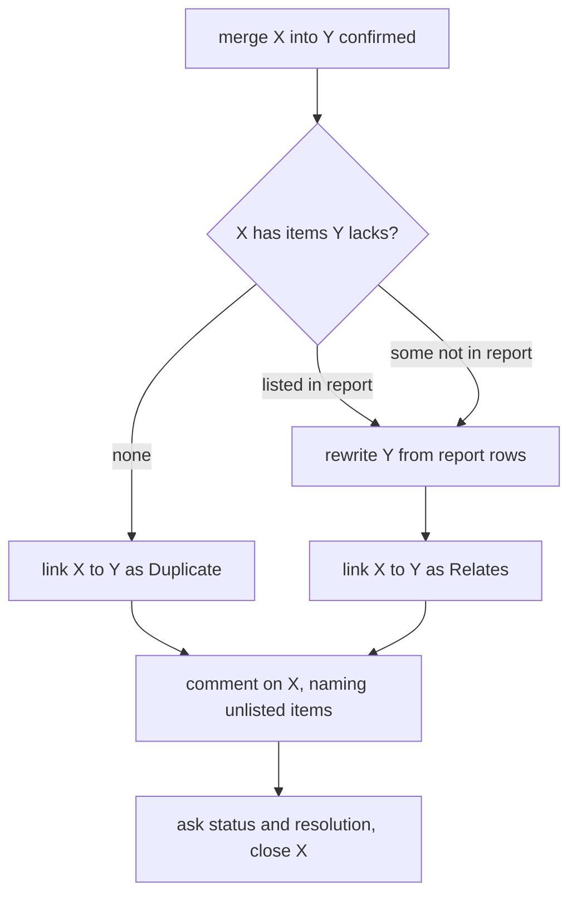

# Duplicate Open Tickets in Report Import - Plan

## Goal Capsule

- **Objective:** The work for one Waltz or Veracode item lives in exactly one open Jira ticket. The Already ticketed screen shows a second ticket only when it is really open, and the user can resolve that situation from the same screen.
- **Means:** Veracode gets ticket merge by running the existing Waltz merge engine in a lighter close mode (KTD1).
- **Product authority:** The requesting user (rbreunung); the choices in Key Decisions and the KTDs marked `session-settled` are theirs.
- **Open blockers:** None.
- **Finishes:** `ce-work` implements on `claude/gracious-faraday-j1hu0q`; shipping is a separate request.

## Product Contract

**Product Contract preservation:** changed: R2 (hint wording, neutral), R6 (link type follows what moved), R11 added (neutral wording) — all confirmed by the user while planning; R1, R3–R5, R7–R10 unchanged.

### Summary

The Ticket cell on the Already ticketed screen stops counting closed tickets and names any other open ticket by key. Waltz keeps its existing ticket merge. Veracode gets the same `merge <sources> into <survivor>` reply with a lighter behavior: it closes the other ticket, links and comments on it, and first moves across any items the kept ticket lacks. Merge wording describes keeping one ticket and moving items, not only duplicates.

### Problem Frame

An Already ticketed row shows its target ticket plus `(+N more)`, where N counts every other ticket carrying one of the row's labels, closed ones included. A row like `PROJ-1234 (+1)` therefore looks like a live duplicate even when the extra ticket was closed long ago. When the extra ticket is genuinely open, only a number is shown, so the user cannot tell which ticket it is and has no way to close it from the review. Veracode imports have no ticket merge at all.

### Key Decisions

- **Closed means a resolution is set.** The importer already uses this test everywhere (target choice, stale check). Tickets moved to a Done-like status without a resolution still count as open. (session-settled: user-directed — chosen over also treating the Done status category as closed: keeps one definition of closed across the importer.) Governs R1, R2.
- **Waltz merge stays as it is.** It rewrites the survivor, adds a banner and a summary prefix to the closed ticket, and closes it. (session-settled: user-directed — chosen over making Waltz merge close-only: that merge also serves tickets covering different items.) Governs R4.
- **Veracode merge is lighter than Waltz merge.** The two importers behave differently on purpose. (session-settled: user-directed — chosen over copying the Waltz merge: no banner or summary edit is wanted.) Governs R5, R6, R7.
- **Veracode merge moves items only when needed.** The survivor is rewritten from the report only when the closing ticket carries flaws it lacks, so all flaws end up on one ticket. (session-settled: user-directed — chosen over close-only with a warning or refusal.) Governs R8, R9.
- **The user picks the direction.** The hint states the reply form and that the ticket after `into` is kept; either order works. (session-settled: user-directed.) Governs R2.
- **The link says what happened.** `Duplicate` when nothing moved, `Relates` when items moved. (session-settled: user-directed — chosen over always `Duplicate` or always `Relates`.) Governs R6.
- **Merge wording covers every use.** Hints, usage, questions and the Veracode confirmation speak of keeping one ticket and moving its items, not of duplicates only. (session-settled: user-directed.) Governs R11.

### Requirements

**Ticket cell (Waltz and Veracode)**

- R1. The Ticket cell counts only other tickets that are still open; closed tickets never appear in it.
- R2. When another ticket is open, the cell names its key, e.g. `PROJ-1234 · also open: PROJ-1190`, and where merge is available the screen shows a merge hint using that row's tickets as the example.
- R3. A row whose other tickets are all closed shows only its target ticket.

**Waltz**

- R4. `merge <sources> into <survivor>` behaves as it does today, apart from the shared wording of R11.

**Veracode ticket merge**

- R5. The Already ticketed and overview screens accept `merge <sources> into <survivor>` with row ids or ticket keys, resolved and refused under the same rules as Waltz merge.
- R6. Merging closes each source using the existing per-issue-type choice of target status and resolution, links the source to the survivor, and posts a short comment on the closed source naming the survivor. The link is `Duplicate` when no item moved from that source and `Relates` when items moved. The source's summary and description are not edited.
- R7. When every flaw on the source is already on the survivor, nothing is rewritten.
- R8. When the source carries flaws the survivor lacks and the current report still lists them, the survivor is rewritten from the report first so it carries all of them, then the source is closed.
- R9. A flaw on the source that the report no longer lists is not moved; its id is named in the comment on the closed source.

**Unchanged behavior and wording**

- R10. Closed tickets still feed change detection and the target-ticket choice, and their labels still keep their flaws or components known, so closing a merged ticket never makes its items reappear as new.
- R11. The merge hint, usage and refusal lines, the status and resolution questions, the Veracode confirmation and the comment on the closed ticket describe keeping one ticket and moving items; "duplicate" appears only where the Jira link or resolution is literally named Duplicate.

### Key Flows

- F1. Merge two open Veracode tickets
  - **Trigger:** An Already ticketed row shows `PROJ-1301 · also open: PROJ-1190`.
  - **Steps:** The user replies `merge PROJ-1190 into PROJ-1301`; merge works out which flaws only PROJ-1190 carries, moves any the report lists onto PROJ-1301, then links, comments on and closes PROJ-1190.
  - **Outcome:** One open ticket remains; PROJ-1190 is closed with a link and a comment.
  - **Covered by:** R2, R5, R6, R7, R8, R9

### Acceptance Examples

- AE1. **Covers R1, R3.** Given a row whose only other ticket has a resolution, when the screen renders, then the cell shows the target ticket and no count.
- AE2. **Covers R2.** Given a row with a second open ticket PROJ-1190, when the screen renders, then the cell reads `PROJ-1301 · also open: PROJ-1190` and the screen offers a merge hint naming both tickets.
- AE3. **Covers R6, R7.** Given a Veracode merge where the source's flaws are all on the survivor, when the user merges, then the source is closed, linked as `Duplicate` and commented, and the survivor is untouched.
- AE4. **Covers R6, R8.** Given a source with a flaw the survivor lacks and the report lists it, when the user merges, then the survivor carries that flaw afterwards, the link is `Relates`, and the source is closed.
- AE5. **Covers R9.** Given a source flaw the report no longer lists, when the user merges, then the survivor does not gain it and the comment on the closed source names its id.

### Scope Boundaries

**Deferred for later**

- A plain per-row `close` action that skips link and merge.
- Treating the Done status category as closed when no resolution is set.
- Making Waltz merge close-only.
- Rewording the Waltz confirmation page and its comment on the survivor.

### Dependencies / Assumptions

- The user manual (`docs/manual/report-imports.md`, the README import section) and `docs/report-import.md` describe the new cell, Veracode merge and the shared wording, including that the two importers' merges differ.
- Veracode's existing row-rewrite already rebuilds a ticket from every report row pointing at it; R8 reuses it rather than adding a second rebuild path.

## Planning Contract

### Key Technical Decisions

- KTD1. **Veracode merge is a mode of the existing merge engine, not a second flow.** `ImportTicketMerge` gains a mode; Waltz keeps today's rewrite-and-mark mode, Veracode supplies a close mode. Both share the confirmation click, the status and resolution questions, retry/ignore and the final report. (session-settled: user-approved — chosen over a separate simpler Veracode flow: one place to maintain and the same look.) Governs R5, R6.
- KTD2. **What moves is read from labels, per source.** The dedup keys on a source's labels (via the descriptor's `labelToDedupKey`) minus those on the survivor are the candidate items; those covered by the report rows the rewrite would use are `movable`, the rest are `unlisted`. A source with any `movable` item triggers the survivor rewrite and gets a `Relates` link; otherwise `Duplicate`. `unlisted` ids go into the comment on that source. The same helper feeds the confirmation page and the run, so the page cannot promise a different plan than the run executes. Governs R6–R9.
- KTD3. **Close mode has its own step list.** In order: survivor rewrite (only when some source has movable items), then per source `link` and a new `source-comment`, then the closes. No survivor comment and no source rewrite. The final report marks a source row `merged` once its close is done, and the survivor row `rewritten` when the rewrite ran. Replays are safe: the link step already skips an existing link, and the comment step skips a comment starting with the same opening line.
- KTD4. **The cell reads a stored list of other open ticket keys.** `buildReviewRows` already holds every ticket and its `resolved` flag; it records the open ones other than the target on the row (`openTicketKeys`). The cell shows up to three keys, then `+N`. A row without the field (a session saved before this change) shows the target alone. `ticketKeys` stays for other readers.
- KTD5. **Shared wording lives in the existing string constants.** The hint, `MERGE_USAGE` and the status/resolution questions are reworded once and apply to both importers. The Waltz confirmation page (`buildMergePrompt`) and Waltz survivor comment stay as they are; Veracode gets its own confirmation builder. Governs R4, R11.
- KTD6. **`canMergeTickets` stays one switch.** Turning merge on for Veracode also turns on `reload report` and the post-merge refresh for it, because the code ties them together; Veracode already records the report path and has a re-parse hook. (session-settled: user-approved — chosen over splitting the switch: the screens go stale after a merge and reload is the cure.)
- KTD7. **The Veracode survivor rewrite keeps Veracode's Due Date rule.** It passes the survivor's creation time and current Due Date to `writeRewrite`, with the movable flaws as the joining item, so the date is set only when empty and moves earlier only when those flaws are due sooner. (session-settled: user-approved — chosen over Waltz's overwrite rule.)
- KTD8. **Closing uses the existing resolution logic.** The project's `Duplicate` resolution is used when offered, otherwise the user picks; only the question text becomes neutral (R11).

### High-Level Technical Design

Directional sketch of the Veracode close-mode run:

### Assumptions

- A merge between tickets of different row targets works as in Waltz: `resolveMergeSides` only needs one report row pointing at one named ticket.
- The survivor's own rows already carry the flaws the report lists for the whole item, because a row matches on any of its flaw ids; the rewrite therefore covers a source's listed flaws even when no row targets the source.

### System-Wide Impact

- Shared wording changes alter Waltz text. Existing tests that assert those strings update with it.
- A row saved in a session before this change shows no "also open" tickets until the review is rebuilt.

### Risks & Dependencies

- **Wrong closes from a mistyped key.** Mitigation: the confirmation page names both tickets with summaries and status, and nothing is written before the click (existing behavior, kept for Veracode).
- **Flaw ids put into Jira text.** They come from Jira labels. Mitigation: only ids that pass the Veracode id pattern are written into the comment (U2 test).

## Implementation Units

### U1. Ticket cell shows only open tickets

- **Goal:** Closed tickets no longer count; other open tickets are named.
- **Requirements:** R1, R2, R3; KTD4.
- **Dependencies:** none.
- **Files:** `src/utils/reportImport.ts` (`buildReviewRows`), `src/participant/session/importTypes.ts` (`ReviewRowBase`), `src/participant/session/importScreens.ts` (`ticketedTicketCell`), tests `src/test/reportImport.test.ts`, `src/test/sessionImportReview.test.ts`.
- **Approach:**
  1. Record the open tickets other than the target on an already-ticketed row.
  2. Render the cell from that list: nothing extra when empty, `also open: KEY[, KEY…]` for up to three keys, then `+N`.
  3. Keep keys as links via `formatKeyLink`.
- **Patterns to follow:** the existing `ticketKeys`/`target` assignment in `buildReviewRows`.
- **Test scenarios:**
  - Covers AE1. A row with two tickets, one resolved: the cell shows the target only.
  - Covers AE2. A row with two open tickets: the cell shows the target plus the other key.
  - Four other open tickets: three keys and `+1`.
  - All tickets resolved: target alone, no count.
  - A row without `openTicketKeys` (old session): target alone.
- **Verification:** the cell output matches the examples for Waltz and Veracode rows.

### U2. Pure merge helpers for close mode

- **Goal:** One place decides what moves, which link type applies, which steps run, and what the texts say.
- **Requirements:** R6, R7, R8, R9, R11; KTD2, KTD3.
- **Dependencies:** none.
- **Files:** `src/utils/ticketMerge.ts`, `src/utils/veracodeReport.ts` (source comment text), `src/participant/session/importReplies.ts` (new Veracode confirmation builder next to `buildMergePrompt`), tests `src/test/ticketMerge.test.ts`, `src/test/sessionImportMerge.test.ts`, and the existing Veracode report test suite for the comment text.
- **Approach:**
  1. Add a helper that returns `movable` and `unlisted` item keys per source from the survivor's labels, the source's labels, the descriptor's label-to-key function, and the keys the rewrite covers.
  2. Add a close-mode plan builder: survivor rewrite only when any source has movable items, then `link` and `source-comment` per source, then closes.
  3. Add the confirmation builder (three cases: nothing moves, items move, some unlisted) using the neutral wording of R11. When a rewrite runs, it also names flaws the kept ticket itself records that the report no longer lists, because the rebuilt description will stop showing them (as the Waltz confirmation already does with its dropped-findings line).
  4. Add the source comment text as a pure function in `src/utils/veracodeReport.ts` (next to the id pattern it validates against); it accepts only ids that pass `ISSUE_ID_PATTERN` and neutralizes the rest. The Veracode descriptor in U4 calls it.
- **Test scenarios:**
  - Covers AE3. Source labels all on the survivor: no movable, no rewrite step, `Duplicate`.
  - Covers AE4. A source flaw absent from the survivor and covered by the report: movable, rewrite step first, `Relates`.
  - Covers AE5. A source flaw the report does not cover: unlisted, named in the comment, not moved.
  - Two sources, one with movable items: link type differs per source.
  - A label that does not parse to a Veracode id is ignored; a crafted id is not written into the comment.
  - Confirmation text for each of the three cases contains the key names and no word "duplicate" except for the literal link/resolution name.
  - A rewrite runs and the kept ticket records a flaw the report no longer lists: the confirmation names it as one the rebuilt description will stop showing.
- **Verification:** helper outputs are deterministic and cover every combination above.

### U3. Close mode in the merge engine

- **Goal:** The engine runs the close-mode plan and reports it.
- **Requirements:** R5, R6, R7, R8, R9; KTD1, KTD3, KTD7, KTD8.
- **Dependencies:** U2.
- **Files:** `src/participant/jira/importMerge.ts`, `src/participant/jira/reportImportTypes.ts` (`ImportTicketMerge`), `src/participant/session/importTypes.ts` (`MergeStepKind`, per-step link type), `src/participant/session/importReplies.ts` (neutral status/resolution questions), tests `src/test/reportImportMerge.test.ts`.
- **Approach:**
  1. Make `ImportTicketMerge` a mode: Waltz's existing fields stay for the rewrite mode, close mode supplies a source-comment builder.
  2. `showMergePrompt` and `startMerge` build the close-mode plan and confirmation when the descriptor is in close mode; link type is chosen per source, with the existing fallback to `Relates` when the project has no `Duplicate` link type.
  3. Add the `source-comment` step with a replay check (`hasCommentStartingWith`); run the rewrite step with the survivor's creation time, current Due Date and the movable flaws as the joining item.
  4. `finish` marks rows and counts outcomes for close mode as KTD3 says.
- **Execution note:** Start with failing engine tests for the three flaw cases, then implement; keep the Waltz tests unchanged as the regression guard.
- **Patterns to follow:** the existing step loop, `failStep`/`askAgain` and `closePhase` in `importMerge.ts`.
- **Test scenarios:**
  - Covers AE3. Close mode, nothing moves: steps are link, comment, close; no `writeRewrite` call.
  - Covers AE4. Items move: the rewrite runs first with Veracode's Due Date rule (an empty Due Date is set, a later one is kept unless the joining flaws are earlier), link is `Relates`.
  - Covers AE5. Unlisted flaw: the comment names it.
  - A comment step failure stops the run with retry/ignore; retry does not repeat finished steps.
  - Replayed confirmation: an existing link and an existing comment are skipped.
  - A project without a `Duplicate` link type: `Relates` is used and noted.
  - Waltz run still produces its original step list and texts (regression).
- **Verification:** engine tests for both modes pass; no step order change for Waltz.

### U4. Turn merge on for Veracode

- **Goal:** Veracode screens accept and offer merge.
- **Requirements:** R5, R2; KTD1, KTD6.
- **Dependencies:** U3.
- **Files:** `src/participant/jira/veracodeHandler.ts` (descriptor `ticketMerge` in close mode with its comment builder), tests `src/test/reportImportMerge.test.ts`, `src/test/reportImportHandler.test.ts`.
- **Approach:**
  1. Add `ticketMerge` to the Veracode descriptor with the neutral source-comment text of R11.
  2. Check that `reload report` and the post-merge refresh work with Veracode's `parseAndFilter` and stored report path.
- **Test scenarios:**
  - `merge A2 into A1` and `merge PROJ-1190 into PROJ-1301` parse and reach the confirmation on a Veracode review.
  - The New and Stale screens answer the ticket form of `merge` with the pointer to the overview.
  - `reload report` is offered on a Veracode review and refreshes it.
  - After a finished merge the Veracode review refreshes unless unfinished choices exist.
- **Verification:** a Veracode review end to end with the mock Jira client closes a source and shows `merged into` on its row.

### U5. Neutral shared wording and the hint

- **Goal:** Short, use-case-neutral merge text on every screen.
- **Requirements:** R2, R11; KTD5.
- **Dependencies:** U1, U3, U4.
- **Files:** `src/participant/session/importScreens.ts` (hint line), `src/participant/session/importReplies.ts` (`MERGE_USAGE`, `MERGE_ON_NEW_OR_STALE`, vocabulary lines), tests `src/test/sessionImportReview.test.ts`, `src/test/sessionImportMerge.test.ts`, `src/test/reportImportAcceptReplies.test.ts`.
- **Approach:**
  1. Replace the long Waltz hint with the short form: on a screen with an "also open" row, `merge <other> into <target>` taken from the first such row, plus the swap note of Key Decisions; otherwise a generic `merge A2 A3 into A1` line.
  2. Reword usage and the status/resolution questions per R11 and KTD8.
  3. Update every test that asserts the old strings.
- **Test scenarios:**
  - Covers AE2. The hint names the first "also open" row's tickets.
  - No "also open" row: the generic hint.
  - The usage and refusal lines contain no "duplicate" except where literally required.
  - The Waltz confirmation page text is unchanged.
- **Verification:** all string assertions in the three suites match the new text.

### U6. Documentation

- **Goal:** Users and developers can read how it works now.
- **Requirements:** all; Dependencies / Assumptions.
- **Dependencies:** U1–U5.
- **Files:** `docs/manual/report-imports.md` (the merge section and the Already ticketed description), `README.md` (import section if it mentions merge), `docs/report-import.md` (cell, "Merging tickets" with a Veracode close-mode subsection), `CLAUDE.md` (key-files rows for `importMerge.ts`, `ticketMerge.ts`, `reportImportHandler.ts` where they say merge is Waltz only).
- **Test expectation:** none -- documentation only (`src/test/userDocsSync.test.ts` does not check these pages; review by hand).
- **Verification:** the manual describes the cell, both merge behaviors and the link rule, with the same wording as the screens.

## Verification Contract

| Check | Command | When |
| --- | --- | --- |
| Type check | `npm run compile` | before every commit |
| Unit tests | `npm test` | before every commit; must be green |
| Focused runs | `npx vitest run src/test/reportImportMerge.test.ts src/test/sessionImportReview.test.ts src/test/sessionImportMerge.test.ts src/test/ticketMerge.test.ts src/test/reportImport.test.ts` | while working on U1–U5 |

## Definition of Done

- All Requirements R1–R11 are true and AE1–AE5 are covered by tests.
- `npm run compile` and `npm test` pass; Waltz merge tests pass without changing their expectations except the shared strings of R11.
- `docs/manual/report-imports.md`, `docs/report-import.md` and the affected `CLAUDE.md` rows are updated in the same change.
- No code left from abandoned approaches.

## Outstanding Questions

### Deferred to Implementation

- How the joining item for the Due Date rule is cut from the movable flaws (start from the existing `fold.narrowToNew` precedent in `src/participant/jira/veracodeHandler.ts`).
- Whether closing with the project's `Duplicate` resolution reads right on a close where items moved; the plan keeps the existing resolution logic (KTD8) and revisits only if the question text proves confusing.

## Sources / Research

- `src/participant/session/importScreens.ts` — `ticketedTicketCell` builds `(+N more)` from `ticketKeys`; the merge hint line.
- `src/utils/reportImport.ts` — `buildReviewRows`, `pickTargetTicket`, the `resolved` flag.
- `src/participant/jira/importMerge.ts`, `src/utils/ticketMerge.ts`, `src/participant/session/importReplies.ts` — current Waltz ticket merge, its prompt and reply parsing; enabled by `ticketMerge` in `src/participant/jira/waltzHandler.ts`.
- `src/participant/jira/importAddToTicket.ts` — `planRewrite`, `writeRewrite`; `src/participant/jira/veracodeHandler.ts` — `fold`, `rewriteDueDate`.
- `docs/report-import.md` — "Merging tickets (Waltz)"; `docs/manual/report-imports.md` — merge section.
