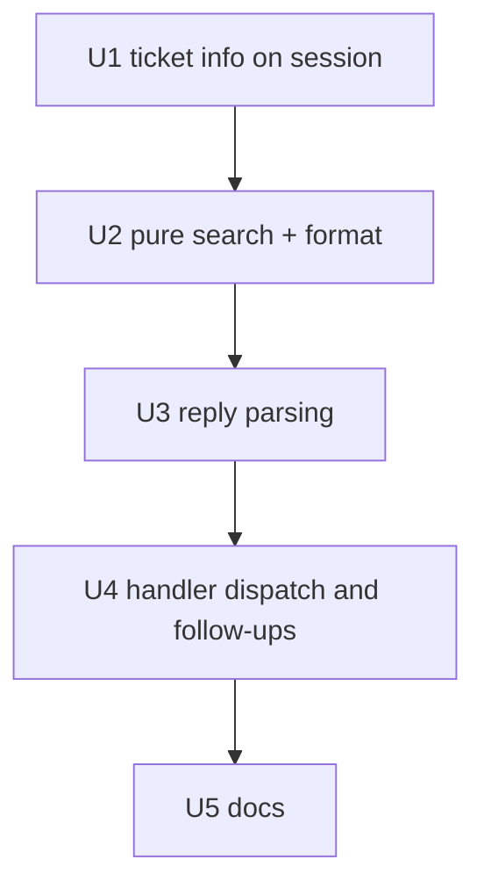

# Import Ticket Search - Plan

## Goal Capsule

- **Objective:** While reviewing a Veracode or Waltz report, a user can find the existing Jira ticket a finding belongs with by typing a keyword such as a component or class name, and can add the finding to it without knowing the ticket key beforehand. The import screens never leave the user stranded after a lookup or export.
- **Means:** Search the tickets the review already knows (the Already-ticketed matches), so no new Jira search runs (KTD1).
- **Product authority:** The requesting user (rbreunung); decisions marked `session-settled` are theirs.
- **Open blockers:** None.
- **Finishes:** `ce-work` implements on `claude/veracode-waltz-ticket-search-5eeeed`; shipping is a separate request.

## Product Contract

**Product Contract preservation:** changed: R1, R2, R3, R5 and Dependencies / Assumptions, all confirmed by the user while planning (search scope narrowed to the tickets the review already matched, A ids shown and accepted as merge targets, shown only beside a row's main ticket after the document review); R4, R6–R8 and AE2 reworded or re-pointed to match, same intent.

### Summary

A `search <keyword>` reply on the New and Already ticketed screens lists the open tickets the review already matched whose summary contains the keyword, each with its Already-ticketed row id, key, status and summary. Search only looks up. Adding New rows to a found ticket uses the existing `add <rows> to <KEY>` flow, which also answers to `merge <rows> into <KEY or A id>`. A `show` reply re-prints the current screen so search and export are no longer dead ends.

### Problem Frame

`add 2 4 to PROJ-123` already adds New rows to any existing ticket, as a comment or as a rewrite (`docs/report-import.md`, "add … to <KEY>"). It needs the ticket key up front, which the user often does not have when a finding belongs with earlier work on the same class or component. After an `export`, the screen is not printed again and the only way out is "Back to overview", which drops the New screen's page-local state.

### Key Decisions

- **Search is a lookup, not a flow.** It lists tickets and the user decides what to do with them. (session-settled: user-directed — chosen over a combined search-then-pick-rows-then-confirm flow: the existing add prompt already owns row choice and confirmation.) Governs R1, R3.
- **Search covers the tickets the review already matched.** It reads no new data from Jira. (session-settled: user-directed — chosen over a fresh project-wide Jira search: the Already-ticketed matches are already fetched before the New screen is shown.) Governs R1, R2.
- **Search returns open tickets only.** (session-settled: user-directed — chosen over also listing resolved tickets with a marker: merging into a closed ticket is not wanted.) Governs R2.
- **`merge … into <ticket>` is an alias of `add … to <ticket>` on the New screen.** The target is a ticket key or an Already-ticketed row id taken from the search results. (session-settled: user-directed — chosen over keeping `add` as the only spelling: the user expects "merge" for this, and the merge screen already works with A ids.) Governs R3, R5.
- **A screen refresher is part of this work.** (session-settled: user-directed — chosen over leaving the "Back to overview" detour: the dead end was hit in practice after an export.) Governs R6, R7.

### Requirements

**Search**

- R1. `search <keyword>` lists tickets whose summary contains every word of the keyword, each as a case-insensitive substring, matching the summary only. It reads the tickets the review already matched and makes no Jira search of its own.
- R2. The results are the open tickets (no resolution set, the importer's existing test for "closed") carried by the review's Already-ticketed rows, each ticket listed once. About 20 are shown in row order with a note when more match.
- R3. Each result shows its key (linked when a Jira base URL is configured), status and summary. A result also shows the Already-ticketed row ids (A1, A3…) whose main ticket it is; an extra open ticket of a row shows its key alone. Summaries are neutralized as untrusted text. Nothing is selected automatically and nothing is written.
- R4. A search with no matches, an empty keyword, or a session that holds no ticket info says so (with the usage or the `reload report` hint) and leaves the session unchanged.

**Merging into a found ticket**

- R5. On the New screen, `merge <rows> into <KEY>` or `merge <rows> into <A id>` behaves exactly as `add <rows> to <KEY>`, with an A id resolved to its row's main ticket (the ticket a search result shows next to that id), including the as-comment / as-rewrite confirmation. `merge <rows>` still combines New rows, and `merge A5 into A3` still merges tickets. Plain `add … to` accepts keys only.

**Not getting stranded**

- R6. `show` re-prints the screen the session is on. It is available on the overview and on the New, Already ticketed and Stale screens, including directly after `search` and `export`.
- R7. The follow-up line after `search` and `export` offers `show` alongside the existing exit link. `accepted` already re-prints the screen and is unchanged.
- R8. `search` and `show` change no session state, so the page, row inclusion and merged rows the user had are intact afterwards.

Scope: Veracode and Waltz imports. Email import has no existing-ticket flow and is untouched.

### Acceptance Examples

- AE1. Covers R1, R3. Given a Waltz import with an Already-ticketed row for `netty-codec` whose main ticket is PROJ-12, when the user replies `search netty` on the New screen, then PROJ-12 is listed with its A id, status and summary, and no row or ticket changes.
- AE2. Covers R2. Given a keyword matching more than 20 of the review's open tickets, the first 20 are listed with a note that more match. Given a matching ticket that is resolved, it is not listed.
- AE3. Covers R4. Given a keyword matching nothing, the reply says no tickets matched and the New screen is still the current screen.
- AE4. Covers R5. Given New rows 1 and 2 and search results showing A3 for PROJ-12, when the user replies `merge 1 2 into A3`, then the add prompt for PROJ-12 appears with the as-comment and as-rewrite links.
- AE5. Covers R6, R8. Given the user ran `export` from page 2 of the New screen, when they reply `show`, then page 2 is printed with the same inclusion and merge state as before.

### Scope Boundaries

- No clickable "add rows to this ticket" links on search results; the user types the add or merge reply.
- No change to what `add … as comment` and `add … as rewrite` do.
- No search of resolved tickets, of tickets the review did not match, of descriptions or comments, or across projects. A ticket outside the review is still reachable with `add … to <KEY>`.
- Email import is out of scope.

### Dependencies / Assumptions

- The dedup search already returns each ticket's summary (`JiraApiClient.searchJql` requests it in its base fields), so search needs no extra Jira call.
- The Stale screen's tickets are not search targets; they are open tickets the report no longer lists.

### Outstanding Questions

#### Deferred to Planning

- None. Result count (20), `show` wording, and keyword handling (plain substring, no JQL) are settled in the Planning Contract.

---

## Planning Contract

### Context and research

The reply vocabulary is parsed per screen in `src/participant/session/importReplies.ts` and applied in `handleImportReviewReply` (`src/participant/jira/reportImportHandler.ts`). Session state types live in `src/participant/session/importTypes.ts`. The dedup search (`reportImportHandler.ts`, around the `buildDedupJql` call) requests `resolution`, `created` and `duedate` on top of the client's base fields, which include `summary`; `toDedupTicket` in `src/utils/reportImport.ts` builds each `DedupTicket`. An Already-ticketed row carries `target` (the ticket `update` writes to) and `openTicketKeys` (the other open tickets), so the open tickets of the review are fully derivable from the rows. `docs/report-import.md` documents every reply and must stay in step. `grep` for `searchTicketsRaw` and the dedup field list confirms no other caller needs the new `summary` field.

### Key Technical Decisions

- KTD1. **Search reads a ticket-info map stored on the review session.** `toDedupTicket` keeps the `summary` the dedup search already returns, and `buildImportReview` copies `key → { summary, status }` for every ticket in the dedup map onto the session as `ticketInfo`. The refresh path already goes through `buildImportReview`, so a reload rebuilds it. Chosen over a new Jira search (user-directed, see Key Decisions) and over putting the summary on each row (a ticket shared by several rows would repeat it).
- KTD2. **Matching is a pure function in a vscode-free module.** `src/participant/session/importSearch.ts` takes the rows, the ticket-info map and the keyword and returns an ordered list of `{ key, ids, status, summary }`, plus a formatter. Keyword handling is a trimmed, lower-cased substring test. It never builds JQL, so no escaping is needed. Both the parser tests and the handler tests can load it.
- KTD3. **`search` and `show` are new `ImportReplyAction` kinds; the alias reuses `addPrompt`.** `merge <rows> into <target>` on the New screen is turned into the existing `addPrompt` action by the parser, so `showAddPrompt` and `addToTicket` stay untouched (R5). An A id is resolved in the parser through a new `ticketTargetKeys` map on `ImportReplyContext` (row id to the row's main ticket key), so the handler gets a ready key and an A id never resolves to a ticket the results did not show beside it.
- KTD4. **Screen availability is explicit per parser.** `search` is parsed on the New and Already ticketed screens only; `show` on all four, both only when `canSearch` is set (so email gets neither). On the overview and Stale screens a reply starting with `search` returns `invalid` with a hint that search works on the New and Already ticketed screens. The existing `merge … into` refusal stays on the Stale screen and on the New screen when the left side is not New rows (so `merge A5 into A3` keeps its pointer to the overview). The parsers answer a reply starting with `search` or `show` themselves, never handing it on, so a typo cannot be read as a row toggle.
- KTD5. **`search` answers like `export`: output is the last thing on screen.** The handler streams the results and a follow-up line (`buildSearchFollowUp`) with `show` and the usable `merge`/`add` forms, saves the session untouched and returns the review session metadata. `buildExportFollowUp` gains the same `show` link. `show` calls the existing `rerender`.

### Sequencing

---

## Implementation Units

### U1. Keep ticket summaries from the dedup search

- **Goal:** Make each matched ticket's summary available on the review session without another Jira call.
- **Requirements:** R1, R2 (KTD1).
- **Dependencies:** none.
- **Files:** `src/utils/reportImport.ts`, `src/participant/jira/reportImportHandler.ts`, `src/participant/session/importTypes.ts`, `src/test/reportImport.test.ts`, `src/test/reportImportRefresh.test.ts`.
- **Approach:**
  1. Add `summary` to `JqlIssueLike.fields` and an optional `summary` to `DedupTicket`; fill it in `toDedupTicket` from `fields.summary`. `JiraApiClient.searchJql` already requests `summary` in its base field list, so the dedup search call needs no change.
  2. Add `ticketInfo?: Record<string, { summary: string; status: string | null }>` to `ReviewSession`; build it in `buildImportReview` from every ticket in the dedup map.
  3. A session saved before this change has no map: later units treat that as "no ticket info". The status stored is the build-time status; a ticket transitioned in Jira during the session shows stale until `reload report`.
- **Patterns to follow:** `dueDate` handling in `toDedupTicket` (optional field, `undefined` = not returned); `ticketDescriptions` as the session-level cache.
- **Test scenarios:**
  - A dedup search result with `fields.summary` yields a `DedupTicket` carrying that summary.
  - A result without `summary` yields a ticket with no summary and no error.
  - `buildImportReview` stores one summary per distinct ticket key, including a ticket shared by two rows.
  - `refreshReview` rebuilds `ticketInfo` from the new search.
- **Verification:** The review session of a Veracode and a Waltz import carries `ticketInfo` after the dedup step; existing import tests still pass.

### U2. Pure ticket search and result formatting

- **Goal:** Match a keyword against the review's open tickets and format the list.
- **Requirements:** R1, R2, R3, R4 (KTD2).
- **Dependencies:** U1 (the ticket-info map's shape).
- **Files:** `src/participant/session/importSearch.ts` (new), `src/test/sessionImportSearch.test.ts` (new).
- **Approach:**
  1. `findTicketsBySummary(rows, ticketInfo, keyword)` collects, per Already-ticketed row that is not a finished merge (`isTicketedRowFinished` with `result.action === 'merge'`, whose tickets are already closed in Jira even though `target.resolved` is still false), its target (when not resolved) and `openTicketKeys`, groups by ticket key keeping the row ids that point to it, looks up status and summary, and keeps those whose summary contains the keyword.
  2. Order by the first row id that points to the ticket; cap at a `SEARCH_RESULT_LIMIT` of 20 and return the total match count.
  3. `buildSearchResults(...)` renders one line per ticket (`A3, A5 · PROJ-12 · status · summary`; an extra open ticket shows `PROJ-15 · status · summary` with no A id) with the key linked via `formatKeyLink` and the summary through `neutralizeMarkdownLinks`; it also renders the empty, no-summaries and over-limit notes.
- **Execution note:** Write the matching tests first; this is pure logic with clear inputs.
- **Patterns to follow:** `buildAcceptedList` and the merge prompt builders for list formatting; `ticketedTargetKey` for the target key.
- **Test scenarios:**
  - Covers AE1. A row whose target summary contains "netty" is returned with its A id, key, status and summary.
  - Matching ignores case and matches inside a word ("repository" finds "OrderRepository.java").
  - Covers AE2. A resolved target is excluded; a resolved ticket listed only in `ticketKeys` is excluded.
  - A row marked as a finished merge (`{ status: 'done', action: 'merge', into: 'PROJ-1' }`) contributes no tickets, even though its target is still unresolved.
  - Two rows pointing to the same ticket yield one result with both ids.
  - An open extra ticket (`openTicketKeys`) is searchable and is listed by key alone, with no A id; an A id appears only on the line of its row's main ticket.
  - More than 20 matches returns 20 and the full count; the formatter adds the "more match" note.
  - Covers AE3. No match returns an empty list; the formatter says no tickets matched.
  - An empty or whitespace keyword returns the usage text, not a list.
  - Missing `ticketInfo` (old session) returns the "reload report" hint.
  - A summary containing markdown link syntax is rendered neutralized.
- **Verification:** The module imports nothing from `vscode`; its tests pass under `npm test`.

### U3. Parse `search`, `show` and the `merge … into` alias

- **Goal:** Teach the screen parsers the new replies without disturbing the existing vocabulary.
- **Requirements:** R3, R4, R5, R6 (KTD3, KTD4).
- **Dependencies:** U2.
- **Files:** `src/participant/session/importReplies.ts`, `src/participant/session/importScreens.ts`, `src/participant/session/importTypes.ts`, `src/test/sessionImportReview.test.ts`, `src/test/sessionImportFolding.test.ts`.
- **Approach:**
  1. Add `{ kind: 'search'; keyword: string }` and `{ kind: 'show' }` to `ImportReplyAction`; add `canSearch` and `ticketTargetKeys` (lower-cased A id → ticket key) to `ImportReplyContext`.
  2. `parseShowReply` is called by all four screen parsers when `canSearch`. `parseSearchReply` is called by the New and Already-ticketed parsers when `canSearch`; a bare `search` returns `invalid` with the usage. Both detect the word on `normalizeReply(reply)`; `parseSearchReply` takes the keyword from the original `reply.trim()` after the first token, so its case survives.
  3. In `parseNewGroupReply`, before `parseMergeOffScreenReply`, try `merge <New row ids> into <target>`: the target is a key (matched with the existing key pattern) or an id found in `ticketTargetKeys`. A match returns `addPrompt` with the resolved key; an unknown row or target returns `invalid` with a reason naming it.
  4. Leave `parseMergeOffScreenReply` for every other `merge … into` (Stale, and New with a non-row left side).
  5. Add `search <keyword>`, `merge 1 2 into A3` and `show` to `describeImportReplyVocabulary`; add a `show` constant to `IMPORT_COMMANDS`.
- **Patterns to follow:** `parseExportReply` (feature flag in the context, answered inside the parser); `parseAddReply` and `matchVisibleNewRows` for row validation.
- **Test scenarios:**
  - `search netty` on the New and Already-ticketed screens returns `search` with keyword "netty"; keyword case is preserved for display and not lower-cased by the parser.
  - `search` with no keyword returns `invalid` with the usage; `search netty` on the overview and Stale screens is not a search.
  - Covers AE4. `merge 1 2 into A3` with `ticketTargetKeys` mapping `a3` to `PROJ-12` returns `addPrompt` with ids 1, 2 and key `PROJ-12`.
  - `merge 1 2 into proj-12` returns `addPrompt` with key `PROJ-12`.
  - `merge 1 2 into A9` (unknown A id) and `merge 7 8 into A3` (rows not on the page) return `invalid` with a reason naming the bad token.
  - `merge 1 2` still returns `merge`; `merge A5 into A3` on the New screen still returns the existing pointer to the overview; the Stale screen still refuses `merge … into`.
  - `add 1 2 to A3` still returns `invalid` (keys only).
  - `show` returns `show` on all four screens; a row id such as `2` still toggles.
  - Email (`canFold`, `canSearch` false) gets none of the new replies, `show` included.
  - `search netty` on the overview and Stale screens returns `invalid` with the hint pointing to the New and Already ticketed screens.
  - `merge A5 into A3` and `merge PROJ-15 into PROJ-12` on the New screen keep the overview pointer (the left side is read as New rows only when every token is purely numeric); `merge 7 8 into A3` with rows 7 and 8 off the page returns `invalid` naming the row.
- **Verification:** Parser tests pass; the "didn't understand" hint lists the new replies only on the screens that accept them.

### U4. Handler dispatch, results output and follow-up links

- **Goal:** Run `search` and `show`, and make `export` and `search` end with a way back.
- **Requirements:** R3, R4, R6, R7, R8 (KTD5).
- **Dependencies:** U1, U2, U3.
- **Files:** `src/participant/jira/reportImportHandler.ts`, `src/participant/session/importScreens.ts`, `src/participant/jira/importExport.ts`, `src/test/reportImportHandler.test.ts`, `src/test/reportImportExport.test.ts`.
- **Approach:**
  1. In `handleImportReviewReply`, build the new context fields: `canSearch` (the importer has dedup), `ticketTargetKeys` from `session.allRows` rows that have a target.
  2. `case 'search'`: stream `buildSearchResults` plus `buildSearchFollowUp` through `trustedChatMarkdown`, log the match count with `logDiag(descriptor.scope, 'info', …)` (count only, not the keyword's matches), save the session unchanged, return the review session metadata.
  3. `case 'show'`: `return rerender()`.
  4. Extend `buildExportFollowUp` with the `show` link; `buildSearchFollowUp` offers `show` and, by screen: on the New screen `merge <rows> into <target>` and `add <rows> to <KEY>`; on the Already ticketed screen only `merge A<n> into A<m>`, and only when the importer supports ticket merge.
- **Patterns to follow:** the `export` case (last thing on screen, session saved, metadata returned) and `showAcceptedList` for streaming.
- **Test scenarios:**
  - Covers AE1. A `search` reply streams the matching ticket and the follow-up line; the saved session equals the session after view-state normalization (`ensureImportViewState`), with no row, page or merge change.
  - Covers AE3. A no-match search streams the no-match note and the review session metadata, so the next reply is still read as an import reply.
  - Covers AE5. After an `export` from page 2 of the New screen, a `show` reply re-renders page 2 with the earlier row inclusion and merged rows intact.
  - A `search` reply in a session without `ticketInfo` streams the reload hint and does not throw.
  - The export output ends with a line containing the `show` link.
  - `merge 1 2 into A3` reaches `showAddPrompt` with the resolved key (spy on the prompt call).
  - A superseded session (a newer import started) still closes without acting, for `search` and `show` too.
- **Verification:** A manual chat run of a Waltz import shows search, show and the alias working end to end (covered by the e2e suite only where the handler needs `vscode`).

### U5. Document the new replies

- **Goal:** Keep `docs/report-import.md` the authority on every import reply.
- **Requirements:** R1–R8.
- **Dependencies:** U1–U4.
- **Files:** `docs/report-import.md`, `docs/onboarding.md` (only if it lists import replies).
- **Approach:**
  1. Add a "Search and show" subsection next to "add … to <KEY>": what `search` reads, why substring and open-only, the A-id and key targets, `show`, and the old-session `reload report` hint.
  2. State in the "add … to <KEY>" paragraph that `merge <rows> into <target>` is an alias.
  3. Note in the Export paragraph that it ends with a `show` link.
- **Test expectation:** none -- documentation only.
- **Verification:** The doc describes only behavior the tests of U2–U4 pin.

---

## Verification Contract

| Check | Command | Applies to |
| --- | --- | --- |
| Type check | `npm run compile` | every unit |
| Unit tests | `npm test` | U1–U4; must be green before commit |
| e2e (optional, needs VS Code) | `npm run test:e2e` | U4 manual confirmation |

## Definition of Done

- All of AE1–AE5 are covered by a passing test or, for AE5's rendering, by the handler test.
- `npm run compile` and `npm test` pass.
- `search`, `show` and `merge <rows> into <target>` work on both Veracode and Waltz and are absent from email import.
- `docs/report-import.md` describes the replies; no code, comment or doc remains from abandoned approaches.

## Risks

- **Scope of results.** Search sees only tickets the review matched through other findings, so a ticket with no label match to this report is not found. Mitigation: documented, and `add … to <KEY>` stays available.
- **Old saved sessions** have no `ticketInfo`. Mitigation: the "no ticket info, reload report" reply (R4).
- **Reply vocabulary collisions.** New words share the screens with row toggles and merge words. Mitigation: KTD4's explicit parsing and the U3 collision tests.

## Sources

- `docs/report-import.md` — "add … to <KEY>", "Waltz ticket merge", the export follow-up behavior.
- `src/participant/session/importReplies.ts` — reply vocabulary and the New-screen refusal of `merge … into`.
- `src/participant/jira/importExport.ts` — the export that ends without re-printing the screen.
- `docs/plans/2026-10-23-2042-feat-duplicate-open-tickets-merge-plan.md` — the existing ticket merge this stays disjoint from.
