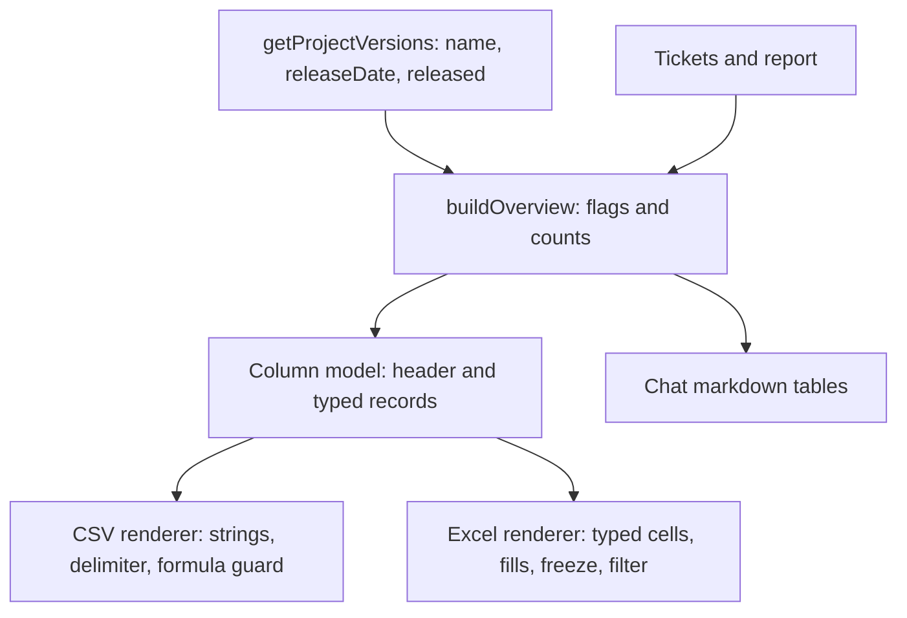

# Overview Excel Export and Column Order - Plan

## Goal Capsule

- **Objective:** A user who exports the Veracode and Waltz security overview gets a table they can read and filter without rearranging it: the dates sit together, the overdue and due-before-release rows stand out, and the file opens as a real Excel workbook.
- **Means:** One shared column definition feeds both the CSV and a new Excel renderer (KTD1); the flag rule lives in the overview model, so every output agrees (KTD3).
- **Product authority:** The requesting user (rbreunung); decisions marked `session-settled` are theirs.
- **Open blockers:** None.
- **Finishes:** `ce-work` implements on the session branch; shipping is a separate request.

## Product Contract

**Product Contract preservation:** new plan, no upstream brainstorm file. The scope was settled in the planning conversation and confirmed by the user before writing.

### Summary

The overview export gets one new column order for CSV and Excel: Fix Version, Release Date, Due Date and the three Waltz dates together, Members last. A new Excel export writes the same rows as one sheet with real date cells, a frozen header, an autofilter, column widths, and an orange or yellow row fill for overdue and due-before-release rows. The flag rule also changes: a ticket with no Fix Version is due before release when its Due Date is before the latest release date among the project's unreleased versions.

### Problem Frame

The export today scatters its dates: Release Date follows Fix Version, the Waltz dates sit near the end, and Members sits in the middle of the Waltz block. Only CSV exists, and a user has to turn it into a spreadsheet by hand (delimiter, date formats, highlighting). Tickets without a Fix Version, which are the ones that most need a planning decision, can never show the due-before-release flag because they have no release date to compare against.

### Key Decisions

- **Excel is one sheet with the CSV's rows, plus real Excel formatting.** (session-settled: user-directed — chosen over a plain text mirror and over one sheet per Fix Version: dates must sort and filter, and the CSV row model is already known to work.) Governs R5, R6, R7.
- **Release Date sits next to its Fix Version, and Fix Version sits in front of Due Date.** (session-settled: user-directed — chosen over keeping Release Date among the date block after Due Date: the release date belongs beside its version name, and in front of Due Date it is still adjacent to the other dates.) Governs R1, R2.
- **Overdue rows are orange and due-before-release rows yellow.** (session-settled: user-directed — chosen over red and amber.) Governs R8.
- **"Last known release" means the latest release date among unreleased versions.** (session-settled: user-directed — chosen over all dated versions: released versions should hold only closed tickets and lie in the past.) Governs R9, R10.
- **The unplanned-ticket rule applies in the shared overview model, so the chat overview and counts change with it.** Inferred, confirmed by the user at the scoping check. Governs R9, R11.

### Requirements

**Column order (CSV and Excel)**

- R1. The CSV and Excel files use one column order: Source, Ticket, Status, Summary, Rating, Fix Version, Release Date, Due Date, Policy date, Planned date, Attestation date, Other Fix Versions, Flag, Report match (import export only), Detail source, the Veracode columns (Issue ID through Function), Remediation action, Plan status, Members.
- R2. Members is the last column, and Release Date is the column right after Fix Version.
- R3. Column titles and row content are unchanged apart from position; one row per Veracode finding and one row per Waltz ticket stays as it is.

**Excel export**

- R4. Every place that offers CSV also offers Excel: the standalone `@jira /overview [PROJECT] xlsx`, the `export xlsx` reply of a Veracode or Waltz import, and a "Save as Excel" link beside "Save as CSV" in both.
- R5. The Excel file is one sheet with the CSV's rows and columns.
- R6. Date columns (Release Date, Due Date, Policy, Planned, Attestation) hold real Excel dates shown as `YYYY-MM-DD`; Line holds a number; every other value is text. An empty value is an empty cell.
- R7. The header row is frozen and bold, the sheet has an autofilter over the whole table, and each column has a width that fits its content up to a cap.
- R8. A row flagged overdue is filled orange and a row flagged due before release is filled yellow across the whole row; other rows are unfilled. The Flag column keeps its text, so no meaning depends on colour.
- R9. A cell's text is stored as plain text, never as a formula: a Jira or report value such as `=1+1` reads back as that text, with no apostrophe prefix. Characters Excel cannot store are dropped and a text longer than Excel's cell limit is shortened with an ellipsis.
- R10. The file is saved through a save dialog like the CSV; a cancelled dialog writes nothing and says so; a failed write is reported. The `overviewCsvDelimiter` setting affects CSV only.

**Flag rule for unplanned tickets**

- R11. A ticket or report-only item with no Fix Version and a Due Date is flagged due before release when its Due Date is before the latest release date among the project's unreleased versions that have a release date. Overdue still wins. With no such version, nothing changes.
- R12. The rule applies everywhere the overview model is used: the chat tables, the summary counts (the Not assigned row shows a count where it shows `–` today), the CSV and the Excel file.

### Acceptance Examples

- AE1. **Covers R1, R2.** Given an import export with a Report match column, the header reads `… Rating, Fix Version, Release Date, Due Date, Policy date, Planned date, Attestation date, Other Fix Versions, Flag, Report match, Detail source, Issue ID … Function, Remediation action, Plan status, Members`.
- AE2. **Covers R6.** Given a Waltz ticket with a planned date of 2026-11-02, the Planned date cell is a date value that sorts after 2026-10-30 and displays `2026-11-02`.
- AE3. **Covers R8.** Given one overdue row, one due-before-release row and one unflagged row, the first is orange, the second yellow and the third has no fill.
- AE4. **Covers R9.** Given a ticket summary `=HYPERLINK("http://x","y")`, the cell reads back as that exact text and has no formula.
- AE5. **Covers R11.** Given unreleased versions releasing 2026-12-01 and 2027-03-01, a ticket with no Fix Version and a Due Date of 2027-02-01 is flagged due before release; one due 2027-04-01 is not; one due yesterday is overdue.
- AE6. **Covers R11.** Given a project whose versions are all released, a ticket with no Fix Version and a future Due Date is not flagged.

### Scope Boundaries

- No sheet per Fix Version and no extra summary sheet.
- No new setting (sheet name, date format, colours, delimiter for Excel).
- No colour in the CSV.
- The chat markdown tables keep their columns; only the flag values and counts change (R12).
- No change to the report-import review screens beyond the new `export xlsx` reply and link.

### Dependencies / Assumptions

- `exceljs` is already a dependency (the Waltz parser) and already bundled; no new package.
- Jira returns `released` on project versions; `JiraProjectVersion.released` exists but `getProjectVersions()` drops it today.
- A version without a `released` value is treated as unreleased.
- Nobody outside the extension depends on CSV column positions; the change is stated in the user manual (Risks).

## Planning Contract

### Context and research

- `src/utils/securityOverviewCsv.ts` builds the CSV from `Overview` rows: `COMMON_COLUMNS`, `VERACODE_COLUMNS`, `WALTZ_COLUMNS`, one row per Veracode finding and one per Waltz ticket (components joined, dates reduced with `earliest`). It also owns `csvCell` and the delimiter helper.
- `src/utils/securityOverview.ts` owns the flag: `flagFor(dueDate, releaseDate, today)`, used by `rowFromTicket` and `rowFromReportOnly` (which passes `null`). `buildOverview` already receives `versions`.
- `src/participant/jira/overviewHandler.ts` holds `saveOverviewCsv`, `streamOverview` (the "Save as CSV" link) and `handleSecurityOverview`; `parseOverviewPrompt` in `securityOverview.ts` detects the `csv` token. `src/participant/jira/importExport.ts` calls both for the import export.
- The import reply `export` / `export csv` is parsed in `src/participant/session/importReplies.ts` (`parseExportReply`, `describeImportReplyVocabulary`), its words live in `IMPORT_COMMANDS` in `src/participant/session/importScreens.ts`, and `reportImportHandler.ts` dispatches `{ kind: 'export', csv }`.
- `src/utils/waltzReport.ts` imports `exceljs` with a note that its `index.d.ts` re-declares `Buffer`; the Waltz test helper `src/test/helpers/waltzWorkbook.ts` builds workbooks and can be mirrored for reading back.
- `src/test/userDocsSync.test.ts` checks settings, commands and Agent Mode tools against the docs; no setting or command is added, but the `/overview` description in `package.json` and the README row should change together.

### Key Technical Decisions

- KTD1. **One column model, two renderers.** A pure module builds the header and the typed records (`text`, `number`, `date`, `empty`, plus the row's flag) from an `Overview`; the CSV renderer turns each into a string and the Excel renderer into a typed cell. This keeps the order in one place so CSV and Excel cannot drift. Governs R1, R2, R3, R5.
- KTD2. **Typed cells carry dates as `YYYY-MM-DD` strings until the Excel renderer.** The Excel renderer converts them to a UTC-midnight `Date` with number format `yyyy-mm-dd`, which avoids a time-zone shift on display. An unreadable date string falls back to text. Governs R6.
- KTD3. **The flag stays computed once in `buildOverview`.** `flagFor` gains a fallback release date used only for rows with no Fix Version; `buildOverview` derives that date from the unreleased dated versions. Governs R11, R12.
- KTD4. **`ProjectVersionInfo` gains `released: boolean`.** `getProjectVersions()` passes Jira's flag through (absent reads as `false`). Governs R11.
- KTD5. **Excel text is stored as strings and sanitised, not prefixed.** A string cell is never parsed as a formula, so the CSV's apostrophe guard would only show as a stray character. The renderer strips characters illegal in XML, caps cells at 32,000 characters with an ellipsis, and a test asserts that a formula-looking value round-trips as a string. Governs R9.
- KTD6. **The standalone prompt and the import reply take a format, not a second boolean.** `parseOverviewPrompt` returns `format: 'csv' | 'xlsx' | null` next to `projectKey`, and the import action carries `format` instead of `csv`. This avoids an `csv && xlsx` state. Governs R4.
- KTD7. **Save-dialog code is shared.** `saveOverviewCsv` becomes a format-aware `saveOverviewFile` that picks the extension, filter and bytes (UTF-8 text for CSV, the workbook buffer for Excel). Governs R10.

### High-Level Technical Design

*Directional guidance, not implementation specification.*

### Sequencing

U1 (flag rule) and U2 (column model and CSV order) are independent. U3 (Excel renderer) needs U2. U4 (entry points) needs U3. U5 (documentation) closes the work.

## Implementation Units

### U1. Flag unplanned tickets against the last unreleased release

- **Goal:** Tickets and report-only items with no Fix Version can be flagged due before release (R11, R12).
- **Requirements:** R11, R12; AE5, AE6.
- **Dependencies:** none.
- **Files:** `src/services/TicketService.ts`, `src/utils/securityOverview.ts`, `src/test/securityOverview.test.ts`, `src/test/TicketService.test.ts` (the `getProjectVersions` block, whose exact `toEqual` expectations gain `released`), `src/test/overviewHandler.test.ts`, `src/test/reportImportOverview.test.ts`.
- **Approach:** Add `released` to `ProjectVersionInfo` and `getProjectVersions()` (KTD4). In `buildOverview`, compute the latest release date among versions with a date and `released !== true`, and pass it to `flagFor` as a fallback used when the row has no Fix Version, for ticketed rows and `rowFromReportOnly` alike (KTD3). Change the summary table so the Not assigned row shows its due-before-release count in place of `–`.
- **Patterns to follow:** the existing `flagFor` call sites and the version map built from `input.versions`.
- **Test scenarios:**
  - Unreleased versions on 2026-12-01 and 2027-03-01: a no-Fix-Version ticket due 2027-02-01 is due-before-release (AE5).
  - The same ticket due 2027-04-01 is unflagged; one due before today is overdue (overdue wins).
  - Only released versions or no dated versions: a future Due Date is unflagged (AE6).
  - A released version dated later than every unreleased one does not move the cutoff.
  - A report-only item with a Due Date is flagged by the same rule.
  - A ticket with a Fix Version keeps its own release-date comparison.
  - The Not assigned row of the summary table shows the count; Fix Version rows are unchanged.
  - `getProjectVersions()` returns `released: true/false`, and `false` when Jira omits it.
- **Verification:** `npm test` for the files above; `npm run compile`.

### U2. Shared column model and the new CSV order

- **Goal:** One definition of the columns and their order, with the CSV rendered from it (R1, R2, R3).
- **Requirements:** R1, R2, R3; AE1.
- **Dependencies:** none.
- **Files:** `src/utils/securityOverviewColumns.ts` (new, pure and `vscode`-free), `src/utils/securityOverviewCsv.ts`, `src/test/securityOverviewCsv.test.ts`, `src/test/securityOverviewColumns.test.ts` (new).
- **Approach:** Move the row-to-cells logic (`commonCells`, the Veracode finding rows, the Waltz joined row, `distinct`, `earliest`) into the new module, which returns the header and a list of records, each with typed cells and the row's flag (KTD1, KTD2). Reorder per R1. `renderOverviewCsv` keeps its signature, BOM, delimiter and `csvCell`, and builds its lines from the records.
- **Patterns to follow:** the existing `renderOverviewCsv` structure and its Veracode and Waltz branches.
- **Test scenarios:**
  - Header order for the standalone overview and for an import export with Report match (AE1).
  - Members is the last cell of a Waltz row and an empty last cell of a Veracode row; Release Date follows Fix Version.
  - A Veracode ticket with three findings gives three rows, each repeating the common cells; a ticket with none gives one row.
  - A Waltz ticket with two components gives one row with the earliest policy, planned and attestation dates.
  - The CSV for the same overview has the same values as before in the new positions, including the formula guard and quoting.
  - Each record carries the row's flag.
- **Verification:** `npm test`; `npm run compile`.

### U3. Excel renderer

- **Goal:** A pure function that turns an `Overview` into the bytes of an `.xlsx` workbook (R5–R9).
- **Requirements:** R5, R6, R7, R8, R9; AE2, AE3, AE4.
- **Dependencies:** U2.
- **Files:** `src/utils/securityOverviewXlsx.ts` (new, pure and `vscode`-free), `src/test/securityOverviewXlsx.test.ts` (new).
- **Approach:** `renderOverviewXlsx(overview)` builds one worksheet named "Security overview" from the column model: date cells as UTC-midnight dates with `yyyy-mm-dd` (KTD2), numbers as numbers, text as strings sanitised per KTD5. Freeze the first row, bold the header, set the autofilter over the used range, size columns from content with a cap. Fill each cell of an `overdue` row orange and a `due-before-release` row yellow, using named colour constants. Return the buffer from `workbook.xlsx.writeBuffer()`. Mirror the `any` cast and its comment from `waltzReport.ts` only if the Buffer typing conflict reaches this file.
- **Patterns to follow:** `src/utils/waltzReport.ts` for the `exceljs` import and typing note, `src/test/helpers/waltzWorkbook.ts` for reading a workbook back in tests.
- **Test scenarios:**
  - Read back with ExcelJS: header row matches the column model; Planned date is a date value displaying `2026-11-02` (AE2); Line is a number.
  - Header is frozen and has an autofilter over all columns and rows.
  - One overdue, one due-before-release and one unflagged row produce orange, yellow and no fill across the row (AE3).
  - A summary of `=HYPERLINK("http://x","y")` reads back as a string with no formula (AE4); no apostrophe is added.
  - A control character in a summary is dropped and the file still opens; a 40,000-character Members value is shortened with an ellipsis.
  - An empty overview with tables still gives a valid workbook with only a header.
  - Column widths grow with content and stop at the cap.
- **Verification:** `npm test`; `npm run compile`; `npm run bundle` still succeeds.

### U4. Entry points: `xlsx` prompt, `export xlsx` reply, links, save dialog

- **Goal:** Excel is offered and works wherever CSV is (R4, R10).
- **Requirements:** R4, R10.
- **Dependencies:** U3.
- **Files:** `src/utils/securityOverview.ts` (`parseOverviewPrompt`), `src/participant/jira/overviewHandler.ts`, `src/participant/jira/importExport.ts`, `src/participant/jira/reportImportHandler.ts`, `src/participant/session/importReplies.ts`, `src/participant/session/importScreens.ts`, `package.json` (the `/overview` command description), and tests `src/test/overviewHandler.test.ts`, `src/test/reportImportExport.test.ts`, `src/test/securityOverview.test.ts`, plus the reply-parser tests that cover `export csv`.
- **Approach:** `parseOverviewPrompt` returns `format` (KTD6); existing callers and tests move from `csv` to `format`. `saveOverviewCsv` becomes `saveOverviewFile(overview, label, format, stream)` (KTD7), with a `.xlsx` filter and a `Uint8Array` write for Excel; the delimiter is read for CSV only. `streamOverview` renders both links: the standalone ones re-run `/overview <KEY> csv` and `/overview <KEY> xlsx`, the import ones send `export csv` and `export xlsx`. `IMPORT_COMMANDS` gets `exportXlsx`, `parseExportReply` accepts it, the action carries `format`, `exportImportOverview` passes it through, and `describeImportReplyVocabulary` lists `export xlsx` where it lists `export csv`.
- **Patterns to follow:** the existing `csv` handling at each of these call sites, including the empty-overview branch that prints the markdown instead of saving.
- **Test scenarios:**
  - `PROJ xlsx` and `xlsx PROJ` give project `PROJ` and format `xlsx`; `csv` still gives `csv`; neither gives `null`.
  - `@jira /overview SEC xlsx` saves a `.xlsx` through the save dialog and reports the path; the CSV path still writes a `.csv` with the configured delimiter.
  - A cancelled dialog writes nothing and says so; a failed write is reported and logged.
  - The overview output has both "Save as CSV" and "Save as Excel" links; the Excel link text decodes to `@jira /overview SEC xlsx`.
  - In a single-group import `export xlsx` builds the export and saves an Excel file; on a group screen of a multi-group import it gives the existing "go back first" message.
  - `export xlsx` is listed in the "didn't understand" vocabulary only where `export csv` is.
  - An empty overview with `xlsx` prints the "No unresolved…" message and writes nothing.
- **Verification:** `npm test`; `npm run compile`.

### U5. Documentation

- **Goal:** Users and developers can find the new column order, the Excel export and the flag rule (project documentation rule).
- **Requirements:** R1–R12 as user-visible changes.
- **Dependencies:** U1–U4.
- **Files:** `README.md` (the `/overview` row), `docs/manual/report-imports.md` (the export notes around the existing CSV paragraph and the "never the due-before-release flag" sentence), `docs/report-import.md` ("Security overview" section), `CLAUDE.md` (key-files rows for `securityOverviewColumns.ts` and `securityOverviewXlsx.ts`, and the CSV row), `package.json` (`overviewCsvDelimiter` description only if it should say it applies to CSV only; keep `docs/manual/settings-reference.md` in step).
- **Approach:** State the new order, the Excel file and its colours, the `xlsx` / `export xlsx` words, the unplanned-ticket rule and its "latest unreleased release" meaning, and that the CSV's column positions changed. Remove or correct the manual sentence saying items without a Fix Version never get the due-before-release flag.
- **Test expectation:** none — documentation. `src/test/userDocsSync.test.ts` must still pass.
- **Verification:** `npm test` (including `userDocsSync`); a read-through of each edited paragraph against the behaviour.

## Verification Contract

| Check | Command | Applies to |
| --- | --- | --- |
| Type check | `npm run compile` | every unit |
| Unit tests | `npm test` | every unit; must be green before commit |
| Bundle | `npm run bundle` | U3, U4 (the Excel renderer ships in the bundle) |
| Docs sync | `src/test/userDocsSync.test.ts` via `npm test` | U4, U5 |

An Excel file written by the renderer should also be opened once by hand in Excel or LibreOffice to confirm the colours, the frozen header and the date display; this is a manual check the tests cannot replace.

## Definition of Done

- Every R in the Product Contract has a unit and at least one passing test, and AE1–AE6 are covered.
- `npm run compile` and `npm test` are green; the bundle builds.
- The CSV, the Excel file and the chat overview agree on every row's flag and on the counts.
- README, the user manual, `docs/report-import.md` and `CLAUDE.md` describe the new behaviour; no sentence still says unplanned items are never flagged due before release.
- No dead code from the old CSV-only helpers remains (`csv` booleans, the old `COMMON_COLUMNS` split) and no experimental code is left in the diff.

## Risks

- **CSV consumers that read columns by position break.** The order changes on purpose; the manual states it. Consumers that read by header name are unaffected.
- **Excel limits and illegal characters.** A very long Members cell or a control character in a Jira value can make a workbook invalid; KTD5 and its tests cover both.
- **Version data quality.** If a project marks versions released inconsistently, the cutoff moves; the rule degrades to no flag, never to a wrong overdue.
- **`exceljs` typing.** Its `Buffer` re-declaration can conflict with `@types/node`; `waltzReport.ts` shows the workaround.

## Sources

- `src/utils/securityOverviewCsv.ts`, `src/utils/securityOverview.ts`, `src/participant/jira/overviewHandler.ts`, `src/participant/jira/importExport.ts`
- `src/participant/session/importReplies.ts`, `src/participant/session/importScreens.ts`, `src/participant/jira/reportImportHandler.ts`
- `src/services/TicketService.ts` (`getProjectVersions`), `src/jira/IJiraClient.ts` (`JiraProjectVersion`)
- `src/utils/waltzReport.ts`, `src/test/helpers/waltzWorkbook.ts`
- `docs/report-import.md` ("Security overview"), `docs/manual/report-imports.md`
- `docs/plans/2026-10-22-2135-feat-security-overview-export-plan.md` (the original overview and CSV plan)
