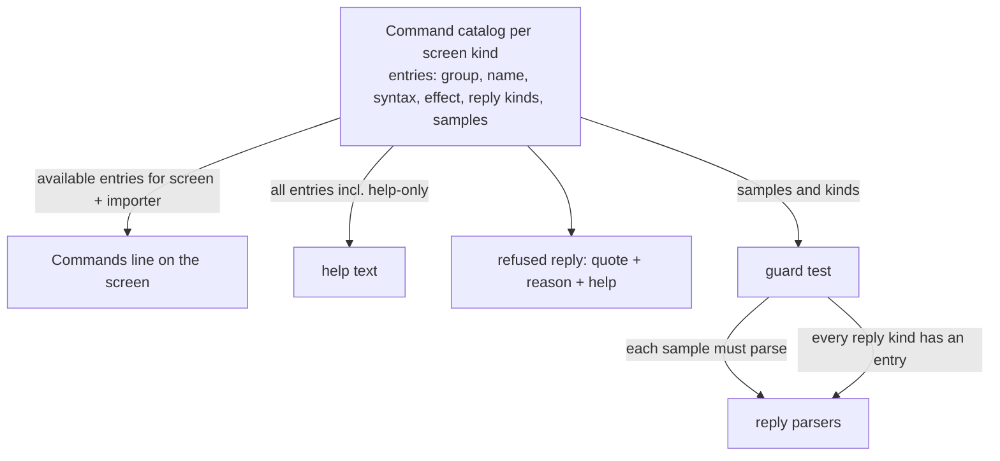

# Compact Import Screen Hints - Plan

## Goal Capsule

- **Objective:** A user reviewing a Veracode, Waltz or email import sees the typed commands a screen offers in one glance (the rest are explained in `help`), can find a command such as `search` without the manual, and gets the longer explanation only when asking for it or after a refused reply. The accept words say what they hide.
- **Means:** One command catalog per screen kind feeds the line, `help` and the refused-reply help (KTD1).
- **Product authority:** The requesting user (rbreunung); decisions marked `session-settled` are theirs.
- **Execution profile:** One pull request; the units share the catalog and cannot merge usefully apart.
- **Open blockers:** None.
- **Finishes:** `ce-work` implements on `claude/compact-import-screen-hints-plan`; opening a PR is a separate request.

---

## Product Contract

**Product Contract preservation:** changed: R7 and AE5 (a refused reply now prints the screen's help, user-directed), the Summary and Key Decisions lines that mention it, and the email-preview assumption (now checked against the code); R1–R6 and R8–R14 unchanged. The Outstanding Questions section is gone because planning resolved both questions (line wording in U1, email preview mapping in U5).

### Summary

Every import review screen keeps its clickable primary actions and replaces the stacked hint paragraphs with one grouped `Commands:` line that lists only what that screen accepts for that importer. A `help` reply or link prints the full explanations for the current screen once, and a refused reply prints the same help. Paging controls show only for directions that exist. `accept` is renamed `accept CVE`, and a bare `accept` writes nothing.

### Problem Frame

The New screen can show up to seven full-sentence hint paragraphs (include/exclude, merge and add, accept, accept component, paging, create, exit), and every new command adds another. The cost showed up the other way too: `search` shipped in PR #103 and no screen mentions it, so it only appears after a wrong reply or after `search` or `export` has already been used.

The accept words add a second problem. `accept` hides CVEs on the New screen only, and `accept component` hides a whole component at a version, which also removes it from Already ticketed and proposes closing its open ticket. Both persist to `.jira-oss-accepted.json`, and the short spelling is the less used one.

### Key Decisions

- **Compact by default; `help` prints the long text once and nothing sticks.** (session-settled: user-directed — chosen over a sticky `help off` toggle and over full text by default: "always collapsed except when I type/click help, then it once prints the longer help".) Governs R1, R6.
- **Existing click actions stay; only the explanatory sentences are compressed.** (session-settled: user-approved — chosen over folding links and commands into one strip, and over links-only: clicking stays the fast path and the strip is the reminder.) Governs R1.
- **`accept` becomes `accept CVE`.** (session-settled: user-directed — chosen over keeping `accept`: component is the case the user uses, and the word should name its effect.) Governs R9, R11.
- **Bare `accept <rows>` writes nothing and shows both spellings.** (session-settled: user-approved — chosen over an alias for CVE and over making bare `accept` mean component: acceptance is a persistent write and the two kinds differ in effect.) Governs R10.
- **The pattern is any screen that lists typed commands.** (session-settled: user-directed — chosen over report-import screens only: "every screen following the pattern".) Applied here to the import screens, their add and merge prompts and the email cleanup preview. One-line choice prompts do not stack hints and stay as they are. Governs R12.
- **Paging controls show only for directions that exist.** (session-settled: user-directed — requested after the first examples.) Governs R4.
- **A refused reply prints the screen's full help.** (session-settled: user-directed — chosen over a link to `help` only and over printing help only when nothing was recognized: a refused reply is when the syntax is least known.) Governs R7.

### Requirements

**Screen layout**

- R1. Each in-scope screen keeps its clickable primary actions and shows one `Commands:` line, grouped by purpose and ending with a clickable `help`, in place of the explanatory hint paragraphs.
- R2. The `Commands:` line lists only commands the screen accepts for that importer: `search` on New and Already ticketed for Veracode and Waltz and not for email, the accept words for Waltz only.
- R3. A command that takes arguments appears as its bare name in the line, and `help` gives the syntax.
- R4. `next` shows only when a later page exists and `prev` only when an earlier one exists. `page <n>` shows only with three or more pages. A single page shows no paging control. These words are the existing clickable controls on the page line beside the primary actions, not part of the `Commands:` line, and `help` explains them. The words stay valid at the boundary and answer that the user is on the first or last page, changing nothing.
- R5. The strip, `help` and the refused-reply help come from one list of commands per screen, so they cannot disagree with each other or with what the screen accepts.

**Help and discoverability**

- R6. `help`, as a reply or a click, prints the full explanation for the current screen once, giving each command's syntax and effect. It leaves the session unchanged and the next screen is compact again.
- R7. A refused reply, whether the screen could not read it or read it and refused it, shows a short defused quote of what was typed when nothing was recognized, the specific reason when there is one, and then the screen's full `help`.
- R8. `search` is listed on New and Already ticketed for Veracode and Waltz and explained in `help`. `show` is explained in `help` only.

**Accept words**

- R9. `accept CVE <rows>` hides those rows' CVEs exactly as `accept <rows>` does today, including the optional `because …` reason and the New-screen-only effect. It is case-insensitive.
- R10. A bare `accept <rows>` records nothing and answers with the two spellings, `accept CVE <rows>` and `accept component <rows>`.
- R11. `accept component`, `accepted`, `unaccept` and the Remove links keep their current words and behavior.

**Coverage and guards**

- R12. The compact line and `help` apply to the overview, New, Already ticketed and Stale screens and the email cleanup preview. The add and merge prompts show a single `help` link instead of the full line.
- R13. The user manual and README tables describe the `Commands:` line, `help`, `search`, `show` and the new accept words.
- R14. A test fails when a command a screen's reply parser accepts appears in neither that screen's `Commands:` line nor its `help` text, or when the line lists a command the parser rejects.

### Acceptance Examples

- AE1. **Covers R1, R2, R4.** Given a Waltz import with three pages of new rows, when page 1 shows, the screen shows `next` and `page <n>`, no `prev`, and a `Commands:` line with `search`, `accept CVE` and `accept component`. A Veracode import shows no accept words. An email import shows no `search`.
- AE2. **Covers R6.** When the user replies `help` on the New screen, the full text for that screen prints once, and the next screen shows the compact line again.
- AE3. **Covers R10.** When the user replies `accept 2 4`, nothing is written to `.jira-oss-accepted.json` and the reply shows both spellings.
- AE4. **Covers R4.** When the user replies `next` on the last page, the reply says it is the last page and the session is unchanged.
- AE5. **Covers R7.** When the user replies `2x` on the New screen, the reply quotes `2x` as not understood and prints the New screen's help. When the user replies a row that is not on the page, the reply gives that reason, then prints the same help.
- AE6. **Covers R9.** When the user replies `accept cve 2 because not reachable`, row 2's CVEs are accepted with that reason, as `accept 2 because not reachable` does today.

### Success Criteria

- A user who has never seen `search` finds it from the New or Already ticketed screen without opening the manual.
- The default New screen drops from up to seven hint paragraphs to one `Commands:` line beside its existing click actions.

### Scope Boundaries

Deferred for later:

- A VS Code setting for the default hint style.
- A sticky help mode.
- Searching Jira beyond the tickets the review already matched.
- Renaming `unaccept`.

Outside this plan:

- Changing what any command does, other than the accept rename and the boundary answers in R4.
- Status and warning lines (the 50-row batch notice, the out-of-date notice, "nothing to apply", the accepted-hidden count) and the contextual lines after `search`, `export` and the merge confirmation keep their wording.
- The email cleanup consent screen (Model check, Skip model, Cancel), which is three links with nothing to explain.
- The one-line choice prompts in ticket creation, template generation, field disambiguation and bulk cleanup, and the PR review follow-ups. Their `Reply` occurrences were single-choice lines when this plan was written; revisit if one starts stacking hints.

### Dependencies / Assumptions

- Builds on the `search`, `show` and `merge … into` replies from PR #103 (`docs/plans/2026-10-24-1051-feat-import-ticket-search-plan.md`).
- The accepted-list file format and stored sessions do not change, and no chat link sends the bare `accept` word today.
- The email cleanup preview accepts `strip`, `keep`, `model check`, row ids, `save <n>` and cancel (`parseEmailCleanupReply` in `src/participant/session/emailCleanup.ts`).

### Sources / Research

- Current hint paragraphs: `src/participant/session/importScreens.ts` (`buildNewGroupScreen`, `buildTicketedGroupScreen`, `buildStaleGroupScreen`, `groupScreenExitLine`, `buildSearchFollowUp`).
- Current vocabulary lines and accept parsing: `src/participant/session/importReplies.ts` (`describeImportReplyVocabulary`, `parseAcceptReply`, `parseAcceptComponentReply`).
- Screen options that gate hints: `src/participant/jira/importReviewScreen.ts` and `ImportScreenOptions` in `importScreens.ts`, which carry `canFold`, `canAccept`, `canMergeTickets` and `canExport` but no search option.
- Behavior and user wording: `docs/report-import.md` ("search and show", accepted CVEs and components) and `docs/manual/report-imports.md`.

---

## Planning Contract

### Key Technical Decisions

- KTD1. **One command catalog per screen kind, in a pure module.** The Commands line, `help` and the refused-reply help are all built from it. The reply parsers stay hand-written and are checked against the catalog rather than generated from it. The drift that hid `search` came from separate strings per screen; one list removes that class of drift. Governs R1, R5, R6, R7.
- KTD2. **The guard test drives the real parsers from the catalog.** Each catalog entry declares the reply kinds it covers and sample replies. The test feeds every sample to the real parser, expects a non-refused action, and maps every reply kind the parser can return to a catalog entry through a typed exhaustive record, so a new reply kind fails to compile until it has an entry. Chosen over snapshotting rendered text, which breaks on every wording change and proves nothing about the parser. Governs R14.
- KTD3. **`help` is a reply kind on every screen, handled like `search`.** The handler prints the help, writes no session state and returns the review session's metadata so the review stays open. A session in flight claims the turn before the generic greeting and help detection in `src/participant/JiraParticipant.ts`, so a `help` typed during a review is not read as the greeting. Governs R6.
- KTD4. **Boundary paging answers come from the handler, not the parser.** The handler knows the current page and page count per view, so a `next` past the last page, a `prev` before the first, or any paging word on a single page answers in one line and neither re-renders nor changes the session. `page <n>` out of range keeps today's clamp to the nearest page, because R4 asks only for the first-page and last-page answers. Governs R4.
- KTD5. **The refused reply quotes the typed text through the existing untrusted-text neutralizer** and goes out as trusted chat markdown, as the refused reply does today, because the help block carries command links. The quote is single-line and capped so pasted text cannot flood the reply or render as a link. Governs R7.
- KTD6. **Bare `accept` is answered per screen.** On New it names both spellings. On Already ticketed, where only the component form exists, it names `accept component` and says `accept CVE` works from New. Neither writes anything. Governs R10.

### High-Level Technical Design

The catalog is the single source; the guard test is the only consumer that also touches the parsers.

Directional only: group labels and wording are fixed in U1, and the parsers keep their current shape.

### System-Wide Impact

- No stored state changes: the review session schema, the schema version and `.jira-oss-accepted.json` stay as they are, so in-flight sessions survive the upgrade.
- `@jira` participant routing is untouched; `help` rides the existing review-session branch.
- The same catalog module serves the import screens and the email cleanup preview, so a later change to one command word is made in one place.

### Risks & Dependencies

- Many existing tests assert the old hint sentences (the `sessionImport*` and `reportImport*` suites and `emailHandler.test.ts`). U2 to U5 rewrite them to assert what the line lists and what `help` explains, so they stay green without keeping the old wording.
- `help` could collide with the generic greeting detection. KTD3 records why it does not, and U4 adds a scenario that proves it.
- The help block on a Waltz New screen with every capability is the longest case. Accepted, since it prints only on request or after a refused reply.

---

## Implementation Units

### U1. Command catalog

**Goal:** Create the single per-screen command list and the three builders that read it.

**Requirements:** R1, R2, R3, R5, R6, R7, R8

**Dependencies:** none

**Files:**
- Create `src/participant/session/importCommands.ts`
- Modify `src/participant/sessionState.ts` (barrel export, next to `importReplies`)
- Test `src/test/importCommands.test.ts`

**Approach:**
- Define a capabilities type from the flags `ImportScreenOptions` and `ImportReplyContext` already share (`canFold`, `canAccept`, `canMergeTickets`, `canExport`, `canSearch`, `actionLabels`, `singleGroup`), so both pass it without conversion.
- One entry per command: group, bare name for the line, syntax and one-sentence effect for `help`, the reply kinds it covers, sample replies, the views and capabilities that enable it, and a help-only flag.
- Group labels follow the confirmed examples: rows, group, hide, find on New; row, all, tickets, hide on Already ticketed; toggle on Stale. `show`, the paging words and the typed `export` forms are help-only; the Export link line stays on the screens.
- Ticketed row-action names go through `actionLabelOf` so Waltz shows `new ticket`, and only actions some open row offers are listed, as `describeImportReplyVocabulary` does today.
- Builders: the `Commands:` line with a trailing `help` link, the full help block, and the refused reply (defused quote, optional reason, help; KTD5).
- Include the email preview's entries here (mapped in U5) so one module owns every command list.

**Patterns to follow:** `describeImportReplyVocabulary` in `src/participant/session/importReplies.ts` for capability gating, `cmdLink` and `neutralizeMarkdownLinks` in `src/participant/session/primitives.ts`.

**Test scenarios:**
- Covers AE1. Waltz New with every capability lists `search`, `accept CVE` and `accept component`; Veracode New lists no accept word; an importer without `canSearch` lists no `search`.
- Every catalog entry available on a screen appears in that screen's help; help-only entries (`show`, paging words, `export csv`) do not appear in the line.
- Waltz Already ticketed lists `A2 new ticket`, not `A2 follow-up`; an importer whose rows offer no `re-create` does not list it.
- A single-group import lists `export` forms in help on group screens; a multi-group import does not on group screens.
- The refused-reply builder quotes `2x` once, defuses `[x](command:evil)` so it renders as text, caps a 500-character input, and puts the reason before the help.

**Verification:** `npm test -- importCommands` passes; the module imports no `vscode`.

### U2. Reply parsing: `help` and the accept words

**Goal:** Add the `help` reply on every screen, rename `accept` to `accept CVE`, and make a bare `accept` a no-op answer.

**Requirements:** R6, R9, R10, R11

**Dependencies:** U1

**Files:**
- Modify `src/participant/session/importReplies.ts`
- Test `src/test/reportImportAcceptReplies.test.ts`, `src/test/sessionImportSearchReplies.test.ts`, `src/test/sessionImportReview.test.ts`, `src/test/sessionImportFolding.test.ts`, `src/test/sessionImportMerge.test.ts`

**Approach:**
- Add a `help` kind to `ImportReplyAction`; recognize the word on the overview, New, Already ticketed and Stale parsers ahead of the exit words, for every importer (no capability gate).
- `parseAcceptReply` requires the `accept CVE` form, case-insensitively, with the same row matching and `because` handling. Any other `accept …` that is not `accept component` is refused with the per-screen bare-`accept` reason (KTD6); refused usage strings name the new spelling.
- Remove `describeImportReplyVocabulary`; its callers use the catalog builders from U1.
- Leave `accept component`, `accepted`, `unaccept` and `unaccept-component` untouched.

**Patterns to follow:** `parseSearchReply` and `parseShowReply` for the always-answered-here reply shape.

**Test scenarios:**
- Covers AE6. `accept cve 2 because not reachable` and `Accept CVE 2` return an `accept` action with ids `["2"]` and the reason; the old `accept 2 4` returns a refusal and no action.
- Covers AE3. Bare `accept 2 4` on New refuses with both spellings; on Already ticketed it refuses naming `accept component` and says `accept CVE` works from New; neither returns an accept action.
- `accept component 2 4` and `accept component A2` still return `acceptComponent` actions.
- `help` returns a `help` action on all four views for a Veracode, a Waltz and an email-style context; `HELP` and ` help ` do too.
- A row id that happens to be typed after `accept cve` but is not on the page is refused with the existing row reason.

**Verification:** the listed suites pass; no parser test still pins the old `accept 2 4` form.

### U3. Screens and prompts

**Goal:** Replace the hint paragraphs on each screen with the page line, the `Commands:` line and a `help` link, and give the add and merge prompts a single `help` link.

**Requirements:** R1, R2, R3, R4, R8, R12

**Dependencies:** U1

**Files:**
- Modify `src/participant/session/importScreens.ts`
- Modify `src/participant/jira/importReviewScreen.ts` (map `canSearch` into the screen options)
- Modify `src/participant/session/importReplies.ts` (`buildAddPrompt`, `buildMergePrompt`, `buildCloseMergePrompt` end with a `help` link)
- Test `src/test/reportImportOverview.test.ts`, `src/test/reportImportReviewPaging.test.ts`, `src/test/reportImportStale.test.ts`, `src/test/reportImportTicketedActions.test.ts`, `src/test/reportImportMerge.test.ts`, `src/test/reportImportVeracodeMerge.test.ts`, `src/test/reportImportTicketSearchVeracode.test.ts`, `src/test/reportImportExport.test.ts`

**Approach:**
- Add `canSearch` to `ImportScreenOptions`, set from `descriptor.dedupKeyOf !== undefined` exactly as the reply context already does.
- One shared page-line builder for New, Already ticketed and Stale: position text, `prev` and `next` links only for existing directions, `page <n>` only with three or more pages, nothing on a single page. The notes about actions applying to every page and tickets closing together move into help.
- New: keep Include all / Exclude all, the accepted-hidden line, the count line and the Create link; drop the fold, accept, accept component, toggle and paging sentences. Already ticketed: keep the Apply link, the batch-limit notice, the one-kind shortcuts and the nothing-to-apply statuses; drop the row-action, merge and accept component sentences. Stale: keep the Close link and the mixed-issue-type warning; replace the "Close 0 tickets" instruction with a plain status.
- Exit, Export and Show lines reduce to their links; overview keeps its structure and gains the `help` link.
- The three prompts keep their text and append one `help` line after the existing "nothing is written until you click" statement.

**Patterns to follow:** `cmdLink`-based link lines already in `importScreens.ts`; the status-line wording that stays.

**Test scenarios:**
- Covers AE1. Three-page New screen: page 1 shows `next` and `page <n>`, no `prev`; page 2 shows both and `page <n>`; page 3 shows `prev` and `page <n>`.
- Two pages show only the one valid direction and no `page <n>`; one page shows no paging text at all (New, Already ticketed, Stale).
- The Waltz New screen contains one `Commands:` line and none of the removed sentences; the Veracode one has no accept words; the email screen has no `search`.
- Already ticketed keeps the Apply link, the "only the first 50 rows run per reply" notice with more than 50 pending rows, and the nothing-to-apply status.
- Stale with nothing marked shows the plain status plus the line; with a mixed-issue-type selection it still shows the warning.
- The overview ends with the `help` link; the add, merge and close-merge prompts end with it and keep their confirmation links unchanged.

**Verification:** the listed suites pass with the line and links asserted, not the old sentences.

### U4. Review handler: `help`, refused replies, page boundaries

**Goal:** Make the review handler print help on request and after a refused reply, and answer paging words at a boundary.

**Requirements:** R4, R6, R7

**Dependencies:** U2, U3

**Files:**
- Modify `src/participant/jira/reportImportHandler.ts`
- Test `src/test/reportImportHandler.test.ts`, `src/test/reportImportReviewPaging.test.ts`, `src/test/reportImportStale.test.ts`, `src/test/reportImportTicketedActions.test.ts`

**Approach:**
- `help`: stream the catalog help for the current view as trusted chat markdown, persist the session unchanged, return the review session metadata, and log one `logDiag` info line (KTD3).
- Refused replies: replace the "Didn't understand that." plus vocabulary line with the refused-reply builder, passing the typed text and the parser's reason (KTD5).
- Page navigation: compute the current page and page count per view with the existing clamp helpers, answer `next` past the last page, `prev` before the first and any paging word on a single page in one line with no re-render, and leave `goto` out of range clamping as today (KTD4).
- A reply typed while a merge run is waiting is still read by the merge flow first; this unit does not change that order.

**Patterns to follow:** the `search` and `export` cases in the same `switch`, which end with the session persisted and the metadata returned.

**Test scenarios:**
- Covers AE2. `help` on the New screen streams the help, leaves `session.rows`, `page` and `view` unchanged, keeps the review session open, and the next `show` renders the compact screen.
- Covers AE5. `2x` on New streams the quote, then the full help; `5` when row 5 is not on the page streams the reason, then the same help.
- Covers AE4. `next` on the last page of Already ticketed, Stale and New streams the last-page line and does not re-render or change the page; `prev` on page 1 streams the first-page line; `next` on a single page says there is one page.
- `page 9` on a three-page New screen still lands on page 3.
- `help` typed during a review is answered by the review, not by the generic greeting.
- The quote of a reply containing a markdown link renders as plain text.

**Verification:** the listed suites pass; the handler tests assert the streamed text and the unchanged session.

### U5. Email cleanup preview

**Goal:** Give the email cleanup preview the same `Commands:` line and `help`, with refused replies printing the help.

**Requirements:** R1, R5, R6, R7, R12

**Dependencies:** U1

**Files:**
- Modify `src/participant/session/emailCleanup.ts` (`buildEmailCleanupPreview`, `parseEmailCleanupReply`)
- Modify `src/participant/jira/emailHandler.ts` (preview-phase reply handling)
- Modify `src/participant/session/importCommands.ts` (the preview's entries)
- Test `src/test/sessionEmailCleanup.test.ts`, `src/test/emailHandler.test.ts`

**Approach:**
- Replace the preview's explanation paragraphs (what `strip` and `keep` do, the exclude-a-row sentence, the "patterns may have missed something" paragraph) with one `Commands:` line and a `help` link; keep the Strip / Keep / Model check / Cancel links and the per-email rows.
- Line entries: `strip`, `keep`, `model check` only while an email can still be checked, row ids for a batch of more than one email, and `save <n>` only while a model-found block can be saved. The single-email and batch wording of what `strip` removes moves into help.
- Add a `help` action to the preview phase of `parseEmailCleanupReply`; the handler prints the preview help without redrawing. The default case prints the refused reply with the help in place of the one italic sentence.
- The consent screen and its reply handling stay as they are.

**Patterns to follow:** the preview's existing link line and `showCleanupScreen` notice handling.

**Test scenarios:**
- A batch preview shows the `Commands:` line with row ids and none of the removed paragraphs; a single-email preview shows no row-id entry.
- `model check` is absent from the line once every email is checked or excluded; `save <n>` is absent when no model-found block exists.
- `help` in the preview prints the help and leaves exclusions and saved blocks unchanged; `help` in the consent phase is still refused as today.
- An unreadable reply in the preview prints the quote and the help; `3` for a row that does not exist does too.
- Every sample in the preview's catalog entries is accepted by `parseEmailCleanupReply`.

**Verification:** the listed suites pass; the preview contains no sentence that explains how to type a command.

### U6. Guard test

**Goal:** Fail the build when a screen's line, its help and its parser disagree.

**Requirements:** R14, R5

**Dependencies:** U1, U2, U3, U5

**Files:**
- Create `src/test/importCommandsGuard.test.ts`

**Approach:**
- For Veracode, Waltz and an email-style capability set, build each view's line and help from the catalog, and feed every available entry's samples to `parseImportReviewReply` (or `parseEmailCleanupReply` for the preview) with a matching context.
- Map every `ImportReplyAction` kind to the catalog entry that covers it, or to an explicit "not a typed command" marker, in a record typed so a missing kind fails `npm run compile` (KTD2).
- Assert every command in a line also appears in that view's help, and that capability gating holds (no `search` for email, no accept words for Veracode).

**Test scenarios:**
- Covers R14. A sample that the parser refuses fails the test with the entry id and view in the message.
- A reply kind with no catalog entry fails to compile.
- A command listed in the line but missing from help fails.
- Boundary paging words and `show` pass because help lists them.

**Verification:** `npm run compile` and `npm test -- importCommandsGuard` pass; deliberately removing a catalog entry makes the test fail.

### U7. Documentation

**Goal:** Update the user manual and the developer docs for the new screens and words.

**Requirements:** R13

**Dependencies:** U1, U2, U3, U4, U5

**Files:**
- Modify `docs/manual/report-imports.md` (a short "Commands line and help" section under reviewing an import, the `search` and `show` words, `accept CVE`, paging, and the email preview line)
- Modify `docs/report-import.md` ("search and show", accepted CVEs and components, paging, the catalog and the guard)
- Modify `CLAUDE.md` (a Key files row for `src/participant/session/importCommands.ts`)
- Test `src/test/userDocsSync.test.ts` (run only; it checks settings, commands and tools, not these words)

**Approach:**
- The manual states the user-facing behavior once, in the section that already describes the review screens, and updates every example that shows the old `accept 2 4`.
- `docs/report-import.md` describes where the catalog lives and the rule that a new reply word needs a catalog entry.
- README tables are checked for the old accept spelling and left alone when absent.

**Test expectation:** none -- documentation only; `userDocsSync` is run to confirm it still passes.

**Verification:** a search of `docs/`, `README.md`, `src/` and `CLAUDE.md` finds no remaining `accept 2 4` as a valid command.

---

## Verification Contract

| Check | Command | Applies to |
| --- | --- | --- |
| Type check | `npm run compile` | every unit; the reply-kind record in U6 fails here |
| Unit tests | `npm test` | every unit; must be green before each commit |
| Catalog and guard | `npm test -- importCommands importCommandsGuard` | U1, U6 |
| Review suites | `npm test -- reportImport sessionImport sessionEmailCleanup emailHandler` | U2 to U5 |
| Docs sync | `npm test -- userDocsSync` | U7 |

The chat flows themselves are not covered by `npm run test:e2e`, so the handler tests in U4 and U5 are the proof that `help`, refused replies and paging answers behave as specified.

## Definition of Done

- `npm run compile` and `npm test` pass.
- Every requirement R1 to R14 is covered by a unit's scenarios, and each acceptance example (AE1 to AE6) has a scenario that names it.
- No screen shows a hint paragraph that only explains how to type a command, and no refused reply repeats a vocabulary line instead of the help.
- The old `accept <rows>` form is gone from code, tests and docs, and a bare `accept` writes nothing.
- The manual, `docs/report-import.md` and `CLAUDE.md` describe the new behavior.
- Code or test scaffolding left from abandoned attempts is removed from the diff.
