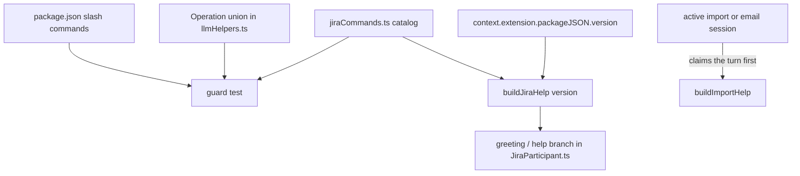

# @jira Help Catalog and /security-report Rename - Plan

## Goal Capsule

- **Objective:** Someone looking for how to export Veracode and Waltz items straight from Jira, or for what `@jira` can do at all, finds it by the command's name and in `@jira help`.
- **Means:** rename `/overview` to `/security-report` and replace the two-sentence greeting with one full grouped help screen built from a single catalog (KTD1).
- **Authority:** Product Contract requirements win on behavior; KTDs win on mechanism; units override neither.
- **Execution profile:** one pull request. Its title carries the breaking removal of `/overview`.
- **Stop conditions:** stop and ask if renaming the slash command breaks the `bundleSmoke` activation test in a way that is not a plain name change.
- **Finished and shipped by:** `ce-work` opens the PR; the user reviews and merges.

---

## Product Contract

### Summary

`/overview` becomes `/security-report`, with no alias. `@jira help`, and every prompt that today shows the greeting ("hi", empty, "what can you do"), prints one full help screen that names the tool and its version and lists every `@jira` command and flow in groups. In a Veracode or Waltz import, `export` and `/security-report` point at each other.

### Problem Frame

The command that exports open Veracode and Waltz tickets straight from Jira was called `/overview`, a name that says nothing about its content, and the only help `@jira` offers is a two-sentence blurb naming six operations. The feature existed and was documented in the manual, but a user inside Copilot Chat had no way to discover it. The recently added import-screen help (`importCommands.ts`) already fixes this problem for the import screens; the top level has no equivalent.

### Key Decisions

- **KD1. `/overview` is renamed to `/security-report` and not kept as an alias.** (session-settled: user-directed — chosen over `/security`, `/vulnerabilities`, `/release-risk` for the name and over a hidden `/overview` alias for compatibility: the user wants the old name gone and `security-report` says what the command produces.) Governs R1, R2.
- **KD2. `@jira help` is a full grouped catalog.** (session-settled: user-directed — chosen over a short blurb with a pointer to the manual and over a blurb with an extra "More" line: the user wants an extensive description of all commands available at that point.) Governs R3, R4.
- **KD3. There is one screen, with no separate greeting.** (session-settled: user-directed — chosen over a short greeting plus a separate `help`: the user has no use case for the greeting.) Governs R3.

### Requirements

**Rename**

- R1. `@jira /security-report [PROJECT] [csv|xlsx]` does what `@jira /overview` did; `/overview` is no longer registered, routed, or mentioned as a command. The save links the report prints re-run `/security-report`.
- R2. User-facing text calls this feature the "security report" (command description, replies, docs headings, the CSV-delimiter setting description). The import hub screen, its `Back to overview` link, and the `overview` command view keep the name "overview".

**Help screen**

- R3. An empty prompt, "hi", "help", "what can you do" and the other phrases `isGreetingOrEmpty` matches print the same full help screen. Its title shows the tool name and the extension version (`**Ticket Sidekick `@jira` · v<version> — Help**`). The suggestion chips below it stay.
- R4. The help lists every `@jira` slash command and every user-triggerable operation in groups (tickets; bulk work and setup; imports; security report), each bullet a code-span command plus one sentence, ending with "`help` prints this list again." A guard test fails when a slash command in `package.json` or an operation the intent parser can return has no entry.
- R5. The help follows the import screens' help conventions: a bold title, flat code-span bullets, commands in code spans, no clickable sample links (their placeholder text would be sent as-is). Group headings are the one addition.
- R6. Inside an active import review or email cleanup preview, `help` still prints that screen's commands.

**Discoverability**

- R7. The import screens' `export` help sentence says the report matches `@jira /security-report`, and the top-level help says `/security-report` is also reachable as `export` inside a Veracode or Waltz import.

**Documentation**

- R8. README, the user manual, the domain docs, `CLAUDE.md` and the `package.json` setting description reflect R1-R7 in the same change.

### Scope Boundaries

**Not built, with the reason:**

- A `/overview` alias: KD1.
- Natural-language routing of "export my veracode tickets" to the security report: not requested, and the slash command plus the help now surface it. Revisit if users still miss it.
- Extra help trigger phrases such as "commands" and "list commands": nobody asked for them, "help" and "what can you do" already reach the screen, and `isGreetingOrEmpty` is shared with `@bitbucket` (`BitbucketParticipant.ts`), so a new phrase would change that participant too. Revisit if users type those words and get nothing.
- Renaming internal files and symbols (`overviewHandler.ts`, `securityOverview*.ts`, `handleSecurityOverview`): no user sees them, and renaming would churn every test import. Revisit if the mismatch confuses contributors.
- Editing `CHANGELOG.md`: the release workflow generates it from the PR title.

#### Deferred to Follow-Up Work

- Check whether a typed `help` is treated as an answer inside other multi-turn sessions (ticket creation, cleanup). U3 observes this; a fix, if one is needed, is a separate change recorded in `docs/known-limitations.md`.

---

## Planning Contract

### Key Technical Decisions

- KTD1. **A sibling catalog module, `src/participant/session/jiraCommands.ts`, not new entries in `IMPORT_COMMAND_ENTRIES`.** The import catalog's entries take `ImportCommandCaps` and screen views; the top level has neither. The new module keeps only the entry fields the top level uses (`id`, `group`, `help`, and the operations or slash commands it covers), reuses the `code()` helper from `primitives.ts`, and uses the `**Help — …**` title and closing sentence, so the two read alike. It has no `samples` or `when`: nothing at the top level gates an entry or renders a sample. It is pure, `vscode`-free, and re-exported through `sessionState.ts`. Governs R3-R5.
- KTD2. **The version is passed in, not read inside the builder, and is read when the help is shown.** `createJiraParticipant(context, …)` already holds the `ExtensionContext`; the greeting/help branch reads `context.extension?.packageJSON?.version ?? 'unknown'` and passes it to the pure `buildJiraHelp(version)`. Reading at that point, not at construction, keeps activation safe: the `bundleSmoke` context stub has no `packageJSON`. The pure builder stays loadable by Vitest. Governs R3.
- KTD3. **The guard test reads sources as text, like `importCommandsGuard.test.ts`.** `src/test` is outside the compile project, so the test parses the `Operation` union in `llmHelpers.ts` and the `package.json` commands and compares them to a record mapping each to a catalog entry id, or to an explicit internal-only marker. A new operation or slash command then fails the test until it is advertised. Governs R4.
- KTD4. **The help is the greeting.** `isGreetingOrEmpty` still routes to the one branch in `JiraParticipant.ts`; that branch streams `buildJiraHelp(version)` instead of the blurb, and still returns the `greeting` follow-up state so the chips remain. `GREETING_OR_HELP_PHRASES` is not changed (see the extra-phrases non-goal). Governs R3, R6.
- KTD5. **Bullet phrasings come from the intent parser's own triggers.** The bulk-work bullets (`cleanup`, workflow discovery, spell check, templates, upload) use the trigger wording in `INTENT_PROMPT` so the text matches what actually works. Governs R4.

### High-Level Technical Design

---

## Implementation Units

### U1. Rename the slash command and its wording

- **Goal:** `/overview` becomes `/security-report` everywhere a user or a re-run link sees it.
- **Requirements:** R1, R2.
- **Dependencies:** none.
- **Files:** `package.json` (the `jira` command entry and the `overviewCsvDelimiter` description), `src/participant/JiraParticipant.ts` (the `request.command` route and its comment), `src/participant/jira/overviewHandler.ts` (the "Please name a project" reply, the csv/xlsx re-run commands, the "Saved the overview to …" reply, doc comment), `src/utils/securityOverview.ts` (comment), `src/test/overviewHandler.test.ts`, `src/test/reportImportExport.test.ts` (asserts the saved-file reply).
- **Approach:**
  - Rename the command `name` and update its `description` so it names Veracode and Waltz first.
  - Replace `command === 'overview'` and every `/overview …` string the handler emits, including the two save links, so the links re-run `/security-report`.
  - Say "security report" in user-facing replies, including "Saved the security report to …", which `importExport.ts` reuses through `saveOverviewFile`; leave identifiers and filenames alone.
- **Patterns to follow:** the existing slash-command registration in `package.json`; `buildChatCommandLink()` for the save links.
- **Test scenarios:**
  - `@jira /security-report SEC` streams the same tables as before and its Save as CSV / Save as Excel links decode to `@jira /security-report SEC csv` and `… xlsx`.
  - With no project and no default project, the reply tells the user to run `@jira /security-report PROJ`.
  - `request.command === 'overview'` is no longer routed (the handler falls through to the intent parser).
  - The existing csv/xlsx save and delimiter scenarios pass under the new command name, and the saved-file reply reads "Saved the security report to …" for both the slash command and an import's `export csv`.
- **Verification:** `npm test` passes; a search for `@jira /overview` and for the handler's `/overview <PROJECT>` command strings finds nothing in `src/`, `package.json` and the user-facing docs (earlier plan files excluded).

### U2. The `@jira` help catalog and its guard test

- **Goal:** one pure catalog that renders the full grouped help and cannot drift from the commands and operations.
- **Requirements:** R3, R4, R5, R7.
- **Dependencies:** none (U1 supplies the final command name; the catalog can be written against it).
- **Files:** `src/participant/session/jiraCommands.ts` (new), `src/participant/sessionState.ts` (re-export), `src/test/jiraCommands.test.ts` (new), `src/test/jiraCommandsGuard.test.ts` (new).
- **Approach:**
  - Entries grouped as Tickets, Bulk work and setup, Import, Security report; each entry has `id`, `group`, one help sentence with code-span commands, and the operations or slash commands it covers (plain strings).
  - `buildJiraHelp(version)` returns the title line with name and version, the groups with bullets, and the closing sentence. Phrasings follow KTD5.
  - The Import group notes that `help` inside an import lists that screen's commands, and that `export` there gives the same report as `/security-report` (R7). The Security report group names the csv/xlsx forms.
  - The guard maps every slash command in `package.json` and every `Operation` to an entry id or an explicit internal-only marker (KTD3).
- **Patterns to follow:** `src/participant/session/importCommands.ts` (entry shape, `code()`, `buildImportHelp`) and `src/test/importCommandsGuard.test.ts` (source-text check).
- **Test scenarios:**
  - `buildJiraHelp('0.8.4')` starts with the bold title containing `@jira` and `v0.8.4`, and ends with "`help` prints this list again."
  - Every group heading appears, in order, and every bullet is a flat code-span bullet with no markdown link.
  - The Security report bullets mention `/security-report`, `csv` and `xlsx`; the Import group mentions `export`.
  - Guard: removing an entry for an existing slash command or operation makes the guard fail with that name; an operation marked internal-only does not need a bullet.
- **Verification:** both new test files pass; `npm run compile` is clean.

### U3. Replace the greeting with the help screen

- **Goal:** the greeting branch streams the catalog help with the version.
- **Requirements:** R3, R6, KD3.
- **Dependencies:** U1, U2.
- **Files:** `src/participant/JiraParticipant.ts` (the greeting branch and `createJiraParticipant`), `src/test/jiraParticipantGreeting.test.ts` (new), `src/test/bundleSmoke.test.ts` (run unchanged; it must still pass).
- **Approach:**
  - Read the version inside the greeting/help branch (KTD2) and stream `buildJiraHelp(version)` as plain markdown; use `trustedChatMarkdown` only if the help ever contains command links.
  - Keep returning the `greeting` follow-up state so the chips stay (KTD4). Leave `GREETING_OR_HELP_PHRASES` alone.
  - No test file drives `createJiraParticipant` today, so add a handler-level test with a mocked `vscode`, modeled on `src/test/bitbucketReviewFlow.test.ts`. If that harness proves much larger than the branch it tests, extract the branch into a small pure function and test that instead.
  - R6 is existing behavior (an in-flight session claims the turn before the greeting check), so the existing import help tests (`reportImportHelp.test.ts`) cover it; the new test adds one case only if the harness makes it cheap.
  - While testing, observe whether `help` typed with a creation or cleanup session open is swallowed as an answer; record the finding for the deferred follow-up, do not fix it here.
- **Execution note:** run `bundleSmoke.test.ts` right after wiring the version read; it is the activation check.
- **Patterns to follow:** the existing greeting branch; `bitbucketReviewFlow.test.ts` for the mocked-`vscode` handler harness.
- **Test scenarios:**
  - An empty prompt, "hi", "help" and "what can you do" each stream the help with the version and return the `greeting` follow-up metadata.
  - When the context has no `packageJSON`, the help still streams and its title shows version `unknown` instead of throwing.
  - A prompt like "update HI-1 status" does not show the help.
  - The old blurb text ("manages Jira tickets in natural language") no longer appears.
- **Verification:** `npm test` passes, including `bundleSmoke.test.ts`; the suggestion chips still render for a greeting.

### U4. Cross-pointers in the import screens' help

- **Goal:** the Veracode and Waltz import screens tell the user the export is also a top-level command.
- **Requirements:** R7.
- **Dependencies:** U1.
- **Files:** `src/participant/session/importCommands.ts` (the `export` entry's help sentence), `src/test/importCommands.test.ts`, `src/test/reportImportHelp.test.ts`.
- **Approach:** extend the `export` help sentence to say the export matches `@jira /security-report`. Keep the entry's `kinds` and `samples` unchanged so the existing guard still holds.
- **Test scenarios:**
  - The overview and single-group screens of a Veracode and a Waltz import show the pointer in `help`.
  - An email import's help has no `export` bullet and no pointer.
  - `importCommandsGuard.test.ts` passes unchanged.
- **Verification:** the import help tests pass.

### U5. Documentation

- **Goal:** the user manual and developer docs match the change.
- **Requirements:** R8, R2.
- **Dependencies:** U1-U4.
- **Files:** `README.md` (slash-command table row, the help description), `docs/manual/report-imports.md` ("Open Veracode and Waltz tickets by release" section and the export paragraph), `docs/jira-flows.md`, `docs/report-import.md` ("Security overview" section and the due-date note), `docs/onboarding.md` (greeting detection section), `CLAUDE.md` (key-files rows for `JiraParticipant.ts`, `overviewHandler.ts`, `sessionState.ts`, plus a new `jiraCommands.ts` row), `docs/manual/settings-reference.md` (only if it names the old command).
- **Approach:**
  - README row becomes `@jira /security-report`, which `userDocsSync.test.ts` requires.
  - Retitle the manual section to use "security report"; add a short "Finding commands" note pointing at `@jira help`.
  - Update the onboarding doc: the greeting and `help` now show one full screen with the version.
  - Add the `jiraCommands.ts` row to `CLAUDE.md` with a one-line summary, per its "Where documentation belongs" rule.
- **Test expectation:** `userDocsSync.test.ts` covers the README slash-command row; chat wording is reviewed by hand (KL9).
- **Verification:** `npm test` passes; a search for `@jira /overview` returns nothing.

---

## Verification Contract

| Check | When | Proves |
| --- | --- | --- |
| `npm run compile` | after every unit | types, including the barrel re-export |
| `npm test` | after every unit, and before the commit | handler, catalog, guard, docs-sync and bundle-smoke tests |
| `jiraCommandsGuard.test.ts` | U2, then always | every slash command and operation is advertised |
| `userDocsSync.test.ts` | U1, U5 | README row for the renamed command |
| `bundleSmoke.test.ts` | U1 | the renamed command still registers and activates |

## Definition of Done

- All units' verification passes and `npm test` is green.
- No `/overview` slash command remains anywhere except the unrelated Bitbucket URL suffix.
- `@jira help` shows name, version and every group; the guard test fails when an entry is removed.
- Docs listed in U5 are updated in the same PR; no abandoned or experimental code remains in the diff.
