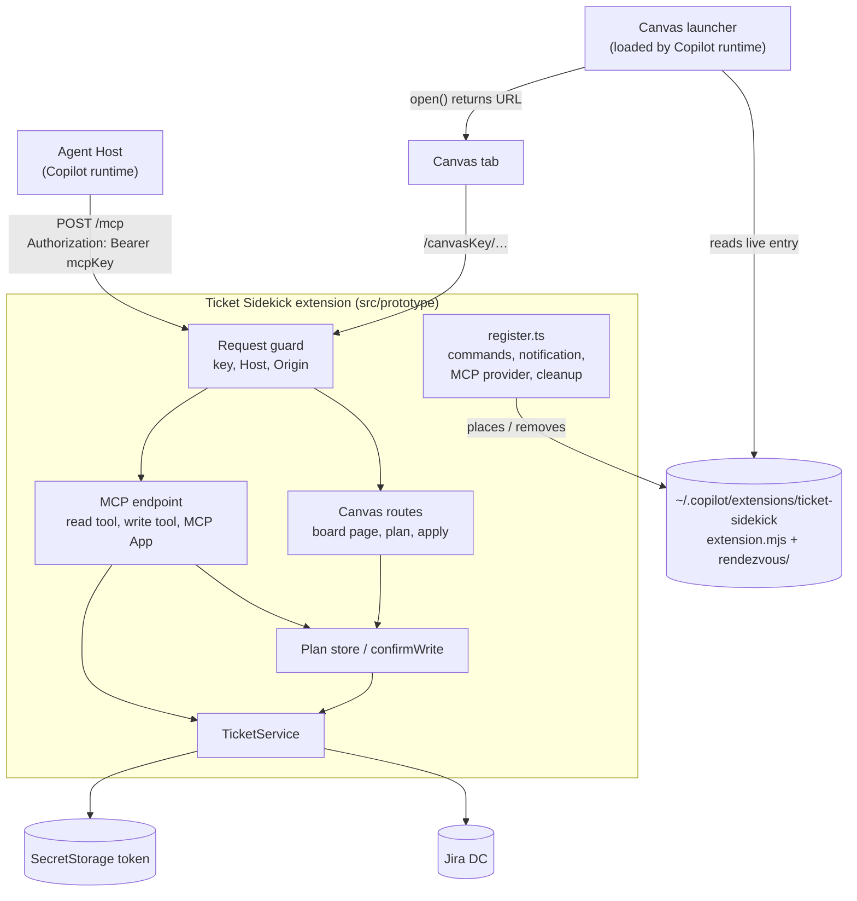
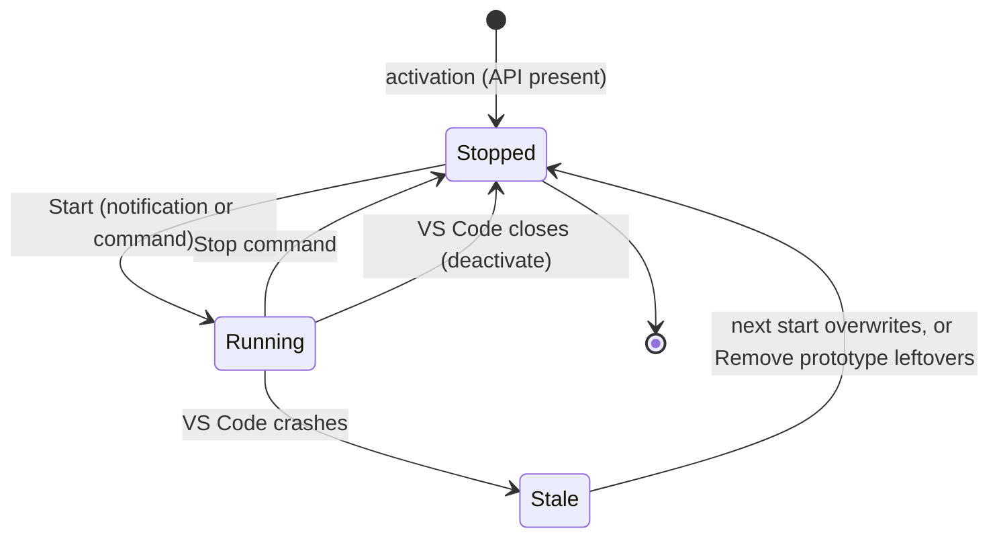
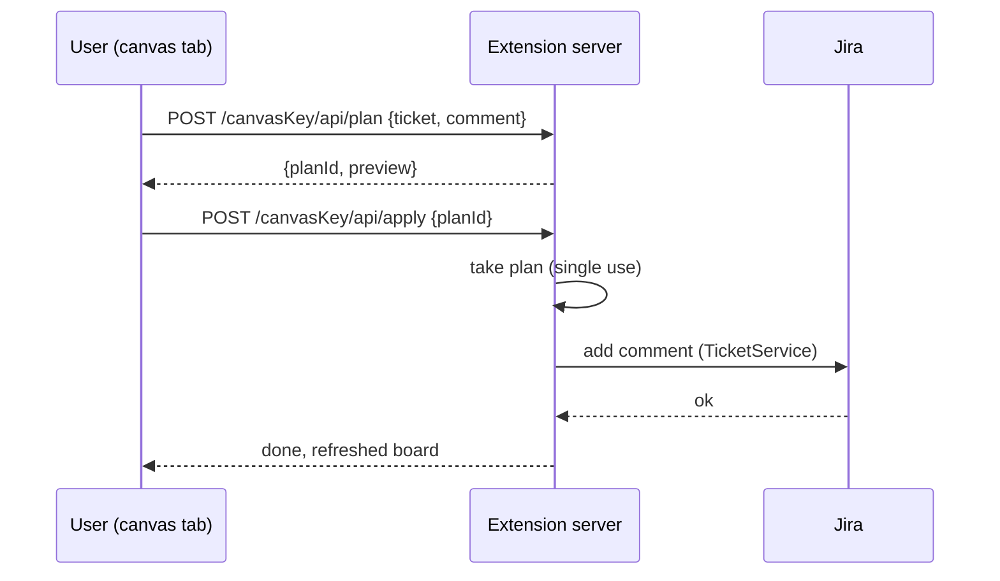

# Copilot Harness Localhost Prototype - Plan

## Goal Capsule

- **Objective:** On a managed machine, a user in a Copilot-harness chat session can read and write Jira through Ticket Sidekick, and work on a canvas board, with the extension's localhost server meeting every security rule of decisions D1–D5. Each open prototype check is answered with evidence, so the migration direction is either confirmed or a named decision is reopened.
- **Means:** a throw-away prototype inside the existing extension, started by hand in each VS Code session: one localhost server serving an MCP endpoint (with one MCP App) and a canvas page, plus a small canvas launcher (KTD1, KTD2, KTD5). Direction settled in [`docs/architecture/copilot-harness-migration.md`](../architecture/copilot-harness-migration.md) §6.6 and §11.
- **Authority:** Product Contract requirements win on behavior; KTDs win on mechanism; units override neither. The full migration (session engine, all flows, participant retirement) is not active scope.
- **Execution profile:** all units land on the feature branch `claude/intelligent-planck-gue5hu`. The user builds the `.vsix` locally from that branch and installs it by hand; the branch is not merged as is.
- **Stop conditions:** stop and ask if the bundled canvas launcher cannot join a Copilot session (KTD5 risk), or if any unit would need a new persisted setting or state to work (R20).
- **Finished by:** `ce-work` implements and verifies on the branch. The user runs the test protocol in the Appendix and pastes back the report; the next planning round starts from those results.

---

## Product Contract

### Summary

Build a minimal, unpublished slice of the decided architecture. When the user starts it for the current VS Code session, the extension runs one key-protected HTTP server on `127.0.0.1`. That server serves an MCP endpoint the Copilot harness uses, one MCP App, and a canvas board page found through a canvas launcher. Stopping the prototype, closing VS Code or installing the release build leaves nothing of it behind. The prototype exists to answer the four checks the architecture doc left open, and to show that the security rules hold in practice.

Product Contract preservation: changed R13, R14 (the user, during planning: the launcher exists only while the prototype runs; a per-session start replaces the install command and the "don't ask again" option). Added R20–R22. The three deferred questions are resolved (Scope Boundaries, KTD5, R10).

### Problem Frame

Chat participants are deprecated and unsupported in the Copilot harness, so `@jira` and `@bitbucket` only work while the Local harness is allowed. The architecture discussion settled the direction (D1–D5), but four facts could only be guessed from source: whether the Agent Host persists the forwarded MCP key, whether a managed sandbox blocks loopback connections, how several VS Code windows behave, and where a user-only rendezvous file can live on each OS. Building the real migration on a guess would be costly to unwind if one of them fails.

### Key Decisions

- **MCP is served by the extension over HTTP on `127.0.0.1`, sharing one server with the canvas page.** Governs R1, R5. (session-settled: user-directed — chosen over a stdio MCP process with a pipe credential broker: once the canvas needs a localhost server, a second process and protocol add cost without benefit.)
- **The access key is always on.** Governs R2, R3. (session-settled: user-directed — chosen over an optional key or loopback binding alone: any local user on shared machines and browser pages could otherwise reach the port.)
- **The extension serves the canvas page and its data; a thin launcher only returns the URL.** Governs R8, R9, R10. (session-settled: user-directed — chosen over a display-only canvas fed by the agent: one model turn per click and large reports flowing through the model.)
- **A canvas write is a click, a preview, then Apply; an agent-initiated write needs the VS Code modal.** Governs R11, R12. (session-settled: user-directed — chosen over always using the modal or acting on a single click.)
- **The launcher is placed by the extension only while the prototype runs, and a startup notification explains it.** Governs R13, R14, R21. (session-settled: user-directed — chosen over a separate agent plugin or committing the launcher per repository; the user then replaced the install command with a per-session start.)
- **The prototype starts only when the user triggers it in each VS Code session and stores nothing.** Governs R14, R20, R21. (session-settled: user-directed — chosen over an always-on build or an on/off setting: the user does not want a test build to change their VS Code profile.)
- **The prototype is built locally from the feature branch and installed by hand.** (session-settled: user-directed — chosen over a pre-release build on the Marketplace.)

### Actors

- A1. User: works in a Copilot-harness chat session and on the canvas tab.
- A2. Copilot agent: runs in the Agent Host and calls the MCP endpoint.
- A3. Ticket Sidekick extension: runs the localhost server, holds credentials in SecretStorage, talks to Jira.
- A4. Canvas launcher: a small Copilot SDK extension that the Copilot runtime loads.
- A5. Jira Data Center test project: the target of reads and writes.

### Requirements

**Localhost server**

- R1. The extension runs one HTTP server bound only to `127.0.0.1` on a random port, from the moment the user starts the prototype until it stops (R20).
- R2. Every request must carry the right key: MCP requests a bearer key, canvas requests a key in the URL path. Both keys are random, at least 256 bits, new at each start, kept only in memory and compared in constant time.
- R3. A request is refused with 403 when its `Host` is not exactly `127.0.0.1:<port>`, or its `Origin` is present and not the server's own origin. Responses carry no CORS headers.
- R4. Requests without a valid key are refused before any Jira call, and no refusal response or log line contains a key or a Jira token.

**MCP endpoint**

- R5. The extension registers its MCP server through `registerMcpServerDefinitionProvider` as an HTTP definition with the bearer key in `headers`, so it appears and works in a Copilot-harness session while the prototype runs.
- R6. The endpoint offers one read tool (load a Jira ticket) and one write tool (add a comment), both calling the existing `TicketService` with the token from SecretStorage.
- R7. The read tool can also return an MCP App that shows the loaded ticket inline in chat.

**Canvas**

- R8. While the prototype runs, the canvas launcher declares one canvas, a ticket board, and its `open()` returns the extension's URL with the canvas key in the path.
- R9. The extension writes the port and canvas key, never a Jira token, to a rendezvous file only the OS user can read, and removes it when the prototype stops.
- R10. The board page is served by the extension and shows live data: the unresolved tickets of the project in `ticketSidekick.jira.defaultProject`, most recently updated first.

**Writes**

- R11. A write started on the board (add a comment to a selected ticket) first shows a preview of exactly what will be written, and executes only after a second **Apply** click.
- R12. A write started by the agent through the MCP write tool shows a VS Code modal with the same preview and executes only after approval.

**Start, stop and cleanup**

- R13. Starting the prototype places the launcher in `~/.copilot/extensions/ticket-sidekick`; stopping it removes that folder unless another VS Code window still runs the prototype.
- R14. At each VS Code start, a notification explains what the prototype does (localhost server, MCP endpoint, canvas board) and offers **Start for this session** and **Not now**; the answer is not remembered.
- R20. The prototype never starts by itself: only the notification or the **Ticket Sidekick: Start prototype** command starts it, and it is stopped again after every VS Code restart. It writes no setting, `globalState` or `workspaceState` entry.
- R21. Stopping the prototype, closing VS Code normally, or running **Ticket Sidekick: Remove prototype leftovers** removes the launcher folder, the rendezvous file and the MCP server registration, so a release build installed afterwards finds nothing of the prototype.

**Prototype checks**

- R15. The prototype answers, with recorded evidence, whether the Agent Host writes the forwarded MCP bearer key anywhere on disk or into logs.
- R16. The prototype answers whether a managed sandbox policy (`allowLocalNetwork`, `sandboxMcpServers`) blocks the Agent Host's or the launcher's connection to `127.0.0.1`.
- R17. The prototype answers how two VS Code windows behave: which window's server a session and its canvas reach, and what the rendezvous file must hold per window.
- R18. The prototype answers where the rendezvous file lives on Windows and on Linux or macOS, and how "only this user can read it" is enforced on each.
- R19. The findings for R15–R18 are recorded in the architecture doc's decision log (§11), each stating whether it confirms D1–D5 or which decision it reopens.
- R22. A **Ticket Sidekick: Copy prototype report** command copies a plain-text report with the evidence for R15–R18 to the clipboard, with every key and token removed.

### Key Flows

- F1. Agent reads a ticket
  - **Trigger:** A1 asks the agent in a Copilot-harness session to show ticket `KEY-1`.
  - **Actors:** A1, A2, A3, A5
  - **Steps:** A2 calls the read tool with the bearer key; A3 checks key, Host and Origin; A3 loads the ticket through `TicketService`; A2 shows the result, or the MCP App renders it inline.
  - **Covered by:** R1–R7
- F2. User opens and works on the board
  - **Trigger:** A1 opens the ticket board canvas.
  - **Actors:** A1, A3, A4, A5
  - **Steps:** A4 reads the rendezvous file and returns the URL; the canvas tab loads the page from A3; A1 selects a ticket and drafts a comment; A3 shows the preview; A1 clicks **Apply**; A3 writes the comment and refreshes the board.
  - **Covered by:** R8–R11
- F3. Agent writes a comment
  - **Trigger:** A1 asks the agent to comment on a ticket.
  - **Actors:** A1, A2, A3, A5
  - **Steps:** A2 calls the write tool; A3 shows the modal with the preview; on approval A3 writes, on refusal it returns "not approved" to A2.
  - **Covered by:** R6, R12
- F4. Each VS Code start
  - **Trigger:** The extension activates in a VS Code that supports MCP server registration.
  - **Actors:** A1, A3
  - **Steps:** A3 shows the notification; **Start for this session** starts the server, places the launcher and writes the rendezvous file; **Not now** or dismissing leaves everything stopped; closing VS Code stops it again.
  - **Covered by:** R13, R14, R20, R21

### Acceptance Examples

- AE1. **Covers R2, R4.** Given the server is running, when a local process sends an MCP request without the bearer key, then it gets 401, no Jira call is made, and the log line names neither key nor token.
- AE2. **Covers R3.** Given a valid key, when the request's `Host` is `localhost:<port>` or another name, then it gets 403.
- AE3. **Covers R3.** Given a valid canvas key, when a web page on another origin posts to the board's write endpoint, then it gets 403 and cannot read any response.
- AE4. **Covers R2, R5.** Given the user stops and starts the prototype again, when the agent's next turn starts, then the old keys are refused and the session works with the new ones after the runtime relaunches the server.
- AE5. **Covers R9, R21.** Given the prototype was stopped, when the launcher's `open()` runs, then no live rendezvous entry exists and the canvas shows that Ticket Sidekick is not running.
- AE6. **Covers R11.** Given A1 drafts a comment on the board, when A1 closes the preview without clicking **Apply**, then nothing is written to Jira.
- AE7. **Covers R12.** Given the agent calls the write tool, when A1 cancels the modal, then nothing is written and the agent receives "not approved".
- AE8. **Covers R14, R20.** Given A1 picks **Not now**, then no port is opened, no launcher folder exists, and the next VS Code start shows the notification again.
- AE9. **Covers R21.** Given VS Code crashed while the prototype ran, when the launcher's `open()` runs, then it ignores the stale entry, and **Remove prototype leftovers** deletes the launcher folder.
- AE10. **Covers R22.** Given the prototype ran and handled requests, when A1 runs **Copy prototype report**, then the clipboard text contains neither key nor token.

### Success Criteria

- F1–F4 work end to end in a Copilot-harness session on a managed machine, on Windows and on at least one of Linux or macOS.
- R15–R18 each have a recorded yes/no answer with evidence, and R19's decision-log entries say which of D1–D5 stand.
- After **Remove prototype leftovers** and installing the release build, the checks in the Appendix's cleanup step find nothing of the prototype.

### Scope Boundaries

- Deferred for later: the session engine, migrating any participant flow (imports, cleanup, guided create), Bitbucket, the onboarding walkthrough step, and any published build. The prototype is packaged locally from the feature branch.
- Deferred for later: hardening beyond R1–R4, such as rate limits, request size limits and an audit journal.
- Outside this prototype: Jira Cloud, remote Agent Hosts and the Agents window; the prototype targets the editor window on a local machine.
- Outside this prototype: changing or removing `@jira`/`@bitbucket` and the existing Agent Mode tools; all keep working unchanged.

### Dependencies / Assumptions

- A managed machine with VS Code 1.144 or later, the Copilot harness available, `chat.canvases.enabled` allowed by policy, and permission to install an extension from a `.vsix` file.
- A Jira Data Center test project, set as `ticketSidekick.jira.defaultProject`, where the prototype may read and add comments, with a PAT set through the existing token command.
- The Copilot SDK canvas API (`createCanvas`, marked `@experimental`) stays compatible for the prototype's lifetime.

### Sources / Research

- [`docs/architecture/copilot-harness-migration.md`](../architecture/copilot-harness-migration.md): current design, options, §6.6 localhost server rules, §11 decision log and open checks.
- VS Code source (`microsoft/vscode`): `src/vs/workbench/contrib/chat/browser/agentSessions/agentHost/agentHostMcpServerSupport.ts` (extension-provided MCP definitions, headers included, are forwarded to the Agent Host), `src/vs/platform/agentHost/node/copilot/copilotSessionLauncher.ts` (MCP Apps and elicitation enabled), `src/vs/workbench/contrib/canvases/common/agentHostCanvas.ts` (canvas URLs must be `http`/`https`).
- MCP specification 2025-11-25, Transports: Origin validation, localhost binding and authentication for local HTTP servers.
- `@modelcontextprotocol/sdk` 1.32.2: Streamable HTTP server transport; its built-in `allowedHosts`/`allowedOrigins` options are deprecated in favour of external middleware (KTD2). `@modelcontextprotocol/ext-apps` 2.0.4: `registerAppTool`, `registerAppResource`.
- `@github/copilot-sdk` 1.0.28: `dist/canvas.d.ts` (`createCanvas`, `CanvasProviderOpenResult` with `url` only), `dist/generated/rpc.d.ts` (`CanvasProviderOpenRequest.session.workingDirectory`, used by KTD7).

---

## Planning Contract

### Key Technical Decisions

- KTD1. **All prototype code lives in `src/prototype/`, in vscode-free modules plus one glue file.** Only `src/prototype/register.ts` imports `vscode`; `src/extension.ts` calls it once. No participant, tool or service imports the prototype. The prototype's tools reach Jira through `TicketService` → `IJiraClient`, so the three-layer rule holds and the vscode-free parts are testable with `MockJiraClient`.
- KTD2. **A Node `http` server with the MCP SDK's Streamable HTTP transport in stateless mode, behind our own request guard.** The guard (R2–R4) runs on every request before routing; the SDK's own host checks are deprecated, so they are not used. Stateless mode needs no MCP session store, and every request carries the bearer key anyway.
- KTD3. **The MCP provider API is feature-detected at runtime; the `engines.vscode` floor stays at 1.95.** `registerMcpServerDefinitionProvider` and `McpHttpServerDefinition` are read from the `vscode` module at runtime through local type declarations, because `@types/vscode` 1.95 lacks them. Without the API the extension behaves exactly as today, with no notification. The provider is registered at activation, returns no server until the prototype starts, and fires its change event on start and stop.
- KTD4. **Keys are 32 random bytes from `crypto.randomBytes`, base64url-encoded, new at every start and compared with `crypto.timingSafeEqual`.** A length mismatch is a plain refusal, never an exception. Governs the mechanism of R2.
- KTD5. **The canvas launcher is a second esbuild entry that bundles `@github/copilot-sdk/extension` into one self-contained `extension.mjs` with a minimal `package.json`, shipped inside the `.vsix`.** Starting the prototype copies it into the launcher folder (R13). It doesn't depend on an SDK copy the Copilot runtime may or may not provide. Risk: the runtime may expect the SDK it injects (`extensionSdkPath`); if a bundled launcher cannot join a session, stop (Goal Capsule).
- KTD6. **The launcher and the rendezvous files share one folder, `<Copilot home>/extensions/ticket-sidekick/`.** The Copilot home is `COPILOT_HOME` when set, else `~/.copilot`, matching how the Copilot runtime finds user-scope configuration; the folder named in R13 is that default. Rendezvous entries live in `rendezvous/window-<pid>.json`, so cleanup (R21) is one folder delete, and **Remove prototype leftovers** checks both locations. On POSIX the folders are created `0700` and files `0600`. On Windows they inherit the user profile's permissions, which R18 checks.
- KTD7. **The launcher picks the window whose workspace folder matches the canvas request's `session.workingDirectory`.** An entry counts only while its process is alive. With no match it falls back to the single live entry; with none, or several unmatched, it returns a "not running" or "ambiguous" status page instead of guessing. The pure `selectWindow` function is shared by the launcher and the report.
- KTD8. **Writes go through an in-memory, single-use plan store.** The canvas posts a plan, gets a preview and a `planId`, then posts **Apply** with that id (R11). A second Apply with the same id is refused, so a double click can't post a comment twice. The agent's write tool shows the modal through an injected `confirmWrite` before calling `TicketService.addComment` (R12). Plans are dropped when the prototype stops.
- KTD9. **The report is built by a pure function and passes a final redaction step that replaces both current keys and the Jira token with `[redacted]`.** For R15 it scans a capped list of candidate folders for the current MCP key: the Copilot home except our own folder, the VS Code logs folder, and VS Code's user-data storage (the global storage folder with `state.vscdb`, and the workspace storage folder), because VS Code may cache extension-provided MCP definitions there, headers included. It reports only file paths and "found"/"not found", and never copies file contents.
- KTD10. **The prototype persists nothing.** No setting, no `globalState`, no `workspaceState`; request counters and recent Host/Origin values live in memory for the report. Governs the mechanism of R20.
- KTD11. **Logging goes through `logDiag('prototype', …)`, and no call passes a key.** The automatic redaction in `logRedaction.ts` catches `token`/`bearer`/`authorization` fields but not a field named `key`, so the rule is to never hand a key to the logger at all. Request paths that reach a log line or the report's counters have their first segment replaced with `[key]`, since a canvas path carries the canvas key.

### High-Level Technical Design

Components while the prototype runs:



Lifecycle per VS Code session:



On entering Running: new keys, server listening, launcher folder placed, rendezvous entry written, MCP provider change fired. On leaving Running: server closed, plans dropped, rendezvous entry removed, launcher folder removed when no other live entry remains, provider change fired.

Canvas write (R11, KTD8):



### Output Structure

```text
src/prototype/
  keys.ts              key generation and comparison (KTD4)
  requestGuard.ts      key, Host, Origin decision (R2–R4)
  planStore.ts         single-use write plans (KTD8)
  mcpEndpoint.ts       MCP server: tools and MCP App (R5–R7)
  canvasRoutes.ts      board page, data, plan, apply (R10, R11)
  localhostServer.ts   http server wiring guard and routes (R1)
  prototypeFolder.ts   launcher folder and rendezvous files (R9, R13, R21)
  selectWindow.ts      window choice for the launcher (KTD7)
  report.ts            report builder, redaction, key scan (R22, KTD9)
  vscodeMcpTypes.ts    local types for the MCP provider API (KTD3)
  register.ts          the only vscode glue (R14, R20, R21)
  launcher/extension.mts  canvas launcher source (KTD5)
src/test/prototype*.test.ts
docs/manual/copilot-harness-prototype.md
```

### Assumptions

- Extension-provided HTTP MCP definitions reach Copilot-harness sessions with their headers, as the VS Code source suggests; F1 confirms it on the machine.
- The canvas page's own requests carry its own origin (`http://127.0.0.1:<port>`) or no `Origin`; if the canvas host sends something else, the guard refuses, and the test protocol reports it.

---

## Implementation Units

### U1. Keys, request guard and plan store

- **Goal:** the pure security core every request and write passes through.
- **Requirements:** R2, R3, R4, R11; KTD4, KTD8.
- **Dependencies:** none.
- **Files:** `src/prototype/keys.ts`, `src/prototype/requestGuard.ts`, `src/prototype/planStore.ts`, `src/test/prototypeGuard.test.ts`.
- **Approach:**
  1. `requestGuard` takes method, path, Host, Origin and Authorization plus the expected port and keys, and returns allow (with route kind `mcp` or `canvas`) or a refusal status (401 or 403) with a non-secret reason code.
  2. Order of checks: Host, then Origin, then key; an unknown path is 404 after Host and Origin.
  3. `planStore` keeps plans in a map; `take(planId)` returns and deletes in one step; `clear()` empties it.
- **Patterns to follow:** small pure modules with Vitest tests, as in `src/utils/reportImport.ts`.
- **Test scenarios:**
  - Covers AE1. MCP request without Authorization is refused with 401.
  - MCP request with a wrong bearer key of the same length is refused with 401.
  - Bearer key of a different length is refused without throwing.
  - Covers AE2. `Host: localhost:<port>` is refused with 403 even with a valid key.
  - `Host: 127.0.0.1:<other port>` is refused with 403.
  - Covers AE3. Canvas request with `Origin: https://evil.example` is refused with 403.
  - Canvas request with `Origin: http://127.0.0.1:<port>` and the right path key is allowed.
  - MCP request without `Origin` and with the right key is allowed.
  - A path whose first segment is not the canvas key is refused with 401, and the reason code contains no key.
  - Two generated keys differ and each decodes to 32 bytes.
  - `take` returns a plan once and `undefined` the second time.
  - `clear` makes every earlier `planId` unknown.
- **Verification:** all guard and plan-store scenarios pass; no exported function returns or logs a key.

### U2. Localhost server and MCP endpoint

- **Goal:** a running `127.0.0.1` server whose `/mcp` route serves the read tool, the write tool and the MCP App.
- **Requirements:** R1, R4, R6, R7, R12; F1, F3; KTD2, KTD8, KTD11.
- **Dependencies:** U1.
- **Files:** `src/prototype/localhostServer.ts`, `src/prototype/mcpEndpoint.ts`, `src/test/prototypeServer.test.ts`, `package.json` (dependencies `@modelcontextprotocol/sdk`, `@modelcontextprotocol/ext-apps`).
- **Approach:**
  1. `localhostServer` listens on `127.0.0.1` port `0`, runs the guard on every request, dispatches to the MCP handler or the canvas routes (U3), and exposes start, stop, port and in-memory counters.
  2. `mcpEndpoint` builds the MCP server per request in stateless mode with two tools: load a ticket (text result plus `_meta.ui.resourceUri` to the MCP App) and add a comment.
  3. The MCP App is one `ui://` HTML resource with no external domains; it renders the ticket from the tool result.
  4. Dependencies arrive injected: a `getTicketService()` that returns a not-configured result when Jira is unset, and `confirmWrite(preview)` for R12.
- **Patterns to follow:** `tryGetConfiguredContext` and the add-comment safeguards in `src/tools/jiraTools.ts` (re-validate inputs in the handler; refuse an empty comment).
- **Execution note:** start with a failing integration test that talks to the server over a real loopback socket with the MCP SDK client.
- **Test scenarios:**
  - The server's address is `127.0.0.1` and the port is non-zero.
  - Covers F1. An MCP client with the right bearer key lists both tools and loads a ticket from `MockJiraClient`.
  - The load tool's result carries a `ui://` resource reference, and reading that resource returns HTML.
  - Covers F3 / AE7. The comment tool with `confirmWrite` returning false writes nothing and answers "not approved".
  - The comment tool with `confirmWrite` returning true calls `addComment` once.
  - Covers AE1. A request without the key makes no `MockJiraClient` call.
  - With Jira not configured, the load tool answers with the existing not-configured wording.
  - After `stop`, a new connection to the old port fails.
- **Verification:** the integration tests pass against a real socket; counters reflect allowed and refused requests.

### U3. Canvas routes and board page

- **Goal:** the board page and its API, served under the canvas key.
- **Requirements:** R10, R11; F2; AE6; KTD8.
- **Dependencies:** U1, U2.
- **Files:** `src/prototype/canvasRoutes.ts`, `src/test/prototypeCanvas.test.ts`.
- **Approach:**
  1. `GET /<canvasKey>/` returns a self-contained HTML page (inline script and styles, no external requests).
  2. `GET /<canvasKey>/api/tickets` returns the unresolved tickets of `ticketSidekick.jira.defaultProject`, most recently updated first, through `TicketService.searchTicketsRaw`.
  3. `POST /<canvasKey>/api/plan` accepts only `application/json`, validates ticket key and comment, and returns `planId` plus preview text.
  4. `POST /<canvasKey>/api/apply` takes the plan from the store and writes the comment.
  5. Jira text shown on the page is escaped; the page uses relative URLs only.
- **Patterns to follow:** neutralizing untrusted text before display, as `sanitizeCellText` does in `src/utils/reportImport.ts`.
- **Test scenarios:**
  - The board page loads with the right key and contains no absolute URL.
  - The tickets route returns the mock project's unresolved tickets in updated order.
  - Plan with an invalid ticket key is refused with 400 and stores nothing.
  - Plan with a non-JSON content type is refused with 415.
  - Covers AE6. A plan that is never applied writes nothing.
  - Apply with a valid `planId` writes the comment once; a second apply with the same id is refused.
  - A ticket summary containing `<script>` is returned escaped in the page's rendering path.
- **Verification:** canvas tests pass; no route reachable without the canvas key.

### U4. Prototype folder, rendezvous and canvas launcher

- **Goal:** the launcher bundle and the one folder that holds it and the rendezvous entries.
- **Requirements:** R8, R9, R13, R17, R18, R21; AE5, AE9; KTD5, KTD6, KTD7.
- **Dependencies:** U1.
- **Files:** `src/prototype/prototypeFolder.ts`, `src/prototype/selectWindow.ts`, `src/prototype/launcher/extension.mts`, `esbuild.js`, `package.json` (devDependency `@github/copilot-sdk`), `src/test/prototypeFolder.test.ts`.
- **Approach:**
  1. `prototypeFolder` places the launcher (copy of the bundled `extension.mjs` and `package.json`), writes this window's entry (pid, port, canvas key, workspace folders, start time), removes the entry, and removes the folder when no live entry remains.
  2. Every function takes the folder root as a parameter, so tests use a temporary directory.
  3. `selectWindow` implements KTD7 over parsed entries and an `isAlive(pid)` callback.
  4. The launcher declares one canvas whose `open()` reads the entries, calls `selectWindow`, and returns the URL or a status page. It appends its choice (pid and reason, never the key) to `launcher-log.jsonl` in the folder for R17.
  5. `esbuild.js` gains a second entry that bundles the launcher as ESM into `out/prototype-launcher/`.
- **Patterns to follow:** `AcceptedListService`'s fail-safe file handling (never throw on a bad file; refuse to overwrite what it cannot read).
- **Test scenarios:**
  - Placing creates the folder with mode `0700` and the entry file with `0600` (POSIX only).
  - Removing this window's entry while another live entry exists keeps the folder.
  - Removing the last entry deletes the whole folder.
  - Covers AE9. An entry whose pid is not alive is ignored by `selectWindow`.
  - The entry whose workspace folder matches `workingDirectory` wins over another live entry.
  - With two live entries and no match, `selectWindow` returns "ambiguous".
  - Covers AE5. With no live entry, `selectWindow` returns "not running".
  - A corrupt entry file is skipped without failing the others.
  - The bundled launcher file exists after the build and imports nothing outside itself.
- **Verification:** folder tests pass on Linux and Windows CI; the build produces the launcher bundle.

### U5. VS Code glue: start, stop, notification and cleanup

- **Goal:** the user-facing lifecycle that ties the parts together and leaves nothing behind.
- **Requirements:** R5, R12, R13, R14, R20, R21; F4; AE4, AE8; KTD3, KTD10.
- **Dependencies:** U2, U3, U4.
- **Files:** `src/prototype/register.ts`, `src/prototype/vscodeMcpTypes.ts`, `src/extension.ts`, `package.json` (commands, `contributes.mcpServerDefinitionProviders`), `src/test/prototypeLifecycle.test.ts` (Vitest with a mocked `vscode`, catches lifecycle and state-write regressions but not the real Agent Host wiring), `src/test/bundleSmoke.test.ts` (only if the stub needs a new name).
- **Approach:**
  1. At activation, if the provider API exists: register the provider (empty until running), register the four commands and show the R14 notification. Without the API, register the commands only; they report that this VS Code version doesn't support the prototype.
  2. **Start:** new keys, start the server, place the launcher and entry, fire the provider change with an HTTP definition (URL and `Authorization` header).
  3. **Stop** and `deactivate`: close the server, clear plans, remove the entry and, when it is the last, the folder, then fire the provider change.
  4. **Remove prototype leftovers:** stop if running, then delete the whole launcher folder regardless of other entries, and confirm in a message.
  5. `confirmWrite` shows a modal warning with the preview and an **Add comment** button.
  6. Nothing is written to settings or state (KTD10).
- **Patterns to follow:** command registration and `context.subscriptions` use in `src/extension.ts`; mocked-`vscode` flow suites such as `src/test/bitbucketReviewFlow.test.ts`.
- **Test scenarios:**
  - Activation against the bundle-smoke stub (no provider API) registers every declared command and starts nothing.
  - Covers AE8. With the provider API mocked, choosing **Not now** opens no port, creates no folder and leaves the provider returning no server.
  - **Start** writes this window's rendezvous entry, places the launcher and makes the provider return one HTTP definition with an `Authorization` header.
  - Covers AE4. Stop then Start makes the provider return a definition whose header differs from the first.
  - **Stop** removes the entry and the folder and makes the provider return no server.
  - Across Start, Stop and Remove prototype leftovers, no `globalState.update`, `workspaceState.update` or configuration `update` call happens (R20).
  - `deactivate` with the prototype stopped does nothing and does not throw.
  - The live notification, modal and Agent Host wiring are checked manually in the Appendix steps, because they need a real VS Code with the Copilot harness.
- **Verification:** `bundleSmoke` and the e2e smoke still pass; manual steps 3–9 in the Appendix succeed.

### U6. Prototype report

- **Goal:** one clipboard report that carries the evidence for R15–R18 without secrets.
- **Requirements:** R15, R16, R17, R18, R22; AE10; KTD9.
- **Dependencies:** U2, U4, U5.
- **Files:** `src/prototype/report.ts`, `src/prototype/register.ts`, `src/test/prototypeReport.test.ts`.
- **Approach:**
  1. Collected facts: VS Code and extension versions, OS, whether the provider API exists, prototype state and port, request counters by route and outcome, recent Host and Origin values (scheme and host only), MCP client user-agent, the folder path and its permissions (POSIX mode, or `icacls` output on Windows), the rendezvous entries without keys, the tail of `launcher-log.jsonl`, the current `chat.*` settings whose names contain `sandbox` or `canvases`, and the R15 key-scan result.
  2. The key scan reads files under the KTD9 candidate folders, with caps on file count and size, compares against the current MCP key in memory, and records only matching paths.
  3. The final redaction step replaces both keys and the Jira token wherever they occur.
- **Test scenarios:**
  - Covers AE10. A fact set that contains both keys and the token produces a report containing none of them.
  - The key scan finds a planted key in a temporary folder and reports its path only.
  - The key scan stops at the file-count cap and says so in the report.
  - A missing `launcher-log.jsonl` yields "no launcher activity" instead of an error.
  - A recorded canvas request path appears in the report as `/[key]/api/plan`, never with the canvas key (KTD11).
- **Verification:** report tests pass; the report from a manual run is readable plain text.

### U7. Documentation

- **Goal:** the experimental commands are documented, and the architecture doc points at the prototype.
- **Requirements:** R19 (where findings land), the repository's docs-sync rule.
- **Dependencies:** U5.
- **Files:** `docs/manual/copilot-harness-prototype.md`, `README.md` (one link line), `docs/architecture/copilot-harness-migration.md` (§11 "Still to settle" links this plan), `CLAUDE.md` (one index line).
- **Approach:** the manual page explains what the prototype is, that it is experimental and local-only, the four commands, and how to remove it. It links to the Appendix test protocol for testers.
- **Test expectation:** `src/test/userDocsSync.test.ts` passes with the four new command titles documented.
- **Verification:** the docs-sync test is green.

---

## Verification Contract

| Check | Command or step | Proves |
| --- | --- | --- |
| Types | `npm run compile` | Glue and local MCP types compile against `@types/vscode` 1.95 |
| Unit and integration tests | `npm test` | U1–U4, U6 scenarios, docs sync, bundle smoke |
| Bundle | `node esbuild.js` | Extension and launcher bundles build |
| Package | `npm run package` | A `.vsix` with the launcher bundle inside |
| E2E smoke (CI) | `xvfb-run -a npm run test:e2e` | Activation and command registration in a real VS Code |
| Manual protocol | Appendix steps 1–12 on the managed machine | F1–F4, R15–R18, cleanup (R21) |

---

## Definition of Done

- Every unit's verification holds, and `npm run compile` and `npm test` are green on the branch.
- `npm run package` produces a `.vsix` that contains `out/prototype-launcher/extension.mjs`.
- No prototype code path writes a setting, `globalState` or `workspaceState` entry.
- No test, log line or report output contains a key or token.
- The step-by-step test instructions have been given to the user in chat, matching the Appendix.
- Experimental code from abandoned approaches is removed from the diff.

---

## Appendix

### Test protocol (managed machine)

The full step-by-step version is handed over in chat after implementation; this is its outline and the evidence to paste back.

1. Build on the branch: `npm ci`, then `npm run package`; install the `.vsix` with **Extensions: Install from VSIX…**; reload VS Code.
2. Set `chat.canvases.enabled` to true; make sure Jira credentials and `ticketSidekick.jira.defaultProject` (a test project) are set.
3. At startup the prototype notification appears; choose **Start for this session**.
4. Open a new chat, choose **Copilot** in Session Target, send one message, then ask for a ticket (F1) and for the inline ticket view (R7).
5. Ask the agent to add a comment; cancel the modal once, approve it once (F3, AE7).
6. Open the ticket board from **Add Context (+) → Canvas…**; draft a comment, close the preview once, then apply one (F2, AE6).
7. Open a second VS Code window on another folder, start the prototype there, and open the board from each window's chat (R17).
8. If a managed sandbox policy applies, note it; repeat step 4 with it in effect (R16).
9. Run **Copy prototype report** in each window and paste both reports back (R15–R18, R22).
10. Run **Stop prototype**, then close VS Code; reopen and choose **Not now** (AE8).
11. Run **Remove prototype leftovers**; confirm `~/.copilot/extensions/ticket-sidekick` is gone.
12. Install the release build of Ticket Sidekick; confirm the four prototype commands are gone and the MCP server list (**MCP: List Servers**) shows no Ticket Sidekick entry.

**Paste back:** both reports from step 9; for steps 4–8 and 10–12 one line each: worked / failed, plus any error text shown. Never paste a key, token or `Authorization` header.
