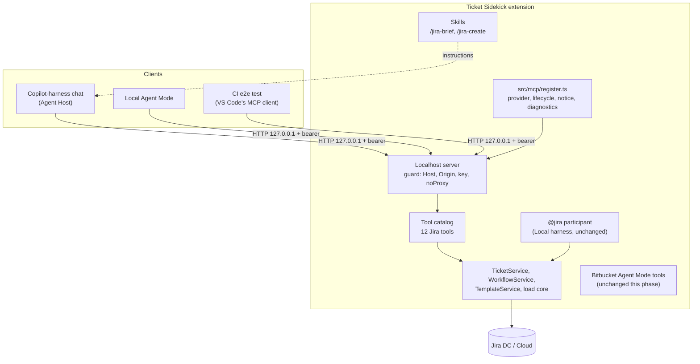
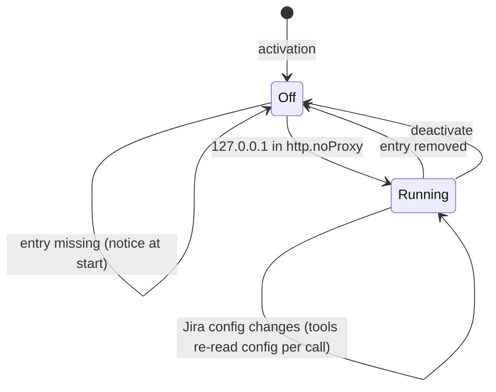

# Jira Tools over MCP for the Copilot Harness - Plan

## Goal Capsule

- **Objective:** In a Copilot-harness chat, where `@jira` is not available, a developer can view, find, load, comment on, update, move and create Jira tickets, check the connection, and get a structured developer brief of a ticket, through one set of tools that is never offered twice. `@jira` keeps working unchanged in the Local harness.
- **Means:** an MCP server inside the extension on a key-protected `127.0.0.1` port (KTD1), carrying 12 Jira tools that replace the 14 Agent Mode Jira tools, plus two skills (KTD11). Direction settled in [`docs/architecture/copilot-harness-migration.md`](../architecture/copilot-harness-migration.md), decision log §11.
- **Authority:** Product Contract requirements win on behavior; KTDs win on mechanism; units override neither.
- **Execution profile:** one feature branch, built in three review steps (PR1, PR2, PR3, each a pull request into the feature branch, merged in order; see Implementation Units), then one merge of the feature branch into `main`. `main` therefore never holds a half-moved tool set and stays releasable throughout. Each moved tool is removed as an Agent Mode tool in the same step that adds it to MCP, so no state offers a tool twice. The feature branch starts from `main`, not from the prototype branch; it brings along the architecture document and the two plans, but not `src/prototype/` or the prototype manual page.
- **Stop conditions:** stop and ask if a moved tool cannot keep a safeguard its Agent Mode version has (for example the never-guess issue type or the duplicate-comment guard), if VS Code refuses the MCP server definition the extension provides, or if the manual checklist fails on a managed Mac or a managed Windows machine.
- **Finished by:** `ce-work` implements, verifies and opens each PR into the feature branch; the user reviews and merges them, runs the manual checklist with a `.vsix` built from the feature branch on a managed Mac and a managed Windows machine, and then merges the feature branch into `main`.

---

## Product Contract

### Summary

The extension runs its own MCP server on `127.0.0.1` whenever `127.0.0.1` is in `http.noProxy`. It offers 12 Jira tools: view, find, list filters, load, move, workflow, check connection, list templates, create, comment, update field and upload attachment. The 14 Jira Agent Mode tools are removed as their replacements land. Two skills, `/jira-brief` and `/jira-create`, add the workflows a tool description cannot carry. Users without the proxy entry are told at every start how to enable the tools.

### Problem Frame

VS Code now defaults new chats to the Copilot harness, where chat participants are not supported, so `@jira` only works in the Local harness. The extension's Agent Mode tools do work there, but they would sit next to the MCP server the architecture decided on, offering the model every capability twice and paying for both in the prompt. The prototype showed that MCP over a key-protected loopback port works in the Copilot harness once `127.0.0.1` bypasses the network proxy, and that without that entry the Copilot runtime sends local requests to a corporate proxy.

### Key Decisions

- **MCP is the only surface for Jira tools; moved tools are removed as Agent Mode tools.** Governs R1, R2. (session-settled: user-directed — chosen over keeping Agent Mode tools as a fallback or switching between both: no capability may be offered to the model twice.)
- **The server starts automatically whenever `127.0.0.1` is in `http.noProxy`.** Governs R3, R4. (session-settled: user-directed — chosen over an opt-in setting or the prototype's per-session start.)
- **Users without the proxy entry get a notice at every VS Code start and an onboarding step.** Governs R5. (session-settled: user-directed — chosen over a one-time notice or documentation only.)
- **The prototype's server core and its diagnostic report move into the product; the canvas, launcher and per-session commands stay on the prototype branch.** Governs R6, R26. (session-settled: user-directed — chosen over merging the whole prototype branch or porting the core alone.)
- **Writes are approved through the harness's tool approval only.** Governs R7. (session-settled: user-directed — chosen over an extension-owned modal or MCP elicitation; users who auto-approve tools get no extra confirmation. Changes the prototype's D4 for agent-initiated writes.)
- **View returns the whole ticket; a developer brief is a skill on top.** Governs R9, R22. (session-settled: user-directed — chosen over comment switches or a concise/full option.)
- **Search is one find tool plus a separate filter list; the search rules live in the find tool's description.** Governs R10, R11. (session-settled: user-directed — chosen over three tools or a /jira-search skill.)
- **Load always behaves the same; a list only adds attachments.** Governs R12. (session-settled: user-directed — chosen over a list that fetches attachments only, or two tools.)
- **Move discovers the workflow by itself; a separate workflow tool answers reachable statuses.** Governs R13, R14. (session-settled: user-directed — chosen over discovery as a mandatory separate step.)
- **Check connection is a new tool; the branch ticket is built into view and load.** Governs R15, R16. (session-settled: user-directed — chosen over a separate branch tool or a combined status tool.)
- **Templates, create, comment, update field and upload stay separate tools.** Governs R17, R18. (session-settled: user-directed — chosen over merging them, which would trigger approval prompts for reads or blur approvals.)
- **Free text is written as Markdown and converted to Jira wiki markup, as `@jira` does.** Governs R19. (session-settled: user-directed — chosen over tools that take wiki markup as today.)
- **Only two skills, both model-invocable: `/jira-brief` and `/jira-create`.** Governs R21, R22, R23. (session-settled: user-directed — chosen over one skill per `@jira` command; MCP prompts are not available in the Copilot harness.)
- **Tests add an e2e check through VS Code's own MCP client; a real-Jira e2e is a follow-up.** Governs R27, R28. (session-settled: user-directed — chosen over an activation-only e2e or including the real-Jira workflow in this phase.)

### Requirements

**Server and surface**

- R1. All Jira tools available to agents are served by the extension's MCP server; after this work, no Jira Agent Mode tool (`contributes.languageModelTools` entry starting with `jira_`) exists.
- R2. At no merged state is the same Jira capability offered both as an MCP tool and as an Agent Mode tool.
- R3. The MCP server runs on `127.0.0.1` with a random port and a random per-start bearer key, and is offered to VS Code only while `127.0.0.1` is in `http.noProxy`.
- R4. The server starts at activation when the entry is present, stops when it is removed, starts again when it is added, and refuses MCP requests whenever the entry is missing; it does not depend on Jira being configured.
- R5. While the entry is missing, every VS Code start on a version with the MCP provider API (1.101 or later) shows a notice that explains what the entry is for and offers to open the setting, and the Jira onboarding walkthrough has a step for it.
- R6. Every request passes the ported request guard: exact `Host` `127.0.0.1:<port>`, no foreign `Origin`, and the bearer key, before any Jira call; no response or log line contains the key or a Jira token.
- R7. Write tools are marked as destructive, and the tools that only read Jira (view, find, list filters, workflow, check connection, list templates) as read-only; load ticket carries neither marking, since it writes local files. The harness asks before each write and shows the tool's arguments; the extension adds no confirmation of its own. Because that approval shows only the arguments, not the values the extension looks up, list templates shows each template's default fields, and the results of create, update field and move report what changed: the previous value, the previous status and the template fields applied.

**The 12 tools**

- R8. The tools are: view ticket, find tickets, list my filters, load ticket, move ticket, workflow, check connection, list templates, create ticket, add comment, update field, upload attachment.
- R9. View ticket returns the fields defined by the display settings (`additionalDisplayFields`, `hiddenDisplayFields`), the full description, all comments newest first up to 100 with a note when there are more, and the attachments with name, size and type.
- R10. Find tickets takes either JQL or a saved filter (id or name), with optional narrowing by fix version, sprint, assignee and the team JQL, supports paging, and shows the columns from `searchFields`.
- R11. Find tickets' description tells the agent that "my team" means the `myTeamJql` setting and to prefer a matching saved filter over new JQL; list my filters returns the user's favourite and owned filters.
- R12. Load ticket always writes `ticket.md`, `comments.md` and the eligible attachments into `.jira-context/<KEY>/`, reports the files it wrote as absolute paths, lists every skipped attachment with size and reason, and additionally downloads attachments named in an optional list without the type filter; the size limit still applies.
- R13. Move ticket moves a ticket to a target status, directly or along a workflow path; it discovers the workflow itself when no workflow is cached or the cached one has no path to the target. A move that stops partway is reported with the status the ticket landed in and is never retried.
- R14. Workflow lists the statuses a ticket can reach and refreshes the workflow cache on request.
- R15. Check connection reports base URL, auth type, token presence and the signed-in user, or a setup hint naming what is wrong; it gives the same answer as `@jira check`.
- R16. View ticket and load ticket take the ticket key as optional; without one they use the key in the current git branch of the first workspace folder and name that folder and branch in the result, or say that the branch holds no key. Write tools always require an explicit key.
- R17. List templates returns the workspace templates; create ticket creates one ticket, prefers a template over a bare issue type, and never guesses an issue type.
- R18. Add comment, update field and upload attachment keep today's behavior: the duplicate-comment guard, the supported field list with name resolution, and the size limit. Upload accepts only files that, after resolving symlinks, lie inside an open workspace folder (wherever that folder is) and have no dotfile or dotfolder segment; this deliberately narrows today's home-folder rule for MCP, while `@jira upload` keeps today's rule.
- R19. Free-text inputs (comment text, create description, update-field text values) are taken as Markdown and sent to Jira as wiki markup through the same conversion `@jira` uses.
- R20. Every tool that fails because Jira is not configured answers with the setup hint `@jira` gives, never a raw error.

**Skills**

- R21. The extension contributes exactly two skills, both model-invocable; neither repeats what a tool description already says.
- R22. `/jira-brief` produces a developer brief with eight sections in order: problem or goal, context, steps to reproduce with expected and actual result, acceptance criteria, decisions and findings from comments with author and date, current state, open questions and missing information, and sources used. A section the ticket does not cover says "not stated in the ticket"; derived acceptance criteria are marked as derived; it reads relevant attachments through load ticket and lists those it could not read.
- R23. `/jira-create` guides template choice, asks only for missing fields, shows the drafted summary and description, then calls create ticket.

**Diagnostics and documentation**

- R24. Every former basic `@jira` command (`view`, `load`, `search`, `comment`, `field`, `move`, `create`, `check`) maps to at least one tool or skill.
- R25. The user manual documents the MCP tools, the two skills, the `http.noProxy` requirement and a manual chat checklist; the Agent Mode tools page keeps only the Bitbucket tools.
- R26. A command copies a diagnostic report of the MCP server (state, whether it is offered, request counts, Host and Origin values seen, MCP settings, and the stored-key search) with every key and token removed.

**Tests**

- R27. Each tool has an integration test over a real loopback socket against the mock Jira client; a guard test fails when a skill names a tool that does not exist or a basic `@jira` command has no tool or skill; the docs-sync test checks the MCP tool list instead of Jira Agent Mode tools.
- R28. The CI e2e job checks, in a real VS Code, that VS Code's own MCP client connects to the server, lists the tools and calls check connection, and that the tools disappear when the proxy entry is removed.

### Acceptance Examples

- AE1. **Covers R4, R5.** Given VS Code 1.101 or later and `http.noProxy` lacking `127.0.0.1`, when VS Code starts, then no server listens, no MCP server is offered, and the notice appears; when the user adds the entry, the server starts and the tools appear without a restart.
- AE2. **Covers R16.** Given the branch `feature/PROJ-123-login`, when the agent calls view ticket without a key, then it returns PROJ-123 and states that the key came from the branch; on `main` it answers that the branch holds no key.
- AE3. **Covers R12.** Given a ticket with `design.pdf` (binary) and `log.txt`, when load runs without a list, then `log.txt` is written and `design.pdf` is listed as skipped; with `["design.pdf"]` both are written, along with `ticket.md` and `comments.md`.
- AE4. **Covers R13.** Given no cached workflow and a target two transitions away, when move ticket runs, then it discovers the workflow, moves through both steps and names them in its result.
- AE5. **Covers R19.** Given a comment written with a Markdown heading, a list and a table, when add comment runs, then Jira receives `h2.`, `*` list items and a `||`-headed table.
- AE6. **Covers R20.** Given no Jira token, when any tool runs, then it answers with the setup hint naming the missing token.
- AE7. **Covers R22.** Given a ticket whose description has no acceptance criteria, when `/jira-brief` runs, then the acceptance criteria section is marked derived or says "not stated in the ticket", and the sources section lists the comments and attachments used.

### Success Criteria

- The manual checklist passes in a Copilot-harness chat on a managed Mac and a managed Windows machine, each with `127.0.0.1` in `http.noProxy`: every R8 tool answers, both skills run, and no Jira Agent Mode tool is listed.
- The model's tool list in a Copilot-harness session contains each Jira capability once.

### Scope Boundaries

- Deferred for later: the Bitbucket tools (they stay Agent Mode tools in this phase), the imports, cleanup, `/security-report`, the canvas board and the session engine.
- Deferred for later: switching `@jira`'s own branch lookup to the explicit-folder lookup of KTD7.
- Considered and not built: an Agent Mode fallback when MCP cannot run (rejected: it reintroduces duplicates); a concise/full output switch (rejected: results follow settings); MCP prompts as entry points (not supported by the Copilot harness, per `src/vs/platform/agentHost/test/node/e2e/suites/mcpSideChannelSuite.ts`).

### Deferred to Follow-Up Work

- A nightly or on-demand e2e workflow against a real Jira Cloud test site, once the user has created the site and stored a token as a GitHub Actions secret. It covers the shared and Cloud-specific paths, not Data Center specifics.
- Checking the tools with a second VS Code window open and in remote windows (Remote-SSH, WSL, Dev Containers), when a use case needs them.

### Dependencies / Assumptions

- VS Code 1.101 or later for the MCP provider API; the prototype was built and tested against 1.144 with the Copilot harness. On older versions the extension offers no Jira tools to agents; `@jira` still works.
- Users who want the tools add `127.0.0.1` to `http.noProxy` themselves; the extension never writes settings.

### Sources / Research

- Decision log and test results: [`docs/architecture/copilot-harness-migration.md`](../architecture/copilot-harness-migration.md) §11; prototype plan [`docs/plans/2026-11-05-1230-feat-copilot-harness-localhost-prototype-plan.md`](2026-11-05-1230-feat-copilot-harness-localhost-prototype-plan.md); prototype code on the branch `claude/intelligent-planck-gue5hu` under `src/prototype/`.
- Today's tools: `src/tools/jiraTools.ts` (14 Jira tools, safeguards), `src/participant/jira/loadHandler.ts` (`loadTicketToWorkspace`, uses `vscode.workspace.fs`), `src/participant/jira/ticketContext.ts` (`resolveTicketFromBranch`, runs `git` without a working directory), `src/participant/JiraParticipant.ts` (`@jira check`), `src/utils/markdownToJiraWiki.ts`.
- VS Code: extension skills via `contributes.chatSkills` (VS Code docs, agent skills); extension skills are synced to the Agent Host (`agentHostLocalCustomizations.ts`); MCP tools are deferred and found through tool search in the Copilot harness (Agent Host `AGENTS.md`); VS Code registers MCP tools with its language-model tool service (`mcpLanguageModelToolContribution.ts`); `workbench.mcp.startServer` (`mcpCommandIds.ts`).

---

## Planning Contract

### Key Technical Decisions

- KTD1. **Product code lives in `src/mcp/`: vscode-free modules plus one glue file, `src/mcp/register.ts`.** The ported modules are the request guard, keys, `http.noProxy` check, localhost server, MCP server builder and report from `src/prototype/`. The prototype branch is not merged; its code is copied and trimmed. Governs the mechanism of R3, R6, R26.
- KTD2. **One bearer key, no canvas key.** The canvas route and its key leave with the canvas (deferred), so the guard only knows `/mcp`. A later canvas phase adds its route back.
- KTD3. **A single tool catalog drives the server, the docs-sync test and the skill guard.** `src/mcp/jiraTools/catalog.ts` exports each tool's name, title, description, input schema, read-only or destructive annotation and handler. The server registers from it, `userDocsSync.test.ts` checks the manual against it, and the skill guard checks skill text against it.
- KTD4. **Handlers reuse today's services and formatters instead of reimplementing them.** `TicketService`, `WorkflowService`, `TemplateService`, `FieldResolver`, `attachmentEligibility`, `pathSafety`, `RecentCallGuard` and the pure message builders in `src/participant/session/toolMessages.ts` stay the single implementation; the MCP handlers are thin, as `jiraTools.ts` is today. Any builder text that names a tool takes the name from the catalog (KTD3), so no message an agent reads points at a removed or renamed tool; skipped attachments are fetched by calling load ticket with their names.
- KTD5. **Tool names keep the `jira_` prefix in snake case** (`jira_view_ticket`, `jira_find_tickets`, …), so a later Bitbucket phase can share the same server without name clashes.
- KTD6. **The load core moves to Node `fs` behind a small writer interface,** so it becomes vscode-free and testable. `@jira load` and the MCP load tool both use it; `.gitignore` handling for `.jira-context/` is kept.
- KTD7. **The branch lookup runs `git branch --show-current` with the first workspace folder as working directory** (`execFile`, no shell, short timeout) and extracts the key with `extractTicketId`. The result names the folder and branch used, so a multi-root mismatch is visible.
- KTD8. **Annotations decide the harness approval:** reads carry `readOnlyHint: true`; Jira writes carry `destructiveHint: true`; load carries neither, since it writes only local files. No extension modal.
- KTD9. **Markdown conversion happens in the handlers** of add comment, create ticket (description) and update field (text values), with `markdownToJiraWiki()`; the tool descriptions say "Markdown".
- KTD10. **The connection check becomes a pure function shared with `@jira check`,** so both give the same answer from the same code.
- KTD11. **Skills are contributed through `contributes.chatSkills`** from `skills/jira-brief/SKILL.md` and `skills/jira-create/SKILL.md`, with `name` equal to the folder name and no `disable-model-invocation`.
- KTD12. **The e2e test drives VS Code's own MCP client.** It writes `http.noProxy` and tool auto-approval into the throwaway profile in `src/e2e/runTest.ts`, starts the server through VS Code, waits for the tools in `vscode.lm.tools`, invokes check connection with `vscode.lm.invokeTool`, then removes the entry and expects the tools to disappear. If VS Code does not expose MCP tools to extensions that way, the test is reduced to activation and server lifecycle, and the plan's coverage note says so.
- KTD13. **The diagnostic report becomes `Ticket Sidekick: Copy MCP diagnostics`,** without the prototype's rendezvous and launcher sections, keeping the stored-key search over the Copilot home, VS Code logs and VS Code storage.

### High-Level Technical Design

Components after this work:



Server lifecycle:



### Output Structure

```text
src/mcp/
  keys.ts  requestGuard.ts  proxyBypass.ts  localhostServer.ts   (ported)
  mcpServer.ts            builds the MCP server from the catalog
  register.ts             vscode glue: provider, lifecycle, notice, diagnostics command
  report.ts               diagnostics report (ported, trimmed)
  branchTicket.ts         key from the current branch
  connectionCheck.ts      shared with @jira check
  jiraTools/
    catalog.ts            the 12 tool definitions
    viewTicket.ts  findTickets.ts  loadTicket.ts  moveTicket.ts  workflow.ts
    templates.ts  createTicket.ts  addComment.ts  updateField.ts  uploadAttachment.ts
skills/
  jira-brief/SKILL.md
  jira-create/SKILL.md
src/test/mcp*.test.ts
```

### Assumptions

- MCP tools served this way appear in VS Code's tool registry under names VS Code derives from the server and tool names; the e2e unit confirms the exact form first (KTD12).

---

## Implementation Units

| U-ID | Title | Main files | Depends on |
| --- | --- | --- | --- |
| U1 | Port the server core | `src/mcp/keys.ts`, `requestGuard.ts`, `proxyBypass.ts`, `localhostServer.ts`, `mcpServer.ts` | — |
| U2 | Server lifecycle and provider | `src/mcp/register.ts`, `src/extension.ts`, `package.json` | U1 |
| U3 | Proxy-entry notice and onboarding step | `src/mcp/register.ts`, `package.json`, `walkthroughs/jira/` | U2 |
| U4 | Check connection tool | `src/mcp/connectionCheck.ts`, `src/mcp/jiraTools/catalog.ts` | U1 |
| U5 | Diagnostics command | `src/mcp/report.ts`, `src/mcp/register.ts` | U2 |
| U6 | E2E through VS Code's MCP client | `src/e2e/runTest.ts`, `src/e2e/suite/*` | U2, U4 |
| U7 | View ticket and branch key | `src/mcp/jiraTools/viewTicket.ts`, `src/mcp/branchTicket.ts` | U4 |
| U8 | Find tickets and list filters | `src/mcp/jiraTools/findTickets.ts` | U4 |
| U9 | Load ticket | `src/mcp/jiraTools/loadTicket.ts`, `src/participant/jira/loadHandler.ts` | U7 |
| U10 | Workflow and list templates | `src/mcp/jiraTools/workflow.ts`, `templates.ts` | U4 |
| U11 | Retire the moved read tools; docs | `src/tools/jiraTools.ts`, `package.json`, `docs/manual/*`, `src/test/userDocsSync.test.ts` | U7–U10 |
| U12 | `/jira-brief` skill and skill guard | `skills/jira-brief/SKILL.md`, `package.json`, `src/test/mcpSkillsGuard.test.ts` | U7, U9 |
| U13 | Markdown conversion for text inputs | `src/mcp/jiraTools/text.ts` | U4 |
| U14 | Write tools | `moveTicket.ts`, `createTicket.ts`, `addComment.ts`, `updateField.ts`, `uploadAttachment.ts` | U10, U13 |
| U15 | Retire the remaining Jira tools; docs | `src/tools/jiraTools.ts`, `package.json`, `docs/manual/*` | U14 |
| U16 | `/jira-create` skill and command coverage | `skills/jira-create/SKILL.md`, `src/test/mcpSkillsGuard.test.ts` | U14, U12 |

### PR1 (into the feature branch): MCP server and check connection

Waits on: nothing.

### U1. Port the server core

- **Goal:** the prototype's security core and server, trimmed to the MCP route, as product code.
- **Requirements:** R3, R6; KTD1, KTD2.
- **Dependencies:** none.
- **Files:** `src/mcp/keys.ts`, `src/mcp/requestGuard.ts`, `src/mcp/proxyBypass.ts`, `src/mcp/localhostServer.ts`, `src/mcp/mcpServer.ts`, `src/test/mcpGuard.test.ts`, `src/test/mcpServer.test.ts`, `package.json` (dependencies `@modelcontextprotocol/sdk`, `zod`).
- **Approach:**
  1. Copy the prototype modules from `src/prototype/` on the prototype branch; drop the canvas route, the canvas key and the plan store.
  2. `mcpServer.ts` builds a stateless MCP server per request from a catalog of tool definitions (KTD3), registering each with its annotations.
  3. The server's `allowMcp` gate calls the `http.noProxy` check on every request.
  4. The `http.noProxy` check counts only the bare `127.0.0.1` entry (a port wildcard only if U6 shows VS Code and the Copilot runtime honour it for every port). An entry such as `127.0.0.1:8080` bypasses the proxy for that port only, so it counts as missing: no start, and the notice appears.
- **Patterns to follow:** the prototype's tests (`prototypeGuard.test.ts`, `prototypeServer.test.ts`, `prototypeProxyBypass.test.ts`), copied and trimmed.
- **Test scenarios:**
  - A request without the bearer key is refused with 401 and reaches no handler.
  - A wrong `Host` (`localhost:<port>`) is refused with 403.
  - A foreign `Origin` is refused with 403.
  - With `allowMcp` false, a valid request is refused with 403 and counted as `mcp-disabled`.
  - The server listens on `127.0.0.1` with a non-zero port and stops accepting after stop.
  - `["127.0.0.1"]` counts as bypassed; `["127.0.0.1:8080"]` does not.
  - A catalog of one test tool is listed and callable through the official MCP client.
- **Verification:** the ported tests pass; no module imports `vscode`.

### U2. Server lifecycle and provider

- **Goal:** the server runs exactly while the proxy entry exists, and VS Code knows about it.
- **Requirements:** R3, R4; KTD1.
- **Dependencies:** U1.
- **Files:** `src/mcp/register.ts`, `src/extension.ts`, `package.json` (`contributes.mcpServerDefinitionProviders`), `src/test/mcpLifecycle.test.ts`.
- **Approach:**
  1. At activation, feature-detect the MCP provider API (prototype `vscodeMcpTypes.ts`); without it, register nothing and log once.
  2. Start the server when `http.noProxy` holds `127.0.0.1`; on `onDidChangeConfiguration` for `http.noProxy`, start or stop accordingly and fire the provider's change event.
  3. The provider returns one HTTP definition (URL plus `Authorization` header) while running, otherwise none; `deactivate` stops the server.
  4. Jira configuration is not a start condition: tools read it per call (R20).
  5. Start, stop and refused requests are logged through `logDiag('mcp', …)`; tool calls are logged by tool name and outcome only, never with arguments, keys or tokens.
- **Patterns to follow:** the prototype's `register.ts` and `prototypeLifecycle.test.ts` (per-file `vi.mock('vscode')`).
- **Test scenarios:**
  - Covers AE1. Without the entry, activation starts no server and the provider offers nothing.
  - Covers AE1. Adding the entry starts the server, fires the change event and makes the provider offer one definition with a bearer header.
  - Removing the entry stops the server and the provider offers nothing.
  - A restart of the server yields a different bearer key.
  - Without the provider API, activation registers nothing and does not throw.
  - Across start, stop and restart, no setting is written.
- **Verification:** lifecycle tests pass; `bundleSmoke.test.ts` still passes.

### U3. Proxy-entry notice and onboarding step

- **Goal:** users without the entry learn at every start why the Jira tools are missing and how to enable them.
- **Requirements:** R5.
- **Dependencies:** U2.
- **Files:** `src/mcp/register.ts`, `package.json` (walkthrough step in `ticket-sidekick.jiraGettingStarted`), `walkthroughs/jira/copilot-tools.md`, `src/test/mcpLifecycle.test.ts`.
- **Approach:** at activation without the entry, and only when the MCP provider API exists (on older VS Code the entry would not help), show a non-modal notice explaining that the Jira tools for Copilot chats need `127.0.0.1` in `http.noProxy` (and why), with **Open Setting**; the walkthrough step explains the same and links the setting.
- **Patterns to follow:** existing walkthrough steps in `package.json` and `walkthroughs/jira/`.
- **Test scenarios:**
  - Covers AE1. Without the entry, activation shows the notice and Open Setting opens `http.noProxy`.
  - With the entry, no notice appears.
  - Without the provider API, no notice appears even when the entry is missing.
- **Verification:** tests pass; the walkthrough lists the new step.

### U4. Check connection tool

- **Goal:** the first MCP tool, and the shared connection check.
- **Requirements:** R8, R15, R20; KTD3, KTD10.
- **Dependencies:** U1.
- **Files:** `src/mcp/connectionCheck.ts`, `src/mcp/jiraTools/catalog.ts`, `src/participant/JiraParticipant.ts` (uses the shared check), `src/test/mcpTools.test.ts`.
- **Approach:**
  1. Move the `@jira check` logic (base-URL validation, `getCurrentUser`, the result table, the failure text) into a pure function returning structured facts plus Markdown.
  2. `@jira check` renders it as today; the tool returns the same Markdown.
- **Execution note:** characterize today's `@jira check` output in a test before moving the code.
- **Test scenarios:**
  - With valid config, the tool reports base URL, auth type, token set and the signed-in user from the mock.
  - Covers AE6. Without a token, the tool answers with the setup hint naming the missing token.
  - With an invalid base URL, the tool answers with the configuration problem text.
  - `@jira check` output is unchanged (characterization).
- **Verification:** tests pass; the catalog holds one tool.

### U5. Diagnostics command

- **Goal:** a support report for proxy and MCP problems at users' sites.
- **Requirements:** R26; KTD13.
- **Dependencies:** U2.
- **Files:** `src/mcp/report.ts`, `src/mcp/register.ts`, `package.json` (command), `src/test/mcpReport.test.ts`.
- **Approach:** port the prototype report without rendezvous and launcher sections; keep server state, offered yes/no with the reason, request counts, Host and Origin values, `chat.mcp.*` and sandbox settings, and the stored-key search; redact keys and tokens at the end.
- **Test scenarios:**
  - A report built from facts containing the key and the Jira token contains neither.
  - The key search reports a planted key by file path only.
  - The report states "offered: no (127.0.0.1 in http.noProxy: no)" when the entry is missing.
- **Verification:** tests pass; the command is documented (R25).

### U6. E2E through VS Code's MCP client

- **Goal:** prove in a real VS Code that VS Code's own MCP client reaches the server and its tools.
- **Requirements:** R28; KTD12.
- **Dependencies:** U2, U4.
- **Files:** `src/e2e/runTest.ts`, `src/e2e/suite/mcp.test.ts`.
- **Approach:**
  1. First confirm the two VS Code details: how `workbench.mcp.startServer` takes its server argument, and how MCP tools are named in `vscode.lm.tools`.
  2. Write `http.noProxy` and tool auto-approval into the throwaway profile's `settings.json` before launch.
  3. Start the server through VS Code, wait for the check tool in `vscode.lm.tools`, invoke it, expect the not-configured hint.
  4. Remove the entry through the configuration API and expect the tool to disappear.
- **Execution note:** if step 1 shows that MCP tools are not exposed to extensions, reduce the test to activation and lifecycle and record that limit in the Verification Contract; do not fake coverage.
- **Test scenarios:**
  - VS Code lists the check tool after the server starts.
  - Invoking it returns the setup hint naming the missing Jira configuration.
  - After removing the entry, the tool is gone from `vscode.lm.tools`.
- **Verification:** `xvfb-run -a npm run test:e2e` passes locally and in the CI `e2e` job.

### PR2 (into the feature branch): Read tools and `/jira-brief`

Waits on: PR1, merge order only.

### U7. View ticket and branch key

- **Goal:** the whole-ticket view, with the key taken from the branch when none is given.
- **Requirements:** R9, R16, R20; KTD4, KTD7.
- **Dependencies:** U4.
- **Files:** `src/mcp/branchTicket.ts`, `src/mcp/jiraTools/viewTicket.ts`, `src/test/mcpTools.test.ts`, `src/test/mcpBranchTicket.test.ts`.
- **Approach:** fields through `TicketService.getTicket` with the display settings as `jira_getTicket` does; comments read in full (`getAllComments`), sorted newest first as the requirements source does, cut to 100, with a note saying how many older ones were left out (the paged reader returns oldest first and cannot be used); attachments with name, size and type; branch key per KTD7 with the source named in the result.
- **Test scenarios:**
  - View returns description, all fixture comments newest first and the attachment list.
  - With 150 comments, view shows the newest 100 and says 50 older ones were left out.
  - Without a key, the result names the folder and branch the key came from.
  - Covers AE2. Without a key on `feature/PROJ-123-login`, view returns PROJ-123 and names the branch.
  - Covers AE2. On `main`, view says the branch holds no key.
  - Not configured gives the setup hint.
- **Verification:** tests pass.

### U8. Find tickets and list filters

- **Goal:** one search tool and the filter list.
- **Requirements:** R10, R11, R20.
- **Dependencies:** U4.
- **Files:** `src/mcp/jiraTools/findTickets.ts`, `src/test/mcpTools.test.ts`.
- **Approach:** JQL goes through `searchTicketsRaw`; a filter name or id goes through the filter path `jira_searchByFilter` uses today, including narrowing and `myTeamJql`; exactly one of JQL and filter is required; columns from `searchFields`.
- **Test scenarios:**
  - JQL returns the fixture tickets in the configured columns.
  - A filter name resolves to its JQL and applies narrowing by sprint.
  - Giving both JQL and a filter is refused with a clear message.
  - List my filters returns favourites and owned filters, deduplicated.
- **Verification:** tests pass.

### U9. Load ticket

- **Goal:** one load tool with optional extra attachments, on a vscode-free core.
- **Requirements:** R12, R16; KTD6.
- **Dependencies:** U7.
- **Files:** `src/participant/jira/loadHandler.ts` (core moved to Node `fs` behind a writer), `src/mcp/jiraTools/loadTicket.ts`, `src/test/mcpTools.test.ts`, `src/test/loadTicketCore.test.ts`.
- **Approach:** the core writes `ticket.md`, `comments.md` and eligible attachments and returns written and skipped files; an optional list adds named attachments without the type filter, respecting `ATTACHMENT_SIZE_LIMIT`; an attachment whose Jira filename fails `isSafeFilename`, or whose resolved path is not inside `.jira-context/<KEY>/attachments/`, is skipped with the reason "unsafe filename"; written files are reported as absolute paths; `@jira load` keeps its behavior on the same core.
- **Execution note:** keep `loadTicketCore.test.ts` passing unchanged before moving the core.
- **Test scenarios:**
  - Covers AE3. Without a list, the text attachment is written and the binary one is listed as skipped with size and reason.
  - Covers AE3. With `["design.pdf"]`, both are written along with the ticket files.
  - A named attachment that does not exist is reported, and the rest of the load still happens.
  - An attachment over the size limit is reported and not written.
  - Attachments named `../../evil.txt` and `..\..\evil.txt` are skipped as unsafe filenames, nothing is written outside the attachments folder, and the other attachments are still written.
  - Without a key, load uses the branch ticket.
  - The load result names no tool outside the catalog (it points skipped attachments at load ticket, not at a removed download tool).
- **Verification:** tests pass; `@jira load` behaves as before.

### U10. Workflow and list templates

- **Goal:** the two remaining read tools.
- **Requirements:** R14, R17.
- **Dependencies:** U4.
- **Files:** `src/mcp/jiraTools/workflow.ts`, `src/mcp/jiraTools/templates.ts`, `src/test/mcpTools.test.ts`.
- **Approach:** workflow wraps `discoverAndCacheWorkflow` (refresh on request) and lists reachable statuses from the cache for a ticket; list templates wraps `TemplateService` as `jira_listTemplates` does and shows each template's default fields (R7).
- **Test scenarios:**
  - Workflow lists the statuses reachable from the fixture ticket's status.
  - Refresh rediscovers and rewrites the cache.
  - List templates returns the workspace templates with their default fields; a missing file gives the existing "no templates" answer.
- **Verification:** tests pass.

### U11. Retire the moved read tools; docs

- **Goal:** the moved read tools exist only on MCP; the manual says so.
- **Requirements:** R1, R2, R25, R27.
- **Dependencies:** U7, U8, U9, U10.
- **Files:** `src/tools/jiraTools.ts`, `package.json`, `src/test/jiraTools.test.ts`, `src/test/userDocsSync.test.ts`, `docs/manual/agent-mode-tools.md`, `docs/manual/copilot-tools.md`, `README.md`, `docs/onboarding.md`.
- **Approach:**
  1. Remove `jira_getTicket`, `jira_getComments`, `jira_searchTickets`, `jira_searchByFilter`, `jira_listMyFilters`, `jira_loadTicket`, `jira_downloadAttachment`, `jira_discoverWorkflow`, `jira_listTemplates` from `package.json` and their registrations and tests.
  2. Switch the docs-sync check to the MCP catalog for Jira tools; Bitbucket stays on `languageModelTools`.
  3. Add the MCP tools page with the `http.noProxy` requirement and the manual checklist.
- **Test scenarios:**
  - Docs-sync fails when a catalog tool is missing from the manual.
  - Bundle smoke registers exactly the remaining declared Agent Mode tools.
- **Verification:** `npm test` passes; no removed tool name remains in `package.json`.

### U12. `/jira-brief` skill and skill guard

- **Goal:** the developer brief and the guard keeping skills honest.
- **Requirements:** R21, R22, R27.
- **Dependencies:** U7, U9.
- **Files:** `skills/jira-brief/SKILL.md`, `package.json` (`contributes.chatSkills`, `.vscodeignore` keeps `skills/`), `src/test/mcpSkillsGuard.test.ts`.
- **Approach:** the skill tells the agent to call view, pick relevant attachments, call load with them, read them from `.jira-context/`, and write the eight sections of R22 with citations; the guard parses every contributed skill and fails on unknown `jira_` tool names, on a `name` that differs from the folder, and on `disable-model-invocation`.
- **Test scenarios:**
  - The guard passes for the shipped skill.
  - A skill naming a non-existent tool fails the guard.
  - Covers AE7. The skill text names all eight sections in order and the "not stated in the ticket" rule.
- **Verification:** tests pass; the packaged `.vsix` contains `skills/jira-brief/SKILL.md`.

### PR3 (into the feature branch): Write tools and `/jira-create`

Waits on: PR2, merge order only. After PR3, the feature branch merges into `main` once the manual checklist passes (Verification Contract).

### U13. Markdown conversion for text inputs

- **Goal:** one place that turns agent Markdown into Jira wiki markup for tool inputs.
- **Requirements:** R19; KTD9.
- **Dependencies:** U4.
- **Files:** `src/mcp/jiraTools/text.ts`, `src/test/mcpTools.test.ts`.
- **Approach:** a helper applying `markdownToJiraWiki()` to comment text, the create description and update-field text values; summary stays single-line.
- **Test scenarios:**
  - Covers AE5. A heading, a list and a table convert to `h2.`, `*` items and a `||` table.
  - Plain text passes through unchanged.
- **Verification:** tests pass.

### U14. Write tools

- **Goal:** move, create, comment, update field and upload on MCP with today's safeguards.
- **Requirements:** R7, R13, R17, R18, R19, R20; KTD4, KTD8.
- **Dependencies:** U10, U13.
- **Files:** `src/mcp/jiraTools/moveTicket.ts`, `createTicket.ts`, `addComment.ts`, `updateField.ts`, `uploadAttachment.ts`, `src/test/mcpTools.test.ts`.
- **Approach:**
  1. Each handler re-validates its inputs and reuses the logic of its `jira_*` counterpart: `resolveAndApplyTransition`, template field resolution with never-guess issue type, `RecentCallGuard` and the size check. Upload uses its own workspace-folder rule (R18) instead of `isAllowedUploadPath`.
  2. Move discovers the workflow when none is cached or the cached one has no path to the target; a `partialFailure` is reported with the landed status and never retried.
  3. Create, update field and move report what changed in their result (previous value, previous status, template fields applied), using the facts today's confirmation builders look up (R7).
  4. All five carry `destructiveHint: true`.
  5. The MCP server is built per request (U1), so state that must outlive a request, such as the `RecentCallGuard` of add comment, lives in the long-lived handler dependencies created once in `register.ts`, not in the per-request server.
- **Test scenarios:**
  - Covers AE4. Move to a status two steps away without a cache discovers, moves twice and names both steps.
  - A cached workflow with no path to the target triggers one discovery; a move that stops partway is reported with its landed status and not retried.
  - Create without a template and an ambiguous issue type returns the available types and creates nothing.
  - Create with a template applies its fields, converts the description and lists the template fields it set.
  - An identical comment sent in a second, separate MCP request within a minute is skipped.
  - Update field refuses an unsupported field name, and a successful update reports the previous value.
  - Upload accepts a file inside a workspace folder that lies outside the home folder, and refuses a home-folder file outside the workspace, a path under a dotfolder, a symlink pointing out of the workspace and a file over 25 MB.
  - Each write tool's definition carries `destructiveHint: true`, and no write tool carries `readOnlyHint` (VS Code's default approval then always applies).
- **Verification:** tests pass.

### U15. Retire the remaining Jira tools; docs

- **Goal:** no Jira Agent Mode tool remains.
- **Requirements:** R1, R2, R25.
- **Dependencies:** U14.
- **Files:** `src/tools/jiraTools.ts` (removed, or reduced to nothing and deleted), `src/extension.ts`, `package.json`, `src/test/jiraTools.test.ts`, `docs/manual/*`, `README.md`, `CLAUDE.md`, `docs/onboarding.md`.
- **Approach:** remove `jira_transitionTicket`, `jira_createTicket`, `jira_addComment`, `jira_updateField`, `jira_uploadAttachment`; delete `registerJiraTools`; move any still-shared helpers to `src/mcp/jiraTools/`; update the index lines in `CLAUDE.md`.
- **Test scenarios:**
  - `package.json` declares no `languageModelTools` entry starting with `jira_`.
  - Bundle smoke and e2e registration checks pass with the Bitbucket tools only.
- **Verification:** `npm test` and `npm run compile` pass.

### U16. `/jira-create` skill and command coverage

- **Goal:** the guided create flow and the coverage guard for former commands.
- **Requirements:** R21, R23, R24, R27.
- **Dependencies:** U14, U12.
- **Files:** `skills/jira-create/SKILL.md`, `package.json`, `src/test/mcpSkillsGuard.test.ts`.
- **Approach:** the skill covers template choice, asking only for missing fields, showing the draft, then create; the guard maps `view`, `load`, `search`, `comment`, `field`, `move`, `create`, `check` to catalog tools or skills and fails on a gap.
- **Test scenarios:**
  - The guard passes for both shipped skills.
  - Removing the create tool from the catalog makes the coverage guard fail for `create`.
- **Verification:** tests pass; the packaged `.vsix` contains both skills.

---

## Verification Contract

| Check | Command or step | Proves |
| --- | --- | --- |
| Types | `npm run compile` | Glue and local MCP types compile against `@types/vscode` 1.95 |
| Unit and integration | `npm test` | U1–U16 scenarios, guards, docs sync, bundle smoke |
| E2E | `xvfb-run -a npm run test:e2e` (CI `e2e` job) | U6 through VS Code's MCP client, or the recorded reduced form |
| Package | `npm run package` | `.vsix` contains `out/extension.js` and both skills |
| Manual | The checklist in `docs/manual/copilot-tools.md` in a Copilot-harness chat, with a `.vsix` from the feature branch, on a managed Mac and a managed Windows machine | R8 tools answer, both skills run, no duplicate tools; gates the merge into `main` |

---

## Definition of Done

- All three PRs are merged into the feature branch in order, each leaving it with no capability offered twice, and the feature branch is merged into `main` after the manual checklist passed on a managed Mac and a managed Windows machine.
- `npm run compile`, `npm test` and the CI `e2e` job pass on `main`.
- No `jira_` entry remains in `contributes.languageModelTools`.
- The manual documents the MCP tools, both skills, the `http.noProxy` requirement and the checklist.
- No log line, report or test output contains a key or token.
- Code from abandoned approaches is removed from the diff.
