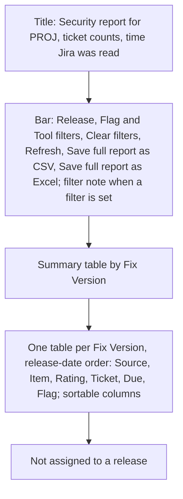
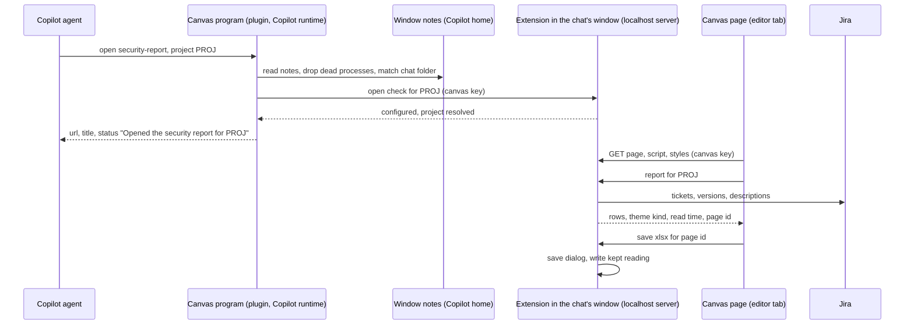
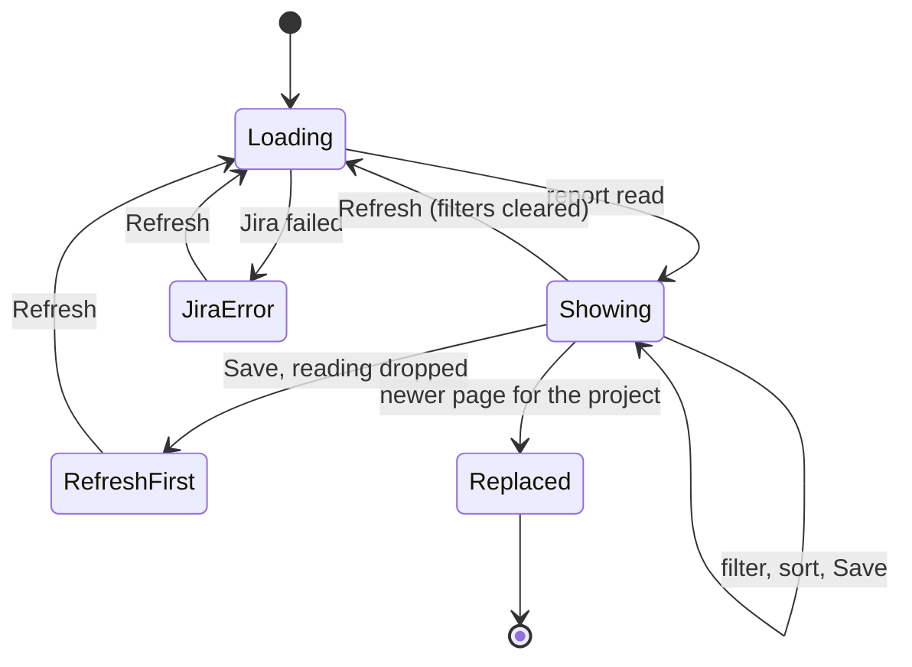

# Security Report Canvas - Plan

## Goal Capsule

- **Objective:** In a Copilot chat, a developer opens a project's security report in its own tab, reads, filters and sorts it, and saves it for colleagues. The vulnerability details never pass through the model. `@jira /security-report` keeps working unchanged in Local chats.
- **Means:** the first Ticket Sidekick canvas, shipped inside the extension as an agent plugin and served and filled from Jira by the extension's localhost server (KTD1, KTD2). It also sets the rule and the shared look that later canvases build on.
- **Authority:** the Product Contract wins on behaviour; KTDs win on mechanism; units override neither.
- **Execution profile:** one feature branch `feat/security-report-canvas` from `main`, built in two pull requests into it (PR1, PR2; see Implementation Units), then one merge of the feature branch into `main` after the manual checklist passes. The branch brings this plan along; it does not bring `src/prototype/` from `claude/intelligent-planck-gue5hu`, whose canvas code is ported, not merged.
- **Stop conditions:** stop and ask if the canvas shipped inside the extension does not start in a Copilot chat on the manual checklist (R15 reopens), if VS Code Elements cannot be styled under the content policy of KTD7, or if the shared report builder cannot keep `@jira /security-report`'s chat output unchanged (R18).
- **Finished by:** `ce-work` implements, verifies and opens each PR into the feature branch; the user reviews and merges them, runs the manual checklist with a `.vsix` built from the feature branch on a managed Mac and a managed Windows machine, and then merges the feature branch into `main`.

---

## Product Contract

Product Contract preservation: changed R14 (only the window whose folder holds the chat's folder serves the page, decided while planning); added R20 (an older page for the same project is marked) and R21 (Save writes the reading shown); Goal Capsule open blockers replaced by stop conditions, since the work starts without a throw-away probe.

### Summary

A "Security report" canvas opens as a tab in VS Code's editor area when a developer asks for a project's security report in a Copilot chat. The extension reads Jira and serves the page itself. The page shows today's report, filters and sorts it, refreshes it, and saves the full report as CSV or Excel. The agent only opens the canvas and learns nothing but whether that worked.

### Problem Frame

The security report (open Veracode and Waltz tickets by release, with Due Date flags) exists only as `@jira /security-report`. Chat participants do not run in the Copilot harness, which VS Code now uses for new chats. So the report is the last basic `@jira` command with no Copilot-chat equivalent; the guard in `src/test/mcpSkillsGuard.test.ts` lists it as the one exception. The report is also wider than the chat panel, and today's answer has to be read in a narrow column.

The report gathers a project's whole open vulnerability list in one place. `@jira` writes it straight into the chat without the model seeing it. A tool answer would put all of it into the model's context, which the developer does not want: they read the report themselves and do not plan to ask the model about it.

### Key Decisions

- **In Copilot chats, talk and decisions stay in chat; a large artifact (a report now, import and review boards later) opens as a canvas tab.** Replaces, for Copilot chats only, the rule that no UI pulls the user out of the chat panel (`docs/plans/2026-09-04-1618-feat-native-chat-interaction-plan.md`); Local `@jira` keeps that rule. (session-settled: user-directed — chosen over a one-off exception for this report: later canvases build on the rule instead of asking again.)
- **The report is a canvas, opened only by the agent.** Governs R1, R4. (session-settled: user-directed — chosen over a Command Palette command opening the same page as an editor tab, and over both: one way in.)
- **No tool for the report; the canvas description and the `/ts-jira` line carry the instruction and the hint.** Governs R1, R5. (session-settled: user-directed — chosen over a small gate tool that checks the project and whether canvases are on: accepts that a plain request on a machine without canvases may lead the agent to build its own report from ticket searches.)
- **The model sees only whether the canvas opened.** Governs R2, R11. (session-settled: user-directed — chosen over the full tables or summary counts in the chat: the developer reads the report and does not ask the model about it.)
- **The agent gets no canvas actions.** Governs R4. (session-settled: user-directed — chosen over a counts-only read action and over read-and-steer actions; a refresh sends nothing to the chat.)
- **Filter and sort on the page.** Governs R7. (session-settled: user-directed — chosen over today's report only, and over a project switch on the page.)
- **Save always writes the full report, labelled as such.** Governs R9. (session-settled: user-directed — chosen over saving the filtered view or asking on each save; the "full report" label was user-approved over plain labels.)
- **Save writes the Jira reading the page shows.** Governs R21. (session-settled: user-approved — chosen over a fresh reading at Save: the file matches the page.)
- **Filters and sort reset on every Refresh and on restart; nothing is stored.** Governs R8, R13. (session-settled: user-directed — chosen over keeping them until restart or across restarts.)
- **After a restart the page is rebuilt fresh from Jira.** Governs R13. (session-settled: user-approved — chosen over showing the last result with Refresh, which would keep vulnerability data on disk, and over a closed tab.)
- **A restored canvas that stays blank is an accepted known limitation.** Governs R13. (session-settled: user-approved — chosen over holding the release until a restored canvas reloads by itself.)
- **Only the window whose folder holds the chat's folder serves the page.** Governs R14. (session-settled: user-directed — chosen over any running window and over "any window when only one runs": workspace settings belong to their workspace, so no other workspace's settings are used by guess.)
- **A second page for the same project marks the older one.** Governs R20. (session-settled: user-directed — chosen over accepting duplicate tabs as a known limitation.)
- **The canvas ships inside the extension, as an agent plugin.** Governs R15. (session-settled: user-approved — chosen over the prototype's "Enable canvas" command that copies a launcher into `~/.copilot/extensions`: no install step, no version drift, nothing left behind.)
- **A notice at every VS Code start while canvases are off.** Governs R16. (session-settled: user-directed — chosen over a notice with "Don't show again" and over the walkthrough and check only; same as the `http.noProxy` notice.)
- **VS Code Elements gives all Ticket Sidekick canvases their look.** Governs R17. (session-settled: user-directed — chosen over an own shared stylesheet and over Bootstrap: VS Code-style controls, ready for the richer import and review boards.)

### Actors

- A1. Developer: asks for the report in a Copilot chat, reads, filters, sorts, refreshes and saves it on the canvas.
- A2. Copilot agent: opens the canvas for a project and relays its open status or the hint.
- A3. Ticket Sidekick extension: reads Jira, serves the page, writes the saved files.

### Requirements

**Opening the report**

- R1. In a Copilot chat, asking for a project's security report, in plain words or with `/ts-jira security-report [PROJECT]`, opens the "Security report" canvas for that project as a tab in the editor area. Without a project named, the canvas opens for `ticketSidekick.jira.defaultProject`; without that setting, the open status asks for a project (R2) and the agent asks the developer.
- R2. What the agent gets back from opening is a short status: opened for the project, or not opened with the reason (for example, no project given, Jira not configured, no VS Code window holds the chat's folder, or `127.0.0.1` missing from `http.noProxy`). No ticket data, counts or report text reaches the model.
- R3. Opening the report for a project whose canvas is already open brings that canvas forward instead of opening a second one. Once the developer has closed it, opening again starts a new canvas that reads Jira fresh.
- R4. The agent is offered no canvas action other than opening it.
- R5. Where canvases are not available, `/ts-jira security-report` answers with a hint: canvases are off, they are turned on with `chat.canvases.enabled` where the organisation allows it, and `@jira /security-report` shows the report in Local chats.

**The page**

- R6. The page shows the same report as `@jira /security-report` for the project: the summary by Fix Version, one table per Fix Version in release-date order, the Not assigned table, the overdue and due-before-release flags, and links to the tickets in Jira. It also says when Jira was read.
- R7. The developer can filter by release, by flag (overdue, due before release, no flag) and by tool (Veracode, Waltz), and sort any table column.
- R8. Refresh reads Jira again and shows the full report, unfiltered and in its default order.
- R9. "Save full report as CSV" and "Save full report as Excel" write, through VS Code's save dialog, the same files `@jira /security-report` writes today, always for the full report. While a filter is set, a line next to the buttons says "Saves all N tickets, not only the M shown."
- R21. Save writes the Jira reading the page shows. When that reading is no longer held, Save writes nothing and the page asks the developer to press Refresh first.
- R10. When Jira cannot be read, the page says so with the HTTP status and a short reason only, and Refresh stays available.
- R20. When a newer security report page for the same project opens, the older page shows "A newer report for PROJ is open; this one is no longer refreshed" with Refresh and Save disabled. It notices when it comes back into view and before any Refresh or Save.

**Data and access**

- R11. Report data stays inside the extension and the page: it is held only while a page needs it, is never written to disk except by the developer's own Save, and is never sent to the model.
- R12. The page is reachable only with the extension's per-start key, like the MCP endpoint, so no other local process, user or web page can read it.

**Restart and several windows**

- R13. After a VS Code restart, a canvas that the Copilot runtime brings back is rebuilt fresh from Jira for the same project, with no filters set. If a restored canvas stays blank, asking for the report again opens a working one; the user manual names this as a known limitation.
- R14. With several VS Code windows open, the page is served by the window whose workspace folder holds the chat's folder, the most specific folder winning, so it uses that workspace's settings and its save dialog appears there. When no open window holds the chat's folder, including a chat in a window with no folder open, the canvas does not open and the status says why (R2). If the serving window closes, the page stops working, and asking again opens a new one.

**Delivery and setup**

- R15. The canvas is part of the installed extension: it is present, updated and removed with it, with no install command and nothing copied into `~/.copilot/extensions`.
- R16. At every VS Code start while `chat.canvases.enabled` is off, a notice explains that the security report opens as a canvas in Copilot chats and offers to open the setting. The extension never changes the setting.

**Look**

- R17. Canvas pages are built from VS Code Elements controls with one shared Ticket Sidekick canvas style, and follow VS Code's light, dark or high-contrast theme. The library is bundled with the extension at a pinned version and never loaded from the web.

**Unchanged and documented**

- R18. `@jira /security-report` and the `export` replies of a Veracode or Waltz import stay as they are.
- R19. The user manual describes opening the report in a Copilot chat, the page, the hint where canvases are off, the startup notice, and the known limitations of R13 and R14.

### Page layout

The page as confirmed in a throw-away demo, top to bottom (Covers R6 to R9):



### Key Flows

- F1. Open the report
  - **Trigger:** the developer asks for the security report in a Copilot chat, or types `/ts-jira security-report PROJ`.
  - **Actors:** A1, A2, A3
  - **Steps:** the agent opens the canvas for the project; the canvas finds the window that holds the chat's folder; the extension reads Jira and serves the page; the tab opens in the editor area; the agent relays the open status.
  - **Covered by:** R1, R2, R3, R6, R14
- F2. Work with the page
  - **Trigger:** the canvas is open.
  - **Actors:** A1, A3
  - **Steps:** the developer filters and sorts; Refresh reads Jira again and clears filters and sort; Save opens VS Code's save dialog and writes the full report from the reading shown.
  - **Covered by:** R7, R8, R9, R10, R20, R21
- F3. No canvas available
  - **Trigger:** canvases are off, or the canvas cannot be opened.
  - **Actors:** A1, A2
  - **Steps:** at startup the extension shows the notice; in the chat the agent answers with the hint or the open status's reason.
  - **Covered by:** R2, R5, R16
- F4. Restart
  - **Trigger:** VS Code restarts while a security report canvas is open.
  - **Actors:** A1, A3
  - **Steps:** a canvas the runtime brings back is rebuilt from Jira; a blank one is closed and the report asked for again.
  - **Covered by:** R13

### Acceptance Examples

- AE1. **Covers R3.** Given the PROJ canvas is open, when the developer asks for the PROJ report again, then the same canvas comes forward and no second tab opens. Given it was closed, when they ask again, then a new canvas opens with a new "read at" time.
- AE2. **Covers R7, R9.** Given 12 tickets and the filter "release 2.4, overdue" showing 2, when the developer presses "Save full report as Excel", then the note reads "Saves all 12 tickets, not only the 2 shown" and the saved file has all 12.
- AE3. **Covers R8.** Given a filter and a sort are set, when the developer presses Refresh, then the page shows the full report in its default order.
- AE4. **Covers R2, R5.** Given canvases are off, when the developer types `/ts-jira security-report PROJ`, then the chat shows the hint and no ticket data. Given `127.0.0.1` is missing from `http.noProxy`, when the agent tries to open the canvas, then the status names the missing entry.
- AE5. **Covers R13.** Given the PROJ canvas was open with a filter set, when VS Code restarts and the runtime brings the canvas back, then it shows the PROJ report read after the restart, with no filter set.
- AE6. **Covers R10.** Given Jira answers 503 to the refresh, when the developer presses Refresh, then the page says Jira could not be read (HTTP 503) with no response body, and Refresh stays available.
- AE7. **Covers R14.** Given window A has `/work/payments` open and window B has `/work/portal`, when the developer asks for the report in a chat whose folder is `/work/payments/api`, then window A serves it. Given a chat whose folder no open window holds, when the agent tries to open the canvas, then it does not open and the status says to ask from the chat of the window whose workspace holds the project.
- AE8. **Covers R20.** Given a PROJ page is open and a second PROJ page opens, when the developer switches back to the first page, then it shows that a newer report is open and its Refresh and Save are disabled.
- AE9. **Covers R21.** Given a page's reading was dropped from memory, when the developer presses Save, then nothing is written and the page asks for Refresh first.

### Success Criteria

- A saved CSV or Excel file is the same as the file `@jira /security-report PROJ csv` or `xlsx` writes for the same reading.
- Before the feature branch merges into `main`, the manual checklist (Verification Contract) passes on a managed Mac and a managed Windows machine.

<!-- ce-section: work-relationships -->
### How This Work Fits Together

This plan covers the security report canvas only. The breakdown below is the current understanding, not a committed roadmap.

- Import review boards for Veracode, Waltz and email, on a canvas.
  - Depends on this plan's canvas foundation (KTD1 to KTD4), the canvas rule in Key Decisions, and the shared look of R17.
  - Still to decide: whether the agent gets canvas actions there, and how review state survives a restart.
- Bitbucket review findings on a canvas.
  - Shares the same foundation; can proceed independently of the import boards.

### Scope Boundaries

- Deferred: canvas actions for the agent (reading counts, refresh, filter), and a note into the chat after a refresh.
- Deferred: asking the model questions about the report.
- Deferred: a project switch on the page.
- Deferred: canvases for the import screens and the Bitbucket review.
- Deferred: Copilot CLI and the GitHub Copilot app as hosts of the canvas.
- Deferred: exact report values instead of the ticket's display-cleaned table text (KL19 in `docs/known-limitations.md`).
- Not in this work: a tool for the report, a Command Palette command or a plain editor tab for it, saving only the filtered rows, remembering filters, and the prototype's install command for a launcher.
- Not in this work: any change to `@jira /security-report` or to the import `export` replies (R18).
- Considered and not built: a throw-away probe build before the real canvas. The user chose to build directly with debug data in the logs (KTD9); the manual checklist confirms the canvas starts before `main` gets the feature.
- Considered and not built: a fallback window when no window holds the chat's folder. Workspace settings would leak across projects (R14); evidence that chats commonly carry no folder would reopen it.

### Dependencies / Assumptions

- Canvases are a VS Code Preview feature of the Copilot harness (`chat.canvases.enabled`); an organisation may keep it off.
- The page is served by the extension's localhost server, which runs only while `127.0.0.1` is in `http.noProxy`.
- VS Code passes agent plugins that an extension contributes (`contributes.chatPlugins`) to the Copilot harness, and Agent Plugins 1.0 lets a plugin carry a canvas under its `com.github.copilot` namespace. That such a canvas starts in a VS Code Copilot chat is not yet observed; the manual checklist confirms it.
- The canvas open request carries the chat's working folder (`session.workingDirectory`), as it did for the prototype in one window.
- The canvas host passes no VS Code theme colours to the page, so the extension supplies the theme to the page itself.
- The Copilot SDK can bring back canvases that were open at shutdown; whether VS Code does so is not yet observed.

### Sources / Research

- Today's report: `src/participant/jira/overviewHandler.ts`, `src/utils/securityOverview.ts`, `src/utils/securityOverviewCsv.ts`, `src/utils/securityOverviewXlsx.ts`; user manual `docs/manual/report-imports.md` "Security report: open Veracode and Waltz tickets by release".
- Canvas direction, prototype results and the localhost server design: `docs/architecture/copilot-harness-migration.md` §6.6, §9, §11 (D3, D5); prototype plan `docs/plans/2026-11-05-1230-feat-copilot-harness-localhost-prototype-plan.md`; prototype code under `src/prototype/` on the branch `claude/intelligent-planck-gue5hu` (not on `main`): `launcher/extension.ts`, `prototypeFolder.ts`, `selectWindow.ts`, `canvasRoutes.ts`, `requestGuard.ts`, and the launcher bundling in that branch's `esbuild.js`.
- Server, key and `http.noProxy` rule this page reuses: `docs/plans/2026-11-05-2037-feat-jira-mcp-tools-copilot-harness-plan.md` (its KTD2 dropped the canvas route until a canvas phase); `src/mcp/register.ts` (startup notice pattern), `src/mcp/report.ts` (`copilotHome`, diagnostics report).
- Extension-contributed agent plugins: VS Code `src/vs/workbench/contrib/chat/common/plugins/agentPluginServiceImpl.ts` (`chatPlugins` extension point with `path` and `when`, `ExtensionAgentPluginDiscovery`); plugins passed to the Copilot harness: `src/vs/workbench/contrib/chat/browser/agentSessions/agentHost/agentHostLocalCustomizations.ts`.
- Canvases in plugins: GitHub docs "Working with canvas extensions" (`content/copilot/how-tos/github-copilot-app/working-with-canvas-extensions.md`); awesome-copilot "Installing and using plugins" (canvas extensions under a plugin's `com.github.copilot/extensions/` directory) and its `create-canvas-extension` skill (`plugin.json` per the Agent Plugins 1.0 schema).
- Canvas protocol: `@github/copilot-sdk` 1.0.28, `dist/canvas.d.ts` (`createCanvas` with `inputSchema`, `open`, `onClose`; actions via `invoke_canvas_action`), `dist/generated/rpc.d.ts` (`CanvasProviderOpenRequest` with a caller-supplied `instanceId` and `input`; `CanvasProviderOpenResult` with `url`, `title`, `status`; `CanvasHostContext` without theme), `dist/types.d.ts` (`openCanvases` rehydration on resume).
- Canvas commands in VS Code (pin, unpin, close; none opens a canvas): `src/vs/sessions/contrib/canvases/electron-browser/pinnedCanvasActions.ts`.
- VS Code Elements: `@vscode-elements/elements` 2.5.1, MIT, depends on `lit` and `@lit/context`; component styles read `--vscode-*` variables with fallbacks; bundled build about 230 KB, 50 KB compressed.
- Learnings: `docs/solutions/security-issues/jira-native-wiki-trigger-neutralization-in-shared-markdown-converter.md` (untrusted Jira text), `docs/solutions/workflow-issues/vscode-mock-testing-convention-not-checked-before-inventing-new-one.md` (per-file `vi.mock('vscode')`).

---

## Planning Contract

### Key Technical Decisions

- KTD1. **The page is served from the existing localhost server under a second per-start key, the canvas key, in the URL path.** The request guard routes `/<canvasKey>/…` to the canvas handler and leaves `/mcp` and its bearer key as they are; the Host and Origin checks apply to both. The canvas host passes only a URL, so the key must be in the path, as in the prototype; `maskPath` already masks it in logs. Governs R12.
- KTD2. **The canvas program ships as an agent plugin inside the `.vsix`.** `package.json` contributes `chatPlugins` with the path `./out/plugin`; the build writes `plugin.json` (Agent Plugins 1.0 schema) and the canvas program, bundled by esbuild from TypeScript into one `extension.mjs` under the plugin's `com.github.copilot/extensions/ticket-sidekick/` folder, as the prototype bundled its launcher. `@github/copilot-sdk` is a pinned dev dependency bundled into that file. Governs R15. (Implements the user-approved Key Decision on delivery.)
- KTD3. **Each window's copy of the extension writes a note with its port, canvas key, workspace folders and process id to `<Copilot home>/ticket-sidekick/windows/window-<pid>.json`.** Written by rename when the server starts, deleted when it stops or the extension deactivates; folder 0700 and file 0600 on POSIX, the profile's permissions on Windows. `<Copilot home>` comes from `copilotHome()` in `src/mcp/report.ts` (`COPILOT_HOME`, else `~/.copilot`). (session-settled: user-approved — chosen over a per-user temp folder: the Copilot runtime already uses this home on every OS.)
- KTD4. **The canvas program picks the window whose workspace folder holds the chat's working folder, the most specific folder winning, and skips notes whose process no longer runs.** No match opens nothing. Before returning the page URL it calls that window's open-check route (Jira configured, project resolved), so the open status can name the reason of R2. It talks to `127.0.0.1` with Node's `http` module, which ignores proxy settings. Governs R2, R14.
- KTD5. **One vscode-free builder gathers the report input for both `@jira /security-report` and the page.** `gatherOverviewInput` loses its chat stream and returns warnings as data; `overviewHandler.ts` streams them as today. Governs R6, R18.
- KTD6. **The page talks to the extension through three key-protected JSON routes: report, save and page status; the canvas program uses a fourth, the open check.** The report route builds the overview, keeps it in memory under a page id with a limit of 10 pages and one hour, and returns the rows with the theme kind and read time. The save route opens VS Code's save dialog through an injected function and writes the kept reading with the existing CSV and Excel renderers. The status route says whether a newer page for the project replaced this one. Requests carry JSON only, as in the prototype's canvas routes. Governs R6, R9, R11, R20, R21.
- KTD7. **Untrusted text is only ever inserted as text, and every page response carries a strict content policy.** The page builds its DOM from element properties and text, never from HTML strings. Ticket links are built from the ticket key and the configured base URL. The policy allows only the page's own script, styles and connections: no inline script or style, no other origin, no forms. Governs R11, R12. (session-settled: user-approved — chosen over plain text only: a later mistake in inserting text could otherwise run code with the page's buttons.)
- KTD8. **The page script is bundled by esbuild with VS Code Elements and Lit into one file, served by the canvas route.** The shared canvas stylesheet defines the `--vscode-*` variables for light, dark and high-contrast themes, and the page applies the set named by the theme kind the report route returns. Text labels replace icons, so no icon font is needed. Governs R17.
- KTD9. **Both sides log the canvas path for debugging, never report content or keys.** The extension logs page requests, Jira reads, saves and replaced pages through `logDiag` in a `canvas` scope. The canvas program appends one JSON line per open decision (windows found, match, status returned) to `<Copilot home>/ticket-sidekick/canvas-log.jsonl`, capped in size, and the diagnostics report includes its last lines. (session-settled: user-directed — chosen over a throw-away probe build before the real canvas.)
- KTD10. **The canvas declaration has the id `security-report`, an input of an optional project key, and no actions.** Its description tells the agent when to open it and to use the instance id `security-report-<PROJECT>` so a second request reuses the open canvas. Governs R1, R3, R4.
- KTD11. **A Playwright test loads the real page from a test server with a mock Jira in headless Chromium.** It runs as its own script in the CI `e2e` job on Ubuntu and checks filters, sort, the save note, a hostile ticket summary shown as text, and that the content policy reports no violation. (session-settled: user-directed — chosen over a manual-only check of the page.)
- KTD12. **`/ts-jira security-report [PROJECT]` is a router row whose call is "open the Security report canvas", with the hint of R5 when no canvas can be opened.** `src/test/mcpSkillsGuard.test.ts` learns a canvas row as a valid call and maps the basic `@jira` command `security-report` to it, removing its exception. Governs R1, R5.

### High-Level Technical Design

Who talks to whom when the agent opens the canvas and the page loads:



Page states (R8, R10, R20, R21):



### Output Structure

```text
plugin/
  plugin.json                       source manifest, copied into out/plugin by the build
src/canvas/
  windowNotes.ts                    KTD3
  selectWindow.ts                   KTD4
  canvasLog.ts                      KTD9, shared by the canvas program and the report
  launcher/extension.ts             canvas program entry (bundled to extension.mjs)
  launcher/openDecision.ts          pure open decision and status texts
  canvasRoutes.ts                   key-protected routes, content policy
  securityReport/reportApi.ts       report, save and status routes
  securityReport/pageStore.ts       kept readings and replaced pages
  page/securityReportPage.ts        page script entry (bundled)
  page/reportView.ts                pure filter, sort and save-note logic
  page/canvasTheme.css              shared canvas style and theme variables
src/utils/securityOverviewGather.ts KTD5
src/page-tests/securityReportPage.spec.ts
```

### Assumptions

- The Agent Plugins layout for a canvas (`com.github.copilot/extensions/<name>/extension.mjs` beside `plugin.json`) is what VS Code passes to the Copilot runtime; the manual checklist's first item confirms it, and the stop condition covers a failure.
- Lit applies the VS Code Elements styles through constructable stylesheets in Chromium, so a content policy without inline styles leaves them working; the Playwright test confirms it.

### Deferred to Implementation

- Whether very large projects need paging on the page, decided against the size of the mock and real reports during U8.
- The exact `--vscode-*` variable values per theme, taken from VS Code's default Light Modern, Dark Modern and High Contrast themes during U8.
- How the bundled licence texts of VS Code Elements and Lit ship in the `.vsix` (esbuild legal comments or a notices file), decided in U8.

### Risks

| Risk | Mitigation |
| --- | --- |
| Canvases and extension plugins are Preview and may change shape | Pin `@github/copilot-sdk`; keep the canvas program small; the manual checklist runs on the current VS Code before merge |
| The agent ignores the instance-id hint and opens a second tab | R20 marks the older page |
| Windows does not restrict the notes folder | Manual checklist item; the notes hold only a port and a per-start key, never a Jira token |
| The agent sandbox blocks the canvas program from reading notes or reaching `127.0.0.1` | Manual checklist item with the sandbox on; the manual names the limitation if it fails |
| The page bundle grows the `.vsix` | One bundled file of about 250 KB; checked by the bundle test |

---

## Implementation Units

### PR1: Canvas foundation

Waits on: nothing.

### U1. Canvas key and canvas route on the localhost server

**Goal:** the server accepts key-protected canvas requests next to `/mcp`.

**Requirements:** R12; KTD1.

**Dependencies:** none.

**Files:**
- `src/mcp/requestGuard.ts`, `src/mcp/localhostServer.ts`, `src/mcp/serverController.ts`
- `src/canvas/canvasRoutes.ts`
- Test: `src/test/mcpGuard.test.ts`, `src/test/mcpServer.test.ts`, `src/test/canvasRoutes.test.ts`

**Approach:**
1. The guard returns a `canvas` route with the sub-path when the first path segment matches the canvas key; `/mcp` keeps its bearer check. Port the shape from the prototype's `requestGuard.ts`.
2. The server takes a canvas key at start and hands canvas requests to a canvas handler; the controller makes a new canvas key at each start and exposes port and canvas key to `register.ts`.
3. `canvasRoutes.ts` dispatches sub-paths and sets the content policy and `no-store` on every response (KTD7).

**Patterns to follow:** prototype `src/prototype/requestGuard.ts` and `canvasRoutes.ts` on `claude/intelligent-planck-gue5hu`; main's `src/mcp/localhostServer.ts` counters and refusal logging.

**Test scenarios:**
- A request to `/<canvasKey>/security-report/` with the right Host reaches the canvas handler.
- A wrong canvas key is refused with 401 and counted as `canvas-key-invalid`; the logged path shows `[key]`.
- A foreign Origin on a canvas route is refused with 403 before the handler runs.
- `/mcp` with the canvas key as bearer is refused; the canvas route with the MCP key is refused.
- After a stop and start, the earlier canvas key is refused.
- Every canvas response carries the content policy and `Cache-Control: no-store`.

**Verification:** both routes work over a real socket and no key appears in logs or counters.

### U2. Window notes

**Goal:** each running server leaves a user-only note the canvas program can find.

**Requirements:** R12, R14; KTD3.

**Dependencies:** U1.

**Files:**
- `src/canvas/windowNotes.ts`, `src/mcp/register.ts`
- Test: `src/test/windowNotes.test.ts`

**Approach:**
1. Port `writeEntry`, `readEntries`, `removeEntry` and `isProcessAlive` from the prototype's `prototypeFolder.ts`, without the launcher copy.
2. `register.ts` writes the note after each server start and removes it on stop and deactivation; a failed write is logged and leaves the MCP tools working.

**Test scenarios:**
- Writing a note creates `windows/window-<pid>.json` with port, canvas key, folders and start time, folder 0700 and file 0600 on POSIX.
- A second write for the same process replaces the note without a half-written file.
- Removing the note on stop deletes only this window's file.
- A malformed file in the folder is skipped and named, not thrown.
- A note whose process no longer runs is reported as dead.

**Verification:** notes appear and disappear with the server in the lifecycle test.

### U3. Canvas program, open decision and plugin packaging

**Goal:** the extension ships a plugin whose `security-report` canvas opens the page from the chat's window or returns the reason it cannot.

**Requirements:** R1, R2, R3, R4, R14, R15; KTD2, KTD4, KTD10.

**Dependencies:** U1, U2.

**Files:**
- `plugin/plugin.json`, `src/canvas/launcher/extension.ts`, `src/canvas/launcher/openDecision.ts`, `src/canvas/selectWindow.ts`
- `src/canvas/canvasRoutes.ts` (open-check route: Jira configured, project resolved)
- `esbuild.js`, `package.json` (`contributes.chatPlugins`, `@github/copilot-sdk` dev dependency), `.vscodeignore`
- Test: `src/test/canvasOpenDecision.test.ts`, `src/test/selectWindow.test.ts`, `src/test/bundleSmoke.test.ts`

**Approach:**
1. `selectWindow.ts` ports the prototype's matcher without its single-window fallback (KTD4).
2. `openDecision.ts` is pure: notes, working folder, liveness, the open-check answer and the input project in; URL, title and status text out.
3. `extension.ts` declares the canvas (KTD10), reads notes, calls the window's open-check route over `http`, and returns the decision.
4. The build bundles the program into `out/plugin/com.github.copilot/extensions/ticket-sidekick/extension.mjs` and copies `plugin.json`; `.vscodeignore` keeps `out/plugin/**`.

**Patterns to follow:** prototype `launcher/extension.ts`, `selectWindow.ts` and the launcher bundling in that branch's `esbuild.js` (including keeping the SDK's FFI host external).

**Test scenarios:**
- Covers AE7. A chat folder inside window A's workspace opens A's URL with A's port and key.
- Two windows hold the chat folder at different depths: the more specific one wins.
- No window holds the chat folder: no URL, and the status says to ask from the chat of the window whose workspace holds the project.
- A note of a dead process is ignored even when its folder matches.
- No notes at all: the status names the missing `http.noProxy` entry or a stopped extension.
- The window answers "not configured": no URL, and the status says Jira is not set up.
- No project in the input and no default project: no URL, and the status asks for a project.
- The URL carries the project and the canvas key, and the status text carries no ticket data.
- The packaged extension contains `out/plugin/plugin.json` and the bundled `extension.mjs`, and `package.json` points `chatPlugins` at that folder.

**Verification:** the bundle test finds the plugin; the open decision covers every R2 reason.

### U4. Canvas debug data

**Goal:** a failed or surprising canvas open can be traced from the diagnostics report.

**Requirements:** KTD9.

**Dependencies:** U3.

**Files:**
- `src/canvas/canvasLog.ts`, `src/canvas/launcher/extension.ts`, `src/mcp/report.ts`, `src/mcp/register.ts`
- Test: `src/test/canvasLog.test.ts`, `src/test/mcpReport.test.ts`

**Approach:**
1. `canvasLog.ts` appends one JSON line per open decision and trims the file to a fixed size; it never writes the canvas key or ticket data.
2. The diagnostics report adds a "Canvas" section with the last lines, passed through the existing `redact` and key scan.
3. Extension-side canvas requests log through `logDiag('canvas', …)`.

**Test scenarios:**
- An open decision writes a line with windows found, the match reason and the status, and no key.
- A log over the size cap keeps its newest lines.
- The diagnostics report includes the last canvas lines and shows `[redacted]` for a planted key.
- A missing or unreadable canvas log yields "no canvas log" in the report, not an error.

**Verification:** the report built in tests holds the canvas section without secrets.

### U5. Startup notice for canvases

**Goal:** users with canvases off learn at each start how the report opens.

**Requirements:** R16.

**Dependencies:** none.

**Files:**
- `src/mcp/register.ts`
- Test: `src/test/mcpLifecycle.test.ts`

**Approach:** read `chat.canvases.enabled` at activation; when it is not `true`, show the notice with an **Open Setting** button, following `showProxyNotice`. Never write the setting.

**Test scenarios:**
- Canvases off: the notice is shown once per activation with **Open Setting**.
- Canvases on: no notice.
- Choosing **Open Setting** opens the settings UI at `chat.canvases.enabled` and changes nothing.

**Verification:** the lifecycle test sees the notice only while the setting is off.

### PR2: Security report page

Waits on: PR1 (needed before this group can start: the page is served by PR1's canvas route).

### U6. Shared report builder

**Goal:** `@jira /security-report` and the page build the report from one vscode-free path.

**Requirements:** R6, R18; KTD5.

**Dependencies:** none within PR2.

**Files:**
- `src/utils/securityOverviewGather.ts`, `src/participant/jira/overviewHandler.ts`
- Test: `src/test/securityOverviewGather.test.ts`, `src/test/overviewHandler.test.ts`

**Approach:** move the Jira reads of `gatherOverviewInput` into the new module, returning the input plus warnings (truncated list, release dates unreadable) and a failure with HTTP status; `overviewHandler.ts` streams the same texts as today.

**Execution note:** characterize `@jira /security-report`'s current chat output first, then refactor.

**Test scenarios:**
- A project with Veracode and Waltz tickets yields the same input as before the move.
- A truncated ticket list returns the truncation warning; the handler streams it word for word.
- Unreadable versions return the release-date warning and an empty version list.
- A failed search returns a failure with the HTTP status and no response body.
- `@jira /security-report PROJ` streams output identical to the characterization.

**Verification:** existing overview and handler tests pass unchanged.

### U7. Report, save and status routes

**Goal:** the page can load the report, save the reading it shows and learn it was replaced.

**Requirements:** R6, R9, R10, R11, R20, R21; KTD6.

**Dependencies:** U1, U3, U6.

**Files:**
- `src/canvas/securityReport/reportApi.ts`, `src/canvas/securityReport/pageStore.ts`, `src/canvas/canvasRoutes.ts`, `src/mcp/register.ts` (injects the save dialog and theme kind), `src/participant/jira/overviewHandler.ts` (save dialog shared with `@jira`)
- Test: `src/test/securityReportApi.test.ts`, `src/test/pageStore.test.ts`

**Approach:**
1. The report route resolves the project (input, else `defaultProject`), builds the overview through U6, stores it under a new page id, marks older pages of the project as replaced, and returns rows, warnings, read time, theme kind and page id.
2. The save route takes page id and format, finds the kept reading, and calls the injected save function that wraps today's `saveOverviewFile` without the chat stream.
3. The page-status route answers whether the page id was replaced.
4. Jira failures answer with the status and short reason of `describeJiraFailure`.

**Patterns to follow:** prototype `canvasRoutes.ts` (JSON-only POST, body cap); `src/utils/jiraFailureText.ts`.

**Test scenarios:**
- The report route for PROJ returns the rows `buildOverview` gives for the mock Jira, the read time and a page id.
- No project and a default project set: the default is used; neither set: 400 with "name a project".
- Jira answers 503: the response says HTTP 503 with no body text from Jira.
- Covers AE2. Save with a page id writes a file equal to the CSV and Excel `@jira` writes for the same reading.
- Covers AE9. Save for an unknown or expired page id writes nothing and asks for Refresh.
- Covers AE8. A second report for PROJ marks the first page id as replaced; the status route says so; another project's page is untouched.
- The store keeps at most 10 readings and drops readings older than an hour.
- A save POST without `application/json` is refused with 415.

**Verification:** routes work over a real socket with `MockJiraClient`; nothing about the report reaches disk except the saved file.

### U8. The page

**Goal:** the canvas shows the report with filters, sort, Refresh and the two Save buttons in VS Code's look.

**Requirements:** R6, R7, R8, R9, R10, R17, R20, R21; KTD7, KTD8.

**Dependencies:** U7.

**Files:**
- `src/canvas/page/securityReportPage.ts`, `src/canvas/page/reportView.ts`, `src/canvas/page/canvasTheme.css`, `src/canvas/canvasRoutes.ts` (page shell, script and style routes)
- `esbuild.js`, `package.json` (`@vscode-elements/elements` pinned)
- Test: `src/test/reportView.test.ts`

**Approach:**
1. `reportView.ts` is pure: rows and filter state in; visible tables, counts and the save note out; sorting by any column; Refresh state is the default state.
2. `securityReportPage.ts` renders with VS Code Elements controls, inserts all Jira text as text (KTD7), builds ticket links from key and base URL, and asks the page-status route on visibility change and before each action.
3. The shell page loads only the bundled script and stylesheet; the theme class comes from the report response.

**Test scenarios:**
- Release "2.4" and flag "overdue" show only matching rows, and the summary counts follow the filter.
- Tool "Waltz" hides every Veracode row; "Both" shows all.
- Sorting by Due puts empty dates last; sorting again reverses.
- With a filter set, the note reads "Saves all 12 tickets, not only the 2 shown"; without one, no note.
- Covers AE3. Refresh returns the default state: no filters, default order.
- A replaced page state disables Refresh and Save and carries the replaced text.

**Verification:** the pure view logic is covered; U9 covers rendering.

### U9. Browser test of the page

**Goal:** the real page is exercised in a browser, including hostile ticket text and the content policy.

**Requirements:** R7, R9, R11, R17; KTD7, KTD11.

**Dependencies:** U8.

**Files:**
- `src/page-tests/securityReportPage.spec.ts`, `src/page-tests/pageServer.ts` (test server with `MockJiraClient`)
- `package.json` (`@playwright/test` pinned, `test:page` script), `.github/workflows/ci.yml` (`e2e` job installs Chromium and runs `test:page`)

**Approach:** start the localhost server with known keys and a mock Jira, open the page URL in headless Chromium, and act like the developer.

**Test scenarios:**
- The page loads, shows the summary and per-release tables, and the read time.
- Choosing a release filter hides other releases and shows the save note.
- Clicking a column heading sorts the table.
- A ticket summary `` shows as those characters and no dialog fires.
- The browser reports no content-policy violation, and the VS Code Elements controls are styled.
- Covers AE6. A mock Jira failure on Refresh shows the HTTP status and keeps Refresh enabled.

**Verification:** `npm run test:page` passes locally and in the CI `e2e` job.

### U10. `/ts-jira security-report` and the guards

**Goal:** the typed command opens the canvas or gives the hint, and the guards accept it.

**Requirements:** R1, R5; KTD12.

**Dependencies:** U3.

**Files:**
- `skills/ts-jira/SKILL.md`
- Test: `src/test/mcpSkillsGuard.test.ts`

**Approach:** add the row, the help line and the argument-hint word; the row says to open the Security report canvas with the project, or reply with the R5 hint when no canvas can be opened. Extend the guard so a canvas row counts as an existing call, and map `security-report` in `BASIC_COMMANDS` instead of filtering it out.

**Test scenarios:**
- The help text lists `security-report [PROJECT]` in table order and the argument hint matches.
- The guard passes with the canvas row and fails when the row names a canvas id the plugin does not declare.
- Every basic `@jira` slash command, including `security-report`, maps to a tool, skill or canvas.

**Verification:** `mcpSkillsGuard.test.ts` passes with no command excluded.

### U11. Documentation

**Goal:** users and developers can find, use and debug the canvas.

**Requirements:** R19.

**Dependencies:** U3 to U10.

**Files:**
- `docs/manual/copilot-tools.md`, `README.md`, `docs/known-limitations.md`, `docs/architecture/copilot-harness-migration.md`, `docs/report-import.md`, `CLAUDE.md`
- Test: `src/test/userDocsSync.test.ts`

**Approach:**
1. Manual: a "Security report canvas" section (opening, the page, the hint, the notice, the `http.noProxy` need) and the checklist items below.
2. Known limitations: blank restored canvas (R13), no canvas from a window without the project's folder (R14), workspace settings decide the report.
3. Architecture decision log: canvas delivery by plugin, window notes, matching window only; the outcome of the manual checklist.
4. `CLAUDE.md`: key-file rows for `src/canvas/` and the canvas line under the Copilot harness section.

**Test expectation:** `userDocsSync.test.ts` stays green; no new settings or commands.

**Verification:** the manual describes every R19 item.

---

## Verification Contract

| Gate | Command or check | Applies to |
| --- | --- | --- |
| Type check | `npm run compile` | every unit |
| Unit tests | `npm test` | every unit |
| Page browser test | `npm run test:page` | U8, U9 |
| Extension smoke in VS Code | `xvfb-run -a npm run test:e2e` | U1 to U5 |
| Package contents | build the `.vsix` and confirm `out/plugin/**` and the page bundle are inside | U3, U8 |

Manual checklist, on a managed Mac and a managed Windows machine with a `.vsix` from the feature branch:

1. With `chat.canvases.enabled` on and `127.0.0.1` in `http.noProxy`, "open the security report for PROJ" in a Copilot chat opens the canvas with the report.
2. Asking again while it is open brings the same canvas forward, or marks the older page (R20).
3. Filters, sort, Refresh and both Save buttons behave as R7 to R9 and R21 say; the saved files match `@jira /security-report PROJ csv` and `xlsx`.
4. Restart VS Code with the canvas open and record what comes back (R13).
5. With two windows open on different folders, a chat in each opens its own window's report; a chat in a window with no folder gets the R14 status.
6. With canvases off, the startup notice appears and `/ts-jira security-report PROJ` gives the hint.
7. On Windows, the `windows` notes folder is readable only by the user.
8. With the agent sandbox on, record whether the canvas opens.
9. Light, dark and high-contrast themes render the page readably.
10. **Ticket Sidekick: Copy MCP diagnostics** includes the canvas log lines and no key.

---

## Definition of Done

- Every unit's verification holds, and `npm run compile`, `npm test`, `npm run test:page` and the e2e suite pass on the feature branch.
- `@jira /security-report` output is unchanged (U6 characterization).
- The manual checklist passed on a managed Mac and a managed Windows machine, and its results are recorded in the architecture decision log.
- The user manual, known limitations and `CLAUDE.md` describe the canvas.
- No dead-end or experimental code from abandoned approaches remains in the diff, and nothing from `src/prototype/` is copied unchanged where a port was planned.
