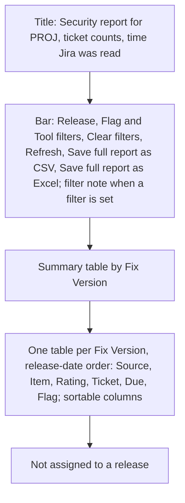

# Security Report Canvas - Plan

## Goal Capsule

- **Objective:** In a Copilot chat, a developer opens a project's security report in its own tab, reads, filters and sorts it, and saves it for colleagues. The vulnerability details never pass through the model. `@jira /security-report` keeps working unchanged in Local chats.
- **Means:** the first Ticket Sidekick canvas, served and filled from Jira by the extension and shipped inside the extension. It also sets the rule and the shared look that later canvases build on.
- **Authority:** the Product Contract wins on behaviour. Planning decides mechanism within it.
- **Open blockers:** none for planning. The first implementation step is a hands-on check that a canvas shipped inside the extension starts in a Copilot chat; if it does not, the delivery decision (R15) reopens.

---

## Product Contract

### Summary

A "Security report" canvas opens as a tab in VS Code's editor area when a developer asks for a project's security report in a Copilot chat. The extension reads Jira and serves the page itself. The page shows today's report, filters and sorts it, refreshes it, and saves the full report as CSV or Excel. The agent only opens the canvas and learns nothing but whether that worked.

### Problem Frame

The security report (open Veracode and Waltz tickets by release, with Due Date flags) exists only as `@jira /security-report`. Chat participants do not run in the Copilot harness, which VS Code now uses for new chats. So the report is the last basic `@jira` command with no Copilot-chat equivalent; the guard in `src/test/mcpSkillsGuard.test.ts` lists it as the one exception. The report is also wider than the chat panel, and today's answer has to be read in a narrow column.

The report gathers a project's whole open vulnerability list in one place. `@jira` writes it straight into the chat without the model seeing it. A tool answer would put all of it into the model's context, which the developer does not want: they read the report themselves and do not plan to ask the model about it.

### Key Decisions

- **In Copilot chats, talk and decisions stay in chat; a large artifact (a report now, import and review boards later) opens as a canvas tab.** Replaces, for Copilot chats only, the rule that no UI pulls the user out of the chat panel (`docs/plans/2026-09-04-1618-feat-native-chat-interaction-plan.md`); Local `@jira` keeps that rule. (session-settled: user-directed — chosen over a one-off exception for this report: later canvases build on the rule instead of asking again.)
- **The report is a canvas, opened only by the agent.** Governs R1, R4. (session-settled: user-directed — chosen over a Command Palette command opening the same page as an editor tab, and over both: one way in.)
- **No tool for the report; the canvas description and the `/ts-jira` line carry the instruction and the hint.** Governs R1, R5. (session-settled: user-directed — chosen over a small gate tool that checks the project and whether canvases are on: accepts that a plain request on a machine without canvases may lead the agent to build its own report from ticket searches.)
- **The model sees only whether the canvas opened.** Governs R2, R11. (session-settled: user-directed — chosen over the full tables or summary counts in the chat: the developer reads the report and does not ask the model about it.)
- **The agent gets no canvas actions.** Governs R4. (session-settled: user-directed — chosen over a counts-only read action and over read-and-steer actions; a refresh sends nothing to the chat.)
- **Filter and sort on the page.** Governs R7. (session-settled: user-directed — chosen over today's report only, and over a project switch on the page.)
- **Save always writes the full report, labelled as such.** Governs R9. (session-settled: user-directed — chosen over saving the filtered view or asking on each save; the "full report" label was user-approved over plain labels.)
- **Filters and sort reset on every Refresh and on restart; nothing is stored.** Governs R8, R13. (session-settled: user-directed — chosen over keeping them until restart or across restarts.)
- **After a restart the page is rebuilt fresh from Jira.** Governs R13. (session-settled: user-approved — chosen over showing the last result with Refresh, which would keep vulnerability data on disk, and over a closed tab.)
- **A restored canvas that stays blank is an accepted known limitation.** Governs R13. (session-settled: user-approved — chosen over holding the release until a restored canvas reloads by itself.)
- **With several windows open, any window's extension may serve the page.** Governs R14. (session-settled: user-directed — the page reads the same Jira data in every window, and filters live in the page.)
- **The canvas ships inside the extension, as an agent plugin.** Governs R15. (session-settled: user-approved — chosen over the prototype's "Enable canvas" command that copies a launcher into `~/.copilot/extensions`: no install step, no version drift, nothing left behind.)
- **A notice at every VS Code start while canvases are off.** Governs R16. (session-settled: user-directed — chosen over a notice with "Don't show again" and over the walkthrough and check only; same as the `http.noProxy` notice.)
- **VS Code Elements gives all Ticket Sidekick canvases their look.** Governs R17. (session-settled: user-directed — chosen over an own shared stylesheet and over Bootstrap: VS Code-style controls, ready for the richer import and review boards.)

### Actors

- A1. Developer: asks for the report in a Copilot chat, reads, filters, sorts, refreshes and saves it on the canvas.
- A2. Copilot agent: opens the canvas for a project and relays its open status or the hint.
- A3. Ticket Sidekick extension: reads Jira, serves the page, writes the saved files.

### Requirements

**Opening the report**

- R1. In a Copilot chat, asking for a project's security report, in plain words or with `/ts-jira security-report [PROJECT]`, opens the "Security report" canvas for that project as a tab in the editor area. Without a project named, the canvas opens for `ticketSidekick.jira.defaultProject`; without that setting, the open status asks for a project (R2) and the agent asks the developer.
- R2. What the agent gets back from opening is a short status: opened for the project, or not opened with the reason (for example, no project given, Jira not configured, or `127.0.0.1` missing from `http.noProxy`). No ticket data, counts or report text reaches the model.
- R3. Opening the report for a project whose canvas is already open brings that canvas forward instead of opening a second one. Once the developer has closed it, opening again starts a new canvas that reads Jira fresh.
- R4. The agent is offered no canvas action other than opening it.
- R5. Where canvases are not available, `/ts-jira security-report` answers with a hint: canvases are off, they are turned on with `chat.canvases.enabled` where the organisation allows it, and `@jira /security-report` shows the report in Local chats.

**The page**

- R6. The page shows the same report as `@jira /security-report` for the project: the summary by Fix Version, one table per Fix Version in release-date order, the Not assigned table, the overdue and due-before-release flags, and links to the tickets in Jira. It also says when Jira was read.
- R7. The developer can filter by release, by flag (overdue, due before release, no flag) and by tool (Veracode, Waltz), and sort any table column.
- R8. Refresh reads Jira again and shows the full report, unfiltered and in its default order.
- R9. "Save full report as CSV" and "Save full report as Excel" write, through VS Code's save dialog, the same files `@jira /security-report` writes today, always for the full report. While a filter is set, a line next to the buttons says "Saves all N tickets, not only the M shown."
- R10. When Jira cannot be read, the page says so with the HTTP status and a short reason only, and Refresh stays available.

**Data and access**

- R11. Report data stays inside the extension and the page: it is held only while a page needs it, is never written to disk except by the developer's own Save, and is never sent to the model.
- R12. The page is reachable only with the extension's per-start key, like the MCP endpoint, so no other local process, user or web page can read it.

**Restart and several windows**

- R13. After a VS Code restart, a canvas that the Copilot runtime brings back is rebuilt fresh from Jira for the same project, with no filters set. If a restored canvas stays blank, asking for the report again opens a working one; the user manual names this as a known limitation.
- R14. With several VS Code windows open, the canvas opens and works, served by any window's running extension. If the serving window closes, the page stops working, and asking again opens a new one.

**Delivery and setup**

- R15. The canvas is part of the installed extension: it is present, updated and removed with it, with no install command and nothing copied into `~/.copilot/extensions`.
- R16. At every VS Code start while `chat.canvases.enabled` is off, a notice explains that the security report opens as a canvas in Copilot chats and offers to open the setting. The extension never changes the setting.

**Look**

- R17. Canvas pages are built from VS Code Elements controls with one shared Ticket Sidekick canvas style, and follow VS Code's light, dark or high-contrast theme. The library is bundled with the extension at a pinned version and never loaded from the web.

**Unchanged and documented**

- R18. `@jira /security-report` and the `export` replies of a Veracode or Waltz import stay as they are.
- R19. The user manual describes opening the report in a Copilot chat, the page, the hint where canvases are off, the startup notice, and the known limitations of R13 and R14.

### Page layout

The page as confirmed in a throw-away demo, top to bottom (Covers R6 to R9):

### Key Flows

- F1. Open the report
  - **Trigger:** the developer asks for the security report in a Copilot chat, or types `/ts-jira security-report PROJ`.
  - **Actors:** A1, A2, A3
  - **Steps:** the agent opens the canvas for the project; the extension reads Jira and serves the page; the tab opens in the editor area; the agent relays the open status.
  - **Covered by:** R1, R2, R3, R6
- F2. Work with the page
  - **Trigger:** the canvas is open.
  - **Actors:** A1, A3
  - **Steps:** the developer filters and sorts; Refresh reads Jira again and clears filters and sort; Save opens VS Code's save dialog and writes the full report.
  - **Covered by:** R7, R8, R9, R10
- F3. No canvas available
  - **Trigger:** canvases are off, or the canvas cannot be opened.
  - **Actors:** A1, A2
  - **Steps:** at startup the extension shows the notice; in the chat the agent answers with the hint or the open status's reason.
  - **Covered by:** R2, R5, R16
- F4. Restart
  - **Trigger:** VS Code restarts while a security report canvas is open.
  - **Actors:** A1, A3
  - **Steps:** a canvas the runtime brings back is rebuilt from Jira; a blank one is closed and the report asked for again.
  - **Covered by:** R13

### Acceptance Examples

- AE1. **Covers R3.** Given the PROJ canvas is open, when the developer asks for the PROJ report again, then the same canvas comes forward and no second tab opens. Given it was closed, when they ask again, then a new canvas opens with a new "read at" time.
- AE2. **Covers R7, R9.** Given 12 tickets and the filter "release 2.4, overdue" showing 2, when the developer presses "Save full report as Excel", then the note reads "Saves all 12 tickets, not only the 2 shown" and the saved file has all 12.
- AE3. **Covers R8.** Given a filter and a sort are set, when the developer presses Refresh, then the page shows the full report in its default order.
- AE4. **Covers R2, R5.** Given canvases are off, when the developer types `/ts-jira security-report PROJ`, then the chat shows the hint and no ticket data. Given `127.0.0.1` is missing from `http.noProxy`, when the agent tries to open the canvas, then the status names the missing entry.
- AE5. **Covers R13.** Given the PROJ canvas was open with a filter set, when VS Code restarts and the runtime brings the canvas back, then it shows the PROJ report read after the restart, with no filter set.
- AE6. **Covers R10.** Given Jira answers 503 to the refresh, when the developer presses Refresh, then the page says Jira could not be read (HTTP 503) with no response body, and Refresh stays available.

### Success Criteria

- A saved CSV or Excel file is the same as the file `@jira /security-report PROJ csv` or `xlsx` writes for the same project at the same moment.
- Before release, these hands-on checks pass on a managed Mac and a managed Windows machine: the canvas starts in a Copilot chat when shipped inside the extension (R15); restart behaviour is observed and documented (R13); two windows open (R14); the agent sandbox on; the canvas handover is readable only by the user on Windows.

<!-- ce-section: work-relationships -->
### How This Work Fits Together

This plan covers the security report canvas only. The breakdown below is the current understanding, not a committed roadmap.

- Import review boards for Veracode, Waltz and email, on a canvas.
  - Depends on this plan's canvas foundation, the canvas rule in Key Decisions, and the shared look of R17.
  - Still to decide: whether the agent gets canvas actions there, and how review state survives a restart.
- Bitbucket review findings on a canvas.
  - Shares the same foundation; can proceed independently of the import boards.

### Scope Boundaries

- Deferred: canvas actions for the agent (reading counts, refresh, filter), and a note into the chat after a refresh.
- Deferred: asking the model questions about the report.
- Deferred: a project switch on the page.
- Deferred: canvases for the import screens and the Bitbucket review.
- Deferred: Copilot CLI and the GitHub Copilot app as hosts of the canvas.
- Deferred: exact report values instead of the ticket's display-cleaned table text (KL19 in `docs/known-limitations.md`).
- Not in this work: a tool for the report, a Command Palette command or a plain editor tab for it, saving only the filtered rows, remembering filters, and the prototype's install command for a launcher.
- Not in this work: any change to `@jira /security-report` or to the import `export` replies (R18).

### Dependencies / Assumptions

- Canvases are a VS Code Preview feature of the Copilot harness (`chat.canvases.enabled`); an organisation may keep it off.
- The page is served by the extension's localhost server, which runs only while `127.0.0.1` is in `http.noProxy`.
- VS Code passes agent plugins that an extension contributes (`contributes.chatPlugins`) to the Copilot harness, and GitHub documents that a plugin can contain a canvas. That such a canvas starts in a VS Code Copilot chat is not yet confirmed (Goal Capsule, open blockers).
- The canvas host passes no VS Code theme colours to the page, so the extension supplies the theme to the page itself.
- The Copilot SDK can bring back canvases that were open at shutdown; whether VS Code does so is not yet observed.

### Outstanding Questions

**Deferred to Planning**

- How the canvas finds the serving extension's port and key, with several windows open, and how that handover stays user-only on Windows.
- How the page learns VS Code's theme kind and follows a theme change while open.
- Whether very large projects need paging on the page.
- How `mcpSkillsGuard.test.ts`'s mapping of basic `@jira` commands treats `security-report` once it maps to a canvas.
- How VS Code Elements and its Lit dependency are vetted, pinned and bundled, and what that adds to the `.vsix` size.

### Sources / Research

- Today's report: `src/participant/jira/overviewHandler.ts`, `src/utils/securityOverview.ts`, `src/utils/securityOverviewCsv.ts`, `src/utils/securityOverviewXlsx.ts`; user manual `docs/manual/report-imports.md` "Security report: open Veracode and Waltz tickets by release".
- Canvas direction, prototype results and the localhost server design: `docs/architecture/copilot-harness-migration.md` §6.6, §9, §11 (D3, D5); prototype plan `docs/plans/2026-11-05-1230-feat-copilot-harness-localhost-prototype-plan.md`; prototype code under `src/prototype/` on the branch `claude/intelligent-planck-gue5hu` (not on `main`).
- Server, key and `http.noProxy` rule this page reuses: `docs/plans/2026-11-05-2037-feat-jira-mcp-tools-copilot-harness-plan.md`; `src/mcp/register.ts` (startup notice pattern).
- Extension-contributed agent plugins: VS Code `src/vs/workbench/contrib/chat/common/plugins/agentPluginServiceImpl.ts` (`chatPlugins` extension point, `ExtensionAgentPluginDiscovery`); plugins passed to the Copilot harness: `src/vs/workbench/contrib/chat/browser/agentSessions/agentHost/agentHostLocalCustomizations.ts`.
- Canvases in plugins and their scopes: GitHub docs, "Working with canvas extensions" (`content/copilot/how-tos/github-copilot-app/working-with-canvas-extensions.md`).
- Canvas protocol: `@github/copilot-sdk` 1.0.28, `dist/canvas.d.ts` (actions via `invoke_canvas_action`), `dist/generated/rpc.d.ts` (`CanvasProviderOpenRequest` with a caller-supplied `instanceId` and `input`; `CanvasProviderOpenResult` with `url`, `title`, `status`; `CanvasHostContext` without theme), `dist/types.d.ts` (`openCanvases` rehydration on resume).
- Canvas commands in VS Code (pin, unpin, close; none opens a canvas): `src/vs/sessions/contrib/canvases/electron-browser/pinnedCanvasActions.ts`.
- VS Code Elements: `@vscode-elements/elements` 2.5.1, MIT, depends on `lit` and `@lit/context`; styles read `--vscode-*` variables with fallbacks.
