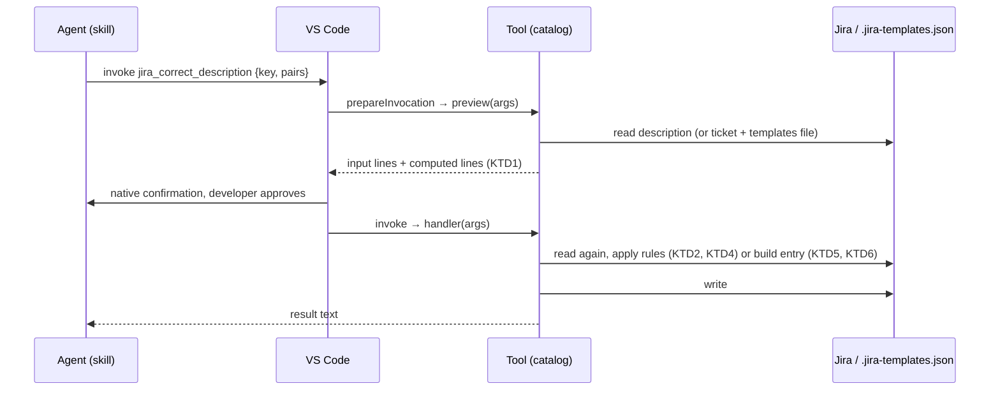

# Spell Check and Template Skills - Plan

## Goal Capsule

- **Objective:** A developer corrects the spelling of a ticket's description, and turns a ticket into a reusable template, from a Copilot chat. Neither needs `@jira` or the Local harness any more.
- **Means:** Two explicit-only skills, `/ts-jira-spell-check` and `/ts-jira-template`, each backed by one new write tool whose confirmation previews the computed result (KTD1). The same change removes `@jira spell check` and `@jira` template generation. This closes O3 and O4 of [`docs/architecture/migration-status.md`](../architecture/migration-status.md).
- **Product authority:** The maintainer's decisions below. They amend R28 and R29 of [`2026-11-11-2234-feat-boards-replace-chat-participants-plan.md`](2026-11-11-2234-feat-boards-replace-chat-participants-plan.md) (R18). The rest of Step 1 (O1, O2, the other O5 removals, O6) is not active scope.
- **Open blockers:** None.
- **Stop conditions:** Stop and ask when a protected wiki span cannot be recognised without a full wiki parser (U2), or when removing a flow would break a participant flow outside spell check and template generation (U6).
- **Execution profile:** One PR on `claude/magical-gates-816h2m`, units in order U1 to U6. `npm run compile` and `npm test` green before every commit.
- **Finishes and ships:** The executor opens the PR; the maintainer reviews, merges and releases with Step 1's preview.

---

## Product Contract

Product Contract preservation: changed R13 — dropped at planning, user-directed: today's flow skips empty fields silently, and listing empty required fields would be new behaviour costing an extra Jira lookup per template. AE5 dropped with it. Everything else unchanged.

### Summary

`/ts-jira-spell-check KEY` lets Copilot's agent list spelling and grammar fixes for a ticket's description, and a tool applies only the fixes the developer approves. `/ts-jira-template KEY` saves a template built from the ticket's fields to `.jira-templates.json` after one native confirmation. `@jira spell check` and `@jira` template generation are removed in the same change.

### Problem Frame

Step 1 of the migration removes every `@jira` flow except the imports, and each flow can go only once its replacement exists (R33 of the boards plan). Spell check and template generation are the two flows with no replacement yet. A developer who uses either has to switch to the Local harness for it. Today's template generation is a seven-step chat dialogue held in `workspaceState` sessions, which is the participant mechanism this migration retires.

### Key Decisions

- **Two separate explicit-only skills, not new `/ts-jira` router commands.** (session-settled: user-directed — chosen over instruction files in the `/ts-jira` folder and over exception rows in its `SKILL.md`: the router keeps its strict one-call rule.) Governs R1, R2.
- **Spell check covers the description only.** (session-settled: user-directed — chosen over summary and description as R28 stated: matches today's `@jira spell check`.) Governs R3.
- **Copilot's agent finds the corrections; the extension makes no model call.** (session-settled: user-approved — chosen over a tool calling a model with today's spell-check prompt: no dependency on open decision Q1 and no model setting, at the cost of results varying with the chat's model.) Governs R4.
- **The proposal is a numbered list of changes, and single items can be dropped.** (session-settled: user-approved — chosen over showing the full corrected text and over all-or-nothing approval.) Governs R5.
- **A tool applies the approved pairs; the agent never writes the whole description.** (session-settled: user-directed — chosen over rules in the skill only and over rules plus a diff in chat: nothing but the listed corrections can change, so wiki markup and code stay intact.) Governs R6 to R8.
- **One template write tool; its native confirmation is the only review.** (session-settled: user-directed — chosen over a read tool followed by a write tool with a field review in chat, and over a board: unwanted fields are removed by editing the file afterwards.) Governs R10.
- **A taken name saves under a numbered name.** (session-settled: user-directed — chosen over refusing and asking for another name, and over replacing the existing template after confirmation.) Governs R11.
- **No-ticket mode is dropped.** (session-settled: user-directed — chosen over saving name and issue type only, and over the agent asking for every value before the write: Jira's required-fields metadata carries no values, so without the review step such a template presets nothing.) Governs R9.
- **Kept from today's flow: asking for the name and the first-ticket offer.** (session-settled: user-directed — chosen over dropping them.) Governs R12, R14.
- **Empty fields on the reference ticket are skipped without a list.** (session-settled: user-directed — chosen over listing the empty required fields: today's flow skips them silently too, and a list would cost one more Jira lookup per template.) Governs R9.
- **The first-ticket offer is a hint, not a question.** (session-settled: user-directed — chosen over asking and then starting `/ts-jira-create`, and over dropping the offer.) Governs R14.
- **The two `@jira` flows are removed in this change.** (session-settled: user-directed — chosen over leaving their removal to O5's single removal pass.) Governs R16.
- **The boards plan is updated in place.** (session-settled: user-approved — chosen over stating only in this plan that it supersedes R28 and R29.) Governs R18.
- **A refused correction refuses the whole write.** The developer sees which pairs were refused and can drop them and run again, so a partial write never surprises them. Governs R7.

### Requirements

**Skills**

- R1. Two new skills, `/ts-jira-spell-check KEY` and `/ts-jira-template KEY [name]`, which the agent never starts by itself (`disable-model-invocation`, like `/ts-jira-brief`).
- R2. `/ts-jira help spell-check` and `/ts-jira help template` print a help page for each skill, as `help brief` and `help create` do today, and the closing line of `/ts-jira help` lists all four pages; the router itself still names no skill.

**Spell check**

- R3. `/ts-jira-spell-check KEY` checks only the ticket's description; a ticket without a description gets a reply saying so and no write.
- R4. The agent proposes spelling and grammar corrections only, no rewording or style changes, and never inside `{code}`, `{noformat}`, `{{monospace}}` or a link target.
- R5. The proposal is a numbered list of "before → after" lines; the developer approves it, or drops items by number first. When nothing is found, the reply says so and nothing is written.
- R6. A new write tool takes the ticket key and the approved pairs, applies them to the description as Jira holds it at the time of the write, and saves the result.
- R7. The tool refuses the write when any pair's "before" text does not occur exactly once in the current description or lies inside code, `{noformat}`, monospace or a link target, and names each refused pair.
- R8. The tool's native confirmation shows every pair and the resulting description; like the other Jira write tools it falls under the shared duplicate guard and reports a write Jira did not answer in time as possibly saved.

**Template**

- R9. `/ts-jira-template` builds the entry from a reference ticket only, with today's deterministic logic: template-shaped fields copied, per-ticket and empty fields left out. Without a ticket key the skill asks for one.
- R10. One write tool builds and saves the entry. Its native confirmation lists the name, the issue type and every field with its value, and nothing is written without approval.
- R11. When the name is already in `.jira-templates.json`, the entry is saved under the lowest free numbered name ("Bug (2)", "Bug (3)"), and the confirmation shows the name used.
- R12. When no name is typed, the agent asks for one before calling the tool.
- R14. After a save, the result ends with one line showing the `/ts-jira-create` command that uses the new template, and asks nothing.
- R15. The save adds only the new entry and keeps the rest of `.jira-templates.json` (other templates, `cleanupRules`). A file that exists but cannot be read in full is never written over.

**Removal and documentation**

- R16. `@jira spell check` and `@jira` template generation are removed: their intent operations, routing, sessions and `workspaceState` keys, help entries, follow-up chips and tests.
- R17. The user manual follows: the README's spell-check line goes, and `docs/manual/copilot-tools.md` describes both skills and both new tools.
- R18. The boards plan is updated: R28 and R29 and their Replacement Map rows name the new skills and today's decisions, and the Key Decision "The minimum VS Code version rises in step 1" is marked withdrawn, matching R36. The migration status marks O3 and O4 as done.

### Key Flows

- F1. Spell check (covers R3 to R8)
  1. The developer types `/ts-jira-spell-check PROJ-123`.
  2. The agent reads the ticket and lists the corrections, numbered.
  3. The developer replies "skip 2" or approves.
  4. The agent calls the apply tool with the approved pairs. The developer approves the native confirmation.
  5. The tool writes the description and reports the result.
- F2. Template (covers R9 to R14)
  1. The developer types `/ts-jira-template PROJ-123`.
  2. The agent asks for a name and gets "Payments bug".
  3. The agent calls the write tool. The confirmation lists the name used, the issue type, and the fields and values.
  4. On approval the tool saves the entry. The result ends with the `/ts-jira-create` hint.

### Acceptance Examples

- AE1. **Covers R7.** Given an approved pair "shwon → shown" and a description where "shwon" appears twice, when the tool runs, then nothing is written and the result names that pair as not unique.
- AE2. **Covers R6, R7.** Given the ticket was edited between the proposal and the write so that one "before" text is gone, when the tool runs, then nothing is written and the edit is kept.
- AE3. **Covers R4, R7.** Given "recieved" appears only inside a `{code}` block, then the agent does not propose it, and a pair naming it is refused by the tool.
- AE4. **Covers R11.** Given templates "Bug" and "Bug (2)" exist, when a template named "Bug" is saved, then it is saved as "Bug (3)" and the confirmation says so.
- AE6. **Covers R15.** Given `.jira-templates.json` holds invalid JSON, when a template is saved, then the file is left unchanged and the result says why.
- AE7. **Covers R3, R5.** Given a ticket with no description, or one with nothing to correct, then the reply says so and no tool writes.

### Scope Boundaries

- Dropped from today's `@jira` behaviour: no-ticket mode, the per-field keep-or-drop review, typing values for empty fields, replacing an existing template, and starting a ticket from the new template automatically.
- Not in this work: spell check of the summary or comments; listing required fields that are empty on the reference ticket; editing or updating an existing template; the other Step 1 points (O1, O2, the remaining O5 removals, O6).

### Dependencies / Assumptions

- `src/test/skillsGuard.test.ts` already requires `disable-model-invocation` on every `ts-` skill other than `/ts-jira-create`. Neither flow has an `@jira` slash command, so its `BASIC_COMMANDS` table is unaffected. `src/test/jiraCommandsGuard.test.ts` ties the `@jira` help catalog to the intent operations, so R16 removes both together.
- New tools go into the catalog in `src/tools/jiraTools/`; `node scripts/sync-jira-tools.mjs` generates their `package.json` entries, and `src/test/userDocsSync.test.ts` checks them against `docs/manual/copilot-tools.md`.
- VS Code calls a tool's `prepareInvocation` also when tool auto-approve is on, and accepts a promise from it. Not verified on the managed machine; if it does not run there, only the preview text is lost, never a write rule.

### Sources / Research

- Today's spell check: `handleSpellCheck` in `src/participant/jira/fieldHandler.ts` (description only, `spellCheckValue` model call in `src/participant/jira/llmHelpers.ts`, preview session).
- Today's template generation: `src/participant/jira/templateGenerationHandler.ts` (`startFromReferenceTicket`, `attemptSave`) and `src/participant/session/templateGeneration.ts` (`buildTemplateFieldReviewRows`, `buildGeneratedTemplate`); candidates from `TicketService.getTemplateCandidatesFromTicket`, which already drops empty and non-template-shaped fields and honours `hiddenDisplayFields`. Flow summary in `docs/jira-flows.md` "Template generation".
- Save path: `TemplateService.saveTemplate` in `src/templates/TemplateService.ts`. It keeps `cleanupRules`, creates a missing file, and throws on a file it cannot read or parse.
- Confirmation today: `confirmationFor` in `src/tools/jiraToolConfirmation.ts` builds lines from the tool input only; `src/tools/registerJiraTools.ts` calls it from `prepareInvocation`.
- Wiki converters: `src/utils/jiraWikiToMarkdown.ts` drops `{color}`, flattens `{panel}` and turns `[~user]` into `@user`, so a wiki → Markdown → wiki round trip is lossy (KTD2).
- Router rules this plan keeps intact: `skills/ts-jira/SKILL.md`. Skill shape to mirror: `skills/ts-jira-brief/SKILL.md`.

---

## Planning Contract

### Key Technical Decisions

- KTD1. **Write tools may preview their computed outcome in the confirmation.** `ToolDefinition` gets an optional `preview(args, deps)` that returns extra confirmation lines; `registerJiraTools.ts` awaits it in `prepareInvocation` and appends its lines to `confirmationFor`'s input lines. A preview that fails adds one line saying the preview could not be built and why; the confirmation still shows. The handler recomputes everything and does not compare with the preview. (session-settled: user-directed — chosen over a preview plus a write-time check of an outcome fingerprint, and over input-only confirmations: simpler, and the rare change between preview and write is accepted.) Governs R8, R10, R11.
- KTD2. **Corrections are applied to the stored wiki text, not through a Markdown round trip.** The agent reads and proposes in Markdown (`jira_view_ticket`); the tool matches each "before" against the raw wiki description and writes the edited wiki string unchanged otherwise. (session-settled: user-directed — chosen over converting wiki → Markdown → wiki like `jira_update_field`: the converters drop colour, panels and mentions in parts nobody corrected.) Governs R6, R7.
- KTD3. **Tool names `jira_correct_description` and `jira_create_template`.** (session-settled: user-directed — `jira_create_template` chosen over `jira_save_template` to read like `jira_create_ticket`.) Governs R6, R10.
- KTD4. **The correction rules live in a pure module.** `src/utils/descriptionCorrections.ts` finds protected spans (`{code…}…{code}`, `{noformat…}…{noformat}`, `{{…}}`, the target of `[text|target]`, the whole of `[target]` with no pipe, bare `http(s)://` URLs) and applies pairs all-or-none. Vitest tests it directly. Governs R7.
- KTD5. **The template building moves out of `src/participant/`.** A pure `src/templates/templateFromTicket.ts` holds building the entry from candidates (today's `buildGeneratedTemplate` with every candidate included) and `nextFreeTemplateName`. `src/participant/session/templateGeneration.ts` goes with the flow (U6), so nothing new imports from the participant tree. Governs R9, R11.
- KTD6. **The numbered name is picked by the tool, saved with `overwrite` never set.** `nextFreeTemplateName(name, existing)` returns `name` when free, else the lowest `name (N)` with N ≥ 2 not taken (exact, case-sensitive match as `saveTemplate` uses). Governs R11, R15.
- KTD7. **Duplicate guard keys.** `jira_correct_description` fingerprints key + pairs; `jira_create_template` fingerprints workspace folder + ticket key + name, so a retried call within a minute does not save "Bug (2)" and then "Bug (3)". Governs R8, R11.

### High-Level Technical Design

Directional only. One tool call from the agent's approval to the write:

### Assumptions

- `TicketService.updateFieldOutcome(key, 'description', wiki)` writes the string as given; only the `jira_update_field` tool converts Markdown first. U3 relies on that.
- `getTemplateCandidatesFromTicket(key, undefined, new Set(config.hiddenDisplayFields))` is today's deterministic candidate logic and stays as is.

---

## Implementation Units

### U1. Preview step for tool confirmations

- **Goal:** A write tool can show values it computes, not only its input, in the native confirmation.
- **Requirements:** R8, R10, R11 (KTD1)
- **Dependencies:** none
- **Files:**
  - `src/tools/toolDefinition.ts` (optional `preview`)
  - `src/tools/jiraToolConfirmation.ts` (merge input lines and preview lines; a failed preview becomes one line)
  - `src/tools/registerJiraTools.ts` (await the preview in `prepareInvocation`)
  - `src/test/jiraTools.test.ts` or a new `src/test/jiraToolConfirmation.test.ts`
- **Approach:**
  1. Add `preview?(args, deps): Promise<Array<{ name: string; value: string }>>` to `ToolDefinition`; `defineTool` types it against the schema.
  2. Add a vscode-free `confirmationWithPreview(tool, input, deps)` that parses the input with the tool's schema, calls `preview` when present and catches its errors.
  3. `prepareInvocation` becomes async for tools with a preview and renders every line as a plain-text code block, as today.
- **Patterns to follow:** `confirmationFor` and the `MAX_VALUE_CHARS` cut; `callTool`'s schema parse.
- **Test scenarios:**
  - A tool without `preview` gets exactly today's lines.
  - A tool with `preview` gets the input lines, then the preview lines.
  - A preview that throws a `JiraApiError` 404 gives the input lines plus one "Could not preview: …" line.
  - Input that fails the schema skips the preview and shows the input lines.
- **Verification:** Existing tool confirmations are unchanged; the bundle smoke test still registers every tool.

### U2. Correction rules for wiki text

- **Goal:** A pure function applies approved "before → after" pairs to wiki markup, or refuses with a reason per pair.
- **Requirements:** R6, R7 (KTD2, KTD4)
- **Dependencies:** none
- **Files:**
  - `src/utils/descriptionCorrections.ts` (new)
  - `src/test/descriptionCorrections.test.ts` (new)
- **Approach:**
  1. `protectedSpans(wiki)` returns the index ranges of the spans KTD4 names.
  2. `applyCorrections(wiki, pairs)` checks every pair against the original text first: occurs exactly once, not overlapping a protected span, not overlapping another pair. Any failure returns `{ refused: [{ index, before, reason: 'not found' | 'not unique' | 'protected' | 'overlaps' }] }` and changes nothing.
  3. Otherwise it replaces from the last match to the first, so earlier indexes stay valid, and returns `{ text }`.
  4. An empty pair list or a pair with an empty "before" is refused as input.
- **Execution note:** Write the test scenarios first; they are the contract the tool and the skill rely on.
- **Patterns to follow:** The vscode-free utils in `src/utils/` with a Vitest file of the same name.
- **Test scenarios:**
  - "shwon → shown" in "Form is shwon." gives "Form is shown." and nothing else changes, panels and colour tags included.
  - "shwon" appearing twice is refused as not unique (AE1).
  - A "before" that is gone after an edit is refused as not found (AE2).
  - "recieved" only inside `{code:java}…{code}` is refused as protected (AE3); the same inside `{noformat}`, `{{…}}`, a link target and a bare URL too.
  - The same word in a link's text part (`[recieved|http://x]`) is corrected, its target is not.
  - Two pairs, one refused: nothing changes and only the refused one is listed.
  - Two pairs whose matches overlap are refused as overlapping.
  - A word inside `*bold*` is corrected when "before" is the word alone.
- **Verification:** `npm test` passes the new file; the module imports nothing from `vscode` or `src/participant/`.

### U3. `jira_correct_description` tool

- **Goal:** The agent can write approved corrections to a ticket's description without touching anything else.
- **Requirements:** R3, R6, R7, R8 (KTD1, KTD2, KTD3, KTD7)
- **Dependencies:** U1, U2
- **Files:**
  - `src/tools/jiraTools/correctDescription.ts` (new)
  - `src/tools/jiraTools/toolNames.ts`, `src/tools/jiraTools/catalog.ts`
  - `package.json` (generated by `node scripts/sync-jira-tools.mjs`)
  - `src/test/jiraWriteTools.test.ts`
- **Approach:**
  1. Input: `ticketKey` and `corrections: [{ before, after }]` (at least one). Annotations: `destructiveHint`.
  2. `preview`: read the raw description with `getRawField(key, 'description')`, run `applyCorrections`, and return a "Corrections" line (numbered pairs) and either a "Resulting description" line or a "Will be refused" line naming the pairs.
  3. `handler` inside `writeOnce` and `runJiraTool`: read again, no description → "has no description, nothing was changed" (R3); refused → the per-pair reasons and "Nothing was changed" (R7); otherwise `ticketService.updateFieldOutcome(key, 'description', text)`, `markWritten`, and answer with the count of corrections applied.
  4. The description tells the agent to make each `before` the shortest unique plain-text fragment that crosses no formatting, as shown by `jira_view_ticket`.
- **Patterns to follow:** `src/tools/jiraTools/updateField.ts` (guard, `ticketKeyProblem`, `runJiraTool`).
- **Test scenarios:**
  - Happy path through `callTool` with `MockJiraClient`: the description is updated with only the listed words changed.
  - A refused pair: no `updateIssue` call, the answer names the pair and its reason.
  - A ticket with no description: no write, the answer says so.
  - The same call twice within a minute: the second answers "Skipped" and does not write.
  - A Jira timeout on the write is reported as possibly saved.
  - The preview of a valid call lists the pairs and the resulting description; of an invalid one, the refusal.
- **Verification:** `jiraToolManifest.test.ts` passes after the sync script; the tool appears in the bundle smoke test.

### U4. `jira_create_template` tool

- **Goal:** One call builds a template entry from a ticket with today's logic and saves it under a free name.
- **Requirements:** R9, R10, R11, R14, R15 (KTD1, KTD3, KTD5, KTD6, KTD7)
- **Dependencies:** U1
- **Files:**
  - `src/templates/templateFromTicket.ts` (new: `buildTemplateFromCandidates`, `nextFreeTemplateName`)
  - `src/tools/jiraTools/createTemplate.ts` (new)
  - `src/tools/jiraTools/toolNames.ts`, `src/tools/jiraTools/catalog.ts`, `package.json` (sync script)
  - `src/test/templateFromTicket.test.ts` (new), `src/test/jiraWriteTools.test.ts`
- **Approach:**
  1. Input: `ticketKey`, `name` (required; the skill asks for it, R12).
  2. Shared `computeTemplate(args, deps)`: no workspace folder → the same answer `jira_list_templates` gives; read the issue type from `getIssue`, the candidates from `getTemplateCandidatesFromTicket` with `hiddenDisplayFields`, the existing names from `TemplateService.loadTemplates()`, then `nextFreeTemplateName` and `buildTemplateFromCandidates`.
  3. `preview` returns "Saved as" (with "the name … is taken" when numbered), "Issue type" and one line per field with `formatTemplateFieldValue`'s display value.
  4. `handler` inside `writeOnce` recomputes, saves with `saveTemplate(template)`, and answers with the name used, the field count and the hint `/ts-jira-create 
 using the template "<name>"` (R14). A load or save error is answered with its message and "Nothing was saved" (R15, AE6).
  5. Move `formatTemplateFieldValue` along with the building code, since the participant copy goes in U6.
- **Patterns to follow:** `src/tools/jiraTools/templates.ts` (workspace folder, `TemplateService`), `createTicket.ts` (guard and answer shape).
- **Test scenarios:**
  - `nextFreeTemplateName`: free name returns itself; with "Bug" and "Bug (2)" taken, "Bug (3)" (AE4); "bug" is not a clash with "Bug".
  - `buildTemplateFromCandidates` gives `{ name, issueType, defaultFields }` with every candidate, and no `resolveFields`.
  - Through `callTool`: saves a new entry, keeps the other templates and `cleanupRules` (R15).
  - Invalid JSON in `.jira-templates.json`: file unchanged, the answer says why (AE6).
  - No `.jira-templates.json`: the file is created with the one entry.
  - A field in `hiddenDisplayFields` is not in the entry.
  - The same call twice within a minute saves once.
  - The answer ends with the `/ts-jira-create` hint.
- **Verification:** The written file round-trips through `jira_list_templates`.

### U5. The two skills and the `/ts-jira` help line

- **Goal:** The developer runs both flows by typing a skill name.
- **Requirements:** R1, R2, R4, R5, R12, R14
- **Dependencies:** U3, U4
- **Files:**
  - `skills/ts-jira-spell-check/SKILL.md` (new), `skills/ts-jira-template/SKILL.md` (new)
  - `skills/ts-jira/SKILL.md` (case 2 reads the two new pages; the closing help line)
  - `skills/ts-jira/help-spell-check.md`, `skills/ts-jira/help-template.md` (new)
  - `package.json` (`contributes.chatSkills`)
  - `src/test/skillsGuard.test.ts` (the pinned `help.at(-2)` line and the `pages` table)
- **Approach:**
  1. `/ts-jira-spell-check`:
     - Call `jira_view_ticket`. No description → say so and stop.
     - List spelling and grammar fixes only, numbered "before → after". Never inside code, monospace or link targets (R4). Nothing found → say so and stop.
     - Wait for approval or "skip N". Then call `jira_correct_description` once with the approved pairs.
     - On a refusal, show the reasons and offer to drop the refused pairs.
  2. `/ts-jira-template`:
     - Needs a ticket key; ask for one if missing (R9). Ask for the name when none is typed (R12).
     - Call `jira_create_template` once and show its answer, hint included, without adding a question (R14).
  3. Both carry `disable-model-invocation: true` and an `argument-hint`.
  4. Add `help-spell-check.md` and `help-template.md` in the shape of `help-brief.md` (usage line, what it does, example, "Without it:", "Copilot runs … only when you type it"). Extend case 2 of the router to read them, and change its closing line to name `help brief, help create, help spell-check, help template`. The router text itself never names the skills (R2).
- **Patterns to follow:** `skills/ts-jira-brief/SKILL.md` and its `describe('the /ts-jira-brief skill')` block; `skills/ts-jira/help-brief.md` and the `describe('the help pages /ts-jira prints for brief and create')` block.
- **Test scenarios:**
  - Both skills run only when typed and name only catalog tools.
  - Spell check names `jira_view_ticket` before `jira_correct_description` and says it proposes spelling and grammar only.
  - Template asks for a missing name before `jira_create_template` and asks nothing after the save.
  - The two new help pages pass the help-page checks: each names a skill that exists, how to use it, when it starts and what to do without it.
  - The `/ts-jira` closing help line lists the four pages, and the router still names no skill.
- **Verification:** `skillsGuard.test.ts` passes; both skills appear in the bundle's `chatSkills`.

### U6. Remove the old flows and update the documents

- **Goal:** `@jira` no longer offers spell check or template generation, and every document says where to go instead.
- **Requirements:** R16, R17, R18
- **Dependencies:** U5
- **Files:**
  - Removal:
    - `src/participant/jira/templateGenerationHandler.ts` (delete), `src/participant/session/templateGeneration.ts` (delete)
    - `src/participant/jira/fieldHandler.ts` (`handleSpellCheck`)
    - `src/participant/jira/llmHelpers.ts` (`spellCheck`/`generateTemplate` operations, intent prompt lines, `spellCheckValue`)
    - `src/participant/JiraParticipant.ts` (routing and the seven session checks)
    - `src/participant/sessionState.ts`, `src/participant/session/followups.ts` (template chip, `template-gen-*` kinds), `src/participant/session/conversation.ts`
    - `src/participant/session/jiraCommands.ts` (`spell-check`, `template` entries)
  - Tests: `src/test/templateGenerationSessionState.test.ts` (delete), `src/test/fieldHandler.test.ts`, `src/test/llmHelpers.test.ts`, `src/test/JiraParticipant.test.ts`, `src/test/jiraCommands.test.ts` (their spell-check and template cases)
  - Documents:
    - `README.md`
    - `docs/manual/copilot-tools.md`, `docs/manual/jira-templates-and-cleanup-rules.md`
    - `docs/jira-flows.md` ("Template generation" and the session table)
    - `CLAUDE.md` ("fifteen Jira tools" → seventeen, the two skills, key files)
    - `docs/architecture/migration-status.md` (O3, O4, the tool count)
    - `docs/plans/2026-11-11-2234-feat-boards-replace-chat-participants-plan.md` (R28, R29, Replacement Map, line 93)
- **Approach:**
  1. Delete the flows and let `npm run compile` and `jiraCommandsGuard.test.ts` find every remaining reference.
  2. Keep `TemplateService.saveTemplate`'s `overwrite` option only if another caller uses it; otherwise drop it with its collision test.
  3. Rewrite the manual's "Generating a template from a ticket" section for `/ts-jira-template`, and add both skills and both tools to `copilot-tools.md`'s tables and its manual test list.
  4. Amend R28 and R29 in the boards plan with a pointer to this plan; mark line 93 "(Withdrawn, see R36.)".
- **Patterns to follow:** The 2026-11-13 deprecation edits for the wording of the boards plan and the migration status.
- **Test scenarios:**
  - `jiraCommandsGuard.test.ts` passes with the two operations and their entries gone.
  - `userDocsSync.test.ts` passes with both tools in `copilot-tools.md`.
  - The intent prompt no longer names `spellCheck` or `generateTemplate`, and the `@jira` help screen has no spell-check or template lines.
- **Verification:** A search for `spellCheck`, `generateTemplate`, `templateGen` and `TEMPLATE_GEN` in `src/` finds nothing; `npm run compile` and `npm test` are green.

---

## Verification Contract

- `npm run compile` — type check after every unit.
- `npm test` — Vitest; must be green before every commit. The units' proofs are `descriptionCorrections.test.ts`, `templateFromTicket.test.ts`, `jiraWriteTools.test.ts`, the confirmation test of U1, `skillsGuard.test.ts`, `jiraToolManifest.test.ts`, `jiraCommandsGuard.test.ts`, `userDocsSync.test.ts` and `bundleSmoke.test.ts`.
- `node scripts/sync-jira-tools.mjs` after U3 and U4, then `npm test` again so `jiraToolManifest.test.ts` sees the generated entries.
- `xvfb-run -a npm run test:e2e` once at the end: every declared tool and skill registers in a real VS Code.
- Not covered by automation: the skills in a live Copilot chat and the async confirmation on the managed machine. Both go on the Step 1 manual checklist (O6).

## Definition of Done

- U1 to U6 are done and their test scenarios exist and pass.
- `npm run compile`, `npm test` and the e2e smoke suite are green.
- `@jira` has no spell-check or template flow, and nothing under `src/` references them.
- README, the manual pages, `docs/jira-flows.md`, `CLAUDE.md`, the migration status and the boards plan describe the two skills and tools as the way to do this.
- No dead code from abandoned approaches is left in the diff.
