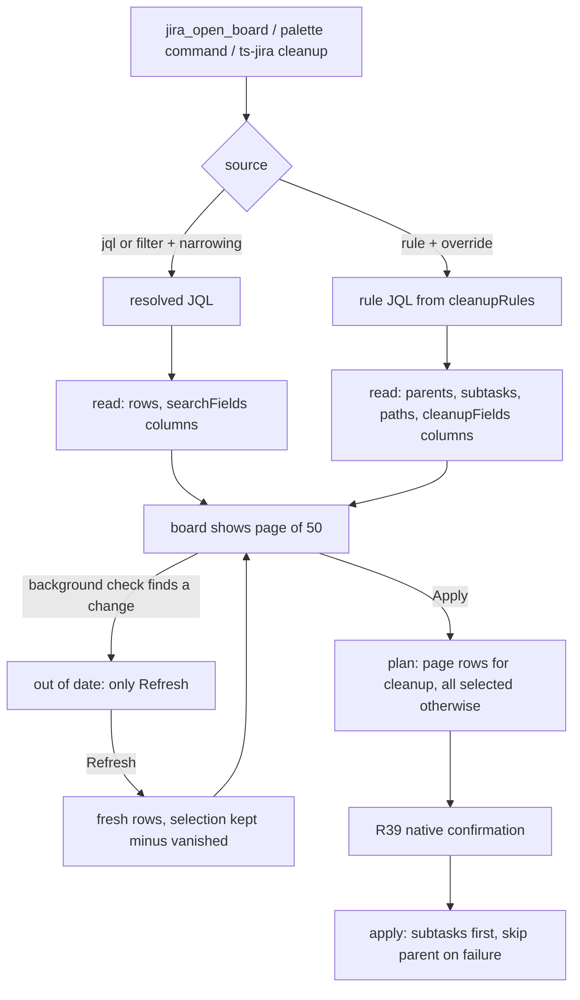

# Ticket List Parity and Step 1 Removal - Plan

## Goal Capsule

- **Objective:** A developer does every Jira task except the report imports, cleanup and bulk changes included, from a Copilot chat and the boards; `@jira` is left with the imports only, and Step 1 of the migration is done on the preview channel.
- **Means:** The ticket list board gains a cleanup mode and the remaining list-flow features; the same PR removes every `@jira` flow the boards plan's Replacement Map lists for Step 1. Closes O1, O2 and O5 of [`docs/architecture/migration-status.md`](../architecture/migration-status.md) and writes Step 1's part of O6.
- **Product authority:** The maintainer's decisions below. They amend R7 to R9, R33 and R35 and AE9 of [`2026-11-11-2234-feat-boards-replace-chat-participants-plan.md`](2026-11-11-2234-feat-boards-replace-chat-participants-plan.md). Steps 2 and 3 (imports, Bitbucket) are not active scope.
- **Open blockers:** None.
- **Stop conditions:** Stop and ask when removing a flow would break an import flow or a tool (U7), when a moved helper turns out to need `vscode` (U6), or when the check-mode change would alter what the security report or sessions board shows (U1).
- **Execution profile:** One PR on `claude/exciting-ride-7nidsk`, units in order U1 to U8 (board work, then the helper move, then the removals, then docs). `npm run compile` and `npm test` green before every commit (R24).
- **Finishes and ships:** The executor opens the PR; the maintainer reviews, merges and releases it on the preview channel only (R23), then runs the Step 1 checklist part (R21).

---

## Product Contract

Product Contract preservation: changed R9 and AE3 — user-directed at planning: the native confirmation of the boards plan's R39 already covers every write to more than one ticket, so R9 now says it covers rows on other pages, not "only over 50". Added R25 — user-directed at planning: transition paths are worked out when the cleanup board loads. The deferred question on rows without a path is resolved by R25 and removed.

### Summary

The ticket list board learns cleanup by `cleanupRules`, configurable columns, narrowing at open, paging, list-value add and remove, and an out-of-date state. In the same PR every Step 1 `@jira` flow is removed, the Jira walkthrough is rewritten, and the docs and the Step 1 manual checklist are brought in line. The migration releases only on the preview channel until it is complete.

### Problem Frame

The single-ticket Jira work already has tools and skills, but the list flows (search, filters, bulk transition, bulk field update, cleanup) still exist fully only in `@jira`. The maintainer still switches to `@jira` for daily cleanup, and every replaced flow left in `@jira` is code that still needs fixes and has to stay in sync with its replacement. KL25 records the board's gaps. Two of them, reading more than 300 tickets and a side-by-side conflict view, turned out not to be `@jira` features: `@jira` reads 50 tickets for search and cleanup, and it never notices a ticket that changed.

### Key Decisions

- **Subtasks follow their parent; only parents are selectable.** (session-settled: user-directed — chosen over a selection that cascades both ways as `@jira` does, and over flat rows: simpler, and a parent never closes over a skipped child.) Governs R3, R4.
- **Both column settings stay.** (session-settled: user-approved — chosen over merging them into one setting and over a column picker: existing settings keep working.) Governs R10.
- **A board opened with a proposed transition counts as a cleanup.** (session-settled: user-approved — chosen over "only rule-loaded boards" and over merged columns: matches `@jira`'s ad-hoc bulk close today.) Governs R10, R8.
- **300 tickets, 50 per page.** (session-settled: user-directed — chosen over one 300-row table, over reading only 50, and over reading past 300: `@jira`'s 50 was a page and safety limit, not a read limit.) Governs R7.
- **Cleanup applies one page at a time.** (session-settled: user-directed — chosen over an approval flow across pages, which comes later as a known limitation.) Governs R8.
- **A changed board offers only Refresh.** (session-settled: user-directed — chosen over a "select again" control and over a side-by-side view.) Governs R13, R14.
- **Narrowing happens when the board opens.** (session-settled: user-approved — chosen over controls on the board and over an editable JQL box.) Governs R11.
- **A failed subtask skips its parent.** (session-settled: user-approved — chosen over trying the parent anyway as `@jira` does, and over stopping the whole Apply.) Governs R5.
- **The native confirmation stays as the boards plan's R39 sets it and counts selected rows.** (session-settled: user-approved — chosen over confirming only above 50 rows, which would weaken R39, and over counting subtasks.) Governs R9.
- **Transition paths are worked out when the cleanup board loads.** (session-settled: user-directed — chosen over finding the path at Apply and over requiring a cached workflow as `@jira` does.) Governs R25.
- **Every replaced `@jira` flow goes in this work, and a removed request gets one generic notice.** (session-settled: user-directed — chosen over removing only the list flows, and over per-command pointers or the general fallback.) Governs R15, R17.
- **One plan, one PR, board work first.** (session-settled: user-directed — chosen over two PRs or two plans.) Governs R24.
- **Preview-only releases until the whole migration is done and tested; stable stays frozen with no hotfix releases.** (session-settled: user-directed — chosen over a normal release per step and over a hotfix branch: colleagues are not interrupted, and work in the middle of a branch never has to stop for a release.) Governs R22, R23.

### Requirements

**Cleanup on the ticket list board**

- R1. The developer starts a cleanup by naming a `cleanupRules` rule in chat (`/ts-jira cleanup "rule" [in …]` or a plain request), or from a new Command Palette command that picks a rule from `.jira-templates.json`; either opens the ticket list board loaded from that rule.
- R2. A cleanup board selects tickets and target states with the same rule fields and prompt overrides as today's `@jira run cleanup` (see `docs/jira-flows.md` "Bulk cleanup").
- R3. With `closeSubtasks`, each parent row shows its open subtasks indented beneath it, each with its own target status and resolution from the rule.
- R4. Only parent rows are selectable; a parent's subtasks are applied exactly when the parent is selected.
- R5. Apply moves a parent's subtasks before the parent; when any of them fails, the parent is not attempted and its result names the failed subtask.
- R6. A missing resolution for a closed target state is chosen on the board before Apply is possible.
- R25. The cleanup board works out each row's transition path when it loads, discovering the workflow once when none is cached; a parent without a path, or with a subtask without one, is shown with the reason and cannot be selected.

**Paging and Apply**

- R7. The board reads at most 300 tickets, shows them 50 per page, and keeps its "more tickets match, narrow the query" notice when more match.
- R8. On a cleanup board (rule-loaded, or opened with a proposed transition), Apply acts only on the selected rows of the page being viewed.
- R9. On any other board the selection holds across pages, and the native confirmation of the boards plan's R39 names and lists every selected row, including rows on pages not in view.

**Columns, narrowing and field changes**

- R10. A search or filter board shows the `ticketSidekick.jira.searchFields` columns, and a cleanup board shows the `ticketSidekick.jira.cleanupFields` columns, with the column rules `@jira` uses today.
- R11. Opening a ticket list board accepts the same fix version, sprint, assignee and `myTeam` narrowing as `jira_find_tickets`, resolved the same way, and the board shows the resulting JQL.
- R12. A bulk field change on a list field can add or remove single values and keep the rest, as `jira_update_field` does.

**Out-of-date board**

- R13. When the background check finds that a listed ticket changed or left the query, the board says it is out of date and offers Refresh as its only action.
- R14. Refresh reloads the rows, keeps the selection of every ticket still in the list, and drops the tickets that no longer match.

**Removing `@jira` flows**

- R15. Every flow in the Replacement Map's Step 1 rows is removed from `@jira`, together with its slash commands, help entries, follow-up chips and disambiguation entries.
- R16. `@jira` keeps only the three report imports and their Command Palette commands.
- R17. Any `@jira` request that is not an import gets one fixed notice saying `@jira` now only imports reports and pointing to `/ts-jira` and Agent mode.

**Docs, onboarding and testing**

- R18. The Jira Getting-Started walkthrough teaches Agent mode, `/ts-jira` and the boards instead of `@jira`.
- R19. README, the user manual, `CLAUDE.md` and the domain docs describe the board features and no longer describe the removed flows as usable.
- R20. `docs/known-limitations.md` closes KL25 and adds an entry for cleanup applying one page at a time; the migration status page closes O1, O2 and O5 and drops "more than 300 tickets" and "side-by-side conflict" as gaps.
- R21. The written manual checklist gets its Step 1 part, run on the managed machine against the preview build of this work.
- R22. The release strategy is recorded where later migration work reads it (the migration status page and the boards plan's R35 and AE9): every migration release is a preview, stable stays on its current version with no hotfix release, each step adds and runs its checklist part on preview, and the one normal release at the end reruns the whole checklist.

**Delivery**

- R23. The work is released on the preview channel only.
- R24. One PR, with commits ordered as board work first, then the removals, then docs and walkthrough, and `npm test` green at every commit.

### Key Flows

- F1. Cleanup run
  - **Trigger:** The developer types `/ts-jira cleanup "Close released bugs"` or picks the rule from the Command Palette.
  - **Steps:** The board opens loaded from the rule, with parents and their subtasks; the developer chooses a resolution if the rule has none; deselects parents to leave; presses Apply for page 1; moves to page 2 and applies again.
  - **Outcome:** Each row shows its result; a parent whose subtask failed shows as skipped.
  - **Covered by:** R1 to R8, R10, R25.
- F2. Bulk field change across pages
  - **Trigger:** The agent opens the board for a filter with a proposed "add label X" change.
  - **Steps:** The developer deselects some rows on pages 1 and 3 and presses Apply with 120 rows selected; the native confirmation names 120.
  - **Outcome:** The 120 tickets get the label added; their other labels stay.
  - **Covered by:** R7, R9, R10, R12.

### Acceptance Examples

- AE1. **Covers R4, R5.** Given parent PROJ-10 with subtasks PROJ-11 and PROJ-12 is selected, when PROJ-12 fails to move, then PROJ-11 is moved, PROJ-10 is not attempted, and PROJ-10's result names PROJ-12.
- AE2. **Covers R8.** Given a cleanup board with 120 tickets and all rows selected on pages 1 to 3, when the developer applies from page 2, then only page 2's selected rows change.
- AE3. **Covers R9.** Given a search board with 120 rows selected across three pages and page 1 in view, when Apply is pressed after the preview, then the native confirmation names 120 tickets and lists all of them.
- AE4. **Covers R8, R10.** Given the agent opens a board for "close PROJ bugs in 3.2" with a proposed transition, then it shows the `cleanupFields` columns and applies per page.
- AE5. **Covers R13, R14.** Given PROJ-5 is selected and a colleague moves it to Done, when the background check runs, then the board shows it is out of date with only Refresh; after Refresh PROJ-5 is still selected if it still matches the query, and gone if it does not.
- AE6. **Covers R17.** Given this release, when a developer types `@jira move PROJ-1 Done`, then `@jira` answers with the fixed notice and changes nothing.
- AE7. **Covers R22, R23.** Given this work is released, when a colleague on the stable channel types `@jira search`, then it still works, because no normal release has shipped since the migration began.
- AE8. **Covers R25.** Given a cleanup rule whose target is Done and PROJ-20 sits in a status with no path to Done, when the board loads, then PROJ-20 shows "no path from Blocked to Done" and its checkbox is disabled.

### Scope Boundaries

- Reading more than 300 tickets on one board.
- A side-by-side view of a changed ticket, or a "select again" control.
- An approval flow that applies a cleanup across several pages at once (recorded as a known limitation by R20).
- Narrowing controls or an editable JQL box on the board.
- Removing the imports, `@jira` itself or anything of `@bitbucket` (Steps 2 and 3).
- Any stable-channel release, including hotfixes, before the whole migration is done.

### Dependencies / Assumptions

- `cleanupRules`, `ticketSidekick.jira.searchFields` and `ticketSidekick.jira.cleanupFields` keep their current format; no settings migration.
- Removing `@jira`'s single-ticket flows does not touch the shared services `@bitbucket`'s requirements pass uses (`TicketService`, `JiraApiClient`).
- `@jira`'s slash commands (`check`, `create`, `view`, `load`, `comment`, `field`, `move`, `search`, `security-report`) all belong to removed flows, so `@jira` keeps no slash command.

### Outstanding Questions

- Deferred to Implementation: where on the board the resolution choice of R6 sits, and how it reads for a rule with different parent and subtask resolutions (U4).

### Sources / Research

- `src/boards/ticketList/kind.ts` (`MAX_LIST_ROWS`, `reconcile`), `src/boards/ticketList/jiraDeps.ts`: the board as built.
- `src/participant/jira/cleanupHandler.ts` (50-ticket read and notice, subtask-before-parent loop): today's cleanup behaviour.
- `src/tools/jiraTools/findTickets.ts` (narrowing), `src/tools/jiraTools/updateField.ts` (`operation` add or remove): behaviour R11 and R12 reuse.
- `docs/jira-flows.md` "Bulk cleanup": rule fields, overrides and `cleanupFields` column rules.
- `skills/ts-jira/SKILL.md`: the command table that gains a `cleanup` row.
- `walkthroughs/jira/`: the pages R18 rewrites.

---

## Planning Contract

### Key Technical Decisions

- KTD1. **A check tells the board whether it is a background check or the developer's Refresh.** (session-settled: user-approved — chosen over a ticket-list-only flag that swaps rows anyway, and over no background check for the ticket list.) The session manager passes the mode to `reconcile`; the ticket list keeps the rows it showed and marks itself out of date in background mode, and lays the working state over the fresh rows on Refresh. Kinds that ignore the mode behave as today. Implements R13, R14.
- KTD2. **Cleanup is a recipe source of the existing ticket list kind, not a new board kind.** The boards plan's R9 already says cleanup is this board; a source type `rule` beside `jql` and `filter` keeps one set of rules for selection, apply, paging and the out-of-date state. Implements R1, R2.
- KTD3. **The cleanup session key is the rule name plus the version override.** (session-settled: user-approved — chosen over the resulting JQL and over a fresh board each time.) Implements R1.
- KTD4. **Stored ticket list sessions are discarded once by raising the kind's `formatVersion`.** (session-settled: user-approved — chosen over migrating them; the session layer never migrates.) Implements the new working shape behind R4, R7, R13.
- KTD5. **Paths are computed in `read` for a cleanup source, with one workflow discovery when the cache has no graph.** (session-settled: user-directed — see the Key Decision governing R25.) Apply still re-reads each target and refuses a changed one, as today.
- KTD6. **The page in view is working state.** A `page` action stores it, so a cleanup Apply (R8) plans only that page's selected rows from the session, never from what the page claims.
- KTD7. **Walkthrough check-offs come from the tools.** (session-settled: user-approved — chosen over checking off on the step's button and over dropping the steps.) `registerJiraTools.ts` sets `ticketSidekick.workflowViewed` after `jira_workflow` succeeds and `ticketSidekick.firstTicketCreated` after `jira_create_ticket` succeeds; the vscode-free catalog stays vscode-free.
- KTD8. **The helpers tools, boards and shared services import move out of `src/participant/` in this PR.** (session-settled: user-directed — chosen over leaving them until Step 2.) Helpers only the imports use (the stale close in `cleanupHandler.ts`, `importTypes.ts`) stay, and `sessionState.ts` re-exports the moved ones so participant code keeps importing from it.
- KTD9. **`@jira` keeps the intent parse for the imports only.** Slash commands are all removed (Dependencies / Assumptions), import sessions keep their routing, and any parsed operation that is not `createFromEmail`, `addEmailComment`, `importVeracode` or `importWaltzReport` gets the notice of R17 without touching Jira.

### High-Level Technical Design

The cleanup board is the ticket list with a third source. Opening resolves the source into a recipe, `read` builds rows (and paths for a rule), the background check marks the board out of date, and Refresh lays the selection over fresh rows.

### Assumptions

- A subtask without a path blocks its parent (R25), extending R4 and R5: closing the parent would leave that subtask open.
- `fixVersion` on a cleanup open keeps `@jira`'s override meaning (`released`, `unreleased`, a `*` pattern, or an exact name); on a search or filter it is the find tool's resolved narrowing (R11).
- The extra columns render through `renderFieldValue` as plain text on the page; no markdown reaches the board.

### Sequencing

U1 → U2 → U3 → U4 → U5 are the board work; U6 moves helpers once the board no longer needs new ones; U7 removes the flows; U8 is the docs, walkthrough and checklist. R24 orders them in one PR.

---

## Implementation Units

### U1. Background and Refresh checks

**Goal:** A check knows whether it runs in the background or on the developer's Refresh.
**Requirements:** R13, R14; KTD1.
**Dependencies:** None.
**Files:** `src/sessions/boardKind.ts`, `src/sessions/sessionManager.ts`, `src/test/sessionManager.test.ts`.
**Approach:**
1. Add an optional mode argument to `reconcile`; background for restore and open, refresh for `SessionManager.refresh`.
2. Leave the security report and sessions kinds untouched; they ignore the argument.
**Patterns to follow:** The existing `check`/`refresh` split in `sessionManager.ts`; scenario tests in `src/test/securityReportBoard.test.ts`.
**Test scenarios:**
- A restored session's check calls `reconcile` with the background mode.
- `refresh()` calls it with the refresh mode.
- The security report board's derived data still updates on a background check.
**Verification:** Existing session and board suites pass unchanged; the new mode reaches `reconcile` on both paths.

### U2. Ticket list: paging, out-of-date state, list values

**Goal:** The ticket list shows 50 rows a page, keeps a selection across pages, adds or removes list values, and goes out of date instead of silently changing.
**Requirements:** R7, R9, R12, R13, R14; AE3, AE5; KTD4, KTD6.
**Dependencies:** U1.
**Files:** `src/boards/ticketList/kind.ts`, `src/boards/ticketList/jiraDeps.ts`, `board-pages/ticket-list/page.js`, `src/test/ticketListBoard.test.ts`, `src/test/ticketListJira.test.ts`.
**Approach:**
1. Working state gains the page in view and an out-of-date marker; raise `formatVersion`.
2. `reconcile` in background mode keeps the stored rows and sets the marker when a listed ticket changed or left; in refresh mode it takes the fresh rows, keeps the selection of rows still present and clears the marker. Today's deselect-and-conflict behaviour goes.
3. `reduce` and `plan` refuse every action except paging and Refresh while out of date.
4. `ListChange` field changes carry `set`, `add` or `remove`; `setField` passes it to `TicketService.updateAnyField`.
5. The page shows the out-of-date banner, page controls and an operation choice for a field change.
**Patterns to follow:** `jira_update_field`'s `operation` (`src/tools/jiraTools/updateField.ts`); the shared Refresh button in `board-pages/shared/board.js`.
**Test scenarios:**
- 120 rows read: the view shows rows 1–50, and page 3 shows 101–120.
- Selecting on page 1 and page 3, then Apply, plans all selected rows with a title naming the count (AE3).
- A background check after PROJ-5 changed: rows unchanged, view out of date, `select` and Apply refused.
- Refresh after that: PROJ-5 still selected with its new status; a ticket that left the query is gone from rows and selection (AE5).
- An `add` change on labels calls `setField` with `add` and the value.
- An empty value is still refused for every operation.
**Verification:** Scenario tests pass; a stored session of the old format is discarded with the existing notice.

### U3. Extra columns from settings

**Goal:** Search and filter boards show `searchFields` columns; cleanup boards and boards opened with a proposed transition show `cleanupFields`.
**Requirements:** R10; AE4.
**Dependencies:** U2.
**Files:** `src/boards/ticketList/kind.ts`, `src/boards/ticketList/jiraDeps.ts`, `board-pages/ticket-list/page.js`, `src/test/ticketListBoard.test.ts`, `src/test/ticketListJira.test.ts`.
**Approach:**
1. The recipe records which setting applies when the board opens (a proposed transition or a rule means `cleanupFields`); a later change on the board does not switch columns.
2. `read` requests the configured field ids and stores each row's rendered text plus the column headers from field metadata; an unknown id logs one warning through `onDiag`, as `buildExtraFieldColumns` does today.
**Patterns to follow:** `buildExtraFieldColumns` and `renderFieldValue` in `src/services/TicketService.ts`.
**Test scenarios:**
- A JQL board with `searchFields: ['customfield_1']` shows a column named after the field.
- A board opened with a proposed transition shows `cleanupFields`, not `searchFields` (AE4).
- An unknown field id yields one warning per read and a `Not set` cell.
**Verification:** Columns appear in the view model and page; no markdown syntax in cell text.

### U4. Cleanup source

**Goal:** A cleanup rule opens the ticket list with parents, nested subtasks, paths, resolution choice, per-page Apply and subtask-first writes.
**Requirements:** R1 to R6, R8, R25; F1; AE1, AE2, AE8; KTD2, KTD3, KTD5.
**Dependencies:** U2, U3.
**Files:** `src/boards/ticketList/kind.ts`, `src/boards/ticketList/cleanupSource.ts` (new, vscode-free rule-to-JQL and row building), `src/boards/ticketList/jiraDeps.ts`, `board-pages/ticket-list/page.js`, `src/test/ticketListCleanup.test.ts` (new), `src/test/ticketListJira.test.ts`.
**Approach:**
1. `validate` accepts a rule name and an optional version override, loads `cleanupRules` through `TemplateService` from the workspace folder, and refuses an unknown rule with the rule names it knows.
2. The rule-to-JQL builder carries `handleRunCleanup`'s rules over verbatim (anchored project, issue type, status and resolution, the four `fixVersion` forms, extra `jql` without `ORDER BY`).
3. `read` fetches parents and, with `closeSubtasks`, their open subtasks; computes paths from the workflow cache, discovering once per missing issue type; marks rows without a path (R25).
4. Selection keys are parents only; a resolution is required in working state before `plan` when the target is closed-like.
5. `plan` on a cleanup source takes only the current page's selected parents; `apply` moves each parent's subtasks first and records the parent as refused naming the failed subtask.
**Execution note:** Port `cleanupHandler.test.ts`'s rule-to-JQL cases first, so the builder matches today's JQL before the board uses it.
**Patterns to follow:** `handleRunCleanup` and `transitionTickets` in `src/participant/jira/cleanupHandler.ts`; `discoverAndCacheWorkflow` in `src/services/WorkflowService.ts`.
**Test scenarios:**
- A rule with `fixVersionFilter: "released"` builds `fixVersion in releasedVersions()`; an override `in "3.2"` wins over it.
- A rule `jql` with `ORDER BY` is ignored and the board says so.
- With `closeSubtasks`, PROJ-10's subtasks appear under it with `subtaskTargetState` and `subtaskResolution`.
- Selecting a subtask key directly is refused.
- A parent in a status without a path is unselectable with the reason (AE8); a parent with such a subtask is too.
- No cached workflow: one discovery per issue type, then paths.
- A closed target without a rule resolution: Apply refused until a resolution is chosen.
- PROJ-12 fails: PROJ-11 moved, PROJ-10 refused naming PROJ-12 (AE1).
- Apply from page 2 changes only page 2's selected rows (AE2).
- An unknown rule name: the board does not open and the reason lists the known rules.
**Verification:** Scenario tests pass with `MockJiraClient`; the JQL matches today's cleanup for the ported cases.

### U5. Opening a board

**Goal:** Every way in reaches the new features: the open tool, the Command Palette and `/ts-jira`.
**Requirements:** R1, R11; F2.
**Dependencies:** U4.
**Files:** `src/tools/jiraTools/openBoard.ts`, `src/boards/registerBoards.ts`, `src/boards/boardPanels.ts` (command list if it holds one), `package.json`, `skills/ts-jira/SKILL.md`, `src/test/jiraReadTools.test.ts`, `src/test/skillsGuard.test.ts`, `src/test/bundleSmoke.test.ts`.
**Approach:**
1. `jira_open_board` gains `cleanupRule`, `fixVersion`, `sprint`, `assignee` and `myTeam` for `ticket-list`; narrowing for JQL and filter sources reuses the find tool's resolution and reports ambiguity in the tool answer.
2. A palette command `ticket-sidekick.boards.cleanup` picks a rule from `.jira-templates.json` and opens the board; no rules gives a message naming the file.
3. `/ts-jira` gets a `cleanup "rule" [in …]` row.
4. Regenerate the tool manifest with `node scripts/sync-jira-tools.mjs`.
**Patterns to follow:** The `ticketList` palette command in `registerBoards.ts`; narrowing in `src/tools/jiraTools/findTickets.ts`.
**Test scenarios:**
- `jira_open_board` with `cleanupRule` opens a ticket list whose recipe source is the rule.
- With `filter` plus `sprint`, the opened recipe's JQL carries the sprint clause.
- An ambiguous sprint returns the candidates and opens nothing.
- `jql` and `cleanupRule` together are refused.
- The palette command and the skill row pass the manifest, bundle and skills guards.
**Verification:** `jiraToolManifest.test.ts`, `bundleSmoke.test.ts` and `skillsGuard.test.ts` pass with the new command and row.

### U6. Move shared helpers out of the participant folder

**Goal:** Tools, boards and shared services import nothing from `src/participant/`.
**Requirements:** KTD8.
**Dependencies:** U5.
**Files:** moved from `src/participant/session/constraints.ts`, `primitives.ts`, `core.ts` (the helpers named below) and `src/participant/jira/loadCore.ts` into `src/utils/` and `src/services/`; `src/participant/sessionState.ts` re-exports; importers in `src/tools/jiraTools/`, `src/services/TicketService.ts`, `src/utils/securityOverview.ts`; their tests.
**Approach:**
1. Move what `findTickets.ts`, `templates.ts`, `viewTicket.ts`, `createTicket.ts`, `loadTicket.ts`, `TicketService.ts` and `securityOverview.ts` import (constraint resolution, filter and bullet formatting, template list, comment formatting, issue type options, review table, link neutralizing, command links, the load core).
2. Keep import-only modules in place.
3. Re-export from `sessionState.ts` so participant code is untouched.
**Execution note:** Pure moves; no behaviour change. Tests should pass without edits beyond import paths.
**Test expectation:** Existing suites move with their subjects; no new scenarios.
**Verification:** A search of `src/tools`, `src/boards`, `src/services` and the non-import `src/utils` modules finds no `participant/` import; `npm test` green.

### U7. Remove the replaced `@jira` flows

**Goal:** `@jira` runs only the imports and answers anything else with one notice.
**Requirements:** R15, R16, R17; AE6; KTD7, KTD9.
**Dependencies:** U6.
**Files:** `src/participant/JiraParticipant.ts`, `src/participant/jira/` handlers for create, content, load (chat part), field, cleanup (chat part), workflow and upload, plus the `/security-report` route in `overviewHandler.ts`; `src/participant/jira/llmHelpers.ts` (the `Operation` union); `src/participant/session/` modules only the removed flows use (guided transition, conversation pieces, followups for removed states, upload); `src/participant/session/jiraCommands.ts`; `src/tools/registerJiraTools.ts`; `package.json` (`chatParticipants` commands, disambiguation, description); `src/test/JiraParticipant.test.ts`, `jiraParticipantCheck.test.ts`, `jiraParticipantHelp.test.ts`, `sessionGuidedTransition.test.ts`, `cleanupHandler.test.ts`, `jiraCommandsGuard.test.ts`, `skillsGuard.test.ts`.
**Approach:**
1. Remove the slash commands and every operation except the four imports; route sessions of removed kinds nowhere.
2. Keep what the imports and `@bitbucket` still use: `buildStaleTicketGroups` and `transitionTickets` (stale close), `saveOverviewFile` and `streamOverview` in `overviewHandler.ts` (import `export`), `ticketContext.ts`, and `llmHelpers.ts` (`generateContent` is imported by `BitbucketParticipant.ts`; only the `Operation` union shrinks). Delete the chat cleanup and the `/security-report` route.
3. The greeting and help screen list the imports and the notice.
4. Lower the guard thresholds and turn `BASIC_COMMANDS` into a check that no `@jira` slash command remains.
5. Set the walkthrough context keys from `registerJiraTools.ts` after a successful workflow or create call (KTD7).
6. Disambiguation and description name report imports only.
**Execution note:** Build the removal list from `Operation`, the session kinds and the chips in code, not from the docs (`docs/solutions/workflow-issues/import-board-parity-list-misses-recent-functional-import-work.md`).
**Test scenarios:**
- `@jira move PROJ-1 Done` answers the notice and makes no Jira call (AE6).
- "import this Veracode report" still starts the Veracode import.
- An email import session reply still reaches the email flow.
- The help screen lists only import entries.
- A successful `jira_workflow` call sets `ticketSidekick.workflowViewed`; a failed one does not.
**Verification:** No `@jira` slash command in `package.json`; the guard tests pass in their new form; import suites unchanged and green.

### U8. Walkthrough, docs, checklist and release rule

**Goal:** Users and later sessions read the new state.
**Requirements:** R18 to R22.
**Dependencies:** U7.
**Files:** `walkthroughs/jira/*.md`, `package.json` (walkthrough step texts), `README.md`, `docs/manual/boards.md`, `docs/manual/copilot-tools.md`, `docs/manual/agent-mode-tools.md`, `docs/manual/jira-templates-and-cleanup-rules.md`, `docs/manual/settings-reference.md`, `CLAUDE.md`, `docs/jira-flows.md`, `docs/onboarding.md`, `docs/known-limitations.md`, `docs/architecture/migration-status.md`, `docs/architecture/boards-and-sessions.md`, `docs/plans/2026-11-11-2234-feat-boards-replace-chat-participants-plan.md`, `docs/architecture/manual-checklist.md` (new), `CONCEPTS.md`.
**Approach:**
1. Rewrite the Jira walkthrough for Agent mode, `/ts-jira` and the boards.
2. Remove the removed flows from README tables and the manual; describe the cleanup board, paging, columns and the out-of-date state.
3. `known-limitations.md`: close KL25, add the one-page cleanup entry.
4. `migration-status.md`: close O1, O2, O5; record the release rule of R22; mark O6 as "Step 1 part written".
5. Amend the boards plan's R35 and AE9 to the release rule.
6. Write the checklist's Step 1 part: cleanup run, bulk move and field update across pages, out-of-date and Refresh, `@jira` notice, walkthrough check-offs, on the managed machine against the preview build.
7. Check each removed doc fact against its destination before deleting it (`docs/solutions/workflow-issues/doc-consolidation-unverified-destination-coverage-assumption.md`).
**Test expectation:** `src/test/userDocsSync.test.ts` covers settings, palette commands and tools; chat replies are checked by hand (KL9).
**Verification:** `userDocsSync.test.ts` passes; no manual page tells a user to type a removed `@jira` command.

---

## Verification Contract

| Gate | Command | When |
| --- | --- | --- |
| Type check | `npm run compile` | Before every commit |
| Unit and scenario tests | `npm test` | Before every commit (R24) |
| Tool manifest in sync | `node scripts/sync-jira-tools.mjs`, then `npm test` (`jiraToolManifest.test.ts`) | After U5 |
| Smoke in VS Code | `xvfb-run -a npm run test:e2e` | Once after U7; CI runs it too |
| Manual | The Step 1 checklist part (U8) on the managed machine | After the preview release |

---

## Definition of Done

- Every R1 to R25 is met and every AE has a passing test or a checklist line.
- `npm run compile`, `npm test` and the e2e smoke pass; CI's `ci-ok` is green on the PR.
- No `@jira` slash command remains; `@jira` runs only the imports.
- No file in `src/tools`, `src/boards` or `src/services` imports from `src/participant/`.
- The docs listed in U8 are updated, and the release rule is in `migration-status.md` and the boards plan.
- Code from abandoned approaches is removed from the diff.
