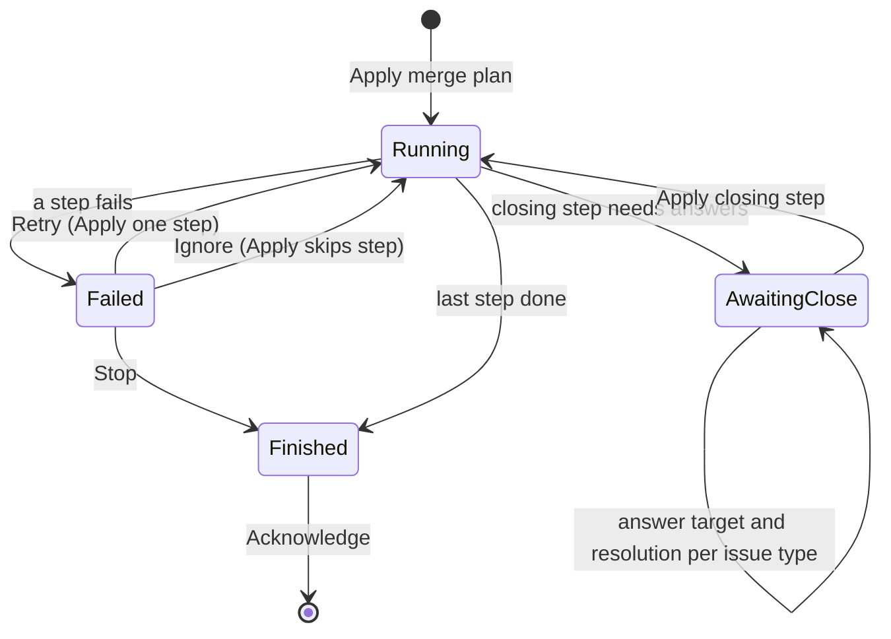
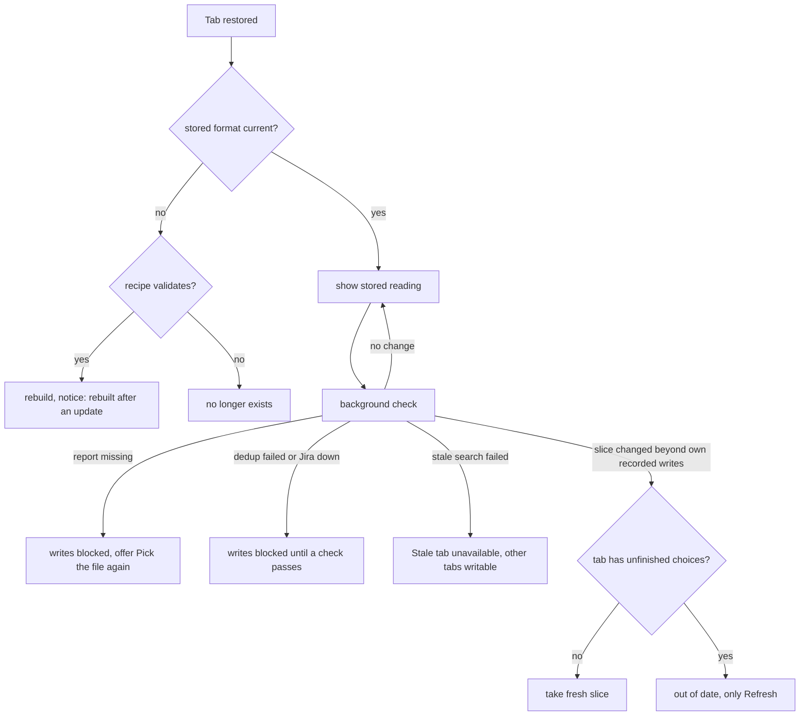

# Import Board for Veracode and Waltz - Plan

## Goal Capsule

- **Objective:** A developer runs every Veracode and Waltz report import from a board in an editor tab, with today's rules and results, and an unfinished import survives a VS Code restart. `@jira` is left with the email import only.
- **Means:** One new import board kind on the session model (KTD1), fed by the import rules moved into a shared engine (KTD2), with the session model saving after each write and rebuilding after a format change (KTD5, KTD6). The same PR removes `@jira`'s Veracode and Waltz imports. Closes the Veracode and Waltz part of O7 in [`docs/architecture/migration-status.md`](../architecture/migration-status.md).
- **Product authority:** The maintainer's decisions below. They narrow R14 and R16 of [`2026-11-11-2234-feat-boards-replace-chat-participants-plan.md`](2026-11-11-2234-feat-boards-replace-chat-participants-plan.md) to the Veracode and Waltz kinds. The email kind, the model settings and the PR review board are not active scope.
- **Open blockers:** None.
- **Stop conditions:** Stop and ask when a moved import core turns out to need `vscode` (U2). Also stop when a ledger "Carry over" row has no board equivalent that keeps its result (U12), or when the per-write save would change what the ticket list or security report board shows (U1).
- **Execution profile:** One PR on `claude/confident-ride-3ponrx` (KTD16), units in the order of the Unit Index. `npm run compile` and `npm test` are green before every commit (`CLAUDE.md`). Workers do not commit or push on their own ([`docs/solutions/workflow-issues/ce-work-unit-subagent-pushes-directly-to-main-bypassing-pr-review.md`](../solutions/workflow-issues/ce-work-unit-subagent-pushes-directly-to-main-bypassing-pr-review.md)).
- **Finishes and ships:** The executor opens the PR with the use-case checklist of R21. The maintainer runs that checklist on the PR's pre-release build, then merges and releases on the preview channel only.

---

## Product Contract

Product Contract preservation: changed R2, R4 and R5, extended R12, and added R22 to R27, all user-directed at planning. R2 now rebuilds every board from its kept recipe. R4 takes the template from a new per-kind setting. R5 opens loaded when the settings are complete. R12 also covers the background check after a restart. R22 to R27 record the call-out answers. R1, R3 and R6 to R21 are unchanged. The deferred questions on the start screen's email entry, reload report under R12 and the parity test are resolved by R4, R22 and U12 and removed.

### Summary

An import board opens one session per Veracode or Waltz report and shows its groups as tabs (New, Already ticketed, Stale, and Accepted for Waltz), each with its own controls and its own Preview and Apply. A running ticket merge gets a tab of its own. Every Veracode and Waltz row the parity ledger marks "Carry over" works on the board. The same preview removes the two chat imports and their Command Palette commands.

### Problem Frame

Veracode and Waltz imports are the last Jira work that still needs the deprecated `@jira` participant. All of their rules (dedup, folding, accepted CVEs and components, rewrite with Due Dates, stale close, the two-mode ticket merge, export) sit in a chat flow driven by typed row ids and paged screens. As long as they stay there, `@jira` and its import code cannot be removed, and every import fix has to be made in a flow that is going away.

A typical run has about 5 New rows. It grows when Veracode stops matching existing tickets or changes its algorithms, to sizes like 10 New and 40 Already ticketed. The chat flow then means paging and typed row ids.

The session store is built for boards like the ticket list, whose writes are moves and field updates. Imports create tickets and run multi-step merges, and the store saves a session only once a whole Apply has finished.

### Key Decisions

- **This slice is the full Veracode and Waltz parity.** (session-settled: user-directed — chosen over a core-first slice, a session-model-only slice and the email kind first: one plan that finishes both report kinds.) Governs R13, R14.
- **The chat imports go in this slice.** (session-settled: user-approved — chosen over keeping them for one preview and over keeping them until email moves: one way to import, no double maintenance.) Governs R17.
- **Board and removal ship in one preview.** (session-settled: user-directed — chosen over removing in the preview that reaches full parity and over removing per kind: no in-between state with two ways to import.) Governs R18.
- **One tab per group.** (session-settled: user-directed — chosen over stacked collapsible sections and over an overview-plus-detail split, after rough sketches at 10 New and 40 Already ticketed.) Governs R7, R8, R9.
- **Already ticketed opens on the rows that need a decision.** (session-settled: user-approved — chosen over all rows with changed ones on top and over report order: most of 40 rows are unchanged and default to `leave`.) Governs R10.
- **A running ticket merge has its own tab.** (session-settled: user-approved — chosen over a panel inside Already ticketed and over an overlay that blocks the board.) Governs R11.
- **Refresh on an out-of-date tab keeps every choice whose rows still exist.** (session-settled: user-directed — chosen over today's rule, which drops the tab's unfinished choices on refresh.) Governs R12.
- **A restart uses the boards' existing out-of-date rule.** (session-settled: user-directed — chosen over a separate "Jira wins" move of stored New rows: one rule for restarts and cross-tab changes, and no Apply on stale data.) Governs R12.
- **The session model saves after each write, for all boards.** (session-settled: user-approved — chosen over saving per write for the import board only and over relying on the dedup check after a restart.) Governs R1.
- **A format change discards the choices; every board rebuilds from what it was opened with.** (session-settled: user-directed — chosen over migrating import sessions, over a warning before updates, and over rebuilding the import board only.) Governs R2, R3.
- **The template comes from a setting per kind.** (session-settled: user-directed — chosen over asking for a template on every import: every later step depends on it.) Governs R4, R5.
- **An empty or stale template setting is picked once and saved.** (session-settled: user-approved — chosen over picking on every import and over refusing to open.) Governs R4.
- **The board-wide native confirmation rule stays as it is.** (session-settled: user-approved — chosen over confirming only closes and merges natively and over a ticket-count threshold.) Governs R15.
- **Accept, unaccept and reload report go through Preview and Apply.** (session-settled: user-approved — chosen over acting at once as the chat does.) Governs R22.
- **The merge's closing step is answered first and applied once.** (session-settled: user-approved — chosen over one Apply and one native confirmation per issue type.) Governs R23.
- **Controls are disabled while an Apply runs.** (session-settled: user-approved — chosen over keeping selection usable and queueing it.) Governs R24.
- **A missing report file blocks writes until it is picked again.** (session-settled: user-directed — chosen over keeping the stored reading writable.) Governs R25.
- **The 50-writes cap stays, and a stale close may span issue types.** (session-settled: user-approved — chosen over keeping stale close to one issue type per Apply.) Governs R26.
- **A finished import stays until discarded or expired.** (session-settled: user-approved — chosen over discarding it by itself.) Governs R27.
- **Export is built from the stored reading.** (session-settled: user-directed — chosen over reading Fix Versions and ticket states from Jira at save time as the chat does.) Governs R16.
- **Two windows on one import are a known limitation.** (session-settled: user-approved — chosen over a lock that makes the second window read-only.) Governs nothing; recorded under Scope Boundaries.
- **Done means scenario tests plus a PR checklist run on the pre-release build.** (session-settled: user-directed — chosen over requiring a separate real-restart check and a removal check as their own signals; the restart is a checklist item.) Governs R20, R21.

<!-- ce-section: work-relationships -->
### How This Work Fits Together

This plan covers the Veracode and Waltz kinds of the import board, Step 2 of the migration. The rest of Step 2 is the current understanding, not a committed roadmap:

- The email kind (O8): start screen entry, boilerplate cleanup with consent, add one email as a comment, and the search for tickets matching an email's subject.
  - Depends on this plan's board kind, start screen and shared import engine.
  - Depends on the open question of whether the extension can call a language model outside a chat participant on the managed machine.
- Model settings for the review passes and the email check, with a pick step (O9, O10). Shares the "pick once and save" rule of R4.
- Removal of the email import, the last import command, `@jira` itself and its help screen (O11). Depends on the email kind.
- The PR review board (Step 3). Can proceed independently of this plan. It also benefits from R1 and R2.

### Actors

- A1. The developer, who opens the board, makes the choices and approves each write.
- A2. The Copilot agent, which only opens the board and learns whether that worked (R5).
- A3. Jira Data Center or Cloud, which the board reads and writes.

### Requirements

**Session model (all boards)**

- R1. The session is saved after each single write during an Apply. A board restored after an interrupted Apply shows the finished targets as done, and a new Preview covers only the rest.
- R2. When a stored session has another format, every board rebuilds it from what it was opened with, and says it was rebuilt after an update. Its earlier choices are not kept.
- R3. An unfinished ticket merge run is part of the session. After a restart its finished, failed and pending steps and its open question are back as they were (R19 of the boards plan).

**Opening an import**

- R4. An "Open import board" Command Palette command opens a start screen with the kind (Veracode or Waltz) and the report file. The template comes from `ticketSidekick.veracode.template` or `ticketSidekick.waltz.template`, the issue type from that template, and the project from `ticketSidekick.jira.defaultProject`. When the template setting is empty or names a template that no longer exists, the start screen asks for one and saves the choice to the setting.
- R5. A workspace path typed in chat or a report file dragged into the chat opens the board through the open-board tool (R15 of the boards plan). It opens loaded when the template and project settings are complete, otherwise on the start screen with the file filled in. The agent learns only whether the board opened (R17 of the boards plan).
- R6. Asking again for the same report file in the same project finds the same session, with the template it was started with.

**Review tabs**

- R7. The review shows one tab per group: New, Already ticketed, Stale, and Accepted for Waltz, each with its row count. One tab is visible at a time.
- R8. Each tab has its own controls and its own Preview and Apply, so writes of different groups never share a preview.
- R9. A Waltz session's Accepted tab lists the accepted CVEs and components, with `unaccept` and `unaccept component` controls.
- R10. Already ticketed opens filtered to changed rows and rows without a Due Date. Filters show Unchanged and All. "Set all shown to" changes only the rows in the current filter, and Apply acts on every row's choice, shown or not.
- R11. Starting a ticket merge opens a merge tab that shows each step with its status. The tab offers Retry, Ignore and Stop on a failed step and asks the target status per issue type and the resolution. While the run is unfinished, Apply on the other tabs is refused, and their other controls stay usable. The tab closes once the finished run has been acknowledged.
- R12. When `unaccept`, a finished ticket merge or a background check after a restart changes what a tab should show, a tab without unfinished choices refreshes at once. A tab with unfinished choices gets an out-of-date mark and offers only Refresh. Refresh keeps every choice whose rows still exist and names the choices it dropped.

**Parity with today's import**

- R13. Every Veracode and Waltz row the import board parity ledger in [`docs/architecture/migration-status.md`](../architecture/migration-status.md) marks "Carry over" works on the board, with the same rules and results as today's chat flow. Rows marked "Dropped" stay dropped. The email-only rows are out of scope.
- R14. A choice that names rows in chat today (merge and unmerge, add to ticket as comment or rewrite, accept, the row actions, merge tickets, marking stale tickets) is made by selecting rows on the board.
- R15. Every import write follows the board-wide confirmation rules: a preview and a second Apply click (R3 of the boards plan), and the native VS Code confirmation for a write that changes more than one ticket or closes one (R39 of the boards plan).
- R16. Search runs over the tickets the review matched without a Jira call. Export saves the overview as CSV or Excel with the due-date columns, built from the reading the board shows, Fix Versions included.

**Removal**

- R17. `@jira`'s Veracode and Waltz imports, the "Import Veracode report" and "Import Waltz report" commands, and the code only they use are removed. `@jira` keeps the email import, and its help, notice and the parity ledger are brought in line with that.
- R18. The board and the removal ship together in one preview release. No release has both ways to import Veracode or Waltz reports.
- R19. The README, the user manual pages, `docs/report-import.md`, the migration status page and `CLAUDE.md` describe the import board as the way to import Veracode and Waltz reports.

**Verification**

- R20. Every Veracode and Waltz "Carry over" row of the parity ledger has a board scenario test that checks the same result today's chat flow gives.
- R21. The PR carries a checklist of every use case, which the maintainer runs on the PR's pre-release build against Jira Data Center. It includes a real VS Code restart with a half-finished ticket merge and unapplied choices. The same items are added to [`docs/architecture/manual-checklist.md`](../architecture/manual-checklist.md).

**Writes and runs**

- R22. Accept, unaccept and reload report show a preview of what they change (the accepted-list entries, or the choices a reload would drop) and run on Apply. They ask no native confirmation, because they write nothing to Jira.
- R23. A ticket merge asks the target status and resolution for every issue type of its sources before its closing step. One Apply then closes all sources. Retry and Ignore on a failed step are each a preview and Apply of that one step.
- R24. While an Apply runs, the board shows its progress and disables every control except switching tabs.
- R25. When the report file is missing at a background check, the board keeps showing the stored reading and refuses every write. It offers to pick the file again, and the choices stay.
- R26. One Apply writes at most 50 tickets. The preview names how many selected writes remain for the next Apply, and a rewrite of one target ticket is never split across two Applies. A stale close may cover several issue types in one Apply.
- R27. When no tab has work left, the board says there is nothing left to do and offers Discard. The session stays, with export and reload, until it is discarded or expires.

### Key Flows

- F1. Review and create from a Veracode report
  - **Trigger:** The developer runs "Open import board", or drags a Veracode XML into the chat.
  - **Actors:** A1, A2, A3
  - **Steps:** Pick the kind and file. The template and project come from settings. The board reads the report and searches Jira for already-ticketed findings. On New, select rows, merge two, and Preview create. Apply, then confirm in VS Code's dialog. Switch to Already ticketed, set its six changed rows, Preview and Apply.
  - **Outcome:** The tickets are created with their SLA Due Dates, the rewrites are written, and each tab shows its results.
  - **Covered by:** R4, R5, R7, R8, R10, R13, R14, R15, R24, R26
- F2. Ticket merge interrupted by a restart
  - **Trigger:** On Already ticketed, the developer merges SEC-90 and SEC-91 into SEC-88.
  - **Actors:** A1, A3
  - **Steps:** The merge tab opens and runs the steps. One step fails, and the developer closes VS Code. On reopen, the board and its merge tab come back with the failed step. Retry, then answer target status and resolution for both issue types and apply the closing step.
  - **Outcome:** The run finishes, the affected tabs refresh or get their out-of-date mark, and the merge tab closes after acknowledgement.
  - **Covered by:** R1, R3, R11, R12, R23

### Acceptance Examples

- AE1. **Covers R1.** Given an Apply creating 7 tickets is interrupted after 4, when the board is restored, then those 4 rows show as created and a new Preview lists only the remaining 3.
- AE2. **Covers R12.** Given two New rows are merged but not created, when the developer unaccepts a CVE on the Accepted tab, then New gets the out-of-date mark. Refresh brings the CVE's component back onto New and keeps the merge, because both rows still exist.
- AE3. **Covers R12.** Given Already ticketed has no unfinished choices, when a ticket merge finishes, then Already ticketed refreshes without a click.
- AE4. **Covers R11.** Given a merge waits for a resolution, when the developer tries Apply on New, then it is refused with a note to finish or stop the merge first. Selecting rows on New still works.
- AE5. **Covers R10.** Given 6 changed and 34 unchanged rows, when the developer picks the Changed filter and sets all shown to `leave`, then only those 6 rows change and the 34 keep their own choice.
- AE6. **Covers R15.** Given one Stale ticket is marked, when the developer applies the close, then the native confirmation is asked, because the write closes a ticket.
- AE7. **Covers R2, R3.** Given an update changes the stored format while a merge is half done, when the board opens, then it says it was rebuilt. Starting the same merge again skips the comment, link and close steps Jira already shows as done.
- AE8. **Covers R12.** Given a crash after Jira created a ticket but before the board saved it, when the restored board's background check finds that ticket, then New gets the out-of-date mark and offers only Refresh. Refresh moves the row to Already ticketed and names the dropped choice.
- AE9. **Covers R4.** Given `ticketSidekick.waltz.template` is empty, when the developer opens a Waltz report, then the start screen asks for a template, and the next Waltz import skips that question.
- AE10. **Covers R25.** Given the report file was moved, when the board is restored, then Preview and Apply are refused with a note naming the missing file. After the developer picks the file at its new place, writes work again and the choices are still there.
- AE11. **Covers R26.** Given 72 New rows are selected, when the developer previews the create, then it lists 50 tickets and says 22 remain for the next Apply.
- AE12. **Covers R23.** Given a merge's sources are a Bug and a Task, when the closing step is reached, then the merge tab asks target and resolution for both, and one Apply with one native confirmation closes both.

### Scope Boundaries

- The email kind, its boilerplate cleanup and its consent step.
- The model settings, their pick step, and the check that the extension can call a model outside a chat participant.
- The PR review board and the Bitbucket tools.
- Approving several Applies at once, across tabs or pages.
- Migrating stored sessions to a new format.
- Any change to the import rules themselves: the board keeps them as they are (R13).
- Considered and not built: a lock against the same import being open in two VS Code windows. The dedup search, the write tools' duplicate guard and the out-of-date mark catch most collisions, so it is recorded as known limitation KL29. A reported duplicate from two windows would change the call.
- Considered and not built: making a merge rerun find the `Merged into` banner anywhere in the description. A banner moved by an edit gets added a second time; this is recorded as KL30 and was kept as it is.

#### Deferred to Follow-Up Work

- The email kind on the board, which reuses the start screen, the shared engine and the pick-once rule (O8).

### Dependencies / Assumptions

- The import rules can be reused from today's importer code. The pure helpers (dedup, rewrite defaults, Due Dates, merge text, table readers) already live in `src/utils/`. The flow modules in `src/participant/jira/` import `vscode` and hold the chat wording; U2 moves their cores.
- The organisation's Copilot policy keeps allowing extension tools (V4 of the migration status page). If it changes, the Command Palette command still opens the board.

### Sources / Research

- [`docs/architecture/migration-status.md`](../architecture/migration-status.md): the import board parity ledger (R13) and open points O7 to O11.
- [`docs/architecture/boards-and-sessions.md`](../architecture/boards-and-sessions.md): the board kind members, the security model and the "adding a board" checklist (section 10).
- [`docs/report-import.md`](../report-import.md): today's review screens, ticket merge, accepted list and Due Date rules.
- [`docs/solutions/workflow-issues/import-board-parity-list-misses-recent-functional-import-work.md`](../solutions/workflow-issues/import-board-parity-list-misses-recent-functional-import-work.md): the ledger is the scope, and its guard must outlive the chat flow (U12).

---

## Planning Contract

### Key Technical Decisions

- KTD1. **One vscode-free board kind `import` serves both report kinds.** The report kind (Veracode or Waltz) is part of the recipe and selects the existing `ReportImportDescriptor`, so the per-kind rules stay in one place. It lives under `src/boards/import/`, like `src/boards/ticketList/`.
- KTD2. **The importer's cores move into a shared engine under `src/imports/`.** The parts of `src/participant/jira/import*.ts`, `cleanupHandler.ts`, `veracodeHandler.ts` and `waltzHandler.ts` that decide and write (no `stream`, no wording) move there, with logging through an injected `onDiag`. The types they need (`ReviewRowBase`, `MergeRun`, the stale types) move with them, and `src/participant/session/importTypes.ts` re-exports them. The board and the remaining email chat flow both call the engine, so a rule exists once, and `src/boards/` never imports `src/participant/` (`CLAUDE.md`, "pure helpers outside `src/participant/`").
- KTD3. **The recipe is kind, project, report path, template name and issue type; the id comes from kind, project and the normalised absolute path.** The template is not part of the id, so reopening the same file finds the same session (R6). A changed template setting reaches a stored session only through "Start over", which discards it and opens again. When "Pick the file again" changes the path, the session moves to the new path's id (KTD13), so the id always matches the current path.
- KTD4. **The start screen is a session-less panel, like the sessions board.** It reads the settings, lists templates through `TemplateService` when it must ask, writes the setting through `ConfigService` (R4), and then calls the manager's `open`. The file choice uses VS Code's native open dialog. The page's requests (file dialog, template and issue type lists, setting write) go through a start-screen route in `boardMessages.ts`, with the dialog and the setting write supplied by `BoardHost`, so the page never names a session or writes settings itself.
- KTD5. **`BoardKind.apply` gets a progress callback that returns a promise.** The kind reports each finished target and awaits the save before its next write, so saves never overlap on the store's temporary file. The manager saves `working` without raising the revision and notifies the page. `working` records each write with what identifies it: the dedup keys a New create covered and the created key, or the ticket key with the `updated` value Jira returned after the write. `plan` leaves out targets already done (R1, AE1). The ticket list kind adopts the callback too, so R1 holds for every board, and its Refresh keeps recorded results for targets still listed.
- KTD6. **On a format mismatch the manager rebuilds from the stored recipe.** A new optional `BoardKind.revalidate(recipe, deps)` checks that a stored recipe still holds without reading open input or settings: the ticket list checks that its query, filter or cleanup rule still resolves; the import kind checks kind and path and keeps the stored template and issue type. `find()` uses it to build a new session with the notice "rebuilt after an update" (R2). A recipe that fails, or a kind without `revalidate`, keeps today's "no longer exists" message.
- KTD7. **Out-of-date is tracked per tab.** `read` returns each tab's slice with its own fingerprint: New by dedup keys and content, Already ticketed and Stale by ticket key and `updated`, Accepted by the accepted-list file. A `background` reconcile first discounts the changes the board's own recorded writes explain (KTD5): a ticket created for recorded dedup keys, or a ticket whose `updated` equals the recorded value. It then keeps the stored reading and marks the tabs whose slice still changed. A tab without unfinished choices takes its fresh slice at once. A Refresh takes the fresh reading and keeps each choice whose dedup key or ticket key still exists, then names the rest (R12, AE2, AE8). Row ids are renumbered from the fresh reading, never used as choice keys.
- KTD8. **The revision stays session-wide, and the page is locked during an Apply.** The plan dialog is modal and controls are disabled while an Apply runs (R24), so a preview on one tab cannot go stale through another tab's action.
- KTD9. **Accept, unaccept and reload report are `plan`/`apply` actions with `risky: false`.** Their apply writes `.jira-oss-accepted.json` through `AcceptedListService` or re-reads the report, then returns new derived data (R22). The accepted-list file is fingerprinted in `derived`, so another session's accept marks this one out of date.
- KTD10. **The ticket merge run lives in `working` as a small state machine.** Each run step is written by a plan and Apply: the opening plan runs until a step fails or the closing step needs answers. It changes the kept ticket and every source, so it is risky and asks the native confirmation (R15). Retry and Ignore each plan one step and are not risky. The closing answers are `reduce` choices, and one risky plan closes all sources (R23). The run reads only its own stored steps, never the tab rows, so a Refresh mid-run cannot change what it writes.
- KTD11. **`read` also fetches what export needs.** It reads the project's versions and the overview fields of the matched tickets with the dedup, so `exportFile` is pure over `derived` (R16), like the security report board's export.
- KTD12. **Tabs show all their rows without paging; `plan` applies the cap of 50.** About 50 rows per tab fit with scrolling. The cap keeps `BATCH_LIMIT` from `src/utils/reportImport.ts` and the all-or-none rewrite grouping (R26). KL16 is reworded to the cap alone.
- KTD13. **A missing report file blocks writes through the existing `writesBlocked`.** `read` throws a typed "report not found" error, so the stored reading stays on show (R25). "Pick the file again" uses a narrow new manager operation: it replaces the recipe's path, moves the session to the id of the new path (saving it there, deleting the old file and pointing the tab at the new id), and runs a check. It refuses with a note naming the other session when one already exists for the new path. A file with other content then reconciles normally.
- KTD14. **Only a failed dedup search makes `read` throw.** A partial dedup would let a reconcile move Already-ticketed rows back to New and invite duplicates, so any failed dedup chunk keeps the stored reading and blocks writes, as a Jira outage does on the other boards. A failed stale search keeps today's result: the Stale tab says the search failed and the other tabs stay writable. A target description that cannot be read keeps today's per-row handling: that row gets no date comparison and the tab shows the existing warning.
- KTD15. **Report text reaches the page only as text.** The page builds every element with the shared `h()` helper and `textContent`, and the Jira-bound text keeps going through the existing sanitizers and builders unchanged ([`docs/solutions/security-issues/waltz-oss-report-markdown-injection-in-jira-wiki-converter.md`](../solutions/security-issues/waltz-oss-report-markdown-injection-in-jira-wiki-converter.md)).
- KTD16. **One PR.** The maintainer asked for one preview with board and removal together and one checklist in the PR (R18, R21), and no project rule requires a split.

### High-Level Technical Design

Components and their direction of use. The arrows show calls; nothing below `src/imports/` imports `vscode`.

```mermaid
flowchart TB
  CP[Command Palette: Open import board] --> SS[Start screen panel]
  TOOL[jira_open_board import] --> SS
  SS -->|settings complete| MGR[SessionManager]
  MGR --> KIND[import board kind]
  KIND --> ENG[shared import engine src/imports]
  CHAT[@jira email import] --> ENG
  ENG --> DESC[Veracode and Waltz descriptors]
  ENG --> TS[TicketService]
  ENG --> ALS[AcceptedListService]
  MGR --> STORE[SessionStore]
  PAGE[import board page] -->|postMessage| MSG[boardMessages]
  MSG --> MGR
```

The merge tab's run, as stored in `working` (KTD10). Transitions marked Apply go through Preview and Apply; the opening Apply and the closing Apply are risky and ask the native confirmation, Retry and Ignore are not.



A restored session (KTD5, KTD6, KTD7, KTD13, KTD14):



### Output Structure

```text
src/imports/                    shared import engine (vscode-free)
  types.ts                      review rows, merge run and stale types
  create.ts  rewrite.ts  ticketedActions.ts  accept.ts  staleClose.ts  merge.ts  cleanup.ts
  review.ts                     the review build (dedup, descriptions, accepted, stale)
  veracode.ts  waltz.ts         the two descriptors
src/boards/import/
  kind.ts                       recipe, derived, working, reduce, plan, apply, reconcile, view
  read.ts  merge.ts  export.ts  jiraDeps.ts  startScreen.ts
board-pages/import/page.js      tabs, filters, merge tab
board-pages/import-start/page.js
```

### Assumptions

- `vscode-tabs` from `@vscode-elements/elements` 2.5.1 may not be in the bundled script; U11 checks the bundle and otherwise builds a plain `role="tablist"` with `h()`.
- About 50 rows per tab stay readable with scrolling; a report far larger still works, since the cap applies to writes, not to display.

### Risks & Dependencies

| Risk | Mitigation |
| --- | --- |
| Moving the cores breaks the email chat import | U2 moves code without changing behaviour and keeps every email chat test green before any board code uses the engine |
| A ledger row is lost when the chat tests are deleted | U12 replaces the parity guard with a board-side check before it deletes anything ([`docs/solutions/workflow-issues/import-board-parity-list-misses-recent-functional-import-work.md`](../solutions/workflow-issues/import-board-parity-list-misses-recent-functional-import-work.md)) |
| A session over 20 MB (`MAX_SESSION_BYTES`) loses R1 and R3 | The existing "not stored" banner shows; the board warns before a merge starts when the session is not stored |
| A timed-out Waltz parse overlaps a reload (KL3) | `read` runs inside the session's queue, so one parse runs at a time |
| Behaviour against real Jira Data Center (links, resolutions, Due Date refusals) | The R21 checklist on the pre-release build; KL13, KL17 and KL26 stay |

### System-Wide Impact

- **Every board:** R1 (save per write) and R2 (rebuild after a format change) change the shared session model. The ticket list and security report boards get both, and their tests cover them (U1).
- **The email chat import:** it keeps running on the shared engine and the shared review screens; only its Veracode/Waltz siblings go (U2, U12).
- **Settings:** two new settings, listed in `docs/manual/settings-reference.md` (checked by `src/test/userDocsSync.test.ts`).
- **Agent surface:** `jira_open_board` gains the `import` board and its inputs; the agent still only opens it (R5).

---

## Implementation Units

| U-ID | Title | Files touched | Depends on |
| --- | --- | --- | --- |
| U1 | Session model: save per write, rebuild, applying state | `src/sessions/*`, `src/boards/ticketList/kind.ts`, `board-pages/shared/board.js` | — |
| U2 | Shared import engine | `src/imports/*`, `src/participant/jira/*`, `src/participant/session/importTypes.ts` | — |
| U3 | Template settings and start screen | `package.json`, `src/services/ConfigService.ts`, `src/boards/import/startScreen.ts`, `board-pages/import-start/page.js`, `src/boards/boardPanels.ts` | U2 |
| U4 | Import board kind: read, reconcile, view | `src/boards/import/kind.ts`, `read.ts`, `jiraDeps.ts`, `src/boards/registerBoards.ts` | U1, U2, U3 |
| U5 | New tab | `src/boards/import/kind.ts` | U4 |
| U6 | Already ticketed tab | `src/boards/import/kind.ts` | U4 |
| U7 | Stale tab | `src/boards/import/kind.ts` | U4 |
| U8 | Accepted tab, accept, unaccept, reload | `src/boards/import/kind.ts` | U4 |
| U9 | Ticket merge tab | `src/boards/import/merge.ts`, `kind.ts` | U4, U6 |
| U10 | Search, export, finished state | `src/boards/import/export.ts`, `kind.ts` | U4 |
| U11 | Import board page | `board-pages/import/page.js`, `board-pages/shared/*` | U5 to U10 |
| U12 | Parity guard, open-board tool, removal | `src/test/importBoardParity.test.ts`, `src/tools/jiraTools/openBoard.ts`, `src/extension.ts`, `src/participant/*`, `package.json` | U11 |
| U13 | Documentation and checklist | `README.md`, `docs/**`, `CLAUDE.md`, `CONCEPTS.md` | U12 |

### U1. Session model: save per write, rebuild, applying state

- **Goal:** Make every board save after each write, rebuild after a format change, and show an Apply in progress.
- **Requirements:** R1, R2, R24; KTD5, KTD6, KTD8.
- **Dependencies:** None.
- **Files:** `src/sessions/boardKind.ts`, `src/sessions/sessionManager.ts`, `src/sessions/sessionTypes.ts`, `src/boards/ticketList/kind.ts`, `src/boards/securityReport/kind.ts`, `board-pages/shared/board.js`, `src/test/sessionManager.test.ts`, `src/test/ticketListBoard.test.ts`, `src/test/boardMessages.test.ts`.
- **Approach:**
  1. Add the optional progress callback to `BoardKind.apply`. The manager saves `working` on each call and notifies the page, raising the revision only at the end.
  2. Expose an "applying" state with done/total in `BoardState`. The shared page client disables controls while it is set.
  3. Add the optional `revalidate` member. In `find()`, on a format mismatch, revalidate the stored recipe and rebuild with a "rebuilt" notice. Keep today's path for a recipe that fails or a kind without `revalidate`. Implement `revalidate` for the ticket list and security report kinds.
  4. Let the ticket list kind report each moved or updated ticket through the callback with the `updated` value Jira returned, leave done targets out of a new plan, discount its own recorded writes in `reconcile`, and keep recorded results through a Refresh (KTD5, KTD7).
- **Patterns to follow:** `sessionManager.ts` `apply` and `check`; `ticketList/kind.ts` `apply` loop and `writeOne`.
- **Test scenarios:**
  - Covers AE1. A kind whose apply reports 4 of 7 targets and then throws leaves a stored session whose `working` names the 4. A new plan lists the other 3.
  - Progress calls do not raise the revision, and the final result raises it once.
  - A stored session with an older `formatVersion` and a valid recipe is rebuilt with the notice. One with an invalid recipe gives "no longer exists".
  - A restored ticket list board with an older format rebuilds from its query instead of failing.
  - `state()` during an Apply reports applying with done and total, and the page disables its controls.
  - A ticket list bulk move interrupted after 2 of 5 tickets shows those 2 as done after a restore. The background check that follows sets no out-of-date mark, and a new plan lists only the other 3.
  - A ticket the ticket list moved, then changed again in Jira by someone else, still marks the board out of date.
  - Two progress calls in a row save one after the other; the session stays stored.
- **Verification:** The session manager and ticket list tests pass with the new cases. The security report board needs no change.

### U2. Shared import engine

- **Goal:** Move the importer's deciding and writing logic out of the chat folder without changing behaviour.
- **Requirements:** R13; KTD2.
- **Dependencies:** None.
- **Files:** create `src/imports/types.ts`, `review.ts`, `create.ts`, `rewrite.ts`, `ticketedActions.ts`, `accept.ts`, `staleClose.ts`, `merge.ts`, `cleanup.ts`, `veracode.ts`, `waltz.ts`. Modify `src/participant/jira/reportImportHandler.ts`, `importCreate.ts`, `importAddToTicket.ts`, `importTicketedActions.ts`, `importAccept.ts`, `importStaleClose.ts`, `importMerge.ts`, `cleanupHandler.ts`, `veracodeHandler.ts`, `waltzHandler.ts`, `src/participant/session/importTypes.ts`, `importReplies.ts`, `importScreens.ts`, `staleTargets.ts`, `importSearch.ts`, `src/utils/reportImport.ts`, `src/utils/ticketMerge.ts`. Tests: the existing import tests in `src/test/`.
- **Approach:**
  1. Move the types `src/utils/reportImport.ts` and `src/utils/ticketMerge.ts` import from `src/participant/session*` to `src/imports/types.ts`. Re-export them from `importTypes.ts`.
  2. Split each chat module into a core (inputs → results and Jira writes, `onDiag` injected) and the chat wrapper that streams its wording. The review build (`buildImportReview`, `refreshReview`) becomes `src/imports/review.ts`.
  3. Move the Veracode and Waltz descriptors with their settings readers passed in as values, not read through `vscode`.
  4. Move the decision parts of the session helpers the board needs, re-exported from their current modules: `mergeNewRows`, `unmergeNewRow` and `restoreMergedRows` (`importReplies.ts`), `applyTicketedActionChange` (`importScreens.ts`), `buildStaleTargetOptions` and `applyStaleTicketToggle` (`staleTargets.ts`), and the matching part of `findTicketsBySummary` without its Markdown wording (`importSearch.ts`).
  5. Keep the chat wrappers calling the cores, so every chat test still passes in this unit.
- **Execution note:** Pure moves first, behaviour unchanged. Run the full import test set after each moved module.
- **Patterns to follow:** `src/services/AcceptedListService.ts` (vscode-free service); the `onDiag` injection in `TicketService`.
- **Test scenarios:**
  - Test expectation: the existing Veracode, Waltz and email chat tests pass unchanged. This unit adds no behaviour.
  - A new test imports every `src/imports/` module without a `vscode` mock, which proves the engine is vscode-free.
- **Verification:** `npm run compile` and `npm test` are green, and nothing under `src/imports/` imports `vscode` or `src/participant/`.

### U3. Template settings and start screen

- **Goal:** Open an import from a kind and a file, taking template, issue type and project from settings.
- **Requirements:** R4, R5, R6; KTD3, KTD4.
- **Dependencies:** U2.
- **Files:** `package.json` (`ticketSidekick.veracode.template`, `ticketSidekick.waltz.template`, command "Open import board"), `src/services/ConfigService.ts`, `src/boards/import/startScreen.ts`, `board-pages/import-start/page.js`, `src/boards/boardPanels.ts`, `src/boards/boardMessages.ts` (start-screen route, KTD4), `src/boards/registerBoards.ts`, `docs/manual/settings-reference.md`, `src/test/importStartScreen.test.ts`, `src/test/boardPanels.test.ts`, `src/test/boardMessages.test.ts`.
- **Approach:**
  1. Add the two settings (string, default empty) and their reader in `ConfigService`.
  2. Build the start screen as a session-less panel. It shows kind and file, and the template, issue type and project from settings for checking. It asks for a template only when the setting is empty or stale, then writes the setting.
  3. Use the template's own issue type when it names one. For a template without one, ask from the project's issue types, bypassing the `issueTypes[0]` fallback of `resolveTemplateIssueType`.
  4. "Open" calls the manager's `open` with the full recipe. An existing session for the same kind, project and path opens as it is, with a "Start over" control.
- **Patterns to follow:** the sessions board panel in `boardPanels.ts`; native pickers before open in `registerBoards.ts`.
- **Test scenarios:**
  - Covers AE9. With the Waltz template setting empty, the start screen asks for a template and writes the setting. A second Waltz open does not ask.
  - A setting naming a deleted template asks again and overwrites the setting.
  - A template without an issue type asks for one from the project's issue types. When those cannot be read, it shows the existing warning (`onIssueTypeFetchFailed`).
  - Opening the same file and project twice gives one session. After the template setting changes, the stored session keeps its template until "Start over".
  - A report file over `maxReportSizeMB` is refused on the start screen with the size message.
  - A cancelled file dialog leaves the start screen as it was.
  - A report that does not parse shows the parse message on the start screen, and Open stays disabled.
  - With Jira not configured, the start screen shows the setup hint (`buildJiraNotConfiguredMessage`) instead of Open.
- **Verification:** `src/test/userDocsSync.test.ts` passes with the settings documented, and `bundleSmoke.test.ts` sees the new command registered.

### U4. Import board kind: read, reconcile, view

- **Goal:** Build, check and show an import session with per-tab out-of-date state.
- **Requirements:** R6, R7, R12, R16, R25; KTD1, KTD7, KTD11, KTD13, KTD14.
- **Dependencies:** U1, U2, U3.
- **Files:** `src/boards/import/kind.ts`, `src/boards/import/read.ts`, `src/boards/import/jiraDeps.ts`, `src/boards/registerBoards.ts`, `src/boards/boardMessages.ts`, `src/sessions/sessionManager.ts` (path replace operation), `src/test/importBoard.test.ts`, `src/test/boardMessages.test.ts`.
- **Approach:**
  1. `read` parses the report through the descriptor and runs the review build from U2; `revalidate` checks kind and path and keeps the stored template and issue type (KTD6). It also reads the versions and overview fields for export (KTD11) and fingerprints the report file and the accepted list. A degraded search throws (KTD14), and so does a missing file (KTD13).
  2. `reconcile` compares the tab slices and marks or takes them per KTD7. Choices are keyed by dedup key or ticket key.
  3. `view` sends only each tab's visible fields, counts, filters, marks and the merge tab. It names the opening tab: the first with work, in the order New, Already ticketed, Stale. A tab with no rows stays, with a count of 0 and a one-line empty message.
  4. Add the manager operation for "Pick the file again" (KTD13) and its `pick-file` session request in `boardMessages.ts`.
- **Patterns to follow:** `ticketList/kind.ts` (`reconcile`, out-of-date, `jiraDeps.ts`); `securityReport/kind.ts` (derived for export).
- **Test scenarios:**
  - A Veracode report with 5 new and 3 matched findings gives New 5, Already ticketed 3 and Stale per the stale search, in report order.
  - Covers AE8. A background check that finds one New row's dedup label on a new ticket marks New out of date. Refresh moves the row and names the dropped choice.
  - Covers AE2. After the accepted list changes, Refresh keeps a merge whose two members still exist, and the row ids are renumbered.
  - A tab without unfinished choices takes its changed slice in a background check without a mark (AE3 shape).
  - Covers AE10. A missing report file at a check blocks writes and keeps the stored rows on show. Picking the file at a new path keeps the choices, and opening the file at that new path afterwards finds the same session.
  - Picking a file whose path already has another session is refused with a note naming it.
  - Covers AE1. After a restore with 4 of 7 creates recorded, the background check finds those 4 tickets, sets no mark on New, and a Preview lists the other 3.
  - A dedup chunk that fails makes the check fail instead of moving rows to New.
  - A failed stale search shows the Stale tab as unavailable while New and Already ticketed stay writable.
  - One unreadable target description opens the board; that row has no date comparison and the tab shows the warning.
  - A report with only matched findings opens on Already ticketed, and New shows a count of 0 with its empty message.
- **Verification:** The kind's scenario tests pass without a `vscode` mock.

### U5. New tab

- **Goal:** Select, fold, add to a ticket and create New rows with today's results.
- **Requirements:** R8, R13, R14, R15, R26; ledger rows `toggle-rows`, `bulk`, `create`, `fold`, Veracode SLA Due Date, refused Due Date.
- **Dependencies:** U4.
- **Files:** `src/boards/import/kind.ts`, `src/test/importBoardNew.test.ts`.
- **Approach:** `reduce` handles selection, merge and unmerge by dedup key through the existing `mergeNewRows`/`unmergeNewRow`. `plan` builds the create, or the add as comment or rewrite through the engine's rewrite plan, capped per KTD12. `apply` writes through `src/imports/create.ts` and `rewrite.ts`, reporting each ticket through the progress callback.
- **Patterns to follow:** `src/participant/session/importReplies.ts` (`mergeNewRows`); `src/imports/create.ts` from U2.
- **Test scenarios:**
  - Creating 3 selected Veracode rows writes 3 tickets with the template fields, the labels and the SLA Due Date from `ticketSidekick.veracode.slaDays`.
  - A Due Date Jira refuses is dropped and the create repeated once. The result line names the dropped field.
  - Merging rows 2 and 3 creates one ticket with the folded title and description.
  - Adding row 4 to `SEC-12` as a comment writes the folded comment. Adding it as a rewrite writes the rewrite with the Due Date rule.
  - Covers AE11. 72 selected rows preview 50 and name 22 remaining.
  - A plan over two or more tickets is risky; a single create is not.
- **Verification:** Each listed ledger row has a passing scenario.

### U6. Already ticketed tab

- **Goal:** Filter, set and apply the row actions with today's rewrite and Due Date rules.
- **Requirements:** R10, R13, R26; ledger rows `row-action`, `all-action`, `run`, `changeTracking`, `deriveActions`, `readsTargetDescriptions`, `dueDateBackfill`, `recordLabelsOf`, `rewriteDueDate`.
- **Dependencies:** U4.
- **Files:** `src/boards/import/kind.ts`, `src/test/importBoardTicketed.test.ts`.
- **Approach:** `reduce` sets a row's action, the filter, and "set all shown to" for the filtered rows, skipping rows that do not allow the action. `plan` groups by target ticket, all-or-none, through `src/imports/ticketedActions.ts`.
- **Patterns to follow:** `applyTicketedActionChange` in `src/participant/session/importScreens.ts`.
- **Test scenarios:**
  - The tab opens on the Changed filter with changed rows and rows without a Due Date.
  - Covers AE5. "Set all shown to leave" on the Changed filter changes only those 6 rows.
  - "Set all shown to" skips rows that don't allow the action and names their count.
  - A Veracode rewrite sets the Due Date once and only moves it earlier. A Waltz rewrite takes the regenerated group's date.
  - Two rows targeting one ticket are rewritten together or not at all.
  - `new ticket` on a resolved target creates a full follow-up ticket.
  - An open ticket without a Due Date is flagged and defaults to rewrite.
- **Verification:** Each listed ledger row has a passing scenario.

### U7. Stale tab

- **Goal:** Mark stale tickets and close them per issue type in one Apply.
- **Requirements:** R13, R15, R26; ledger rows `toggle-stale`, `close`, `stale`.
- **Dependencies:** U4.
- **Files:** `src/boards/import/kind.ts`, `src/test/importBoardStale.test.ts`.
- **Approach:** The tab groups marked tickets by issue type. Each group gets a target picker (cleanup rules first, then reachable statuses through `buildStaleTargetOptions`) and a resolution picker only for a closing target without a rule resolution. `plan` covers every group with a target, capped at 50. Choices are by id, never by typed word.
- **Patterns to follow:** `src/participant/session/staleTargets.ts`; `src/imports/staleClose.ts` from U2.
- **Test scenarios:**
  - Covers AE6. One marked Bug closed to Done with resolution Fixed is a risky plan.
  - A Bug group and a Task group with targets close in one Apply.
  - A ticket without a discovered workflow is shown but not selectable.
  - A group without a target is left out of the plan, and the plan says so.
- **Verification:** Each listed ledger row has a passing scenario.

### U8. Accepted tab, accept, unaccept, reload

- **Goal:** Accept and unaccept Waltz CVEs and components, and reload the report, through Preview and Apply.
- **Requirements:** R9, R12, R22; KTD9; ledger rows `accept-cve`, `accept-component`, `accepted-list`, `reload`, `accepted`, never writing over an unreadable list.
- **Dependencies:** U4.
- **Files:** `src/boards/import/kind.ts`, `src/test/importBoardAccepted.test.ts`.
- **Approach:** Accept from New or Already ticketed, and unaccept from the Accepted tab, are plans whose lines name the file entries. Their apply writes through `AcceptedListService` and returns the new reading. Reload is a plan whose lines name the choices it would drop, and its apply re-reads with the choices kept per KTD7.
- **Patterns to follow:** `src/imports/accept.ts` from U2.
- **Test scenarios:**
  - Accepting a CVE adds one entry, and the row leaves New after Apply.
  - `accept component` drops the component from New and Already ticketed, and Stale refreshes.
  - Covers AE2. Unaccept marks a New tab with a merge out of date, and Refresh keeps the merge.
  - A list file that could not be read in full refuses the accept, and the plan says why.
  - Reload of an edited report keeps the choices whose rows still exist and names the others.
  - None of these plans is risky.
- **Verification:** Each listed ledger row has a passing scenario.

### U9. Ticket merge tab

- **Goal:** Run both merge modes as a resumable, stored run with its own tab.
- **Requirements:** R3, R11, R23; KTD10; ledger rows `merge-tickets`, `ticketMerge`, out-of-date after a merge.
- **Dependencies:** U4, U6.
- **Files:** `src/boards/import/merge.ts`, `src/boards/import/kind.ts`, `src/test/importBoardMerge.test.ts`.
- **Approach:**
  1. The developer selects the Already-ticketed rows to merge, then picks the kept ticket from those selected rows or types a ticket key, as the chat's `resolveMergeSides` accepts today. The merge preview shows the kept ticket, the sources, the warnings and the fallbacks before Apply, built through `src/imports/merge.ts`. Waltz uses rewrite mode and Veracode close mode.
  2. The run's state follows the HTD state machine. Each continuation is a plan. Apply on other tabs is refused while a run is unfinished.
  3. On finish, the tabs refresh or are marked per R12. Acknowledge removes the run from `working`.
- **Patterns to follow:** `startMerge`, `advance`, `closePhase` in today's `importMerge.ts`.
- **Test scenarios:**
  - A Waltz merge of two sources rewrites the kept ticket, links and comments each source, and closes them.
  - A Veracode merge leaves a source with unlisted items open.
  - The opening merge plan is risky. A kept ticket typed as a key outside the report is accepted, and one that does not exist is refused with today's message.
  - A failed link offers Retry, Ignore and Stop. Retry applies one step and is not risky.
  - Covers AE12. Sources of two issue types ask both answers, then one risky Apply closes both.
  - Covers AE4. While the run waits, Apply on New is refused and selection still works.
  - A restored session shows the run with its finished and failed steps.
  - Covers AE7. After a rebuild, starting the same merge skips the comment, link and close steps Jira already shows as done.
- **Verification:** Each listed ledger row has a passing scenario, and F2 runs end to end in one scenario test.

### U10. Search, export, finished state

- **Goal:** Search the matched tickets, export the overview from the stored reading, and show the finished state.
- **Requirements:** R16, R27; KTD11; ledger rows `search`, `export`, `overviewExport`.
- **Dependencies:** U4.
- **Files:** `src/boards/import/export.ts`, `src/boards/import/kind.ts`, `src/test/importBoardExport.test.ts`.
- **Approach:** Search is a `reduce` filter over the matched tickets through `findTicketsBySummary`. `exportFile` builds the overview with `buildOverview` from `derived`, as CSV with the configured delimiter or as Excel. The view reports "nothing left to do" when no tab has work.
- **Patterns to follow:** `securityReport/kind.ts` `exportFile`; `importExport.ts` row-to-overview mapping.
- **Test scenarios:**
  - A search for a summary word lists the matching tickets without a Jira call.
  - The CSV export has the due-date columns, the overdue and due-before-release flags from the stored versions, and the formula-prefix protection.
  - The Excel export has date cells and flag fills.
  - A session with nothing left shows the finished state with Discard, and export still works.
- **Verification:** Each listed ledger row has a passing scenario.

### U11. Import board page

- **Goal:** Show the tabs, filters, merge tab and progress on the page, with report text only as text.
- **Requirements:** R7 to R12, R24; KTD15.
- **Dependencies:** U5 to U10.
- **Files:** `board-pages/import/page.js`, `board-pages/shared/board.js`, `board-pages/shared/board.css`, `esbuild.js`, `src/test/boardMessages.test.ts`, `src/test/importBoardPage.test.ts`.
- **Approach:**
  1. Check the bundled `@vscode-elements/elements` for `vscode-tabs` and use it if present, otherwise build a `role="tablist"` with `h()` that follows the WAI-ARIA tabs pattern (arrow keys, `aria-selected`, `aria-controls`). Each tab renders its table, filters and controls from `view`, keeping only transient drafts as the ticket list page does.
  2. Show a loading state with the read's progress text while a session builds.
  3. Give each row a result state after an Apply: pending, done with the ticket key as a link, done with a dropped field named, failed with Jira's reason, or skipped. Done rows lose their selection, and the tab shows an Apply summary above its table.
  4. Put progress, refusal notes and the out-of-date mark in a polite live region, as text, not colour alone (R46 of the boards plan).
- **Patterns to follow:** `board-pages/ticket-list/page.js`, `board-pages/security-report/page.js`.
- **Test scenarios:**
  - A finding title holding HTML, Markdown link, Jira wiki and a formula-looking cell renders as plain text on the page.
  - The same crafted title, applied, reaches Jira through the existing sanitizers and the CSV export with the formula prefix.
  - The page posts only the message types `boardMessages.ts` accepts, and the tab, not the page, names the session.
  - Every control is reachable by keyboard with a visible focus order, and the arrow keys move between tabs.
  - A partial Apply (4 of 7 done, one failed) shows each row's state, removes the done rows from the selection, and announces the summary in the live region.
  - The out-of-date mark and an Apply refused by a running merge are announced as text.
- **Verification:** The board message tests pass with the import kind registered.

### U12. Parity guard, open-board tool, removal

- **Goal:** Keep parity guarded, open the board from chat, and remove the Veracode and Waltz chat imports.
- **Requirements:** R5, R13, R17, R18, R20.
- **Dependencies:** U11.
- **Files:** `src/test/importBoardParity.test.ts`, `src/tools/jiraTools/openBoard.ts`, `package.json`, `src/extension.ts`, `src/participant/JiraParticipant.ts`, `src/participant/jira/llmHelpers.ts`, `src/participant/session/jiraCommands.ts`, `src/participant/jira/veracodeHandler.ts`, `src/participant/jira/waltzHandler.ts`, the Veracode/Waltz chat tests in `src/test/`, `src/test/jiraCommandsGuard.test.ts`, `src/test/importCommandsGuard.test.ts`, `docs/architecture/migration-status.md` (ledger).
- **Approach:**
  1. Add a parity map inside `src/test/importBoardParity.test.ts`: each Veracode/Waltz "Carry over" ledger id names its board action or rule and its scenario test. The test checks every such row against the map and that each named action exists on the import kind, and checks the email rows against the chat catalog as today.
  2. Add `import` to `jira_open_board` with `kind` and `path`, then run `node scripts/sync-jira-tools.mjs`.
  3. Remove the two commands, their registration, the Veracode/Waltz intent operations and routes, the `@jira` help entries, and the code only they use. Delete or port the chat-flow tests; split `reportImportHandler.test.ts` to keep its email paths.
  4. Update the guard tests to the email-only `@jira`.
- **Execution note:** Land step 1 and see it fail on a deliberately missing map entry before any deletion.
- **Patterns to follow:** [`docs/plans/2026-11-14-1257-feat-ticket-list-parity-and-step1-removal-plan.md`](2026-11-14-1257-feat-ticket-list-parity-and-step1-removal-plan.md) (the Step 1 removal).
- **Test scenarios:**
  - The parity test fails when a Carry over row has no board entry, and passes with the map complete.
  - `jira_open_board` with `import`, kind and a path opens the board loaded when the settings are complete, and the start screen otherwise.
  - `@jira import veracode report` now gets the notice pointing to the import board.
  - The email import still runs from `@jira` and its command.
- **Verification:** `npm test` is green, `src/test/jiraToolManifest.test.ts` passes, and no code path reaches the removed handlers.

### U13. Documentation and checklist

- **Goal:** Describe the import board everywhere users and developers look, and write the use-case checklist.
- **Requirements:** R19, R21.
- **Dependencies:** U12.
- **Files:** `README.md`, `docs/manual/boards.md`, `docs/manual/copilot-tools.md`, `docs/manual/settings-reference.md`, `docs/report-import.md`, `docs/architecture/migration-status.md`, `docs/architecture/boards-and-sessions.md`, `docs/architecture/manual-checklist.md`, `docs/known-limitations.md`, `CLAUDE.md`, `CONCEPTS.md`, `skills/ts-jira/SKILL.md`.
- **Approach:**
  1. Write the board's manual page and the settings.
  2. Mark the Veracode/Waltz chat flows removed in `docs/report-import.md`, keeping their rules as the board's reference.
  3. Update the migration status (O7 partly closed, the ledger) and `CLAUDE.md`'s key files and board line.
  4. In the known limitations: reword KL16 to the cap, and add KL29 (two windows) and KL30 (merge banner).
  5. Write the use-case checklist into `manual-checklist.md` and the PR description.
  6. Check each deleted doc fact against its new home ([`docs/solutions/workflow-issues/doc-consolidation-unverified-destination-coverage-assumption.md`](../solutions/workflow-issues/doc-consolidation-unverified-destination-coverage-assumption.md)).
- **Test scenarios:**
  - Test expectation: `src/test/userDocsSync.test.ts` passes; the rest is reviewed by hand (KL9).
- **Verification:** No user doc describes the chat Veracode or Waltz import as current.

---

## Verification Contract

| Gate | Command or check | When |
| --- | --- | --- |
| Type check | `npm run compile` | Before every commit |
| Unit and scenario tests | `npm test` | Before every commit |
| Tool manifest in sync | `node scripts/sync-jira-tools.mjs`, then `src/test/jiraToolManifest.test.ts` in `npm test` | After U12 changes the open-board tool |
| Real VS Code smoke | `xvfb-run -a npm run test:e2e` | Before the PR is opened |
| Parity | `src/test/importBoardParity.test.ts` green with the board map | From U12 on |
| Use cases on real Jira | The R21 checklist on the PR's pre-release build | Before merge, by the maintainer |

## Definition of Done

- Every unit's verification holds, and every Veracode/Waltz "Carry over" ledger row maps to a passing board scenario test (R20).
- `@jira` offers only the email import; the two import commands are gone, and "Open import board" exists.
- The PR description carries the use-case checklist, and the same items are in `docs/architecture/manual-checklist.md`.
- The migration status page, the known limitations and `CLAUDE.md` describe the state after this PR.
- No code from abandoned attempts is left in the diff, and nothing under `src/boards/` or `src/imports/` imports `src/participant/`.

---

## Deferred / Open Questions

Entries here are review items left for the author; they do not block implementation of the other units.

### From 2026-11-14 review

- **Start screen with an empty or wrong default project** — U3, Template settings and start screen (P2, design-lens, confidence 75)

  A developer whose `ticketSidekick.jira.defaultProject` is empty or names a project Jira does not know reaches the start screen with no way to continue, or the board opens and every dedup search and write fails. The template rule (ask once and save) cannot simply be copied, because the extension's existing rule for this setting is to show Open Setting and never write it (`src/participant/jira/defaultProjectNotice.ts`). Decide whether the start screen asks for a project key and saves it, asks for this import only, or refuses with Open Setting.
