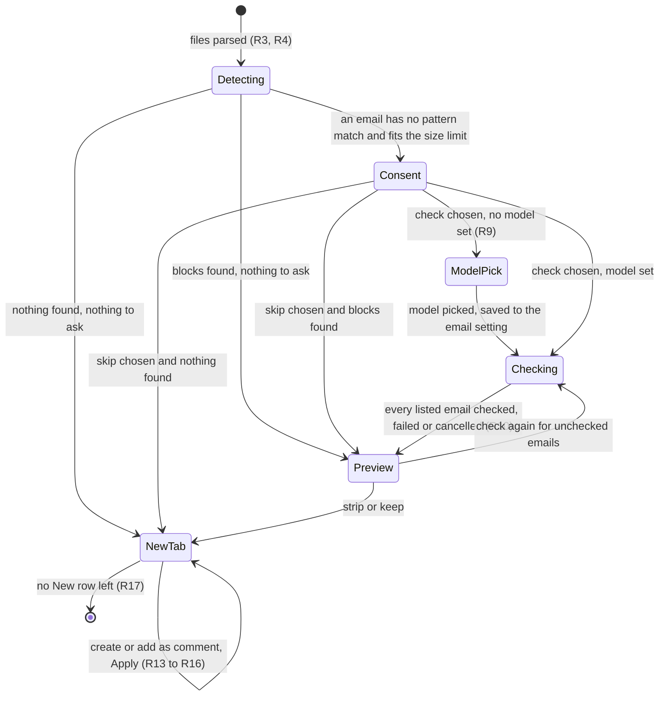

# Email Import Board and @jira Removal - Plan

## Goal Capsule

- **Objective:** A developer does all Jira work, email imports included, from a Copilot chat or a board, with no `@jira` participant and no Local harness. This finishes Step 2 of the migration.
- **Means:** Email becomes a third kind on the existing import board, with the boilerplate cleanup as a board step (KTD1, KTD4). The extension calls the model itself through a board model access layer (KTD2). Then `@jira` is removed (U7). Closes O7, O8 and O11 and the email part of O9 and O10 in [`docs/architecture/migration-status.md`](../architecture/migration-status.md).
- **Product authority:** The maintainer's decisions below, within R14 to R19, R24, R25, R43 and R45 of [`2026-11-11-2234-feat-boards-replace-chat-participants-plan.md`](2026-11-11-2234-feat-boards-replace-chat-participants-plan.md). Step 3 (Bitbucket) is not active scope.
- **Open blockers:** None for starting. The probe gate after U1 (R1, R2) blocks the model check in U4 and the removal in U7 until the maintainer reports the result.
- **Stop conditions:**
  - Stop after U1 and wait for the maintainer's probe result from the PR's pre-release build. U2 and U3 may be built while waiting; U4's model-check part and U7 may not.
  - Stop and ask if a moved email core turns out to need `vscode` (U2).
  - Stop and ask if an email "Carry over" row of the parity ledger has no board action that keeps its result (U7).
- **Execution profile:** One PR on `claude/lucid-goldberg-h16o4v`, units in the order U1 to U8. `npm run compile` and `npm test` are green before every commit (`CLAUDE.md`). Workers do not commit or push on their own ([`docs/solutions/workflow-issues/ce-work-unit-subagent-pushes-directly-to-main-bypassing-pr-review.md`](../solutions/workflow-issues/ce-work-unit-subagent-pushes-directly-to-main-bypassing-pr-review.md)).
- **Finishes and ships:** The executor opens the PR with the email part of the manual checklist. The maintainer runs the probe (after U1) and the checklist (after U8) on the PR's pre-release build, then merges and releases on the preview channel only.

---

## Product Contract

Product Contract preservation: changed R5 and added R22, user-approved at planning. R5 now takes the template from a new `ticketSidekick.email.template` setting, like the other kinds. R22 records that attachments are read again from the files at Apply. The deferred questions on the template, the probe's delivery, the guard tests and the session id are resolved by R5, KTD2, U7 and KTD3 and removed. Everything else is unchanged.

### Summary

The import board gets an Email kind: the developer picks one or more `.eml` files, then goes through the boilerplate cleanup step on the board, with consent and a model pick before any email text reaches a model. After cleanup, the emails are rows on the New tab. Each row becomes a new ticket or a comment on an existing ticket, and rows whose subject matches an existing ticket are marked as likely repeats. When this works on the managed machine, `@jira` is removed.

### Problem Frame

The email import is the last Jira work that runs only through `@jira`, and `@jira` runs only in the Local harness. Every other Jira task already has a tool, a skill or a board. Until the email import moves, the participant stays in the code along with its own help screen, its `workspaceState` sessions, its guard tests and a second set of documentation. Every email fix also has to be made in a flow that is being retired.

The email check is the only part of the import that calls a language model. Today it uses the chat request's model, which exists only inside a participant. Nothing in the extension has yet called a model from outside a chat request on the managed machine (Q1 of the migration status page). Tool calls that already work don't answer this, because they run the other way: Copilot calls the extension, and the extension never calls a model.

### Key Decisions

- **The model probe comes first, and what happens if it fails is decided after the result.** (session-settled: user-directed — chosen over deciding now to remove `@jira` regardless, and over deciding now to keep `@jira` for the model check: the maintainer wants the result before choosing.) Governs R1, R2.
- **Adding an email as a comment is a per-row choice on the New tab.** (session-settled: user-approved — chosen over a separate start mode and over both: one control covers one or many emails and fits the likely-repeat marking.) Governs R13, R14.
- **Mid-run prompts are steps on the board.** (session-settled: user-approved — carried from the boards plan, chosen over native VS Code pickers and over asking in chat.) Governs R8, R9.
- **Repeated emails are found by searching Jira for the subject.** (session-settled: user-directed — carried from the boards plan, chosen over remembering which files produced a ticket, and over a warning only.) Governs R12.
- **The email check has its own model setting, which falls back to the review-model setting; both ship in this step.** (session-settled: user-directed — carried from the boards plan, chosen over one setting for all calls, and over dropping the model check.) Governs R9, R18.
- **A model pick is written to the email-model setting.** That is the setting the check reads first, and it leaves the review choice to the review board in Step 3. Governs R9.
- **The batch template is a setting, as for Veracode and Waltz.** (session-settled: user-approved — chosen over a choice on every run: the start screen already asks once and saves.) Governs R5.
- **Every release is a preview.** (session-settled: user-directed — carried from the migration status page, chosen over a normal release after each step.) Governs R21.

### Actors

- A1. Developer: chooses the files, gives or withholds consent, picks the model, decides each row, and applies.
- A2. Copilot agent: opens the board, loaded or not, and learns only whether it opened.
- A3. Extension: parses emails, runs the cleanup and the model check, searches Jira, and writes tickets and comments.

### Requirements

**Model probe**

- R1. Before the model check is built on the board, the maintainer confirms on the managed machine, with the Local harness disallowed, whether the extension can list the available models and call one from outside a chat request. The result is recorded under Q1 on the migration status page.
- R2. If the probe fails, work stops before the model-check and `@jira`-removal units until the maintainer chooses what to do (see Open Questions).

**Starting an email import**

- R3. The import board's start screen offers Email as a kind next to Veracode and Waltz, and takes one or more `.eml` files. Today's file-count limit (50) and `ticketSidekick.email.maxBatchSizeMB` cap apply to the whole selection.
- R4. A file that fails to parse is named on the board, and the rest of the batch continues.
- R5. One template and issue type apply to the whole batch. The template comes from `ticketSidekick.email.template`, which the start screen asks for once and saves, as it does for the other kinds.
- R6. A workspace path or `.eml` dragged into the chat opens the board already loaded, through the open-board tool. A dragged email counts as consent to send it to the model, as R15 of the boards plan states.

**Cleanup step**

- R7. Before the New tab, the board runs today's boilerplate cleanup: pattern detection from `ticketSidekick.email.boilerplatePatterns`, a preview of the blocks found in each email, strip or keep, excluding single emails, and saving a model-found block as a pattern.
- R8. No email text goes to a model until the developer consents on the board. The consent step names the emails that would be checked and offers check or skip, and the preview offers the check again for emails not yet checked.
- R9. When neither the email-model setting nor the review-model setting names a model, the consent step asks the developer to pick one of the available models, before any call. The choice is written to the email-model setting, and the board shows which model checked each email.
- R10. A failed or cancelled check leaves that email's blocks as they were and marks it, so it can be checked again. Logs carry metadata only, never email text or model replies, as they do today.
- R11. Cleanup choices, consent and check results are part of the session and survive a reload or restart.

**New tab and writes**

- R12. Before anything is created, the board searches the project for tickets whose summary matches each email's subject. A match is marked as a likely repeat with its key and is not selected for creation.
- R13. Each email row can be created as a ticket or added to an existing ticket as a comment through the board's add-to-ticket control. A likely repeat offers its matched key as the target.
- R14. A comment carries the cleaned body and uploads the email's remaining attachments, following the file rules of today's comment flow.
- R15. Creating tickets keeps today's rules: one ticket per included email, a failed email doesn't stop the rest, attachments are uploaded after creation (a failed upload is a warning, not a failed row), and `ticketSidekick.email.deleteEmlAfterImport` is honoured.
- R16. Writes follow the board rules: a preview, then Apply, a native confirmation when more than one ticket changes, and a line in the Output Channel for each write.
- R17. A drained email import, with no New row left after the writes, finishes without a separate step, as the parity ledger's rule states.
- R22. Attachments are read again from the email's file when a write runs. If the file is gone, that email's write is refused with a request to pick the file again, and the other emails are written.

**Settings**

- R18. The review-model and email-model settings exist with the fallback of Key Decisions and are documented in `docs/manual/settings-reference.md`.

**Removal and documentation**

- R19. Every email row of the import board parity ledger (`email-*`, `afterCreate`, the drained finish) is mapped to a board action and a board scenario test before `@jira` is removed.
- R20. Removes the `@jira` participant, its email import and add-as-comment flows, its help screen, its `workspaceState` sessions and the Command Palette command "Create Jira ticket from email (.eml)". Wherever these were mentioned, the docs now point to the import board.
- R21. The README, the manual pages, `CLAUDE.md` and the migration status page describe the email kind and drop `@jira`. The email part of the manual checklist is written and run on the preview build on the managed machine.

### Key Flows

- F1. Batch import from the start screen
  - **Trigger:** The developer opens the import board and picks Email and several `.eml` files.
  - **Actors:** A1, A3
  - **Steps:** Files are parsed (R4). Cleanup detects patterns (R7). Consent and, if needed, a model pick (R8, R9). The model check runs and the preview is shown. Strip or keep. The New tab shows rows with likely repeats marked (R12). The developer creates some rows and adds others as comments (R13). Preview, Apply (R16). The import finishes (R17).
  - **Covered by:** R3 to R17, R22
- F2. Opened from chat
  - **Trigger:** The developer drags an `.eml` into the chat and asks to import it.
  - **Actors:** A1, A2, A3
  - **Steps:** The agent opens the board loaded (R6). Consent is already given by the drag, so the board runs the check or asks for a model (R9), then continues as in F1.
  - **Covered by:** R6, R8, R9

### Acceptance Examples

- AE1. **Covers R1, R2.** Given the probe shows that no model can be called outside a chat request on the managed machine, when planning continues, then the model-check and removal units are not started until the maintainer decides.
- AE2. **Covers R8.** Given an email with no pattern match, when the developer chooses skip on the consent step, then no model call is made and the email goes to the New tab unchanged.
- AE3. **Covers R9.** Given both model settings are empty, when the developer consents, then the board asks for a model before any call, and the next import does not ask again.
- AE4. **Covers R12, R13.** Given an email whose subject matches the summary of PROJ-42, when the New tab lists it, then it is marked as a likely repeat of PROJ-42, isn't selected for creation, and offers "add as comment to PROJ-42".
- AE5. **Covers R14.** Given an email whose cleanup stripped a signature with an inline image, when it is added as a comment, then the comment has the cleaned body and only the attachments that remain are uploaded.
- AE6. **Covers R11.** Given the developer consented and two of five emails were checked, when VS Code restarts, then the board shows those two as checked and the other three as not checked.
- AE7. **Covers R20.** Given this step is released, when a developer types `@jira`, then no participant answers, and the Command Palette has no email import command.
- AE8. **Covers R22.** Given two emails on the New tab and one of their files deleted after the board loaded, when the developer applies a create of both, then the other email's ticket is created and the deleted one is refused with a request to pick its file again.

### Scope Boundaries

- Merging email rows into one ticket. The email kind has no fold, as today.
- A separate start mode for adding one email to a given ticket key. Replaced by R13.
- Step 3: the review board, `bitbucket_read_findings`, `/ts-bitbucket`, and removing `@bitbucket`. The review-model setting ships here (R18), but its pick step for reviews belongs to Step 3.
- The `@bitbucket` deprecation mark in the chat UI (O18, Q5) and the keyboard and screen-reader check (O17).
- Considered and not built: storing attachment bytes in the session so a write survives a deleted file. A session is capped at 20 MB and a batch may be 150 MB; R22's refusal names the file. Would change if sessions were stored outside that cap.
- Considered and not built: a fuzzy subject match (edit distance). The exact normalised compare of KTD5 is predictable; would change if the checklist shows real repeats missed.

### Dependencies / Assumptions

- The email chat flow already runs on the shared import engine (`src/imports/`), so the board reuses its rows, creation and `afterCreate`. Only the cleanup step and the comment outcome are new to the board.
- The add-to-ticket control on the New tab, built for Veracode and Waltz folding, can take an email row as its source (U5 adds a comment-only mode for a kind without fold).
- Verified 2026-11-16: no code outside `src/participant/` calls `vscode.lm.selectChatModels`, and the email check and intent parse use the chat request's model (`src/participant/JiraParticipant.ts:130`, `:173`).
- `vscode.lm.selectChatModels` exists on the engines floor (VS Code 1.95). VS Code may show its own consent dialog the first time an extension uses a model; the probe shows whether that dialog appears and works on the managed machine.

### Open Questions

**Resolve after the probe (gate after U1)**

- If the probe fails: ship the email board with pattern cleanup only and remove `@jira`, or keep `@jira` for the model check until a model call outside a chat request works.

### Sources / Research

- [`docs/architecture/migration-status.md`](../architecture/migration-status.md): O7 to O11, Q1, the import board parity ledger and the removal checklist.
- [`docs/report-import.md`](../report-import.md) "EML email import (batch)": today's cleanup, consent, model check and comment flow.
- [`2026-11-14-1641-feat-import-board-veracode-waltz-parity-plan.md`](2026-11-14-1641-feat-import-board-veracode-waltz-parity-plan.md): the import board, start screen and add-to-ticket control this builds on.
- [`docs/solutions/workflow-issues/import-board-parity-list-misses-recent-functional-import-work.md`](../solutions/workflow-issues/import-board-parity-list-misses-recent-functional-import-work.md): why every ledger row is mapped to a board test.

---

## Planning Contract

### Key Technical Decisions

- KTD1. **Email is a third report kind of the existing import board, not a new board kind.** `REPORT_KINDS` gains `email`; the board's area handlers stay one per area, plus one new handler for the cleanup step. Reuses the start screen, the session model, the New tab and the Apply machinery. Governs R3, R13, R16.
- KTD2. **One model access layer for boards, injected as a dependency.** `src/boards/` stays vscode-free: a `BoardModels` dependency (list available models, call one by id with cancellation) is bound in `src/boards/registerBoards.ts` over `vscode.lm.selectChatModels` and `withLmRetry`. The pick step is a board component shared by the start screen and the cleanup step. U1 delivers it with a one-call "the model answered" confirmation after a pick, which is the probe: real code that stays, not a throwaway command. (session-settled: user-approved — chosen over a temporary probe command.) Governs R1, R9.
- KTD3. **An email session's recipe holds the sorted, normalised file paths; its id comes from kind, project and that list.** Opening the same set of files in the same project continues the session; another set is another session. Governs R3, R11.
- KTD4. **The cleanup step is a stage of the email session, shown before the New tab.** Its state (rows, blocks, model status per email, consent, saved patterns, the model used) moves from `EmailCleanupSession` in `src/participant/session/emailCleanup.ts` into the board session's working state. The pure detection and decision helpers in `src/utils/emailBoilerplate.ts` and the decision logic in `emailCleanup.ts` are reused; the chat screen builders and reply parser are not. Governs R7 to R11.
- KTD5. **Repeat search is one JQL text search per batch, then an exact compare after normalising.** Each subject is quoted with `quoteJqlValue` into `summary ~` clauses (chunked like the dedup search); a hit counts only when its summary equals the subject after lower-casing, trimming and removing leading `RE:`/`AW:`/`FW:`/`WG:` prefixes. A failed search marks the New tab with a warning and selects no row as a repeat; it does not block creation. Governs R12.
- KTD6. **The session stores bodies, not attachment bytes.** The reading keeps each email's parsed and cleaned body, inline-image map without bytes, and attachment names; a write re-parses the email's file to upload the remaining attachments (R22). Keeps a 150 MB batch under the 20 MB session cap.
- KTD7. **The email descriptor moves to `src/imports/email.ts`, vscode-free, over injected settings, as `veracode.ts` and `waltz.ts` do.** `deleteEmlAfterImport`, the upload and the logging come in through readers and `onDiag`; the chat flow uses the same descriptor until U7 removes it.
- KTD8. **A comment add for email is comment-only and builds today's comment body.** The New tab's add control offers only comment mode for a kind without `fold`; the body is today's header (sender, date) plus `buildEmailJiraWiki`. Today's comment flow does not delete the `.eml`, so neither does the board's (R14).

### High-Level Technical Design

The email session's stages. The Veracode and Waltz sessions skip straight to their tabs as today.

---

## Implementation Units

### U1. Model access for boards, the two model settings, and the probe

- **Goal:** The extension can list models and call one from a board, with no chat request, and the developer picks a model on a board. This is the probe of R1.
- **Requirements:** R1, R9, R18; KTD2.
- **Dependencies:** None.
- **Files:**
  - Create `src/boards/boardModels.ts` (the vscode-free `BoardModels` type and the pick-step view and action helpers).
  - Modify `src/boards/registerBoards.ts` (bind `BoardModels` over `vscode.lm`), `src/boards/import/startScreen.ts` (a "Model for the email check" row when the kind is email, with pick and the one-call confirmation), `board-pages/import-start/page.js`.
  - Modify `package.json` (`ticketSidekick.email.checkModel`, `ticketSidekick.bitbucket.reviewModel`), `docs/manual/settings-reference.md`.
  - Test `src/test/boardModels.test.ts`, `src/test/importStartScreen.test.ts`.
- **Approach:**
  1. `BoardModels.list()` returns id, name and vendor of the available models; `call(id, prompt, token)` sends one request and collects the text, retried by `withLmRetry`.
  2. The model in use is the email setting, else the review setting, else none (the pick is shown).
  3. A pick writes the email setting, then the start screen makes one short fixed-prompt call (no email text) and shows "answered" or the error. Every call and failure is logged through `onDiag` with model id and outcome only.
  4. The email kind is listed on the start screen but cannot open a board until U3.
- **Patterns to follow:** `templateSettingKey`/`writeTemplateSetting` in `src/boards/import/startScreen.ts` for asking once and saving; `withLmRetry` in `src/utils/lmRetry.ts`.
- **Test scenarios:**
  - Both settings empty: the start screen for email shows the pick with the listed models.
  - Email setting empty and review setting set: the review model is shown as in use and no pick is asked.
  - Picking a model writes `ticketSidekick.email.checkModel` and the confirmation shows "answered" when the stubbed call returns text.
  - The stubbed call throws: the screen shows the error, the setting stays written, and the log line holds no prompt or reply text.
  - No models available: the screen says so and offers no pick.
  - `userDocsSync.test.ts` passes with the two new settings documented.
- **Verification:** On the PR's pre-release build, on the managed machine with the Local harness disallowed, the maintainer picks a model on the start screen and sees "answered", or records the error. The result goes into Q1 on the migration status page. **Gate:** stop here for that result.

### U2. Email descriptor out of the participant

- **Goal:** The email descriptor is vscode-free and usable by the board.
- **Requirements:** R15; KTD7.
- **Dependencies:** None (can be built while waiting on the U1 gate).
- **Files:**
  - Create `src/imports/email.ts`.
  - Modify `src/participant/jira/emailHandler.ts` (use the new descriptor), `src/services/importSettings.ts` (`emailSettings`).
  - Test `src/test/emailHandler.test.ts` (unchanged behaviour), `src/test/importsEngineVscodeFree.test.ts` (covers the new file).
- **Approach:** Move `buildRowFields`, `buildTicketFields`, `afterCreate` and the batch-cap check into `src/imports/email.ts` with `deleteEmlAfterImport` and the file system behind injected readers; `buildEmailJiraWiki` and the comment header move with it. `onIssueTypeFetchFailed` stays in the participant.
- **Patterns to follow:** `src/imports/veracode.ts`, `src/imports/waltz.ts` and `veracodeSettings`/`waltzSettings`.
- **Test scenarios:**
  - The existing email chat tests pass unchanged.
  - `afterCreate` with two attachments where one upload fails throws the "Uploaded 1 of 2" warning and still deletes the file when the setting is on.
  - `importsEngineVscodeFree.test.ts` fails if `src/imports/email.ts` imports `vscode`.
- **Verification:** The chat email import behaves as before, and the descriptor loads in Vitest without `vscode`.

### U3. The email kind on the start screen and the board

- **Goal:** The developer opens an email import on the board with one or more files and sees one New row per email.
- **Requirements:** R3, R4, R5, R11, R22; KTD1, KTD3, KTD6.
- **Dependencies:** U2.
- **Files:**
  - Modify `src/boards/import/recipe.ts` (`email` kind, file list in the recipe, id per KTD3), `src/boards/import/read.ts` (read through the email descriptor, no attachment bytes in the stored data, a missing file reported per email), `src/boards/import/startScreen.ts` (multi-file pick, caps, `ticketSidekick.email.template`), `src/boards/import/kind.ts` (tabs for email: New only), `src/boards/registerBoards.ts`, `board-pages/import-start/page.js`, `board-pages/import/page.js`, `package.json` (`ticketSidekick.email.template`), `docs/manual/settings-reference.md`.
  - Test `src/test/importBoardEmail.test.ts` (new), `src/test/importStartScreen.test.ts`, `src/test/helpers/importBoardFixture.ts` (email fixtures).
- **Approach:**
  1. The recipe's single `reportPath` becomes a path list for email; Veracode and Waltz keep one path. "Pick the file again" re-points one email's path.
  2. The caps of R3 are checked before any file is read, with today's messages.
  3. A file that fails to parse becomes a notice on the board and no row (R4).
  4. The email kind has no dedup, stale or accepted parts, so only the New tab shows.
  5. The fingerprint covers each file's hash, so a changed file marks the tab out of date as for the other kinds.
- **Execution note:** Start with the scenario test for a three-file batch with one unreadable file.
- **Patterns to follow:** `importBoardNew.test.ts` and `importBoardFixture.ts` for scenario tests through `importKind`.
- **Test scenarios:**
  - Three files, one of them not a valid email: the board opens with two New rows and a notice naming the third file.
  - 51 files: the start screen refuses with the batch-limit message and reads none.
  - Total size over `maxBatchSizeMB`: refused with the cap in effect named.
  - The same two files opened again in another order: the same session continues.
  - The template setting is empty: the start screen asks for an email template once and saves it.
  - The stored session of a batch with a 5 MB attachment holds no attachment bytes.
  - One file changed on disk after the board loaded: the New tab is marked out of date after the background check.
- **Verification:** An email batch opens on the board with its rows, and the stored session stays small.

### U4. The cleanup step on the board

- **Goal:** The developer runs today's boilerplate cleanup on the board, with consent and the model pick before any model call.
- **Requirements:** R7 to R11; KTD2, KTD4.
- **Dependencies:** U1, U3. **Gate:** the model-check part waits for the U1 probe result; pattern detection, preview, strip/keep and save can be built first.
- **Files:**
  - Create `src/boards/import/cleanupStage.ts` (area handler: detect, consent, pick, check, preview, strip, keep, exclude, save).
  - Modify `src/boards/import/kind.ts` (the stage before New), `src/boards/import/registry.ts`, `src/participant/session/emailCleanup.ts` (decision helpers kept, chat screens untouched until U7), `board-pages/import/page.js`.
  - Test `src/test/importBoardEmailCleanup.test.ts` (new).
- **Approach:**
  1. After the reading, detection runs with the patterns of `ticketSidekick.email.boilerplatePatterns`; the stage follows the transitions in the High-Level Technical Design.
  2. A check call is made only after a consent action in the session (or the drag consent of R6), and only with the model from U1's resolution or a pick (R9).
  3. Each email's model status and the model id that checked it are stored in the session (R11).
  4. Strip applies `applyBoilerplateCleanup` to the included emails and the New rows take the cleaned bodies; keep takes them unchanged.
  5. Save writes `buildPatternFromBlock` to the global setting, as today.
  6. Cancellation of a running check leaves unchecked emails as not checked (R10).
- **Patterns to follow:** today's flow in `src/participant/jira/emailHandler.ts` (detection, `listModelCheckEligibleRows`, `verifyModelBlocks`, `remapSavedBlocks`); `mergeTab.ts` for a resumable run held in `working.ext`.
- **Test scenarios:**
  - Covers AE2. One unmatched email, skip chosen: no model call is made and the row reaches New unchanged.
  - Covers AE3. Both settings empty, check chosen: the pick is shown before any call; after the pick, the call runs and the next import asks no model.
  - Covers AE6. Five eligible emails, the stubbed model answers two and the run is cancelled: after reloading the session, two are checked and three are not.
  - A pattern block and a model block cover the same text: they merge and the pattern wins.
  - The stubbed call throws for one email: that email is marked failed, keeps its pattern blocks and can be checked again from the preview.
  - Save on a model-found block appends a pattern to the setting.
  - An email over the size limit for the check is marked too long and never sent.
  - A background check or Refresh after a restart re-runs pattern detection but makes no model call, even for emails consented to but not yet checked.
  - The log lines of a check hold the model id and outcome, no body or reply text.
- **Verification:** The cleanup works on the board as it does in chat today, and no stubbed model call happens before a consent action.

### U5. Repeat search, comments and writes for email rows

- **Goal:** The developer creates tickets or adds emails as comments from the New tab, with likely repeats marked.
- **Requirements:** R12 to R17, R22; KTD5, KTD6, KTD8.
- **Dependencies:** U3 (U4 for cleaned bodies, but not for the write path).
- **Files:**
  - Modify `src/boards/import/read.ts` (the repeat search after the reading), `src/boards/import/newTab.ts` (comment-only add for a kind without fold, the matched key as the suggested target, create and add through the email descriptor with the file re-read), `src/services/TicketService.ts` (a summary search helper for the repeat search, if `searchTicketsRaw` is not enough), `board-pages/import/page.js`.
  - Test `src/test/importBoardEmail.test.ts`, `src/test/TicketService.test.ts` (if a helper is added).
- **Approach:**
  1. The repeat search runs once per reading per KTD5; matches are stored per row with the matched key, and those rows start excluded.
  2. The add control shows only "as comment" for email and offers a likely repeat's key first.
  3. Create goes through `createNewRowTickets` with the email descriptor's `afterCreate`; a comment goes through `TicketService.addComment` plus the uploads of the remaining attachments.
  4. Each write re-parses the email's file; a missing file refuses that email only (R22).
  5. When no New row is left after a write, the import finishes. The rule `isNewGroupDrained` lives in `src/participant/session/importScreens.ts` today; it moves into `src/imports/` so the board can use it.
- **Patterns to follow:** `planNew`/`prepareNew` in `src/boards/import/newTab.ts`; the dedup chunking in `src/utils/reportImport.ts`.
- **Test scenarios:**
  - Covers AE4. A subject "RE: Login fails" and a ticket PROJ-42 "Login fails": the row is marked as a likely repeat of PROJ-42, excluded, and the add offers PROJ-42.
  - A ticket "Login fails on Monday": not marked (Jira's loose match is not enough).
  - The repeat search fails: the tab shows a warning, no row is marked, and create still works.
  - Covers AE5. An email whose cleanup dropped an inline image, added as a comment: the comment has the header and cleaned body, and only the remaining attachments are uploaded.
  - Two emails created: one fails in Jira, the other is created with its attachments, and the result lines name both.
  - Covers AE8. One email's file is deleted before Apply: the other is created and the deleted one is refused with "pick the file again".
  - A comment add does not delete the `.eml`, even with `deleteEmlAfterImport` on; a create does.
  - Creating every row ends the import with no separate step.
  - Applying a create of two emails asks for the native confirmation.
- **Verification:** Every email write the chat flow does today is possible from the New tab, with the same results.

### U6. Opening an email import from chat

- **Goal:** The agent opens the email board loaded from a typed path or a dragged `.eml`.
- **Requirements:** R6.
- **Dependencies:** U3, U4.
- **Files:**
  - Modify `src/tools/jiraTools/openBoard.ts` (kind `email`, one or more paths, the drag consent flag), `skills/ts-jira/SKILL.md` (`import email [PATH...]`), then run `node scripts/sync-jira-tools.mjs`.
  - Test `src/test/jiraReadTools.test.ts`, `src/test/skillsGuard.test.ts`, `src/test/jiraToolManifest.test.ts`.
- **Approach:** The tool takes `kind: email` with `paths`; an attachment dragged into the chat is passed as a path with consent set, which counts as consent in U4. The answer says only whether the board opened, as today.
- **Test scenarios:**
  - `kind: email` with two workspace-relative paths opens the board loaded with two rows.
  - A network path is refused with today's message.
  - A dragged email opens with consent set: the cleanup stage does not show the consent step for it.
  - The `/ts-jira` router row for `import email` names the tool, and `skillsGuard.test.ts` passes.
- **Verification:** "Import these emails" in a Copilot chat opens the loaded board.

### U7. Remove @jira

- **Goal:** No `@jira` participant, email chat flow or email Command Palette command is left.
- **Requirements:** R19, R20; AE7.
- **Dependencies:** U1 to U6, and the probe decision of R2.
- **Files:**
  - Delete `src/participant/JiraParticipant.ts`, `src/participant/jira/emailHandler.ts`, `reportImportHandler.ts`, `importReviewScreen.ts`, `importCreate.ts`, `llmHelpers.ts` (`generateContent` moves to `src/participant/bitbucket/` with its tests from `llmHelpers.test.ts`, since `@bitbucket` uses it), `src/participant/session/jiraCommands.ts`, `importCommands.ts`, `emailCleanup.ts` chat parts, and their tests (`jiraCommandsGuard.test.ts`, `importCommandsGuard.test.ts`, `emailHandler.test.ts`, `reportImportHandler.test.ts` and the chat-only session tests).
  - Modify `src/extension.ts`, `package.json` (`chatParticipants` entry, `ticket-sidekick.importEml`, the Jira walkthrough steps that name `@jira`), `src/test/importBoardParity.test.ts` (map the email rows to board actions and tests), `src/test/bundleSmoke.test.ts`, `src/e2e/`.
- **Approach:**
  1. Map every email ledger row to its U3 to U5 board action and scenario test first (R19), then delete.
  2. Keep what `@bitbucket`, `extension.ts` or the tools still import; `sessionState.ts` keeps only what remains used. `src/participant/jira/defaultProjectNotice.ts` stays (the start-up check of the default project uses it) and moves out of the Jira participant folder.
  3. `jira.session.*` keys get no migration; they are left unused, as the removal checklist allows.
- **Execution note:** Delete in small steps and run `npm run compile` after each, since the participant files have many shared helpers.
- **Test scenarios:**
  - `importBoardParity.test.ts` maps every email row to a board action and a board test, and fails if one is missing.
  - `bundleSmoke.test.ts`: `package.json` declares no `ticket-sidekick.jira` participant and no `importEml` command, and activation registers no participant for Jira.
  - The e2e smoke suite still activates and registers every declared command and tool.
- **Verification:** `@jira` is gone from the build and the manifest, and `npm test` and the e2e suite pass.

### U8. Documentation and the manual checklist

- **Goal:** Users and developers read about the email kind, not `@jira`.
- **Requirements:** R21.
- **Dependencies:** U7.
- **Files:** `README.md`, `docs/manual/boards.md`, `docs/manual/copilot-tools.md`, `docs/manual/settings-reference.md`, `docs/report-import.md`, `docs/jira-flows.md`, `docs/onboarding.md`, `CLAUDE.md`, `CONCEPTS.md`, `docs/architecture/migration-status.md` (O7, O8, O11 closed, O9 and O10 email parts closed, Q1 answered, ledger email rows), `docs/architecture/manual-checklist.md` (email part), `docs/known-limitations.md` (only if a limitation is added).
- **Approach:** Rewrite the email sections of the README and manual for the board; in `CLAUDE.md` drop the `@jira` rows and point the email rows to the new files; mark the chat email flow as removed in `docs/report-import.md`.
- **Test expectation:** `userDocsSync.test.ts` covers settings, commands, tools and the Jira tool catalog; the rest is checked by hand.
- **Verification:** No page describes `@jira` as current, and the checklist's email part is ready for the maintainer.

---

## Verification Contract

- `npm run compile` and `npm test` green before every commit; the new scenario suites are `src/test/boardModels.test.ts`, `src/test/importBoardEmail.test.ts` and `src/test/importBoardEmailCleanup.test.ts`, with the model stubbed through `BoardModels`.
- `xvfb-run -a npm run test:e2e` passes after U7 (activation, registration, a tool call, a board tab).
- Guard tests: `importBoardParity.test.ts`, `userDocsSync.test.ts`, `jiraToolManifest.test.ts`, `skillsGuard.test.ts`, `importsEngineVscodeFree.test.ts`.
- Not covered automatically: a real model call and Copilot. Covered by the U1 probe and the email part of the manual checklist, both on the PR's pre-release build on the managed machine.

## Definition of Done

- Every R1 to R22 is met, and AE1 to AE8 hold, each AE by the test scenario that covers it or, for AE1 and AE7, by the gate and the manifest test.
- The probe result is recorded under Q1, and the R2 decision, if the probe failed, is recorded in this plan's Open Questions and on the migration status page.
- `@jira`, its code, its command and its tests are gone; the parity ledger maps every email row to the board.
- The docs of U8 are updated, and the manual checklist's email part is written.
- No code from abandoned approaches is left in the diff.
