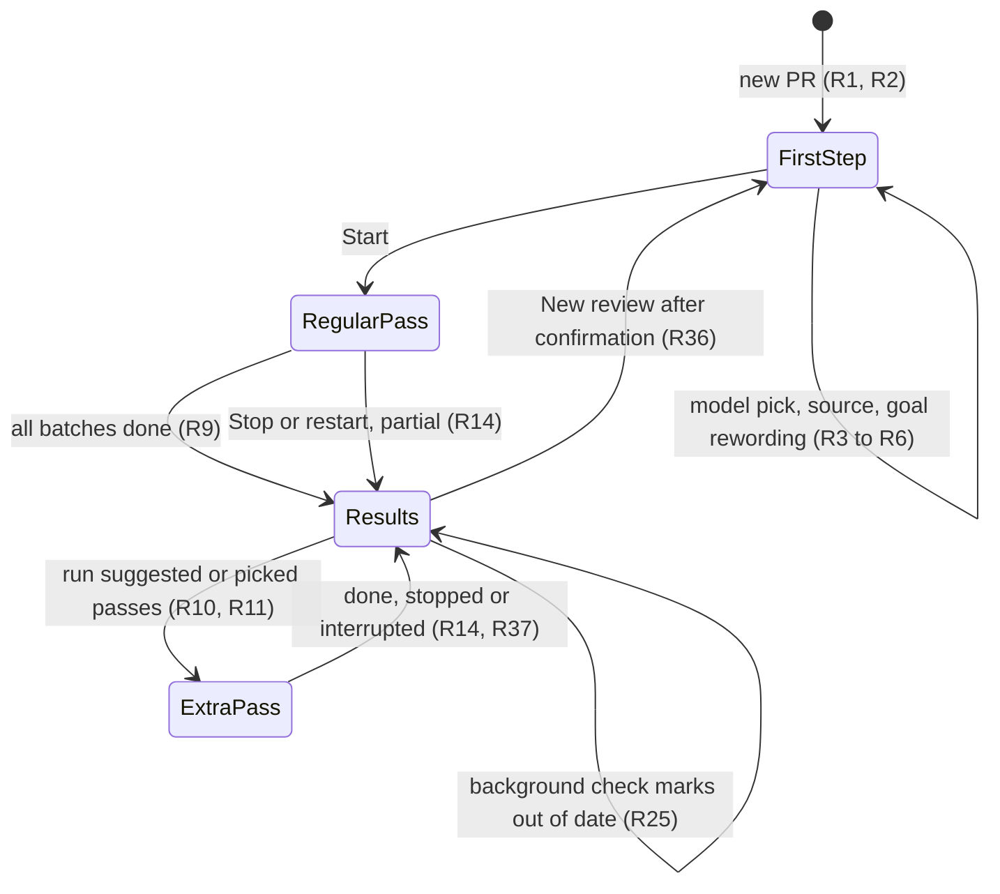
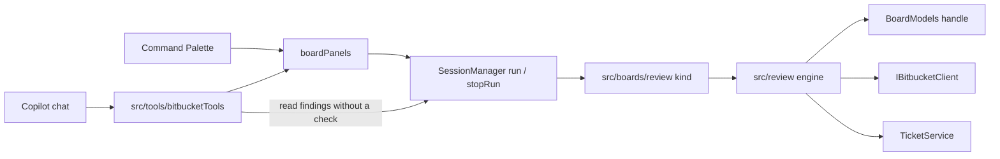

# PR Review Board and @bitbucket Removal - Plan

## Goal Capsule

- **Objective:** A developer reviews a Bitbucket pull request from a Copilot chat or the Command Palette, without the `@bitbucket` participant or the Local harness. They decide how deep the review goes at the latest useful moment, not up front. This is the last step of the migration: after it, nothing deprecated remains, and the stable channel can get a release.
- **Means:** A PR review board. A staged review on it replaces the quick, smart and deep modes. A read-findings tool, the Bitbucket tools moved into the catalog shape of the Jira tools, a `/ts-bitbucket` skill, and then the removal of `@bitbucket`. This closes O9, O10, O12 to O16, O18, O19 and the Bitbucket part of O20 in [`docs/architecture/migration-status.md`](../architecture/migration-status.md). It answers Q2, Q3 and Q5: O18 and Q5 by the removal, with no interim deprecation mark.
- **Product authority:** The maintainer's decisions in Key Decisions below, within R20 to R27 and R45 of [`2026-11-11-2234-feat-boards-replace-chat-participants-plan.md`](2026-11-11-2234-feat-boards-replace-chat-participants-plan.md). Where the two disagree, this plan wins. It replaces the review modes with a staged review, which changes that plan's R20 and R27. It also adds an Explain control to the review board, which that plan's "Not in this work" line left out.
- **Open blockers:** None for starting. The removal (U11) waits on the maintainer's run of the Step 3 manual checklist on the PR's pre-release build.
- **Stop conditions:**
  - Stop before U11 and wait for the maintainer to report the Step 3 checklist result from the pre-release build. U12's documentation for the board and tools may be written while waiting.
  - Stop and ask if a moved review module turns out to need `vscode` (U1).
  - Stop and ask if a "Carry over" row of the review parity ledger has no board action or tool that keeps it (U10).
  - Stop and ask if the full reviewed diff plus the session's other data of a real PR passes the 20 MB session limit (KTD5).
- **Execution profile:** One PR from the work branch, units in the order of the Unit Index. `npm run compile` and `npm test` are green before every commit (`CLAUDE.md`). Workers do not commit or push on their own ([`docs/solutions/workflow-issues/ce-work-unit-subagent-pushes-directly-to-main-bypassing-pr-review.md`](../solutions/workflow-issues/ce-work-unit-subagent-pushes-directly-to-main-bypassing-pr-review.md)).
- **Finishes and ships:** The executor opens the PR with the Step 3 part of the manual checklist. The maintainer runs it on the PR's pre-release build before U11 and runs the whole checklist after U12. Then they merge and release on the preview channel. The first stable release follows the full checklist (R35).

---

## Product Contract

Product Contract preservation: unchanged. Planning resolved the deferred questions on model access (KTD3), the verdict (KTD10), the screens for no findings and for a failed regular pass (U6), selection (U7), `showTokenUsage` (KTD11) and the PR split (Execution profile), and removed them from Outstanding Questions.

### Summary

The review board opens as soon as a review is asked for. It stops on a first step: the model, the requirements source (a Jira ticket, a goal the developer types and the board rewords for review, or none) and an optional upfront question. After Start, the board runs the regular pass and shows the findings, along with a suggestion of which extra passes are worth running. The suggestion may be empty. The developer keeps the result, runs the suggestion, or picks any extra passes up to a full review, now or later. Each finding can be explained, posted to Bitbucket as an editable comment, or copied for Teams or as Markdown. The chat agent can read the findings through a tool. Once every `@bitbucket` behaviour has a home or a recorded drop, `@bitbucket` is removed.

### Problem Frame

The PR review is the last flow that runs only through a chat participant. `@jira` went on 2026-11-16. Now `@bitbucket` is the only reason the extension still needs the Local harness, `src/participant/`, `workspaceState` chat sessions, follow-up chips and a second set of documentation. The migration status page (Q4) records that VS Code 1.146's release notes announce the Local harness's removal for February 2027. Under the migration's release rule, the stable channel gets nothing until the whole migration is done, so colleagues on stable get no fix until this step lands.

Today's review also asks the developer to choose the depth before seeing anything. A deep review costs many model calls. Smart mode picks its extra passes without asking. Once a review is done, more depth means running it again from the start. In chat, a finding is explained in one turn, a comment is drafted in another, and "Copy for Teams" is triggered by a typed word. None of it survives when the chat moves on.

---

### Key Decisions

- **All of Step 3 is one plan, removal included.** (session-settled: user-directed — chosen over a plan covering only the board and the read-findings tool, and over the board alone: one plan carries the migration to its end.) Governs R31 to R35.
- **A staged review replaces quick, smart and deep.** Every review runs the regular pass first. The developer then keeps the findings, runs the suggested extra passes, or picks any of them up to a full review. More passes can be added later. (session-settled: user-directed — chosen over keeping the modes as shortcuts next to a step-by-step default, and over keeping the modes with only an upgrade on a finished review: decide what to run at the latest point, not up front.) Governs R8 to R12, R29.
- **The requirements source is chosen before the review and runs with the regular pass.** (session-settled: user-directed — chosen over offering the requirements check as an extra pass after the regular one.) Governs R5.
- **A typed goal is reworded for review and shown before Start.** (session-settled: user-directed for the goal as a source; user-approved for showing the rewording, chosen over rewording silently and over using the typed words as they are.) The developer's wording may not suit a requirements check, so the board rewrites it into in-scope and out-of-scope points they can correct. Governs R6.
- **The board always stops on its first step.** (session-settled: user-approved — chosen over starting at once when the chat request already names everything.) Governs R2.
- **The board opens at once and shows live steps.** (session-settled: user-approved — chosen over streaming findings while the run continues, and over opening the board only when the review is done.) Answers Q3. Governs R1, R13.
- **Comments are edited by hand, with a model Rewrite as an option.** (session-settled: user-directed — chosen over hand editing only, and over posting without editing.) Governs R19.
- **Explain is on the board, and the agent can still read findings.** (session-settled: user-approved — chosen over a board-only review the agent cannot see, and over explaining only in chat; it supersedes the boards plan's "no Explain control on the board".) The use case is to explain an issue, then post it or share it with a teammate. Governs R17, R19, R20, R28.
- **Copy offers plain text for Teams and Markdown for everywhere else.** (session-settled: user-directed — chosen over plain text only.) Governs R20, R21.
- **Every model call uses the review model.** This covers Explain, Rewrite, the goal rewording and the re-check. (session-settled: user-approved — chosen over a second model setting for these calls.) Governs R3, R23.
- **A stopped or interrupted review keeps what it found.** (session-settled: user-approved — chosen over resuming the remaining batches, and over discarding the partial run.) Governs R14.
- **The agent matches a free-text question to a finding itself.** (session-settled: user-approved — chosen over keeping the extension's own matching call.) Governs R28.
- **The agent gets a review's result from the read-findings tool.** Starting a review only answers "opened". (session-settled: user-approved — chosen over a tool call that stays open until the review ends, which board steps can delay for minutes.) Governs R26, R28.
- **The Bitbucket tools move into the catalog shape of the Jira tools.** (session-settled: user-approved — chosen over leaving the three existing tools as they are and building only the new ones that way.) Answers Q2. Governs R30.
- **No note field on findings.** (session-settled: user-directed — chosen over keeping the boards plan R21's note: the editable draft carries the developer's own words.) Governs R18, R20.
- **The results screen is one column.** The next-pass choice sits above the findings. (session-settled: user-directed — chosen over tabs like the import board, and over a list with a detail pane, after text sketches of each.) Governs R16.
- **Later passes see what the regular pass saw, read at the reviewed commit.** (session-settled: user-approved — chosen over reading newly requested files at the PR's newest head.) Governs R11, R24.
- **A repeat request opens the stored review.** (session-settled: user-approved — chosen over opening on the first step with the stored review named, and over keeping several reviews per PR.) Governs R36.
- **The critic labels instead of removing when the developer worked on a finding.** (session-settled: user-approved — chosen over keeping every rejected finding labelled, and over always removing.) Governs R37.
- **A new commit on the PR never starts a review by itself.** (session-settled: user-approved — chosen over an automatic quick re-run, and over reviewing only the new commits.) Governs R25.

---

### Requirements

**Starting a review**

- R1. A review starts from a PR link in a Copilot chat, from `/ts-bitbucket review <url>`, or from a Command Palette command that asks for the PR link on the board. The review board opens as an editor tab before any pass runs.
- R2. A new review always stops on the board's first step, prefilled from the chat request or the command, and starts only when the developer presses Start. The step holds the model pick when one is needed (R3), the requirements source (R5) and an optional upfront question.
- R36. Asking for a PR that already has a stored review opens that review, marked out of date when R25 applies. A New review control goes to the first step. Start then asks for confirmation before it replaces a review that has explanations or drafts.
- R3. Every model call the board makes uses the model named in `ticketSidekick.bitbucket.reviewModel`. When that setting is empty, or names a model that is not available, the first step asks the developer to pick one and saves the pick to the setting.
- R4. No model call is made before the model is chosen. The goal rewording (R6) is the only call before Start. The board shows which model ran (boards plan R45).

**Requirements source**

- R5. The first step offers three requirements sources: the Jira ticket, a goal, or none. The ticket is preselected when Jira is configured and the request names a key or the PR title carries one. Otherwise none is preselected. With Jira not configured, the ticket option is unavailable, with a one-line reason. The chosen source is checked as part of the regular pass.
- R6. A typed goal is reworded by one model call into in-scope and out-of-scope points, shown in an editable box on the first step. The developer corrects it and presses Start. The check compares the diff against the text as it stands at Start. The rewording runs only once a model is chosen, and Start is locked while it runs. When it fails, the typed words stay and are used as they stand. Changing the typed goal after the points were corrected asks before the corrections are replaced.
- R7. After a review, the developer can change the source or edit the goal and re-check. Only the requirements check runs again, on the stored diff, and replaces the coverage block. The findings are untouched.

**Staged review**

- R8. Every review starts with the regular pass. That is today's standard review: pass 1, then the budget-aware Pass 2 with whole-file context, plus the requirements check when a source is chosen. The quick, smart and deep modes and the `ticketSidekick.bitbucket.reviewMode` setting are removed.
- R9. The regular pass ends with a suggestion of which of the four persona passes are worth running. Every batch of the regular pass asks for the recommendation as smart mode's first phase does today, and the suggestion is the union across the finished batches. When the recommendation is empty, the board says no extra pass is suggested. When no batch gave a usable recommendation, the board says so and suggests nothing.
- R10. After the regular pass, the developer keeps the findings, runs the suggested passes, or picks any combination of the four persona passes and the critic pass. Picking all of them gives today's deep review.
- R11. Extra passes can be added to a finished review at any time. They run on the full diff the regular pass reviewed and see the context files the earlier passes read. They may ask for more files, as Pass 2 does today, and every file is read at the reviewed commit, never at a newer head. Their findings join the list under today's dedupe rules, and the board marks which passes have run.
- R37. The critic checks the findings it has not checked yet. A finding it cannot confirm is removed, as in deep mode today, unless the developer has explained it or drafted a comment for it. Then it stays, labelled as probably a false alarm. Finding numbers never change: new findings get new numbers, and a removed finding leaves a gap.
- R12. Each pass keeps today's prompts, anchor verification, confidence and dedupe rules. A review with the regular pass plus every extra pass applies the same rules as today's deep review (boards plan R20).

**Running**

- R13. While a pass runs, the board shows each batch as it finishes, with the other controls locked, and a Stop control.
- R14. A pass stopped by the developer or interrupted by a restart keeps the findings of its finished batches, under a banner that names how many batches finished. A pass with failed batches shows today's partial-results banner the same way. A stopped extra pass is not marked as run, and it can be added again on its own. Run again redoes the whole review from the regular pass, after a confirmation when explanations or drafts would be lost.

**Findings**

- R15. The board shows the verified findings exactly as computed, ordered by severity, with today's markers for low confidence and for an unverified location, the requirements coverage block when there is one, and the token usage per pass (boards plan R21).
- R16. After the regular pass, the board is one column, in this order: a header line with the PR, the model, the requirements source and the passes run; the pass suggestion and picker; the coverage block; the findings. Post and Copy act on the selected findings.
- R17. Each finding has an Explain control. Explain makes one model call with the finding, its code, the PR title and description, and the upfront question, and shows the answer under the finding. Explaining again replaces the answer.
- R18. The developer selects findings to post. The board drafts one comment per finding from the finding and its explanation, each in an editable text box. A draft is made once and does not change by itself. When the finding's explanation changes later, the draft is marked outdated, with a Regenerate control.
- R19. A draft can be edited by hand or rewritten by the model with an instruction the developer types, one model call per draft, and the developer reviews the result before posting. After a Rewrite, Undo restores the previous text until the developer edits or posts. Posting needs the native confirmation, which names each comment (boards plan R3).
- R20. Copy for Teams puts the selected findings, or all of them, on the clipboard as plain text with their explanations and the coverage block. It stays plain text because Teams shows pasted Markdown as raw characters.
- R21. Copy as Markdown copies the same content as Markdown, for places that render it, such as a Bitbucket comment or Confluence.
- R22. While Explain, Rewrite, the goal rewording, a re-check or Post runs, that control is locked and shows it is busy. On failure, an error line appears where the result would go, and the previous explanation, draft or coverage stays unchanged. Posting several comments reports each one, and only the failed ones can be retried.
- R23. Every model call the board makes counts toward the monthly per-model token counters.

**Session**

- R24. Findings, the passes run, explanations, drafts, the requirements source, coverage, token usage, the full reviewed diff, the reviewed commit and the context files read are part of the review's session. A restored board shows them without running anything, and the agent can still read them (boards plan R26).
- R25. When the PR's head commit has changed since the review, the board marks itself out of date and offers Run again. It never starts a review on its own.

**Chat**

- R26. A review started from chat answers the agent "opened". The agent gets the counts by severity, the passes run, the verdict and the coverage summary through the read-findings tool (R28).
- R27. When the agent posts a comment on its own, the comment goes through the tool's confirmation dialog, not through the board (boards plan R23).
- R28. A read-findings tool gives the agent a review's summary, its findings list, and on request one finding with its code and explanation. The agent uses it to explain, to work out which finding a free-text question means, and to fix a finding in the local checkout.
- R29. `/ts-bitbucket` offers `review <url>`, `check`, `usage` and `help`. `check` tests the Bitbucket connection and `usage` shows the monthly token table, as `@bitbucket check` and `@bitbucket usage` do now. A plain chat request with a PR link also starts a review.
- R30. The Bitbucket tools are in the same catalog shape as the Jira tools, with generated manifest entries, confirmations for writes and the same guard tests.

**Removal**

- R31. A parity ledger lists every `@bitbucket` behaviour as Carry over or Dropped: reply words, chips, sessions, settings, modes and pipeline rules. A test fails when a behaviour is missing from it, or when a Carry over row has no board or tool that keeps it. It works like the import board's ledger.
- R32. Once the ledger is complete, the removal takes out `@bitbucket`, `src/participant/`, the `chatParticipants` contribution, follow-up chips, disambiguation entries, the participant walkthrough steps, the `bitbucket.session.*` keys and the participant guard tests, along with the rest of the migration status page's removal checklist.
- R33. Every developer and user document then describes tools and boards only. That covers `docs/review-process.md` (now the staged review), `docs/onboarding.md`, the README's Bitbucket section, the manual, `CLAUDE.md` and its Bitbucket checklist, and the migration status page. The deprecation notes added on 2026-11-13 go too (O16, O19, O20).
- R34. The manual checklist gets a Step 3 part, and each preview build runs it on the managed machine.
- R35. Every release until the removal is a preview. The first stable release after it reruns the whole manual checklist.

---

### Key Flows

- F1. Review from chat
  - **Trigger:** The developer pastes a PR link in Copilot chat and says "review this".
  - **Steps:** The board opens on its first step (R1, R2). The ticket from the PR title is preselected. The developer switches to a goal, types "only backend endpoint, export button later", and corrects the reworded points (R5, R6). After Start, the regular pass runs with live progress (R13). The findings appear with "Suggested: security pass" (R9). The developer runs it (R10). Later they ask in chat "how bad is it?", and the agent answers from the read-findings tool (R26, R28).
  - **Covered by:** R1 to R6, R8 to R10, R13, R26, R28
- F2. Explain, then post or share
  - **Trigger:** The developer is unsure about finding #3.
  - **Steps:** Explain shows the reason under the finding (R17). The developer selects #3 to post and rewrites the draft with "shorter, friendlier" (R18, R19). They confirm, and the comment is posted. Then they copy #3 for a teammate in Teams (R20).
  - **Covered by:** R17 to R20
- F3. Back the next day
  - **Trigger:** VS Code restarts with the review board open, and the PR has a new commit.
  - **Steps:** The developer pastes the PR link again, and the board opens on the stored findings, explanations and passes run (R36, R24), marked out of date (R25). They add the critic pass to the stored review. It reads files at the reviewed commit (R11) and labels #3, which the developer had explained, as probably a false alarm (R37). In chat, "fix #2 in my checkout" works through the read-findings tool (R28).
  - **Covered by:** R11, R24, R25, R28, R36, R37

---

### Acceptance Examples

- AE1. **Covers R2, R3, R4.** Given the review model setting is empty, when the developer pastes a PR link in chat, then the board stops on its first step and asks for a model. No model call is made before the pick, and the next review does not ask for a model again.
- AE2. **Covers R5.** Given a PR titled "PROJ-12 Add export" with Jira configured, when the board opens, then the ticket is preselected. When the developer picks none, no ticket is read and no coverage block appears.
- AE3. **Covers R6.** Given the developer types the goal "only backend endpoint, export button later", when they leave the goal field, then one model call shows in-scope and out-of-scope points in an editable box. Nothing else runs until Start.
- AE4. **Covers R7.** Given a finished review with a coverage block, when the developer edits the goal and re-checks, then exactly one model call runs, the coverage is replaced and the findings are unchanged.
- AE5. **Covers R9, R10.** Given the regular pass suggests no extra pass, when the board shows the findings, then it says no extra pass is suggested and still offers every extra pass to pick.
- AE6. **Covers R11.** Given a finished review that ran the security pass, when the developer adds the critic pass the next day, then the critic runs on the full reviewed diff over the findings it has not checked yet, and the security pass is marked as run.
- AE7. **Covers R14.** Given the regular pass on 7 batches, when the developer presses Stop after 3, then the board shows the findings of those 3 under a banner saying 3 of 7 batches finished.
- AE8. **Covers R19, R22.** Given a hand-edited draft, when a Rewrite fails, then the error shows under the draft and the hand-edited text is unchanged. When the developer declines the native confirmation, nothing is posted.
- AE9. **Covers R24, R28.** Given a review board was open, when VS Code restarts, then the board shows the same findings and explanations, no review runs, and the agent can still read finding #3.
- AE10. **Covers R25.** Given a stored review and a new commit on the PR, when the board's background check runs, then the board is marked out of date and no model call is made.
- AE11. **Covers R36.** Given a stored review of PR #482 with an explanation on #3, when the developer asks for PR #482 again, then the stored review opens. Pressing New review and then Start asks for confirmation before the stored review is replaced.
- AE12. **Covers R37.** Given finding #3 has an explanation and #5 has none, when the critic added later cannot confirm either, then #5 is removed and #3 stays labelled as probably a false alarm. #4 keeps its number.
- AE13. **Covers R14.** Given the security pass is stopped after 2 of 5 batches, when the board shows the review, then its findings from 2 batches are kept, the security pass is not marked as run, and it can be added again.

---

### Scope Boundaries

- Dropped with `@bitbucket`, and recorded as Dropped in the ledger (R31): the quick review (pass 1 without Pass 2), the mode words and the hands-off deep review from chat, the smart-mode fallback question, the reply words (`done`, `cancel`, `copy`, `add … to review`, `#N`), follow-up chips, clickable finding headings in chat, and the extension's call that matches a free-text question to a finding.
- Resuming a stopped pass where it left off.
- Findings that appear while a pass is still running.
- A review or extra pass started by a new commit, or by anything other than the developer.
- An Explain, Rewrite or goal rewording that runs without the developer asking for it.

---

### Dependencies / Assumptions

- The session model gains a model-run mode for the review board. A run starts from a board action and saves each finished batch to the session. Stop is handled outside the per-session action queue and cancels the model call in flight. The run is never started by a background check or Refresh. Today every board action waits in one queue per session (`src/sessions/sessionManager.ts`), and no board model call can be cancelled (`src/boards/registerBoards.ts`). This is a shared interface, so it is built before the board's runs (R11, R13, R14).
- A board can call the review model outside a chat request on the managed machine, as Q1 confirmed for the email check on 2026-11-16.
- The organisation's Copilot policy keeps allowing extension tools (V4). If it stops, the board still opens from the Command Palette, but F1, R26 and R28 do not work.

---

### Outstanding Questions

#### Open decision from the plan review (2026-11-19)

- **When does the goal rewording run?** AE3 says it runs when the developer leaves the goal field. Scope Boundaries says no rewording runs without the developer asking. A click on Start right after typing would be swallowed, because the rewording locks Start (R6). The recommended answer is an explicit Reword button: Start stays enabled and uses the typed words as they stand, until the developer presses Reword. This changes AE3 and U5's trigger, so it is the maintainer's call. U5 cannot be finished before it is answered.

#### Deferred to Implementation

- How a long findings list stays easy to scan after a full review: collapsing explanations, or a severity filter. Decide when the page meets a real deep review. It is not a requirement.
- The exact wording of the goal-rewording prompt and its parse format, within KTD9.
- Whether an `@bitbucket` setting other than `reviewMode` and `showTokenUsage` loses its job at the removal. The ledger (U10) decides per setting.

---

### Sources / Research

- [`docs/architecture/migration-status.md`](../architecture/migration-status.md): open points O9 to O20, decisions Q2 to Q5, the removal checklist and the release rule.
- [`2026-11-11-2234-feat-boards-replace-chat-participants-plan.md`](2026-11-11-2234-feat-boards-replace-chat-participants-plan.md): R20 to R27 and R45, flow F3, AE6 to AE8, and the mapping table of old flows to new.
- [`docs/review-process.md`](../review-process.md): the passes, the mode table, persona recommendations, the requirements pass, follow-ups, Copy for Teams and token usage that R5 to R23 build on.
- [`docs/architecture/boards-and-sessions.md`](../architecture/boards-and-sessions.md): the session model, Apply progress, and the rule that an open-board tool answers only "opened" (behind R26).
- `src/boards/boardModels.ts`: the existing `ticketSidekick.bitbucket.reviewModel` setting constant and the board's model list and send interface. The review passes do not read the setting yet.
- `src/tools/bitbucketTools.ts`: the three Bitbucket tools as they are today, outside the Jira catalog.
- `src/test/importBoardParity.test.ts` and the import board parity ledger on the migration status page: the pattern R31 follows.
- [`2026-11-16-0628-feat-email-import-board-and-jira-removal-plan.md`](2026-11-16-0628-feat-email-import-board-and-jira-removal-plan.md): how the previous step moved a participant flow to a board and removed the participant.

---

## Planning Contract

### Key Technical Decisions

- KTD1. **The board gets its own staged review engine, vscode-free, in `src/review/`. `@bitbucket` keeps its inline pipeline until U11 deletes it.** The engine is built on the pure helpers moved there in U1 (prompts, parsers, anchors, dedupe, chunking, the requirements pass, the token meter). The chat handler's inline loop in `src/participant/BitbucketParticipant.ts` (`createBitbucketParticipant`) is not refactored onto the engine. It is deprecated, gets bug fixes only, and is deleted in this PR. Governs R8 to R12.
- KTD2. **Model runs are a new session-manager operation outside the per-session queue, in two sizes.** Today every action, preview and apply waits in one queue per session (`src/sessions/sessionManager.ts`, `enqueue`), and only `state()` skips it. A kind gains an optional `run`, and the manager starts it from a board request. Both sizes write their results into the then-current working state inside the queue, never from the run's starting snapshot, so a background check or an edit made meanwhile is not overwritten. `read` and background checks never start a run.
  - **Pass runs** (the regular pass, extra passes, Run again): at most one per session. Every other action, preview, apply and single-call run is refused while one runs. `stopRun` bypasses the queue and aborts the signal. Each progress report saves the working state without raising the revision, as Apply's progress does. A pass run that a restart cut off is marked interrupted on load. Governs R13, R14, R25.
  - **Single-call runs** (Explain, Rewrite, goal rewording, re-check): lock only their own control (R22). Other actions stay allowed, and only a pass run is refused while one is active. Governs R6, R7, R17, R19, R22.
- KTD3. **The board's model access gains a model handle with the token meter's shape.** `BoardModels` keeps `list` and `send` for the email check and adds a handle by id. The handle has an `id`, `countTokens`, `maxInputTokens` and a `sendRequest` that streams text under an abort signal, which is the structural model `createTokenMeter` already wraps. `src/boards/registerBoards.ts` binds it over `vscode.lm`, with a `CancellationTokenSource` cancelled by the signal. An aborted request throws a distinct cancellation error, never a `PartialLmResponseError`, so `isTransientLmError` is false for it and `withLmRetry`/`withEasierRetry` rethrow it at once. The handle refuses to send under a signal that has already aborted. The engine otherwise keeps today's retry helpers and `PartialLmResponseError` recovery for provider failures. `ModelSettings` gains the review-model write. Governs R3, R4, R14, R23.
- KTD4. **Finding numbers are assigned once per review session.** A new finding gets the next unused number. A later pass's finding that dedupes against an existing one is merged into it under today's `dedupeFindings` merge rule: stronger severity, combined sources, the corroboration confidence bump and the better provenance. The existing finding keeps its number, title, description and recommendation. The critic acts per R37. The cross-run renumbering in today's `completeReview` is not carried over. Governs R11, R37.
- KTD5. **The review snapshot in the session is the full parsed diff, the reviewed commit, the batch boundaries and each batch's context-file paths, not file contents.** Later passes re-read context files by path at the reviewed commit through `IBitbucketClient.getFileContent(…, commitHash)`, which returns the same content because a commit cannot change. This keeps a large PR under `MAX_SESSION_BYTES` (20 MB). When a save still fails, the board shows the existing "will not survive a restart" state. Before an extra pass or the critic calls the model, it reads its context files at the reviewed commit. If any read fails, for example after a force-push removed the commit, the pass does not run. It is not marked as run, it removes no finding, and the board says the reviewed commit can no longer be read and offers Run again. It never falls back to a newer head. Governs R11, R14, R24.
- KTD6. **The review board is one board kind, `review`, keyed by the normalised PR URL.** Its recipe is the PR URL and host. The session id comes from kind and URL through `sessionIdFor`, so a repeat request finds the stored session (R36). `read` fetches only the PR's title, author, state and head commit. `reconcile` compares the head commit and marks the board out of date without touching the review. All review data lives in the working state, because only runs and the developer's actions produce it. Governs R1, R24, R25, R36.
- KTD7. **Copy goes through a new host capability, and the text is built in the extension.** `BoardHost` gains `copyText`, bound to `vscode.env.clipboard.writeText` in `src/boards/boardPanels.ts`. A page request names the format and the selection, never the text. Plain text extends today's `formatReviewForSharing`. Markdown is a new formatter that escapes finding text. Governs R20, R21.
- KTD8. **The Bitbucket tools join the catalog shape under their current names.** `bitbucket_getPullRequest`, `bitbucket_getPullRequestDiff` and `bitbucket_postComment` keep their names and reference names. The new tools use the Jira style: `bitbucket_open_review`, `bitbucket_read_findings`, `bitbucket_check_connection`, `bitbucket_token_usage`. The manifest builder and sync script cover both catalogs with a tag per product. The `when` clause goes. A Bitbucket tool answers with a setup hint while Bitbucket is not configured, as the Jira tools do. Governs R26 to R30.
- KTD9. **Goal rewording is one bounded call whose reply is parsed into points, and the check uses the developer's final text.** The prompt asks for in-scope and out-of-scope points in the developer's own terms. It adds no requirement they did not state, and lists anything unclear as an open point rather than guessing. The goal is sent as quoted untrusted text, the way ticket text is in `buildRequirementsPrompt`. An unreadable reply counts as a failed rewording (R6). The requirements check receives the edited text as its primary requirement, through the existing requirements pass. Governs R5 to R7.
- KTD10. **The verdict is the highest severity found:** "critical issues", "warnings", "suggestions only", or "no findings". Today's review has no overall verdict, so this derives one from what the board already shows. Findings labelled as probably a false alarm do not count. Governs R26.
- KTD11. **`ticketSidekick.bitbucket.reviewMode` and `ticketSidekick.bitbucket.showTokenUsage` are removed in U11.** The staged review has no modes (R8), and the board always shows token usage (R15). `reviewModel`'s description is rewritten for the board. Governs R8, R15.
- KTD12. **Both parity guards stay after the removal.** `importBoardParity.test.ts` and the new `reviewBoardParity.test.ts` keep checking that each Carry over row maps to a board action and a scenario test. The removal checklist line that lists the import guard for deletion changes. Governs R31.
- KTD13. **Finding, explanation, coverage and draft text is untrusted at every sink.** The page renders it as text only, and the Markdown copy escapes it. A posted comment goes through `formatPrComment`/`postCommentItems` as today. Tool answers carry it as plain text. ([`docs/solutions/`](../solutions/) security learnings; `src/utils/reportImport.ts` sanitizers as the pattern.)

### High-Level Technical Design

A review session's stages. Every arrow from a running state comes from a run (KTD2). The rest are board actions.

How the parts connect. Arrows point from caller to callee.

### Assumptions

- `IBitbucketClient.getFileContent` with a commit hash usually works on Data Center and Cloud for a commit that is no longer the PR's head. This is unverified: `@bitbucket` only reads at the head of the moment. KTD5 covers the case where it fails.
- The managed machine allows a board's streamed, cancellable model call, as it allowed the email check's call (Q1).

---

## Implementation Units

### Unit Index

| U-ID | Title | Files touched | Depends on |
| --- | --- | --- | --- |
| U1 | Move the review core out of `src/participant/` | `src/review/*`, `src/services/PrReviewService.ts`, `src/tools/bitbucketTools.ts` | — |
| U2 | Board model handle and review-model setting | `src/boards/boardModels.ts`, `src/boards/registerBoards.ts` | — |
| U3 | Model runs in the session manager | `src/sessions/*`, `src/boards/boardMessages.ts`, `board-pages/shared/board.js` | — |
| U4 | Staged review engine | `src/review/engine/*` | U1, U2 |
| U5 | Review board kind and first step | `src/boards/review/*`, `board-pages/review*/page.js`, `src/boards/boardPanels.ts` | U3, U4 |
| U6 | Runs, suggestion and picker on the board | `src/boards/review/*`, `board-pages/review/page.js` | U5 |
| U7 | Explain, drafts, Post and Copy | `src/boards/review/*`, `src/review/shareFormat.ts`, `src/boards/boardPanels.ts` | U6 |
| U8 | Bitbucket tools in the catalog shape | `src/tools/bitbucketTools/*`, `src/tools/toolManifest.ts`, `scripts/sync-tools.mjs`, `package.json` | U5 |
| U9 | `/ts-bitbucket` skill | `skills/ts-bitbucket/*`, `src/test/skillsGuard.test.ts`, `package.json` | U8 |
| U10 | Review parity ledger | `docs/architecture/migration-status.md`, `src/test/reviewBoardParity.test.ts` | U7, U9 |
| U11 | Remove `@bitbucket` | `src/participant/`, `src/extension.ts`, `package.json`, tests | U10, checklist gate |
| U12 | Documentation and manual checklist | `docs/*`, `README.md`, `CLAUDE.md`, `walkthroughs/*` | U11 |

### U1. Move the review core out of `src/participant/`

- **Goal:** Every vscode-free review module lives outside `src/participant/`, so the board can use it and U11 can delete the participant folder.
- **Requirements:** R12, R32; KTD1.
- **Dependencies:** None.
- **Files:** Move `src/participant/reviewSessionState.ts` (the pure parts: types, `parsePrUrl`, `parseDiff`, `parseReviewReply`, `aggregateRecommendedPersonas`, `dedupeFindings`, `resolveFindingAnchors`, `parseCriticKeep`, `buildAdaptiveChunks`, `selectFilesWithinBudget`, `mergePass2Findings`, `buildFindingFollowUpPrompt`, `formatReviewForSharing`, the diagnostics formatters) and `src/participant/bitbucket/{requirementsCoverage,requirementsPass,reviewDiagnostics,tokenMeter}.ts`, plus `readTicketGuarded` and `safeErrorText` from `requirementsFlow.ts` and `neutralizeMarkdownLinks`, `sanitizeGfmCellText` and `normalizeShareText` from `reviewSessionState.ts`, into `src/review/`. Chat-only helpers stay in `src/participant/`: `parseFollowUpIntent`, `computeBitbucketFollowups`, `isEndSessionRequest`, `endBitbucketSessions`, `extractPromptDirectives`, `decideTicketStep`'s pause text, `buildChatCommandLink` and `buildSmartRerunCommand`. Update imports in `src/services/PrReviewService.ts`, `src/tools/bitbucketTools.ts`, `src/participant/BitbucketParticipant.ts` and `src/extension.ts`. Move the matching tests from `src/test/` imports (`reviewSessionState.test.ts`, `requirementsCoverage.test.ts`, `requirementsPass.test.ts`, `reviewDiagnostics.test.ts`, `tokenMeter.test.ts`, `PrReviewService.test.ts`).
- **Approach:** A pure move with no behaviour change. Grep each moved name's destination before deleting the source ([`docs/solutions/`](../solutions/) doc-consolidation learning). Keep `src/review/` free of `vscode` imports and of imports from `src/participant/`.
- **Patterns to follow:** The `@jira` removal's moves (`defaultProjectNotice.ts` to `src/services/`, `chatPrimitives.ts`), commit `f2bbca9`.
- **Test scenarios:**
  - Test expectation: none beyond the moved suites passing unchanged. This is a move with no behaviour change.
  - `bundleSmoke.test.ts` still registers every chat participant and tool `package.json` declares.
- **Verification:** `npm run compile` and `npm test` are green. `src/review/` has no `vscode` import, and nothing outside `src/participant/` imports from it.

### U2. Board model handle and review-model setting

- **Goal:** A board can stream a cancellable, token-counted model call with the model named in `ticketSidekick.bitbucket.reviewModel`, and save a pick to that setting.
- **Requirements:** R3, R4, R23; KTD3.
- **Dependencies:** None.
- **Files:** `src/boards/boardModels.ts`, `src/boards/registerBoards.ts`, `src/test/boardModels.test.ts`.
- **Approach:** Add the handle (KTD3) to `BoardModels` beside `list` and `send`, and `writeReviewModel` and a "review model in use" reader to `ModelSettings`. The vscode binding (`vscodeBoardModels`) stays thin: it selects the model by id, maps the abort signal to a `CancellationTokenSource`, and returns `{ text }` as an async stream from `sendRequest`. A missing model id answers "not available", which the first step shows as a pick (R3). Log through `logDiag('boards.models', …)`.
- **Patterns to follow:** `vscodeBoardModels` and `checkModelAnswers` in `src/boards/boardModels.ts`; the participant's `callLLMOnce` for partial-text keeping.
- **Test scenarios:**
  - A handle from a fake model yields its fragments in order and reports the token counts the fake gives.
  - Aborting the signal mid-stream ends the request with the cancellation error, which `isTransientLmError` rejects.
  - A request sent under a signal that has already aborted is refused without calling the model.
  - `createTokenMeter` wraps a handle and records its input and output tokens.
  - With the setting empty, the review model in use is none. After `writeReviewModel('m1')` it is `m1`.
  - A setting naming a model that `list()` does not return counts as not available.
- **Verification:** The email check still passes its scenario tests (`importBoardEmailCleanup.test.ts`) unchanged.

### U3. Model runs in the session manager

- **Goal:** A board kind can run long model work that the developer can stop, that saves progress as it goes, and that a restart marks as interrupted.
- **Requirements:** R13, R14, R22; KTD2.
- **Dependencies:** None.
- **Files:** `src/sessions/boardKind.ts`, `src/sessions/sessionManager.ts`, `src/sessions/sessionTypes.ts`, `src/boards/boardMessages.ts`, `board-pages/shared/board.js`, `src/test/sessionManager.test.ts`, `src/test/boardMessages.test.ts`.
- **Approach:** Add an optional `run(session, request, deps, progress, signal)` to `BoardKind`, and `startRun`, `stopRun` and `peek` to `SessionManager`. `startRun` validates and records the run inside the queue, then runs the work outside it. It merges each progress report and the final result into the then-current working state inside the queue (KTD2). A background check that finishes during a run merges only its derived data and out-of-date mark, never the working state of its stale snapshot. `BoardState` gains `running` (the run's size, what runs, done of total) beside `applying`. On load, a stored working state that still says a pass is running is changed to interrupted through a kind hook. `peek(kind, id)` returns a session from memory or the store without creating an entry or starting a check, and applies the same hook. The page client gains `board.run` and `board.stop`. It locks every other control during a pass run (R13), and only the busy control during a single-call run (R22). Page requests `run` and `stop` join `asBoardRequest`.
- **Patterns to follow:** Apply progress (`entry.applying`, the progress save without a revision raise) in `sessionManager.ts`. The `state()` long-poll, which already skips the queue.
- **Test scenarios:**
  - A run reporting 3 progress steps saves each one, and `state()` shows done 1, 2, 3 of 3 while it runs.
  - `stopRun` during a run aborts its signal at once, even while an earlier action is queued, and the run ends with its finished steps saved.
  - An action, preview, apply or second run sent while a run is active is refused with a clear reason.
  - A session stored mid-run is restored as interrupted, with its finished steps kept and no run active.
  - A background check during a run does not start a run and does not overwrite the run's working state.
  - During a single-call run, an action that edits another part of the working state is accepted, and the run's result does not undo it.
  - A pass run is refused while a single-call run is active, and the reverse.
  - `peek` on a stored session that is not loaded calls no `read` and starts no check.
- **Verification:** Every existing `sessionManager.test.ts` scenario passes unchanged.

### U4. Staged review engine

- **Goal:** A vscode-free engine runs the regular pass, each persona pass, the critic and the requirements check over a stored review snapshot, with progress, cancellation and stable finding numbers.
- **Requirements:** R6, R7, R8, R9, R11, R12, R14, R37; KTD1, KTD4, KTD5, KTD9.
- **Dependencies:** U1, U2.
- **Files:** `src/review/engine/` (snapshot, regular pass, extra passes, critic, requirements check, goal rewording, finding store), `src/test/reviewEngine.test.ts`, `src/test/goalReword.test.ts`.
- **Approach:**
  - **Snapshot:** built by the regular pass. It holds the PR, the full parsed diff, the reviewed commit, the batches from `buildAdaptiveChunks` and each batch's context-file paths (KTD5).
  - **Regular pass:** pass 1 with `buildPrompt(…, includePersonaRecommendation: true)` on every batch, then the budget-aware Pass 2 with file fetching at the reviewed commit, then the requirements check when a source is chosen. The suggestion is `aggregateRecommendedPersonas` over the finished batches (R9).
  - **Extra passes:** `buildPersonaPrompt` per batch, with the same context files re-read by path. A pass may ask for more files as Pass 2 does.
  - **Critic:** `buildCriticPrompt`/`parseCriticKeep` per batch over the findings not yet checked, with the R37 label rule.
  - **Finding store:** assigns numbers per KTD4 and records which passes ran and which findings the critic checked.
  - **Plumbing:** each step reports progress per batch and checks the abort signal between batches. Model calls go through the U2 handle wrapped by `createTokenMeter`, with today's retry helpers. Token usage is recorded per pass.
- **Execution note:** Implement test-first against `MockBitbucketClient` and a scripted fake model handle, because the pipeline rules must match today's (R12).
- **Patterns to follow:** The pass loop, critic and smart phase 2 in `src/participant/BitbucketParticipant.ts` (main loop, `runPersonaPassesForChunk`, `resumeSmartReviewPhase2`, `fetchAndBudgetContextFiles`, `resolveTokenBudget`). `runRequirementsPass(params, deps)` for the dependency shape.
- **Test scenarios:**
  - A 3-batch PR whose batches recommend security, then nothing, then security and performance suggests security and performance.
  - Covers AE5. Every batch returning an empty recommendation gives "no extra pass suggested". Every reply missing the field gives "no usable recommendation".
  - A security pass run a day later on the stored snapshot re-reads its context files at the reviewed commit, not at a newer head the mock returns.
  - A security finding (critical) that dedupes against #2 (a suggestion) merges into #2: #2 keeps its number and text, becomes critical, lists both sources and gains the corroboration bump.
  - Stop during batch 3's model call makes no further model call (no retry, no split), and batch 3 counts as not finished, not as failed.
  - When the mock refuses a context-file read at the reviewed commit, the critic makes no model call, removes no finding and reports the commit as unreadable.
  - Covers AE12. The critic rejects #3 (explained) and #5 (untouched): #5 is removed, #3 is labelled, and #4 keeps its number.
  - Covers AE7. Aborting after batch 3 of 7 ends with 3 batches' findings and a stopped result that names 3 of 7.
  - A batch that fails after retries is counted in the partial-results result, and the other batches' findings stand.
  - Covers AE3. Goal rewording turns a fake reply into in-scope and out-of-scope points. An unreadable reply fails the rewording.
  - Covers AE4. A re-check runs exactly one model call on the stored diff and replaces only the coverage.
  - The requirements check with source none makes no Jira call and no requirements call.
- **Verification:** Each pass's prompts are built by the same `PrReviewService` builders `@bitbucket` uses, which the tests assert by prompt content.

### U5. Review board kind and first step

- **Goal:** A developer can open the review board for a PR URL, go through the first step and start the regular pass. A repeat request opens the stored review.
- **Requirements:** R1 to R6, R24, R25, R36; KTD6, KTD9.
- **Dependencies:** U3, U4.
- **Files:**
  - **Board kind:** `src/boards/review/{recipe,kind,firstStep,deps}.ts`, plus the review start screen for the Command Palette (`src/boards/review/startScreen.ts`).
  - **Pages:** `board-pages/review/page.js`, `board-pages/review-start/page.js`.
  - **Wiring:** `src/boards/registerBoards.ts` (Bitbucket and Jira dependencies, the new command), `src/boards/boardPanels.ts`, `src/boards/boardMessages.ts`, `package.json` (command `ticket-sidekick.boards.openReview`), `esbuild.js` (page copy).
  - **Tests:** `src/test/reviewBoard.test.ts`, `src/test/reviewBoardPage.test.ts`, `src/test/reviewStartScreen.test.ts`.
- **Approach:**
  - **Kind:** `read` fetches the PR metadata and head commit only, and `reconcile` marks the board out of date on a changed head (R25).
  - **First step:** stored in working. It holds the model pick (U2), the requirements source with the R5 preselection (ticket only when Jira is configured), the goal text and its reworded points (a run, KTD2), and the upfront question.
  - **Start:** starts the regular-pass run (U4).
  - **New review:** after `deps.confirm` when explanations or drafts exist, it resets the working state to the first step (R36).
  - **Command Palette:** opens the session-less start screen, which asks for the PR URL and opens the board.
  - **Page:** one column per R16.
  - **Ticket:** the ticket is read through `TicketService.getRequirementsSource` with `readTicketGuarded`.
  - **First completed review:** sets `ticketSidekick.firstReviewCompleted` for the walkthrough.
- **Patterns to follow:** `src/boards/import/startScreen.ts` (session-less start, model pick, `openWhenReady`), `src/boards/import/kind.ts` (`reconcile`, out-of-date marks), `board-pages/import/page.js`, `src/test/helpers/fakeDom.ts`.
- **Test scenarios:**
  - Covers AE1. With the setting empty, opening a PR shows the first step with a model pick and makes no model call. After the pick, a second PR does not ask.
  - Covers AE2. A PR titled "PROJ-12 Add export" with Jira configured preselects the ticket. With Jira not configured, the ticket option is unavailable with its reason.
  - Covers AE3. Leaving the goal field with a model chosen starts one rewording call, and Start stays locked until it ends.
  - A failed rewording keeps the typed words and shows an error line, and Start uses the typed words.
  - Changing the typed goal after the points were corrected asks before replacing them.
  - Covers AE11. Asking again for PR #482 opens the stored review. New review then asks for confirmation before resetting.
  - Covers AE10. A background check with a new head commit marks the board out of date and makes no model call.
  - Two different URLs for the same PR (with and without `/overview`) open the same session.
  - The start screen refuses a URL that is not a Bitbucket PR, with `parsePrUrl`'s reason.
- **Verification:** The board opens as an editor tab from the new command in the e2e smoke suite (`src/e2e/suite/boards.test.ts`).

### U6. Runs, suggestion and picker on the board

- **Goal:** After the regular pass, the developer keeps the result, runs the suggested passes or picks any passes, now or later, with live progress and Stop.
- **Requirements:** R8 to R11, R13 to R15, R37; KTD2, KTD4.
- **Dependencies:** U5.
- **Files:** `src/boards/review/{kind,runs}.ts`, `board-pages/review/page.js`, `src/test/reviewBoardRuns.test.ts`, `src/test/reviewBoardPage.test.ts`.
- **Approach:**
  - **Picker:** sits under the header line (R16). It preselects the suggestion, offers the four persona passes and the critic, and marks the passes already run.
  - **Run selected:** starts one run that does the chosen passes in a fixed order, personas first and critic last.
  - **Stop:** calls `stopRun`, and a stopped extra pass is not marked as run (R14).
  - **Banners:** partial (stopped or interrupted, naming the batches done of total) and failed batches.
  - **No findings:** a finished review with no findings shows "No issues found" with the coverage, the token usage, the picker and Run again.
  - **Failed regular pass:** a regular pass whose every batch failed shows the failure banner and Run again, and no findings controls.
  - **Run again:** confirms through `deps.confirm` when explanations or drafts would be lost (R14).
  - **Unreadable commit:** an extra pass refused under KTD5 shows its banner with Run again, and the pass stays unmarked.
  - **Requirements check failure:** when the ticket cannot be read, the reply is unreadable or the model call fails, the coverage position shows the cause and a Re-check control, and the findings stand.
  - **Token usage:** shown per pass in the header area (R15).
- **Patterns to follow:** Apply progress and the locked controls in `board-pages/shared/board.js`. The import page's live region for progress text.
- **Test scenarios:**
  - Covers AE5. With no extra pass suggested, the picker says so and still offers all five passes.
  - Covers AE6. Adding the critic the next day runs it over the unchecked findings, and the security pass stays marked as run.
  - Covers AE13. Stopping the security pass after 2 of 5 batches keeps its findings, leaves it unmarked, and offers it again.
  - While a pass runs, every other control is locked and Stop is enabled. The live region reads "Security pass: 2 of 5 batches".
  - A regular pass with no findings shows "No issues found" with the picker and Run again.
  - A regular pass whose batches all failed shows the failure banner and no findings controls.
  - Run again on a review with an explanation asks for confirmation. Declining keeps the review.
  - A regular pass whose ticket read fails shows the findings, plus a coverage line naming the failed ticket read with Re-check.
- **Verification:** A restored board after a mid-run restart shows the interrupted banner and no running state.

### U7. Explain, drafts, Post and Copy

- **Goal:** Each finding can be explained, drafted as an editable comment, rewritten with Undo, posted after the native confirmation, and copied as plain text or Markdown.
- **Requirements:** R17 to R23; KTD7, KTD13.
- **Dependencies:** U6.
- **Files:** `src/boards/review/findings.ts`, `src/review/shareFormat.ts`, `src/boards/boardPanels.ts` and `src/boards/boardMessages.ts` (`copyText` host capability), `board-pages/review/page.js`, `src/test/reviewBoardFindings.test.ts`, `src/test/shareFormat.test.ts`.
- **Approach:**
  - **Explain:** a run with `buildFindingFollowUpPrompt` over the finding, its hunk, the PR title and description, and the upfront question. It stores the answer on the finding and replaces an earlier one.
  - **Drafts:** selecting a finding for posting creates its draft under that finding, once, from the finding and its explanation with `formatPrComment`. A later explanation change marks the draft outdated, with Regenerate (R18). Draft text is saved to the session on blur and before any run or Post starts. Draft boxes and selection checkboxes stay editable during a single-call run.
  - **Order:** select, edit or Rewrite, then Post. Post previews the existing drafts and never rebuilds them.
  - **Rewrite:** a run per draft that keeps the previous text for Undo until the next edit or post (R19).
  - **Post:** a risky plan naming each comment. `deps.confirm` is the native confirmation, and `apply` posts each comment with `postCommentItems` and reports each result, so only the failed ones can be retried (R22).
  - **Selection:** a checkbox per finding plus select-all. Post and Copy act on the selection.
  - **Copy:** the page names the format and the selected finding numbers, and the extension builds the text (KTD7).
  - **Busy and error states:** per R22.
- **Patterns to follow:** `postCommentItems` and `formatPrComment` in `src/services/PrReviewService.ts`. Risky plans and native confirmation in `sessionManager.ts`. The participant's comment-preview refinement for the Rewrite prompt (`generateContent`).
- **Test scenarios:**
  - Explaining #3 makes one model call whose prompt contains #3's hunk and the upfront question, and stores the answer. Explaining again replaces it.
  - Changing #3's explanation marks its existing draft outdated. Regenerate rebuilds it.
  - Covers AE8. A failed Rewrite leaves the hand-edited text unchanged with an error line. A successful Rewrite offers Undo, which restores the previous text.
  - Covers AE8. Declining the native confirmation posts nothing.
  - Posting #2 and #5 when #5's post fails reports #2 posted and #5 failed, and offers retry for #5 only.
  - Copy for Teams of #3 gives plain text with its explanation and no Markdown characters. Copy as Markdown escapes a finding title that contains `*` and `[`.
  - A page request carrying its own text for Copy is ignored, and the text comes from the session.
  - Explain, Rewrite and Post all count toward the monthly per-model token counters (R23).
- **Verification:** No page request can post without a plan id from a preview and the native confirmation.

### U8. Bitbucket tools in the catalog shape

- **Goal:** All Bitbucket tools are catalog `ToolDefinition`s with generated manifest entries, including the new open, read-findings, check-connection and token-usage tools.
- **Requirements:** R1, R26 to R30; KTD8, KTD10, KTD13.
- **Dependencies:** U5.
- **Files:** `src/tools/bitbucketTools/{catalog,toolNames,bitbucketAccess,getPullRequest,getPullRequestDiff,postComment,openReview,readFindings,checkConnection,tokenUsage}.ts`, `src/tools/registerBitbucketTools.ts`, `src/tools/toolManifest.ts` (generalised from `jiraToolManifest.ts`), `scripts/sync-tools.mjs` (renamed from `sync-jira-tools.mjs`), `package.json`, `src/test/bitbucketTools.test.ts`, `src/test/toolManifest.test.ts` (from `jiraToolManifest.test.ts`).
- **Approach:**
  - **The three existing tools:** rebuilt with `defineTool` under their current names. `postComment` keeps its confirmation through `confirmationWithPreview` and the write guard.
  - **`bitbucket_open_review`:** takes the PR URL and opens the board through `boards.panels.open`. It answers "opened" or the reason (R26).
  - **`bitbucket_read_findings`:** derives the session id from the normalised URL and reads the stored session through `SessionManager.peek` (U3), which starts no check. It returns the summary (counts, passes run, verdict per KTD10, coverage summary), the list, or one finding with its code and explanation (R28).
  - **`bitbucket_check_connection`:** moves the `@bitbucket check` logic over `configValidation` and the client's health probe.
  - **`bitbucket_token_usage`:** reads `TokenUsageService` and formats it with `formatUsageTable`.
  - **Manifest:** the builder takes a tag per catalog, and the sync script and test cover both.
  - **Unconfigured Bitbucket:** each tool answers with a Bitbucket setup hint (a pure builder next to `src/services/setupHints.ts`).
- **Patterns to follow:** `src/tools/jiraTools/` (`catalog.ts`, `jiraAccess.ts`, `openBoard.ts`), `src/tools/registerJiraTools.ts`, `src/tools/jiraToolConfirmation.ts`, `writeGuard.ts`.
- **Test scenarios:**
  - `bitbucket_read_findings` for a stored review answers counts by severity, the passes run, the verdict and the coverage summary, and it starts no check.
  - Covers AE9. After a restart, `bitbucket_read_findings` with finding 3 returns #3's code and explanation.
  - `bitbucket_read_findings` for a PR with no stored review answers that there is none and how to start one.
  - `bitbucket_open_review` answers "opened" without waiting for the review (R26).
  - With Bitbucket not configured, each tool answers the setup hint and makes no request.
  - `bitbucket_postComment` shows the comment text in its confirmation, and an identical call within a minute is skipped by the guard.
  - The manifest test finds every catalog tool in `package.json` with the right tag and no `when` clause.
- **Verification:** `bundleSmoke.test.ts` registers exactly the tools `package.json` declares, and e2e calls `bitbucket_check_connection`.

### U9. `/ts-bitbucket` skill

- **Goal:** A developer types `/ts-bitbucket review <url>`, `check`, `usage` or `help`, and a plain request with a PR link starts a review.
- **Requirements:** R29.
- **Dependencies:** U8.
- **Files:** `skills/ts-bitbucket/SKILL.md`, `skills/ts-bitbucket/help-review.md`, `package.json` (`chatSkills`), `src/test/skillsGuard.test.ts`.
- **Approach:** Mirror `skills/ts-jira/SKILL.md`: frontmatter with `disable-model-invocation: true`, the command table mapping `review` to `bitbucket_open_review`, `check` to `bitbucket_check_connection` and `usage` to `bitbucket_token_usage`, and printed help. Generalise `skillsGuard.test.ts`: tool names with `bitbucket_` are checked against the Bitbucket catalog, the router-table checks run for each router skill, and the former-command map gains `@bitbucket review`, `check` and `usage`. The `bitbucket_open_review` description tells the agent that a plain PR link means opening a review.
- **Patterns to follow:** `skills/ts-jira/SKILL.md`, its `help-*.md`, and the `BASIC_COMMANDS`/`coverageGaps` checks in `skillsGuard.test.ts`.
- **Test scenarios:**
  - The guard fails for a `/ts-bitbucket` row that names a tool not in the catalog.
  - The guard fails when `@bitbucket check`, `review` or `usage` has no tool or skill left for it.
  - The guard accepts `ts-bitbucket` as explicit-only.
- **Verification:** `userDocsSync.test.ts` finds the skill and its tools in `docs/manual/copilot-tools.md`.

### U10. Review parity ledger

- **Goal:** Every `@bitbucket` behaviour is listed as Carry over or Dropped, and a test proves each Carry over row has a board action or tool and a scenario test.
- **Requirements:** R31; KTD12.
- **Dependencies:** U7, U9.
- **Files:** `docs/architecture/migration-status.md` (`#### Review board parity ledger`), `src/test/reviewBoardParity.test.ts`.
- **Approach:** Build the list from the code and docs, not from memory ([`docs/solutions/workflow-issues/import-board-parity-list-misses-recent-functional-import-work.md`](../solutions/workflow-issues/import-board-parity-list-misses-recent-functional-import-work.md)). Sources:
  - the `FollowUpIntent` kinds and reply words in `src/participant/reviewSessionState.ts`;
  - the chips from `computeBitbucketFollowups`;
  - the `bitbucket.session.*` kinds;
  - every `ticketSidekick.bitbucket.*` setting;
  - the modes;
  - the rules in `docs/review-process.md`, including the Data Center truncated-diff recovery and the token footer;
  - the `@bitbucket` commits since 2026-11-01 in the git log.

  The Dropped rows are those in the Scope Boundaries. The test reads the ledger section and maps each Carry over row to the action strings in `src/boards/review/*.ts` or a tool name, and to a test title.
- **Patterns to follow:** `src/test/importBoardParity.test.ts` (frozen list, `BOARD_PARITY` map, row checks).
- **Test scenarios:**
  - The test fails when a frozen behaviour id has no ledger row.
  - The test fails when a Carry over row maps to an action string that no `src/boards/review` file contains.
  - The test fails when a mapped test title does not exist.
- **Verification:** Every row is Carry over with a mapping or Dropped with a Scope Boundaries reason.

### U11. Remove `@bitbucket`

- **Goal:** The extension has no chat participant, no `src/participant/` and no Local-harness dependency.
- **Requirements:** R32, R35; KTD11, KTD12.
- **Dependencies:** U10, and the maintainer's Step 3 checklist result from the pre-release build (Goal Capsule).
- **Files:**
  - **Deleted:** `src/participant/` with its tests (`bitbucketReviewFlow.test.ts` and the other participant-only suites).
  - **Changed:** `src/extension.ts`, `src/test/bundleSmoke.test.ts`, and the `reviewMode` and `showTokenUsage` readers and fields in `src/services/ConfigService.ts`, `src/bitbucket/IBitbucketClient.ts` and `src/test/ConfigService.test.ts`.
  - **`package.json`:** the `chatParticipants` entry, its commands and disambiguation, `reviewMode`, `showTokenUsage`, the walkthrough step text, and the `when` keys only the participant used.
  - **Docs:** `docs/manual/settings-reference.md`.
- **Approach:**
  - Delete in one commit marked `feat!:` with a `BREAKING CHANGE:` footer, as `f2bbca9` did.
  - Before deleting each file, grep for any remaining importer.
  - Leave the stored `bitbucket.session.*` `workspaceState` keys unread, as was done for `jira.session.*`.
  - Change the removal checklist line about guard tests (KTD12).
- **Patterns to follow:** Commit `f2bbca9` and its follow-up `a2a66a1`.
- **Test scenarios:**
  - `bundleSmoke.test.ts` asserts the extension creates no chat participant.
  - `userDocsSync.test.ts` passes with no participant slash commands left in the README.
  - Both parity guards still pass (KTD12).
- **Verification:** `rg "createChatParticipant|participant/" src --glob '!src/test/**'` finds nothing, `package.json` has no `chatParticipants` key, and the e2e suite activates and registers every command and tool.

### U12. Documentation and manual checklist

- **Goal:** Developer and user documents describe the review board, the tools and `/ts-bitbucket` only, and the manual checklist covers Step 3.
- **Requirements:** R33, R34; KTD11, KTD12.
- **Dependencies:** U11. The board and tools parts may be written once U9 lands.
- **Files:**
  - **Domain doc:** `docs/review-process.md`, rewritten for the staged review and the board while keeping the pipeline rules.
  - **User docs:** `docs/manual/boards.md`, `docs/manual/copilot-tools.md`, `docs/manual/agent-mode-tools.md`, `docs/manual/settings-reference.md`, `README.md` (Bitbucket setup moves up, and the participant manual goes).
  - **Developer docs:** `docs/onboarding.md`, `docs/architecture/boards-and-sessions.md` (model runs, the review kind, `copyText`), `docs/architecture/migration-status.md` (O9 to O20 and Q2 to Q5 closed, removal checklist done), `docs/architecture/manual-checklist.md` (Step 3 part), `CLAUDE.md` (key files, the Bitbucket checklist without participant steps, the sync script name, the deprecation lines), `CONCEPTS.md`.
  - **Walkthrough:** `walkthroughs/bitbucket/*`.
- **Approach:** Update each user-visible change's manual page in the same PR (`CLAUDE.md` "Where documentation belongs"). Remove the 2026-11-13 deprecation notes. Grep each removed fact's new home before deleting it.
- **Test scenarios:**
  - `userDocsSync.test.ts` passes for every setting, command, tool and skill `package.json` declares.
- **Verification:** The docs describe no participant flow, except as history in superseded plans.

---

## Verification Contract

| Gate | Command | Applies to |
| --- | --- | --- |
| Type check | `npm run compile` | Every unit, before each commit |
| Unit and scenario tests | `npm test` | Every unit, before each commit |
| Smoke in a real VS Code | `xvfb-run -a npm run test:e2e` | U5, U8 and U11, and once at the end |
| Manifest in sync | `node scripts/sync-tools.mjs`, then `npm test` (`toolManifest.test.ts`) | U8, and every later tool change |
| Manual checklist, Step 3 part | `docs/architecture/manual-checklist.md`, run by the maintainer on the PR's pre-release build | Before U11 |
| Whole manual checklist | Same file, all steps | After U12, before the stable release (R35) |

CI (`.github/workflows/ci.yml`) runs compile and test on Ubuntu and Windows with Node 24 and 26, plus the e2e job. The `ci-ok` check must be green.

---

## Definition of Done

- Every unit's verification holds, and the gates above are green.
- Every R1 to R37 and AE1 to AE13 is covered by a unit's test scenario or verification.
- The review parity ledger has no unmapped Carry over row, and both parity guards pass.
- `src/participant/` and the `chatParticipants` contribution are gone. `rg` finds no `@bitbucket` outside superseded plans, history, the review parity ledger and the guard tests that prove its removal (`skillsGuard.test.ts`, `reviewBoardParity.test.ts`).
- `docs/architecture/migration-status.md` shows O9, O10, O12 to O16, O18, O19, the Bitbucket part of O20 and Q2 to Q5 closed. O17 (the keyboard and screen-reader check) and the rest of O20 stay open.
- Code from abandoned approaches is removed from the diff, and no new file under `src/review/` or `src/boards/review/` imports `vscode` except the binding files `registerBoards.ts` and `boardPanels.ts`.
