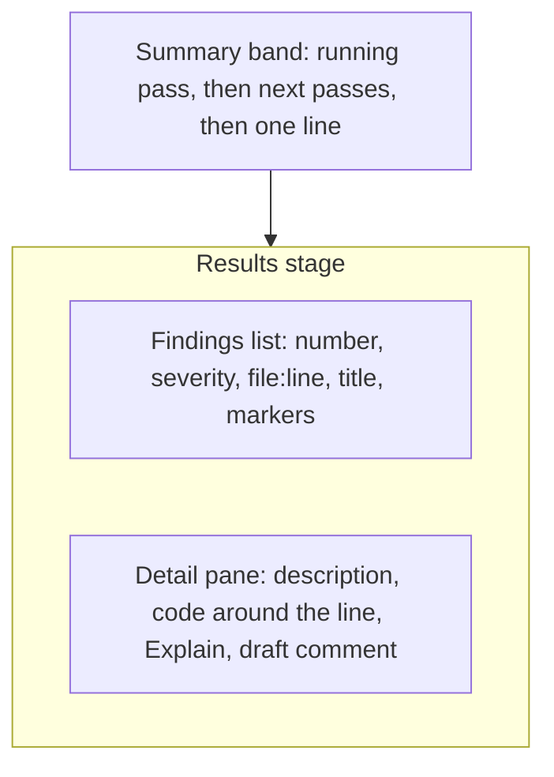

# Review Board Layout Redesign - Plan

## Goal Capsule

- **Objective:** A developer reviewing a pull request on a wide screen sees the finding they are working on next to its code and its draft comment, without scrolling between sections. One background (a Jira ticket or their own text) tells the reviewer what the change is meant to do.
- **Means:** A list-and-detail layout with a summary band that follows the stage of the review. One background on the first step replaces the requirements source and the upfront question. The requirements coverage check is removed for now.
- **Product authority:** The maintainer's decisions in Key Decisions below. Where this plan and [`2026-11-19-0828-feat-pr-review-board-and-bitbucket-removal-plan.md`](2026-11-19-0828-feat-pr-review-board-and-bitbucket-removal-plan.md) disagree on the review board's layout, first step or requirements check, this plan wins. The staged review itself (regular pass, persona passes, critic, Explain, Post, Copy) stays as that plan defined it.
- **Open blockers:** None.

---

## Product Contract

### Summary

The review board becomes a two-column page: the findings list on the left, the selected finding in full on the right. A summary band above both columns shows the running pass, then the next passes to run, then folds to one line. The first step asks for one background, a Jira ticket or the developer's own text, which every review call receives. A change that goes against the background shows up as a finding marked "against goal".

### Problem Frame

The review board renders as one long column: model, requirements, question, extra passes, coverage, findings, then the files that were not reviewed. On a wide editor tab most of the width is empty, and a developer working through findings scrolls between a finding, its draft comment and the controls for more passes. Nothing shows a finding next to its code.

The first step also splits the developer's intent in two. A goal or ticket feeds an isolated coverage check with its own Reword and Re-check cycle, while a separate question steers every review call. The maintainer does not want the coverage check for now. What they want is for the reviewer to understand the goal of the change and point out where the change works against it.

### Key Decisions

- **Layout: findings list plus detail pane.** Chosen from three sketched directions. (session-settled: user-directed — chosen over a three-column layout with an overview rail and over a wide table with rows that expand in place: the developer works through one finding at a time.) Governs R1, R2, R3.
- **Overview: a summary band above both columns.** (session-settled: user-directed — chosen over chips with drop-down panels in a top strip and over a "Review summary" entry at the top of the list.) Governs R4, R5, R6, R7.
- **Findings appear while a pass runs.** (session-settled: user-directed — chosen over keeping the list empty until the pass ends, as the board does today.) Governs R5, R8.
- **One background replaces the goal and the upfront question, and there is no coverage check.** (session-settled: user-directed — chosen over keeping two fields, splitting one box by Reword, and over one box that also feeds a coverage check: the background is context for the reviewer, not a checklist.) Governs R10, R13, R14, R18.
- **The background is a Jira ticket or the developer's own text, not both.** (session-settled: user-directed — chosen over sending the ticket and an extra text together.) Governs R10, R12.
- **The ticket's text is shown for trimming before it is sent.** (session-settled: user-directed — chosen over sending only the summary and description, and over sending the full capped text untouched: the developer controls what goes into every call.) Governs R11.
- **A request with both a ticket key and text preselects the text.** (session-settled: user-directed — chosen over preselecting the ticket and over preselecting neither; the first step always waits for Start, so the developer can still switch.) Governs R12.
- **A narrow tab shows the finding as an overlay over the list.** (session-settled: user-directed — chosen over stacking the detail below the list and over a wide-only layout.) Governs R9.

### Requirements

**Layout**

- R1. The results stage shows the findings list in a left column and the selected finding in a right detail pane, side by side on a wide tab.
- R2. Each list entry shows its number, severity, file and line, title, and markers for "against goal", a drafted comment and a posted comment; selecting an entry shows it in the detail pane.
- R3. The detail pane shows the finding's description, recommendation, line facts (verified or not, new or existing code, confidence, source), the code around the finding, Explain with its answer, and the draft comment with Rewrite and Undo.
- R4. A summary band sits above both columns for the whole review and changes with the stage, per R5 to R7.

**The summary band through the flow**

- R5. While a pass runs, the band shows its progress by batch with Stop, the background in use and the tokens so far.
- R6. When the regular pass ends, the band opens with the finding counts by severity and "against goal", the next passes to run (the suggested ones preselected, the other persona passes and the critic offered) with Run selected and Not now, the background, the files that were not reviewed and the tokens.
- R7. Once the developer starts on the findings, the band folds to one line that keeps the counts, the passes run, the background, the not-reviewed count, the tokens, More passes and Run again; the developer can open it again.

**Findings while a pass runs**

- R8. Findings appear in the list as each batch finishes, and can be selected and read; Explain, Rewrite and Post wait until the pass ends.

**Narrow tab**

- R9. On a tab too narrow for two columns, the list fills the tab and a selected finding opens as an overlay over it, with a way back to the list.

**First step: the background**

- R10. The first step offers one background: a Jira ticket, the developer's own text, or none.
- R11. Choosing a Jira ticket fills an editable box with its summary, description and newest comments, within the existing size caps; what the developer leaves in the box is what is sent.
- R12. When a request names both a ticket key and text, the first step opens with the text preselected and the key kept in the ticket field; nothing runs before Start.
- R13. The background goes into every review call: the regular pass and its continuation and whole-file call, every persona pass, the critic and Explain.
- R14. The reviewer is asked to flag changes that go against the background; such a finding is an ordinary finding with an "against goal" marker, which only appears when a background was given.
- R15. Ticket text, trimmed or not, is sent marked as data that cannot act as instructions to the reviewer; the developer's own text is sent as instructions, as the upfront question is today.
- R16. The model picker stays on the first step, and the start screen that asks for the pull request link is unchanged.

**What goes**

- R17. The board no longer shows Reword, Re-check, the requirements coverage block or the requirements source form after the review.
- R18. Copy and `bitbucket_read_findings` no longer include requirements coverage; `bitbucket_read_findings` reports the background in use instead.
- R19. A review stored before this change is rebuilt from its recipe or discarded under the existing stored-format rule; its coverage result is not kept.

### Key Flows

- F1. A review on a wide tab
  - **Trigger:** The developer opens a review from the Command Palette, `/ts-bitbucket review <link>` or Copilot.
  - **Steps:** Start screen (link) → first step (model, background, Start) → regular pass with the band showing progress and findings filling the list → band opens with the next passes → the developer runs some or picks Not now → the band folds while they select findings, Explain, draft, Rewrite, select and Post or Copy.
  - **Outcome:** Posted comments in Bitbucket, or copied text.
  - **Covers:** R1 to R8, R10, R13, R14, R16.
- F2. A ticket as background
  - **Trigger:** The pull request title names `PROJ-123`, or the developer types a key.
  - **Steps:** The first step preselects the ticket and fills the box with its text → the developer trims it → Start.
  - **Covers:** R10, R11, R13, R15.

### Layout

### Acceptance Examples

- AE1. **Covers R5, R8.** Given a regular pass on its third of five batches, when the first two batches produced four findings, then the list shows four findings, the band says "batch 3 of 5" with Stop, and Explain on a selected finding is not offered yet.
- AE2. **Covers R6, R7.** Given the regular pass ended with nine findings and suggests Security, when the band opens, then Security is preselected among the next passes; when the developer selects a finding, the band folds to one line with More passes.
- AE3. **Covers R11, R15.** Given the developer picks ticket PROJ-123 and deletes its comments from the box, when they press Start, then every review call receives only the summary and description left in the box, marked as data.
- AE4. **Covers R12.** Given `/ts-bitbucket review <link> PROJ-123 watch thread safety`, when the board opens, then the background is "My own text" with "watch thread safety", the ticket field holds PROJ-123, and no pass has started.
- AE5. **Covers R14.** Given the background "sessions must expire after the configured TTL" and a change that sets the expiry to 0, when the regular pass ends, then a finding on that line carries the "against goal" marker; given no background, no finding carries it.
- AE6. **Covers R9.** Given a narrow editor split, when the developer selects a finding, then it opens over the list, and going back returns to the list at the same place.

### Scope Boundaries

- The requirements coverage check is deferred, not rejected; bringing it back is a separate decision.
- No new review passes, and no change to how findings are found, anchored, deduplicated or checked by the critic beyond receiving the background (R13, R14).
- The sessions board, the import board and the other boards keep their layouts.
- No styling beyond VS Code's theme and the shared board style.
- The Agents window problem is tracked separately as O23 in [`docs/architecture/migration-status.md`](../architecture/migration-status.md).

### Outstanding Questions

**Deferred to Planning**

- What exactly makes the band count as "started on the findings" for R7 (the first selection, or the first Explain or draft).
- The width at which R9's overlay takes over from two columns.
- How much code around the finding the detail pane shows (R3), and whether it comes from the stored diff or the whole file.
- Whether the coverage engine code is deleted or kept unused (R17, R18).
- Which documents change: the user manual pages on the review board, `docs/review-process.md` ("Upfront question", "Requirements check"), the `/ts-bitbucket` help, the review board parity ledger in `docs/architecture/migration-status.md`, and the manual checklist's Step 3.

### Sources / Research

- Current page: `board-pages/review/page.js` (one column of sections; `results()` renders the header line, token list, notes, pass picker, requirements block and findings in order).
- First step and its source choice: `src/boards/review/firstStep.ts` (`SourceId` is `ticket`, `goal` or `none`; a separate `question`).
- The question goes into every review call and the ticket text only into the requirements call: `docs/review-process.md` "Upfront question" and "Requirements check".
- The ticket text caps: `src/utils/requirementsSource.ts` (`REQUIREMENTS_TEXT_MAX_CHARS` 6000, comments 8000, one comment 1500).
- Coverage in the tool and Copy: `src/tools/bitbucketTools/readFindings.ts`, `src/review/shareFormat.ts`.
- Directional sketches from this brainstorm (machine-local, best effort; a missing sketch is not a blocker and the requirements above govern any disagreement): `/tmp/claude-0/-home-user-ticket-sidekick/1a078609-124a-5997-84ea-b3dad766d2e7/scratchpad/sketches/`, chiefly `004-band-through-flow.html` (the chosen layout through the stages) and `003-no-coverage.html` (the first step).
