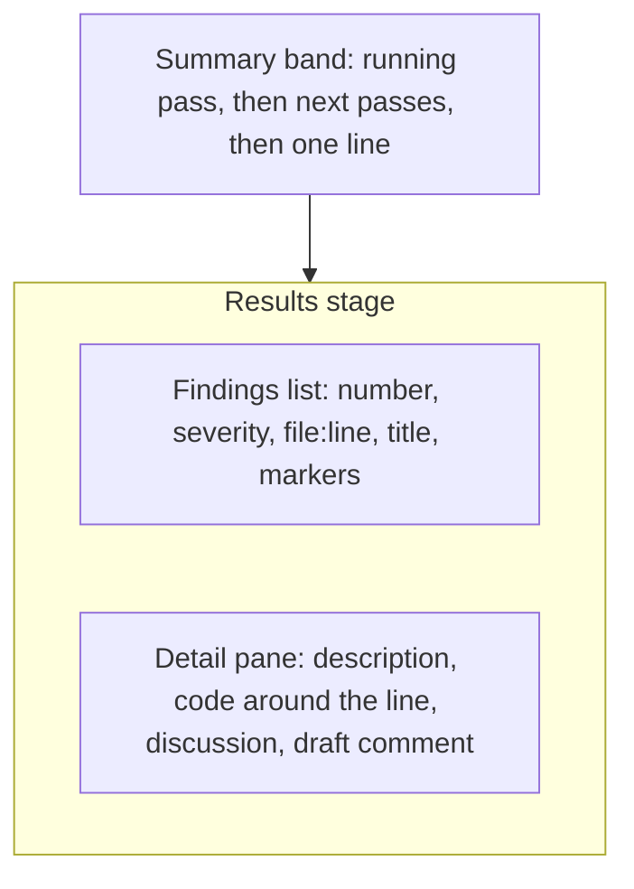
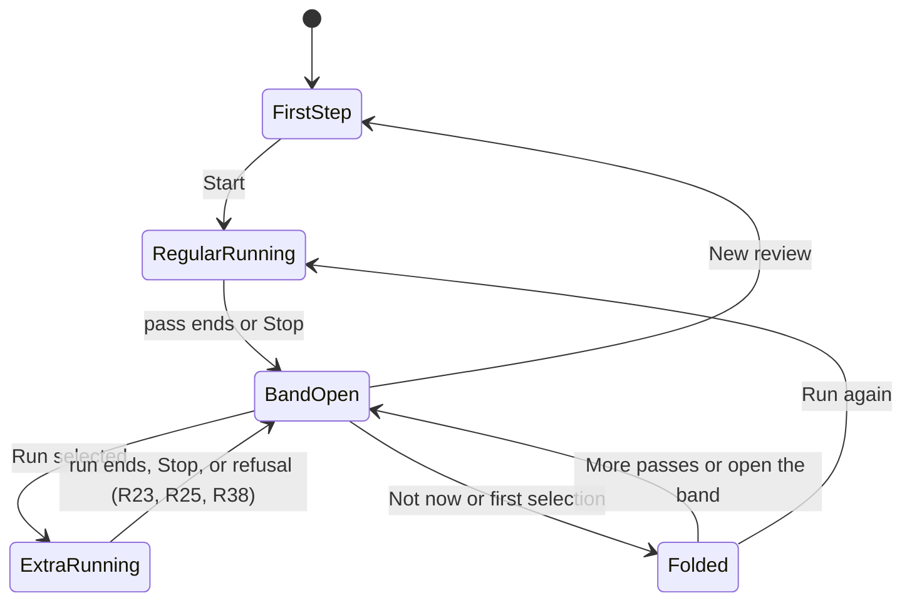
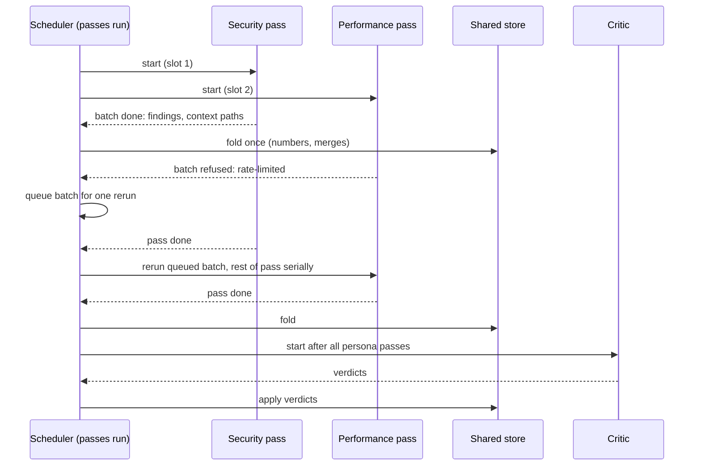
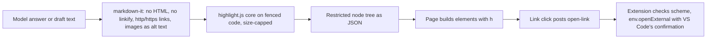

# Review Board Layout Redesign - Plan

## Goal Capsule

- **Objective:** A developer reviewing a pull request on a wide screen sees the finding they are working on next to its code and its draft comment, without scrolling between sections. One background (a Jira ticket or their own text) tells the reviewer what the change is meant to do.
- **Means:** A list-and-detail layout with a summary band that follows the stage of the review. One background on the first step replaces the requirements source and the upfront question. The requirements coverage check is removed for now. Picked extra passes run at the same time. A finding can be discussed in a thread on the board or handed to Copilot Chat with everything the review saw.
- **Product authority:** The maintainer's decisions in Key Decisions below. Where this plan and [`2026-11-19-0828-feat-pr-review-board-and-bitbucket-removal-plan.md`](2026-11-19-0828-feat-pr-review-board-and-bitbucket-removal-plan.md) disagree on the review board's layout, first step or requirements check, this plan wins. The staged review itself (regular pass, persona passes, critic, Explain, Post, Copy) stays as that plan defined it.
- **Open blockers:** None. The managed-machine probe in the Verification Contract is a check to run early, not a blocker.
- **Stop conditions:**
  - Stop and ask if the managed-machine probe shows that more than two of four concurrent model requests are refused, or that Copilot Chat cannot be opened with a prefilled prompt; R20 or R30 would then need a product decision.
  - Stop and ask if a "Carry over" row of the review board parity ledger has no board action or tool left that keeps it and no recorded reason to drop it (U10).
  - Stop and ask if `markdown-it` or `highlight.js` cannot be bundled by esbuild into `out/extension.js` without shipping `node_modules` (KTD7).
- **Execution profile:** One pull request from the work branch, units in Unit Index order. `npm run compile` and `npm test` are green before every commit (`CLAUDE.md`). Workers do not commit or push on their own ([`docs/solutions/workflow-issues/ce-work-unit-subagent-pushes-directly-to-main-bypassing-pr-review.md`](../solutions/workflow-issues/ce-work-unit-subagent-pushes-directly-to-main-bypassing-pr-review.md)). Plan a code review focused on races in the parallel-pass fold (U5) before the PR is merged.
- **Finishes and ships:** The executor opens the PR with the updated Step 3 part of the manual checklist. The maintainer runs it on the PR's preview build on the managed machine, then merges and releases on the preview channel (the release rule in [`docs/architecture/migration-status.md`](../architecture/migration-status.md)).

---

## Product Contract

Product Contract preservation: changed R11, R19, R23, AE8 — planning research showed that a `Blocked` or quota refusal makes Copilot refuse every call for minutes, so only a rate-limited batch is rerun (R23); that an unreadable or emptied ticket box needs a defined Start (R11); and that reopening on the first step is how a discarded review avoids spending tokens (R19). Added R38 (the critic after a stopped or partly failed run) and AE15 to AE17. Meaning of every other R, F and AE unchanged. Planning resolved the deferred questions and removed them from Outstanding Questions.

### Summary

The review board becomes a two-column page: the findings list on the left, the selected finding in full on the right. A summary band above both columns shows the running pass, then the next passes to run, then folds to one line. The first step asks for one background, a Jira ticket or the developer's own text, which every review call receives. A change that goes against the background shows up as a finding marked "against goal". Picked extra passes run at the same time, capped on large reviews. Each finding has a discussion thread rendered as Markdown, a draft preview, and Discuss in chat, which hands the finding to Copilot with its thread, the background, the reviewed commit and its files.

### Problem Frame

The review board renders as one long column: model, requirements, question, extra passes, coverage, findings, then the files that were not reviewed. On a wide editor tab most of the width is empty, and a developer working through findings scrolls between a finding, its draft comment and the controls for more passes. Nothing shows a finding next to its code.

The first step also splits the developer's intent in two. A goal or ticket feeds an isolated coverage check with its own Reword and Re-check cycle, while a separate question steers every review call. The maintainer does not want the coverage check for now. What they want is for the reviewer to understand the goal of the change and point out where the change works against it.

### Key Decisions

- **Layout: findings list plus detail pane.** Chosen from three sketched directions. (session-settled: user-directed — chosen over a three-column layout with an overview rail and over a wide table with rows that expand in place: the developer works through one finding at a time.) Governs R1, R2, R3.
- **Overview: a summary band above both columns.** (session-settled: user-directed — chosen over chips with drop-down panels in a top strip and over a "Review summary" entry at the top of the list.) Governs R4, R5, R6, R7.
- **Findings appear while a pass runs.** (session-settled: user-directed — chosen over keeping the list empty until the pass ends, as the board does today.) Governs R5, R8.
- **One background replaces the goal and the upfront question, and there is no coverage check.** (session-settled: user-directed — chosen over keeping two fields, splitting one box by Reword, and over one box that also feeds a coverage check: the background is context for the reviewer, not a checklist.) Governs R10, R13, R14, R18.
- **The background is a Jira ticket or the developer's own text, not both.** (session-settled: user-directed — chosen over sending the ticket and an extra text together.) Governs R10, R12.
- **The ticket's text is shown for trimming before it is sent.** (session-settled: user-directed — chosen over sending only the summary and description, and over sending the full capped text untouched: the developer controls what goes into every call.) Governs R11.
- **A request with both a ticket key and text preselects the text.** (session-settled: user-directed — chosen over preselecting the ticket and over preselecting neither; the first step always waits for Start, so the developer can still switch.) Governs R12.
- **Picked persona passes run at the same time, not one after another.** Faster on a large pull request; the critic still runs last because it checks the other passes' findings. Governs R20, R21, R22, R23, R25, R38.
- **A finding can be discussed on the board and in Copilot Chat.** A short thread in the detail pane for quick follow-ups, and a hand-off to Copilot Chat for a longer investigation. (session-settled: user-directed — chosen over a board thread only and over a Copilot hand-off only.) Governs R26, R27, R28, R29, R30, R34, R35, R36. R36's limits keep the agent from reaching other endpoints with the developer's credentials.
- **The board renders discussion answers and a draft preview as Markdown with highlighted code.** (session-settled: user-directed — chosen over rendering the thread only and over keeping plain text: the developer sees what they will post.) Governs R31, R32, R33.
- **A narrow tab shows the finding as an overlay over the list.** (session-settled: user-directed — chosen over stacking the detail below the list and over a wide-only layout.) Governs R9.

### Requirements

**Layout**

- R1. The results stage shows the findings list in a left column and the selected finding in a right detail pane, side by side on a wide tab.
- R2. Each list entry shows its number, severity, file and line, title, and markers for "against goal", a drafted comment and a posted comment; the list is sorted by severity, then by confidence (highest first), and selecting an entry shows it in the detail pane.
- R3. The detail pane shows the finding's description, recommendation, line facts (verified or not, new or existing code, confidence, source), the code around the finding, its discussion (R26 to R30), and the draft comment with Rewrite and Undo.
- R4. A summary band sits above both columns for the whole review and changes with the stage, per R5 to R7.

**The summary band through the flow**

- R5. While a pass runs, the band shows its progress by batch with Stop, the background in use and the tokens so far.
- R6. When the regular pass ends, the band opens with the finding counts by severity and "against goal", the next passes to run (the suggested ones preselected, the other persona passes and the critic offered) with Run selected and Not now, the background, the files that were not reviewed and the tokens.
- R7. Once the developer starts on the findings, the band folds to one line that keeps the counts, the passes run, the background, the not-reviewed count, the tokens, More passes and Run again; the developer can open it again.

**Findings while a pass runs**

- R8. Findings appear in the list as each batch finishes, sorted into place per R2, and can be selected and read; the selected finding keeps the focus and stays selected when new findings arrive; Explain, Rewrite and Post wait until the pass ends.

**Narrow tab and keyboard**

- R9. On a tab too narrow for two columns, the list fills the tab and a selected finding opens as an overlay over it, with a way back to the list.
- R37. Every control can be reached with the keyboard; Escape and Back close the overlay and return focus to the same list entry; markers are words, not colour alone.

**First step: the background**

- R10. The first step offers one background: a Jira ticket, the developer's own text, or none.
- R11. Choosing a Jira ticket fills an editable box with its summary, description and newest comments, within the existing size caps; what the developer leaves in the box is what is sent. When the ticket cannot be read (not found, no access, Jira not set up), the box shows the reason, the developer can switch to their own text or none, and Start stays available. If the ticket is still unreadable, or the box is empty, when Start is pressed, the review runs with no background and no "against goal" checking, and the band says why.
- R12. When a request names both a ticket key and text, the first step opens with the text preselected and the key kept in the ticket field; nothing runs before Start.
- R13. The background goes into every review call: the regular pass and its continuation and whole-file call, every persona pass, the critic and Explain.
- R14. The reviewer is asked to flag changes that go against the background; such a finding is an ordinary finding with an "against goal" marker, which only appears when a background was given.
- R15. Ticket text, trimmed or not, is sent marked as data that cannot act as instructions to the reviewer; the developer's own text is sent as instructions, as the upfront question is today.
- R16. The model picker stays on the first step, and the start screen that asks for the pull request link is unchanged.

**What goes**

- R17. The board no longer shows Reword, Re-check, the requirements coverage block or the requirements source form after the review.
- R18. Copy and `bitbucket_read_findings` no longer include requirements coverage; `bitbucket_read_findings` reports the background instead, and returns a finding's thread (whose first answer is the former explanation) with no separate explanation field.
- R19. A review stored before this change is discarded: the board reopens on the first step for the same pull request with a notice saying so, and nothing runs, so no tokens are spent on an old review.

**Running the extra passes**

- R20. The persona passes picked in one Run selected run at the same time, each over every batch one batch after another: all of them when the review has at most four batches, at most two at once when it has more, with the rest starting as one ends.
- R21. When the critic is picked together with persona passes, it starts after they have all ended, so it checks their findings too.
- R22. While passes run together, the band shows each pass's progress on its own line, and Stop ends all of them, keeping what each found so far.
- R23. When a batch is refused as rate-limited while more than one pass runs, the remaining passes run one after another instead, that batch is run once more after the other passes end, and the band says so; if it is refused again, the run stops with the quota message. When the model is blocked or the quota is used up, no further batch or pass starts, the run stops at once with the quota message, and the passes not started are offered again (R25).
- R24. Each persona pass reviews the diff and context files on its own: its prompt never contains the regular pass's findings or another pass's, so running them at the same time or one after another gives the same kind of result.
- R25. When a run of extra passes ends, the band opens again with the passes not run yet and the critic when there are unchecked findings, so the developer can pick a next run, any number of times.
- R38. After Stop, a picked critic does not run. When one picked persona pass failed and another finished, the critic checks the findings that exist, and the failed pass is offered again.

**Discussing a finding**

- R26. Explain becomes a thread in the detail pane: the first question gets an answer, and each follow-up is added below it instead of replacing it.
- R27. Each call of the thread receives the finding, its code, the pull request title and description, the background and the thread so far; it runs on the review model and counts toward the token usage.
- R28. The thread is kept with the review and survives a restart; a finding with a thread counts as worked on, so the critic keeps it as a probable false alarm instead of removing it.
- R29. When the thread has grown since the draft comment was made, the draft says so and Regenerate rebuilds it from the finding and the whole thread; the developer's edits are lost only on Regenerate.
- R30. Discuss in chat opens Copilot Chat with a short prompt that names the pull request link and the finding number and asks the agent to read that finding first; the developer adds their question and sends it, and the conversation stays in Copilot without changing the board's draft.

**Markdown on the board**

- R31. Discussion answers may use Markdown, and the board renders them with headings, lists and code blocks highlighted by language.
- R32. The draft comment has a Preview toggle that shows it rendered as Markdown, as Bitbucket will show it after Post; editing stays in the plain text box.
- R33. Rendered Markdown never runs raw HTML, scripts, images or command links, since answers and drafts are model output derived from pull request content; web links open only after VS Code's own confirmation.

**The hand-off to Copilot Chat**

- R34. For one finding, `bitbucket_read_findings` returns its thread and the review's background as full text, along with the rest of what it returns today (per R18, the thread takes the place of the single explanation).
- R35. `bitbucket_read_findings` names the commit the review read, and says so when the pull request has a newer commit, so the agent does not mix the reviewed code with the current one.
- R36. A new read-only Bitbucket tool returns one file of the pull request's repository at the reviewed commit, so the agent can read whole files as the review did, independent of the developer's local checkout. It sends requests only to the Bitbucket server configured in the settings, the one the credentials belong to; the pull request link only identifies the pull request on that server; project, repository and commit come from the stored review; and a path that is empty, absolute, or contains `.`, `..` or backslash segments is refused before any request is made.

### Key Flows

- F1. A review on a wide tab
  - **Trigger:** The developer opens a review from the Command Palette, `/ts-bitbucket review <link>` or Copilot.
  - **Steps:** Start screen (link) → first step (model, background, Start) → regular pass with the band showing progress and findings filling the list → band opens with the next passes → the developer runs some or picks Not now → the band folds while they select findings, Explain, draft, Rewrite, select and Post or Copy.
  - **Outcome:** Posted comments in Bitbucket, or copied text.
  - **Covers:** R1 to R8, R10, R13, R14, R16.
- F2. A ticket as background
  - **Trigger:** The pull request title names `PROJ-123`, or the developer types a key.
  - **Steps:** The first step preselects the ticket and fills the box with its text → the developer trims it → Start.
  - **Covers:** R10, R11, R13, R15.

### Layout

### Acceptance Examples

- AE1. **Covers R5, R8.** Given a regular pass on its third of five batches, when the first two batches produced four findings, then the list shows four findings, the band says "batch 3 of 5" with Stop, and Explain on a selected finding is not offered yet.
- AE2. **Covers R6, R7.** Given the regular pass ended with nine findings and suggests Security, when the band opens, then Security is preselected among the next passes; when the developer selects a finding, the band folds to one line with More passes.
- AE3. **Covers R11, R15.** Given the developer picks ticket PROJ-123 and deletes its comments from the box, when they press Start, then every review call receives only the summary and description left in the box, marked as data.
- AE4. **Covers R12.** Given `/ts-bitbucket review <link> PROJ-123 watch thread safety`, when the board opens, then the background is "My own text" with "watch thread safety", the ticket field holds PROJ-123, and no pass has started.
- AE5. **Covers R14.** Given the background "sessions must expire after the configured TTL" and a change that sets the expiry to 0, when the regular pass ends, then a finding on that line carries the "against goal" marker; given no background, no finding carries it.
- AE6. **Covers R9.** Given a narrow editor split, when the developer selects a finding, then it opens over the list, and going back returns to the list at the same place.
- AE7. **Covers R20, R21, R22.** Given the developer picks Security, Performance and the Critic, when they press Run selected, then Security and Performance run at the same time with a progress line each, and the Critic starts only after both have ended.
- AE8. **Covers R23.** Given a parallel Performance request is refused as rate-limited, when Security is still running, then Performance waits and runs after Security, and the band says the passes now run one after another.
- AE9. **Covers R25.** Given Security and Performance have run and the critic has not, when the run ends, then the band offers Reliability, Maintainability and the Critic; after the critic runs, it is offered again only once a later pass adds findings.
- AE10. **Covers R26, R27, R29.** Given finding #1 has a draft and one answer, when the developer asks a follow-up, then the answer appears below the first one, the call receives both earlier messages, and the draft says the discussion changed since it was made.
- AE11. **Covers R30.** Given finding #12, when the developer presses Discuss in chat, then Copilot Chat opens with a prompt naming the review and #12, and the agent's first step is to read that finding with `bitbucket_read_findings`.
- AE12. **Covers R31, R33.** Given a follow-up answer containing a fenced Java block and an HTML `<script>` tag, when it is shown, then the Java block is highlighted and the tag appears as text, not run.
- AE13. **Covers R32.** Given a draft with a fenced diff block, when the developer turns on Preview, then the block is shown highlighted as it will look in Bitbucket, and turning Preview off returns to the text box with the same text.
- AE14. **Covers R34, R35, R36.** Given a review at commit 4f2a91c and a pull request that has since moved to 7b10e02, when the agent reads finding #12, then the reply carries its thread, the background text and a note that the review read 4f2a91c and the pull request is now at 7b10e02, and the agent can read `TransferController.java` at 4f2a91c through the new tool.
- AE15. **Covers R23.** Given Security and Performance running together, when a Performance batch is refused because the model is blocked, then no further batch starts, the run stops with the quota message, and the band offers Performance and the passes not started again.
- AE16. **Covers R38.** Given Security failed on every batch and Performance finished, with the Critic picked, when the run ends, then the Critic has checked the findings that exist and the band offers Security again.
- AE17. **Covers R11.** Given ticket PROJ-123 cannot be read because Jira answers 404, when the developer presses Start without switching, then the review runs with no background, no finding carries "against goal", and the band says the ticket could not be read.

### Scope Boundaries

- The requirements coverage check is deferred, not rejected; bringing it back is a separate decision.
- No new review passes, and no change to how findings are found (other than R20 to R23 running the picked passes at the same time), anchored, deduplicated or checked by the critic beyond receiving the background (R13, R14).
- The sessions board, the import board and the other boards keep their layouts.
- No styling beyond VS Code's theme and the shared board style.
- Considered and not built: the agent writing to the board's thread or draft, or posting comments itself. Discuss in chat stays read-only on the board side; evidence that developers paste agent answers back by hand often would reopen it.
- Considered and not built: raising the VS Code engines floor to 1.99 for chat's agent mode. Below 1.99 chat simply opens in its current mode (KTD9); a reported need for older VS Code versions to open agent mode would reopen it.
- The Agents window problem is tracked separately as O23 in [`docs/architecture/migration-status.md`](../architecture/migration-status.md).

### Outstanding Questions

**Deferred to Implementation**

- The exact width at which R9's overlay takes over from two columns; pick it from the mockups and the narrowest editor split that still fits both panes.
- The character budget for thread calls (KTD10) and for the Markdown renderer's input caps (KTD7); set them from the review model's context budget already used for batches.

### Sources / Research

- File at a commit: `IBitbucketClient.getFileContent(project, repo, path, commitHash)` in `src/bitbucket/IBitbucketClient.ts`, which the review passes already use for context files.
- Current page: `board-pages/review/page.js` (one column of sections; `results()` renders the header line, token list, notes, pass picker, requirements block and findings in order).
- First step and its source choice: `src/boards/review/firstStep.ts` (`SourceId` is `ticket`, `goal` or `none`; a separate `question`).
- The question goes into every review call and the ticket text only into the requirements call: `docs/review-process.md` "Upfront question" and "Requirements check".
- The ticket text caps: `src/utils/requirementsSource.ts` (`REQUIREMENTS_TEXT_MAX_CHARS` 6000, comments 8000, one comment 1500).
- Coverage in the tool and Copy: `src/tools/bitbucketTools/readFindings.ts`, `src/review/shareFormat.ts`.
- Directional sketches from this brainstorm (machine-local, best effort; a missing sketch is not a blocker and the requirements above govern any disagreement): `/tmp/claude-0/-home-user-ticket-sidekick/1a078609-124a-5997-84ea-b3dad766d2e7/scratchpad/sketches/`, chiefly `005-mockups-dummy-data.html` (eight use cases with dummy data: first step with ticket and with own text, regular pass running, regular pass done, two passes running together, working on findings with a thread and draft preview, no findings, narrow tab), `004-band-through-flow.html` and `003-no-coverage.html`.
- Research dossiers from planning (machine-local, best effort): `/tmp/compound-engineering-0/ce-plan-research/a07dd0d2/` (`repo-research.md`, `learnings.md`, `agent-native.md`, `framework-docs.md`, `spec-flow.md`).

---

## Planning Contract

### Key Technical Decisions

- KTD1. **Reading during a pass is page-local, and numbering grows batch by batch.** The session refuses every action while a pass runs (`requireNoPass`, `src/sessions/sessionManager.ts`), so the finding the developer reads in the detail pane is page state keyed by finding number, as `typed` is today in `board-pages/review/page.js`. The regular pass folds each finished batch's findings into the running store once instead of rebuilding the store on every progress report (`src/review/engine/regularPass.ts`), so a number never changes during a pass. Governs R8.
- KTD2. **Parallel passes run inside the one `passes` run, with one fold point.** `extraPassesRun` (`src/boards/review/runs.ts`) becomes a scheduler: all picked persona passes at once when the review has at most four batches, else two, the next starting as one ends, and the critic after all of them per R21 and R38. Each pass returns its new findings and context paths per finished batch, and the scheduler folds them into the shared store in one synchronous step (`addFindings`, `src/review/engine/findingStore.ts`), so numbers, merges and `stepsRun` stay single-writer by construction ([`docs/solutions/logic-errors/concurrent-attachment-download-same-filename-race-silently-drops-one.md`](../solutions/logic-errors/concurrent-attachment-download-same-filename-race-silently-drops-one.md)). One `AbortController` still stops everything; a result arriving after Stop is dropped. `ActivePass` keeps a progress entry and a partial change per step, and `interruptedWorking` merges all of them after a restart. Governs R20, R21, R22, R24, R38.
- KTD3. **Refusals are classified, not parsed from text.** `src/utils/lmRetry.ts` gains a classification of the three refusals Copilot sends: rate-limited (a plain error named `ChatRateLimited`), blocked (`LanguageModelError` code `Blocked`) and quota used up (`ChatQuotaExceeded`), by code first, then error name, then message. `withEasierRetry` and `callWithRetry` rethrow these refusals at once today, past `BatchReviewResult`, so `callBatchWithSplit` and `reviewBatch` (`src/review/engine/plumbing.ts`, `batchReview.ts`) catch a classified refusal and return it as a failed part carrying its class instead of throwing; `BatchReviewResult` keeps the text note beside the class. On a blocked or quota refusal the scheduler aborts the other running passes through the shared `AbortController` before it stops. Once one batch is refused as rate-limited, every later rate-limited refusal in the same run is queued for the single rerun round too, and that round starts only after a wait taken from the refusal's retry hint, or 30 seconds when there is none. `LanguageModelError.RateLimited` is a proposed API and is not used. Governs R23.
- KTD4. **The background enters the existing prompt seams.** Own text goes in as `focus`, the trusted `ADDITIONAL INSTRUCTIONS` block it uses today (`assemblePrompt`, `src/services/PrReviewService.ts`). Ticket text goes into a new block inside the `«UNTRUSTED-CONTENT»` fence, defanged like the requirements prompt does today. The "against goal" request lives in the trusted prompt tail next to the output contract, only when a background exists. Findings carry an `againstGoal` flag that `resolveFindingAnchors` keeps and that survives a merge when either side has it (`findingStore.ts`, `dedupeFindings` in `src/review/reviewSessionState.ts`); this is the one deduplication change Scope Boundaries allows. Governs R13, R14, R15.
- KTD5. **The fence is defanged in every review prompt, and the critic's PR title and findings move inside it.** Ticket text in every call widens a weakness the review prompts already have (the diff is fenced but not defanged; the critic puts the title and findings outside), so the same unit closes it. Governs R15.
- KTD6. **The ticket is read before Start by a first-step call run.** A `read-ticket` call (the pattern `reword` uses today in `src/boards/review/kind.ts`) reads through `TicketService.getRequirementsSource` with the 20-second guard (`src/review/ticketRead.ts`) and fills the box with `formatRequirementsSourceText` (`src/utils/requirementsSource.ts`). It runs when the developer picks Jira ticket or changes the key, and once on open when the ticket is preselected. A result for a key that is no longer in the field is dropped; a read over a box the developer edited asks first. Start waits while a read runs. Governs R10, R11, R12.
- KTD7. **Markdown is rendered in the extension into a restricted node tree.** `markdown-it` with `html: false`, `linkify: false` and `typographer: false`, a link check that allows only `http:` and `https:`, and an image rule that emits the alt text only. Code blocks are highlighted with `highlight.js` core and a registered set of languages (Java, Kotlin, TypeScript, JavaScript, JSON, XML, SQL, shell, diff), with a size limit above which a block stays plain. The result is a JSON tree of allowed elements that the page builds with `h()`, so no HTML string reaches the page, and the test DOM, which has no HTML parser, can check it. Highlighter output is converted by a strict reader that accepts only its own span markup and escaped text and falls back to plain text otherwise. Input above a size cap renders as plain text. Both libraries are pinned to exact versions and bundled by esbuild into `out/extension.js`. (session-settled: user-directed — markdown-it and highlight.js chosen over markdown-it without highlighting and over a renderer of our own: well-tested parsers, about 55 KB gzipped.) Governs R31, R32, R33.
- KTD8. **Links open through the extension.** Rendered links carry their target as data, not as a live `href`. A click posts a board message; the extension checks for `http:` or `https:` and calls `vscode.env.openExternal`, which shows VS Code's own confirmation. A plain anchor in a webview would open without one in a trusted workspace. Governs R33.
- KTD9. **Discuss in chat uses VS Code's chat command, with a clipboard fallback.** A new board message makes the extension build the prompt (pull request link, finding number, the reviewed commit, and the read-findings tool by its reference name) and call `workbench.action.chat.open` with `isPartialQuery: true` and `mode: 'agent'`. Below VS Code 1.99 the mode is ignored and chat opens in its current mode; the engines floor stays `^1.95.0`. When the command fails, the prompt is copied and the board says so. The prompt never carries finding text. Governs R30.
- KTD10. **The thread replaces the single explanation in the working state.** `explanations` becomes a list of turns per finding. A thread or Regenerate call sends only the developer's turns and an own-text background as instructions; the PR title and description, the finding's title, description and recommendation, its code, a ticket-text background and earlier model answers go inside the untrusted fence, defanged (`buildFindingFollowUpPrompt` puts several of these outside the fence today), with the first answer and the newest turns within a character budget. Answers may use Markdown (`EXPLAIN_QUESTION`, `src/review/findingCalls.ts`, stops asking for plain text). A finding with a thread counts as worked on for the critic (`workedOn`, `runs.ts`). Regenerate becomes a one-call run from the finding and the thread when a thread exists, keeping the previous text for Undo; without a thread it stays the pure rebuild it is today. Governs R26, R27, R28, R29.
- KTD11. **The requirements check is deleted, not left unused.** `src/review/engine/requirementsCheck.ts`, `goalReword.ts`, `src/review/requirementsPass.ts`, `requirementsCoverage.ts`, `buildRequirementsPrompt` and their tests go; `src/utils/requirementsSource.ts` and `TicketService.getRequirementsSource` stay as the ticket reader for the background box. The review board's `formatVersion` goes from 1 to 2, so the session manager discards a stored review and reopens the board from its recipe on the first step with its rebuilt notice, with nothing run. Governs R17, R18, R19.
- KTD12. **The new file tool is `bitbucket_read_file`, and its checks are its own.** Inputs are the pull request link and a repository-relative path only. It refuses before any request when the link's host is not the configured Bitbucket server: on Data Center the host of `ticketSidekick.bitbucket.baseUrl`, on Cloud `bitbucket.org` (the client calls the fixed `api.bitbucket.org`, and the base URL setting is usually empty there); the stored `recipe.host` is compared today by nothing. It also refuses when no review is stored for the link, or when the path is empty, absolute, or has `.`, `..` or backslash segments (the client's per-segment encoding keeps `..`). Project, repository and commit come from the stored review. Output is capped with a note, a binary file is refused, and a Data Center read that hit the 5000-line browse limit says so. Governs R36.
- KTD13. **The page layout lives in the review page and the shared style, and the shared client keeps scroll and caret.** Two columns by CSS grid with an overlay below a width threshold, checked by `ResizeObserver` on the board root. The shared `paintNow` (`board-pages/shared/board.js`) saves and restores `scrollTop` and the text selection of elements with ids across each repaint, since a live list otherwise jumps to the top on every tick. The review view sets a flag that makes the shared header leave out its run line and Stop, so the band owns both. The band's folded state is stored in the working state: it folds on the first selection after a run or on Not now, and reopens when a run ends (R25). Governs R1 to R9, R37.
- KTD14. **`bitbucket_read_findings` and `bitbucket_open_review` follow the new board.** Read-findings drops coverage, reports the background (ticket text inside a data section), returns a finding's thread, marks "against goal" and "discussed", names the reviewed commit in one-finding mode and reads the pull request's current head there with one request (falling back to the stored head with a note), lists every running pass, and says when a stored review was discarded by the update. Open-review renames its `question` input to `background` and keeps `ticketKey`; when a review for that pull request already exists past the first step, the reply says the board keeps its background and New review starts over. Governs R12, R18, R34, R35.

### High-Level Technical Design

The summary band and run lifecycle the units must keep:

How the parallel run folds findings (KTD2, KTD3):

How Markdown reaches the page (KTD7, KTD8):

### Assumptions

- Copilot's refusal names (`ChatRateLimited`, `ChatQuotaExceeded`) and the `Blocked` behaviour were read from VS Code and Copilot Chat source, not observed in a running VS Code; the managed-machine probe and the refusal tests use them as written there.
- `workbench.action.chat.open` with `isPartialQuery` and `mode` was read from source; whether the organisation's policy lets it open agent mode is checked by the probe.

### System-Wide Impact

- **Agent surface.** `bitbucket_open_review` changes its input (`background`), `bitbucket_read_findings` changes its output, and `bitbucket_read_file` is new; the agent reads the review, the board stays the only place that runs passes, thread turns, Regenerate and Post, so every write keeps its native confirmation.
- **Prompts.** Every review prompt changes its fenced section (KTD4, KTD5); diagnostics and token metering per pass stay as they are.
- **Shared board client.** Scroll and caret preservation in `board-pages/shared/board.js` and the header flag apply to every board; the other boards keep their layouts and gain only the preservation.
- **Stored sessions.** The review board's format bump discards stored reviews once; no other board's sessions change.

### Risks

| Risk | Mitigation |
| --- | --- |
| The parallel fold races and gives two findings one number or loses a result after Stop | One synchronous fold point (KTD2), a scenario test with interleaved batch completions, and the race-focused code review in the execution profile |
| `markdown-it` gets a new denial-of-service advisory | Exact pin, the riskier features off (KTD7), input caps, and a test that renders the known advisory shapes within a time budget |
| Copilot blocks the extension under parallel load | The cap of two on large reviews (R20) and the stop-at-once rule for blocked or quota refusals (R23) |
| The parity guard fails when actions go | U10 moves the affected ledger rows to Dropped with reasons or re-maps them to the new actions in the same PR |
| A webview link opens without confirmation | Links carry no `href` (KTD8), with a page test that no rendered element has one |

---

## Implementation Units

| U-ID | Title | Files touched (key) | Depends on |
| --- | --- | --- | --- |
| U1 | Remove the requirements check | `src/review/engine/*`, `src/review/requirements*.ts`, `src/boards/review/kind.ts` | — |
| U2 | One background on the first step | `src/boards/review/firstStep.ts`, `kind.ts`, `recipe.ts`, `src/tools/bitbucketTools/openReview.ts` | U1 |
| U3 | Background and fence in every prompt | `src/services/PrReviewService.ts`, `src/review/engine/plumbing.ts`, `findingStore.ts` | U1 |
| U4 | Live findings with stable numbers | `src/review/engine/regularPass.ts`, `src/boards/review/kind.ts` | U1 |
| U5 | Parallel extra passes | `src/boards/review/runs.ts`, `src/review/engine/extraPass.ts`, `batchReview.ts`, `src/utils/lmRetry.ts` | U4 |
| U6 | Discussion thread and Regenerate | `src/boards/review/findings.ts`, `src/review/findingCalls.ts` | U3 |
| U7 | Markdown renderer and link opening | `src/review/markdownTree.ts` (new), `src/boards/boardMessages.ts`, `package.json` | — |
| U8 | Board page redesign | `board-pages/review/page.js`, `board-pages/shared/*` | U2, U4, U5, U6, U7 |
| U9 | Hand-off tools and Discuss in chat | `src/tools/bitbucketTools/*`, `src/boards/boardPanels.ts` | U1, U6 |
| U10 | Docs, parity guard and checklist | `docs/*`, `CLAUDE.md`, `skills/ts-bitbucket/*` | U1 to U9 |

### U1. Remove the requirements check

**Goal:** The review no longer checks coverage, rewords a goal or re-checks requirements, and stored reviews of the old format are discarded.

**Requirements:** R17, R18 (coverage part), R19; KTD11.

**Dependencies:** none.

**Files:**
- Delete `src/review/engine/requirementsCheck.ts`, `src/review/engine/goalReword.ts`, `src/review/requirementsPass.ts`, `src/review/requirementsCoverage.ts`, `src/test/goalReword.test.ts`, `src/test/requirementsCoverage.test.ts`, `src/test/requirementsPass.test.ts`.
- Modify `src/review/engine/index.ts`, `types.ts`, `regularPass.ts`, `src/services/PrReviewService.ts` (`buildRequirementsPrompt`), `src/review/shareFormat.ts`, `src/boards/review/kind.ts`, `runs.ts`, `findings.ts`, `src/tools/bitbucketTools/readFindings.ts`.
- Tests: `src/test/reviewEngine.test.ts`, `reviewBoardRuns.test.ts`, `shareFormat.test.ts`, `bitbucketTools.test.ts`.

**Approach:**
1. Remove the regular pass's call to the requirements check and the `requirements`/`coverage` fields of `StagedReview`.
2. Remove the `reword` and `recheck` runs, the requirements form after the review and coverage in Copy and read-findings.
3. Raise the review kind's `formatVersion` to 2, keeping `revalidate` so a stored review reopens on the first step.

**Patterns to follow:** the format bump path in `src/sessions/sessionManager.ts` (rebuilt notice).

**Test scenarios:**
- A regular pass with a ticket key in the recipe makes no requirements call and its review has no coverage.
- Copy for Teams and as Markdown of a finished review contain no coverage block.
- Covers R19. A stored review of format 1 opens on the first step for the same pull request with the rebuilt notice, and no run starts.
- `bitbucket_read_findings` on a finished review prints no coverage line.

**Verification:** No source file imports the deleted modules; `npm test` passes without the deleted tests.

### U2. One background on the first step

**Goal:** The first step offers Jira ticket, own text or none, reads the ticket into an editable box before Start, and passes one background to the run.

**Requirements:** R10, R11, R12, R16; KTD6, KTD14 (open-review input).

**Dependencies:** U1.

**Files:**
- Modify `src/boards/review/firstStep.ts`, `kind.ts`, `recipe.ts`, `deps.ts`, `src/boards/registerBoards.ts`, `src/tools/bitbucketTools/openReview.ts`, `skills/ts-bitbucket/SKILL.md`, `skills/ts-bitbucket/help-review.md`.
- Tests: `src/test/reviewBoard.test.ts`, `src/test/bitbucketTools.test.ts`.

**Approach:**
1. Replace `SourceId` (`ticket | goal | none`) and the goal, points and question fields with a background choice (`ticket | text | none`), a ticket key, the ticket box text with its read state, and the own text.
2. Add the `read-ticket` call run (KTD6) and its result handling: reason on failure, stale results dropped by key, a confirm before replacing an edited box.
3. Change `reopen` and `initialWorking` so a request with both a key and text preselects the text (R12).
4. At Start, resolve the background per R11: the box text as ticket background, the own text, or none with the band's reason.
5. Rename the open-review tool input `question` to `background`, update its description, and the existing-session reply (KTD14); run `node scripts/sync-tools.mjs`.

**Patterns to follow:** `rewordRun` in `kind.ts` (a first-step call run returning an update); `readTicketGuarded` in `src/review/ticketRead.ts`.

**Test scenarios:**
- Picking Jira ticket with a found key starts a read, and the box fills with summary, description and newest comments.
- Covers AE4. A request with key PROJ-123 and text "watch thread safety" opens with own text preselected and PROJ-123 in the ticket field, and no run starts.
- A read that answers 404 shows the reason in the box, and Start stays available.
- Covers AE17. Start with an unreadable ticket runs with no background, and the band notice names the reason.
- Changing the key while a read runs drops the first read's result.
- A second read over a box the developer edited asks before replacing it.
- With Jira not configured, the ticket choice shows the setup reason and own text and none still work.
- `bitbucket_open_review` with `background` passes the text to the board; on an existing review past the first step its reply says New review starts over.

**Verification:** The first step has no goal, Reword or question field; the tool manifest test passes after sync.

### U3. Background and fence in every prompt

**Goal:** Every review call receives the background in its trust position, asks for "against goal" findings when a background exists, and fences untrusted content safely.

**Requirements:** R13, R14, R15; KTD4, KTD5.

**Dependencies:** U1.

**Files:**
- Modify `src/services/PrReviewService.ts` (`assemblePrompt`, `buildCriticPrompt`, prompt tail), `src/review/engine/types.ts`, `plumbing.ts`, `critic.ts`, `findingStore.ts`, `src/review/reviewSessionState.ts` (`resolveFindingAnchors`, `dedupeFindings`), `src/boards/review/runs.ts`.
- Tests: `src/test/PrReviewService.test.ts`, `reviewEngine.test.ts`, `reviewSessionState.test.ts`.

**Approach:**
1. Carry the background on the engine settings as either own text (to `focus`) or ticket text (a new fenced block), set from the started-with state.
2. Defang the fence in the PR header, diffs, context files, ticket text and critic content; move the critic's title and candidate findings inside the fence. U6 applies the same to `buildFindingFollowUpPrompt`.
3. Add the "against goal" request and output field to the trusted tail only when a background exists, keep the flag through anchor resolution, and make it survive a merge.

**Patterns to follow:** the requirements prompt's fenced and defanged ticket block (removed in U1; mirror its shape).

**Test scenarios:**
- Covers AE3. With ticket background, every pass, the continuation, the whole-file call and the critic prompt contain the ticket text inside the fence and not in `ADDITIONAL INSTRUCTIONS`.
- With own text, every call carries it in `ADDITIONAL INSTRUCTIONS` and no ticket block.
- Ticket text and a diff containing the fence marker string are defanged and cannot close the fence.
- The critic prompt has the PR title and candidate findings inside the fence.
- Covers AE5. A reply finding with `againstGoal` keeps it after anchor resolution; with no background the prompt asks for nothing and a stray flag is dropped.
- Two duplicate findings, one marked "against goal", merge into one finding that keeps the mark.

**Verification:** Prompt snapshots in tests show the fence boundaries; the persona passes still receive no earlier findings (R24).

### U4. Live findings with stable numbers

**Goal:** Findings appear in the review view while the regular pass runs, with numbers that never change mid-run, sorted by severity then confidence.

**Requirements:** R2, R8; KTD1.

**Dependencies:** U1.

**Files:**
- Modify `src/review/engine/regularPass.ts`, `src/boards/review/kind.ts` (`view`, `resultsView`), `runs.ts` (progress reporter).
- Tests: `src/test/reviewEngine.test.ts`, `reviewBoardRuns.test.ts`.

**Approach:**
1. Fold each finished batch's findings into the running store once, in batch order.
2. Expose the partial review in the view while `active.what === 'regular'` so the results stage renders during Start.
3. Sort the view's finding list by severity, then confidence, then number.

**Test scenarios:**
- Covers AE1. After two of five batches, the view lists the findings of those two batches with the numbers they keep at the end.
- A later batch's duplicate of an earlier finding merges into it without renumbering anything.
- The list orders a critical finding with confidence 0.6 before a warning with 0.9, and two criticals by confidence.
- A stopped regular pass keeps the numbered findings it reached.

**Verification:** Numbers in progress snapshots equal the numbers in the final review for the same findings.

### U5. Parallel extra passes

**Goal:** Picked persona passes run at the same time under the cap, the critic runs after them, refusals follow R23, and the band can offer the next run.

**Requirements:** R20, R21, R22, R23, R24, R25, R38; KTD2, KTD3.

**Dependencies:** U4.

**Files:**
- Modify `src/boards/review/runs.ts` (`extraPassesRun`, `ActivePass`, `interruptedWorking`, picker), `src/boards/review/kind.ts` (`ActivePass` type, view of per-pass progress), `src/review/engine/extraPass.ts`, `batchReview.ts`, `plumbing.ts`, `src/utils/lmRetry.ts`.
- Tests: `src/test/reviewBoardRuns.test.ts`, `reviewEngine.test.ts`, `lmRetry.test.ts`.

**Approach:**
1. Classify refusals in `lmRetry.ts`, catch them in `callBatchWithSplit` and `reviewBatch` so they come back as classified failed parts instead of throwing, and carry the class in `BatchReviewResult` (KTD3).
2. Make a persona pass report each finished batch's new findings and context paths instead of a rebuilt review.
3. Schedule passes with the cap, fold results at one point, queue a rate-limited batch for one rerun after the others, stop launching on blocked or quota, and run the critic last under R21 and R38.
4. Keep one progress entry and partial change per step, merge all of them on restart, and compute the passes and critic offered after the run (R25).

**Execution note:** Write the interleaving scenarios first against a fake model whose replies resolve in a chosen order; the fold has to be correct by construction, not by timing.

**Patterns to follow:** the one-run Stop through `stopRun` in `src/sessions/sessionManager.ts`; the per-pass `PassContext` from `openPass` in `src/review/engine/diagnostics.ts`.

**Test scenarios:**
- Covers AE7. Security and Performance on a three-batch review run at the same time, each with its own progress, and the Critic starts only after both end.
- On a six-batch review with three passes picked, at most two run at once and the third starts when one ends.
- Batches completing in interleaved order give unique, gap-free numbers across both passes, and a cross-pass duplicate merges into one finding.
- Covers AE8. A Performance batch refused as rate-limited while Security runs is rerun once after Security ends, and the band says the passes now run one after another.
- A rerun refused again stops the run with the quota message.
- A multi-file batch whose first call throws `Blocked` comes back as a classified failure, the other running pass is aborted, and no model call starts after the run ends.
- A second batch refused as rate-limited while the passes already run one after another joins the same rerun round.
- The rerun round starts only after the refusal's retry hint, or 30 seconds without one (with a fake clock).
- Covers AE15. A blocked refusal starts no further batch or pass, stops with the quota message, and offers the passes not started.
- Covers AE16. Security failing on every batch while Performance finishes still runs the picked Critic over existing findings, and offers Security again.
- Stop ends both passes, keeps what each found, does not run the Critic, and a batch result arriving after Stop does not change the store.
- A restart during two running passes restores both partial results and records both as interrupted.
- Covers AE9. After Security and Performance, the band offers Reliability, Maintainability and the Critic; after the Critic, it is offered again only once a later pass adds findings.
- A persona prompt never contains another pass's findings (R24).

**Verification:** The scheduler has one place that writes the store; race-focused review done before merge.

### U6. Discussion thread and Regenerate

**Goal:** Explain becomes a kept thread with follow-ups, answers may use Markdown, and the draft can be regenerated from the thread.

**Requirements:** R26, R27, R28, R29; KTD10.

**Dependencies:** U3.

**Files:**
- Modify `src/boards/review/findings.ts`, `kind.ts` (working state), `runs.ts` (`workedOn`), `src/review/findingCalls.ts`, `src/review/reviewSessionState.ts` (`buildFindingFollowUpPrompt`).
- Tests: `src/test/reviewBoardFindings.test.ts`.

**Approach:**
1. Replace the single explanation per finding with a list of turns; a follow-up appends a question and its answer.
2. Build the thread and Regenerate prompt with the trust split in KTD10, within the character budget, and allow Markdown in answers.
3. Mark the draft outdated when the thread grew since it was made, and make Regenerate a call run from finding plus thread when a thread exists, keeping Undo.
4. Count a finding with a thread as worked on for the critic.

**Test scenarios:**
- Covers AE10. A follow-up on finding #1 appends below the first answer, and the call contains both earlier turns.
- An earlier answer containing an instruction is sent inside the fence, not as an instruction.
- A PR description and a ticket background containing the fence marker string stay inside the fence of a thread call and a Regenerate call, defanged.
- A long thread sends the first answer and the newest turns within the budget, and says turns were left out.
- A failed follow-up keeps the thread and shows the error line.
- The draft made before a follow-up says the discussion changed; Regenerate replaces it with the model's text and Undo restores the hand-edited version.
- A finding with a thread that the critic cannot confirm is kept as a probable false alarm.
- A thread survives a restart of the board.

**Verification:** Explain, follow-up and Regenerate count toward the token usage per pass.

### U7. Markdown renderer and link opening

**Goal:** Model answers and drafts render as safe, highlighted Markdown, and web links open only after VS Code's confirmation.

**Requirements:** R31, R32, R33; KTD7, KTD8.

**Dependencies:** none.

**Files:**
- Create `src/review/markdownTree.ts` (vscode-free renderer to the restricted node tree) and `src/test/markdownTree.test.ts`.
- Modify `package.json` (exact-pinned `markdown-it` and `highlight.js` dependencies), `src/boards/boardMessages.ts` (`open-link` op, `BoardHost` member), `src/boards/boardPanels.ts` (`vscode.env.openExternal`).
- Tests: `src/test/boardMessages.test.ts`, `src/test/bundleSmoke.test.ts` (the bundle still activates with the new libraries).

**Approach:**
1. Render with the options and rules in KTD7 and convert highlighter output with the strict reader.
2. Emit only allowed node types (paragraph, heading, list, list item, code block with token spans, inline code, emphasis, strong, link with target data, blockquote, table) and plain text for everything else.
3. Answer `open-link` by validating the scheme and calling `env.openExternal`.

**Test scenarios:**
- Covers AE12. A fenced Java block becomes a code node with highlighted token spans, and a `<script>` tag in the same answer becomes text.
- An image renders as its alt text only.
- A `command:`, `vscode:`, `javascript:` or `data:` link renders as text with no target; an `https:` link keeps its target as data.
- Input above the size cap renders as plain text, and a code block above its limit stays unhighlighted.
- The known `markdown-it` denial-of-service shapes (a multi-line link reference definition, unmatched closing quotes) render within a time budget.
- `open-link` with an `https:` URL calls the host's open function; with any other scheme it is refused.

**Verification:** `npm run compile` and the bundle smoke test pass with the libraries bundled; no `node_modules` entry is needed in the `.vsix`.

### U8. Board page redesign

**Goal:** The review page shows the list and detail columns, the band through the stages, the overlay on a narrow tab, the thread, the draft preview and keyboard basics.

**Requirements:** R1 to R9, R32, R37; KTD13.

**Dependencies:** U2, U4, U5, U6, U7.

**Files:**
- Modify `board-pages/review/page.js`, `board-pages/shared/board.css`, `board-pages/shared/board.js` (scroll and caret preservation, header flag), `src/boards/review/kind.ts` (view fields for the band, fold state, rendered trees, the selected finding's code excerpt).
- Tests: `src/test/reviewBoardPage.test.ts`, `src/test/boardClient.test.ts`.

**Approach:**
1. Rebuild the results stage as band plus two columns; the first step keeps its own layout.
2. Render the band's three states (KTD13) with per-pass progress lines and the band's own Stop.
3. Keep the focused finding as page state, the overlay below the width threshold, and Escape or Back returning focus to the same entry.
4. Render thread answers and the draft preview from the node trees; links post `open-link`.
5. Save and restore scroll position and text selection across repaints in the shared client.
6. Have the review view supply the selected finding's code excerpt from the stored review diff (`extractHunkAround`, `src/review/reviewSessionState.ts`) with line numbers and the finding's line marked, and render it in the detail pane (R3).

**Patterns to follow:** `h()` elements and `afterSaving` in `board-pages/review/page.js`; the shared client's focus restore.

**Test scenarios:**
- Covers AE2. After the regular pass the band is open with Security preselected; selecting a finding folds it to one line with More passes.
- During a pass the list grows on repaint, the focused finding stays focused, and the list keeps its scroll position.
- Covers AE6. Below the threshold a selected finding opens over the list; Escape returns focus to the same list entry.
- Covers AE13. Preview shows the draft's diff block highlighted; turning Preview off shows the same text in the box.
- No rendered element in a thread answer or preview has an `href` attribute.
- Every marker in the list has visible text.
- The detail pane shows the code around the selected finding's line with its line numbers and the finding's line marked; a finding whose location is unverified shows no excerpt and says so.
- The header shows no run line or Stop on the review board, and the band's Stop stops the run.

**Verification:** The page test covers each band state; the mockup screens in Sources can be reproduced by state.

### U9. Hand-off tools and Discuss in chat

**Goal:** Discuss in chat opens Copilot with a short prompt, read-findings gives the agent what the review saw, and a new tool reads repository files at the reviewed commit.

**Requirements:** R18, R30, R34, R35, R36; KTD9, KTD12, KTD14.

**Dependencies:** U1, U6.

**Files:**
- Create `src/tools/bitbucketTools/readFile.ts`.
- Modify `src/tools/bitbucketTools/catalog.ts`, `toolNames.ts`, `readFindings.ts`, `bitbucketAccess.ts`, `src/boards/boardMessages.ts` (`discuss` op), `src/boards/boardPanels.ts` (chat command and clipboard fallback), `package.json` (via `node scripts/sync-tools.mjs`).
- Tests: `src/test/bitbucketTools.test.ts`, `src/test/boardMessages.test.ts`, `src/test/toolManifest.test.ts`.

**Approach:**
1. `discuss` builds the prompt in the extension and calls the chat command with partial query and agent mode, falling back to the clipboard with a notice.
2. Update read-findings per KTD14, with ticket text and thread inside a section marked as data.
3. Add `bitbucket_read_file` with the checks in KTD12, read-only, and sync the manifest.

**Test scenarios:**
- Covers AE11. Discuss on finding #12 calls the chat command with a prompt naming the pull request link and #12 and no finding text.
- When the chat command throws, the prompt is copied and the board reports it.
- Covers AE14. One-finding read-findings shows the thread, the background text in a data section, the reviewed commit and a note naming the newer head; when the head cannot be read it falls back to the stored head with a note.
- Read-findings on a review from before the update says it was discarded and the board must be opened again.
- `bitbucket_read_file` returns a file at the reviewed commit for a valid path.
- It refuses `../../users`, `/etc/passwd`, a path with a backslash, `./a` and an empty path before any client call.
- It refuses a link whose host is not the configured server, and a link with no stored review.
- On Cloud a link on `bitbucket.org` is accepted, and a link on any other host is refused.
- A binary file is refused, a file over the output cap is cut with a note, and a Data Center read of 5000 lines says it may be cut.

**Verification:** The tool appears in the manifest and the Agent Mode tools page; the refusal tests assert the client was never called.

### U10. Docs, parity guard and checklist

**Goal:** Every document, guard and checklist describes the new board, and the parity guard passes.

**Requirements:** R17, R18, R30, R36 (user-visible changes); the documentation rule in `CLAUDE.md`.

**Dependencies:** U1 to U9.

**Files:**
- Modify `docs/review-process.md`, `docs/manual/bitbucket-pr-review.md`, `docs/manual/boards.md`, `docs/manual/agent-mode-tools.md`, `docs/architecture/migration-status.md` (review board parity ledger), `docs/architecture/manual-checklist.md` (Step 3), `docs/known-limitations.md` (KL14), `CLAUDE.md` (key-files rows for the requirements check, the new renderer and tool), `CONCEPTS.md` ("Review background"), `ai-usage.md`, `src/test/reviewBoardParity.test.ts`.

**Approach:**
1. Move the ledger rows tied to removed actions (coverage block, requirements call, ticket read, goal, upfront question, check-against-ticket chip, diff question) to Dropped with the reason, or re-map them to the background and thread actions; fix the test title that says ticket text goes only to the requirements check.
2. Rewrite the review-process sections on the staged review, persona passes, upfront question, requirements check, Explain and the agent's side.
3. Update the manual pages, the Agent Mode tools table (new tool row), the Step 3 checklist (band states, parallel passes, overlay, thread, preview, Discuss in chat, the file tool), KL14 (closed with the removal) and the `CLAUDE.md` rows.

**Test expectation:** none for prose; `src/test/userDocsSync.test.ts`, `toolManifest.test.ts` and `reviewBoardParity.test.ts` are the guards and must pass.

**Verification:** A search of `docs/` and `CLAUDE.md` finds no mention of Reword, Re-check or the coverage check as current behaviour.

---

## Verification Contract

| Check | When | Proves |
| --- | --- | --- |
| `npm run compile` | before every commit | Types across the removed and new modules |
| `npm test` | before every commit | All unit and scenario tests, the parity guard, the docs and manifest guards, the bundle smoke test |
| `node scripts/sync-tools.mjs` then `npm test` | after U2 and U9 | `contributes.languageModelTools` matches the catalog |
| `xvfb-run -a npm run test:e2e` | before opening the PR | The bundle activates in a real VS Code with the new libraries, registers every tool, and opens a board tab |
| Managed-machine probe | early, before U5 and U9 are finished | Four concurrent model requests, the most R20 sends, succeed; `workbench.action.chat.open` opens agent mode with a prefilled, unsent prompt |
| Step 3 of `docs/architecture/manual-checklist.md` | on the PR's preview build, by the maintainer | The band states, live findings, parallel passes, overlay, thread, preview, Discuss in chat and the file tool in a real Copilot setup |

---

## Definition of Done

- Every R1 to R38 is covered by a unit and its scenarios, and AE1 to AE17 each have a passing test that names them, except AE11's chat opening, which the manual checklist proves.
- `npm run compile`, `npm test` and the e2e suite pass; the parity guard passes with its ledger rows updated.
- The race-focused review of the parallel fold (U5) is done and its findings resolved.
- `markdown-it` and `highlight.js` are pinned to exact versions and bundled; the `.vsix` ships no `node_modules`.
- No deleted module is imported, and no code, test or doc from an abandoned approach is left in the diff.
- The user manual, `docs/review-process.md`, the Agent Mode tools page, `CLAUDE.md`, the migration status ledger and the Step 3 checklist describe the new board.

---

## Deferred / Open Questions

These entries are review items left for the author. They do not block implementation.

### From 2026-11-25 review

- **Select, Post and Copy have no place in the new layout** — Product Contract, list entries (R2), detail pane (R3), narrow tab (R9) (P2, design-lens, confidence 75)
  An implementer working from the requirements alone has to guess where the selection checkboxes, Select all, Post and Copy live, and whether they stay reachable when a finding is open as an overlay on a narrow tab. The "probably a false alarm" label the critic sets is also missing from the list's markers.
  Change: R2 gives each list entry a checkbox for Post and Copy and ends the list with a footer holding Select all, Post N comments and both Copy buttons, adds "probably a false alarm" to the markers, and R9 keeps that footer reachable on a narrow tab, as mockup case 6 shows.
- **The empty list and the first selection are undefined** — Product Contract, list and detail pane (R3, R8) (P2, design-lens, confidence 75)
  On a wide tab the detail pane could stay blank while the first findings arrive, or jump when a higher-severity finding sorts above an auto-selected one, and nothing says what the pane shows when a pass finds nothing.
  Change: R8 selects the top finding once when the list gets its first finding with nothing selected and never changes the selection by itself after that; R3 shows what was reviewed (files, batches, reviewed commit) when there are no findings, with "No issues found" in the list.
- **The Summary says Discuss in chat hands Copilot the thread and files** — Product Contract, Summary (P2, coherence, confidence 75)
  A reader expects the chat prompt to contain the thread, background and files, while the hand-off requirement (R30) and its decision (KTD9) send only the pull request link and the finding number and let the agent read the rest through the tools.
  Change: the Summary says Discuss in chat opens Copilot with a short prompt naming the pull request link and finding number, and the agent reads the thread, background and commit through the read-findings tool and whole files through the new file tool.
