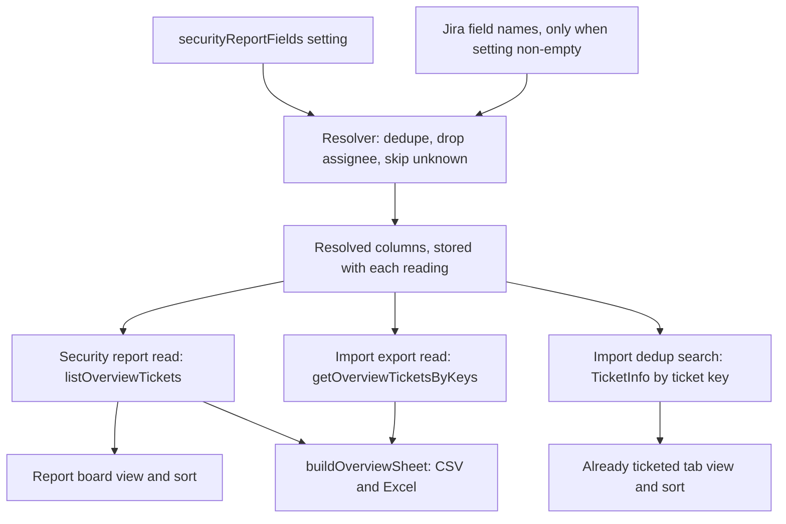

# Security Report Extra Columns - Plan

GitHub issue: [rbreunung/ticket-sidekick#134](https://github.com/rbreunung/ticket-sidekick/issues/134), "Add column to security-report".

## Goal Capsule

- **Objective:** A person reading the security report or the import board can see who owns each open Veracode or Waltz ticket without opening Jira, and can add further Jira fields as columns when their team needs them.
- **Means:** Assignee becomes a built-in column and one new setting lists extra field ids, both shared by four places (KTD2).
- **Authority:** The Product Contract below wins on behavior, the Key Technical Decisions win on mechanism, and `CLAUDE.md` wins on repo conventions (vscode-free modules, docs and tests in the same PR).
- **Execution profile:** One pull request, seven units. `ce-work` or a developer finishes and ships it. Nothing here needs a separate approver or a production step before the rest.
- **Stop conditions:** Stop and ask if a Jira field shape cannot be rendered to text without field-specific code, or if keeping stored sessions readable turns out to need a stored-format bump (KTD4).

---

## Product Contract

### Summary

The security report, its CSV and Excel exports, the import board's overview export and the import board's Already ticketed tab each get an Assignee column. A new setting, `ticketSidekick.jira.securityReportFields`, adds more Jira fields as columns to the same four places. Assignee and the extra columns sort by clicking the title in natural order on the security report, the ticket list and the Already ticketed tab.

### Problem Frame

Someone who follows security tickets for a release sees the ticket, status, Due Date and flag, but not who owns it, and opens each ticket in Jira to find out. The ticket list already offers extra columns through `ticketSidekick.jira.searchFields`, so the need is known. Teams also differ in what they track (a team, a sprint, a custom field), so a fixed list of columns would not settle it. Sorting matters because an owner is only useful when the report can be grouped by owner.

### Key Decisions

- **Assignee is a built-in column, and the setting defaults to empty.** (session-settled: user-directed — chosen over making `["assignee"]` the setting's default value: Assignee should always be there, and the setting should only add.) Governs R1, R2.
- **One new setting for all four places.** (session-settled: user-directed — chosen over reusing `searchFields`, which would tie the report to the ticket list's columns, and over an own setting per place.) Governs R2, R5.
- **Extra columns sort in natural order on the security report, the ticket list and the Already ticketed tab.** (session-settled: user-directed — chosen over plain text order and over field-aware sorting by type: "Team 2" before "Team 10" without interpreting field types.) Governs R6, R7.
- **On the Already ticketed tab every data column sorts.** (session-settled: user-directed — chosen over sorting only the extra columns: a mix of sortable and unsortable data columns looks inconsistent.) Governs R7.
- **The columns are display only, with no filtering.** (session-settled: user-directed — a filter by assignee was weighed and declined.) Governs R4.
- **An unknown field id is skipped and logged.** (session-settled: user-directed — chosen over an empty column and over refusing the board; a one-line notice was weighed and declined.) Governs R3.
- **Stored sessions will hold assignee names and extra values, and the manual says so.** (session-settled: user-approved — chosen over reading names from Jira at every open, which costs a Jira call per open and complicates the stored format.) Governs R9, R11.

### Requirements

**Columns**

- R1. Assignee, shown as the person's display name or "Unassigned", is a built-in column on the security report board, in its CSV and Excel exports, in the import board's overview export and on the Already ticketed tab.
- R2. `ticketSidekick.jira.securityReportFields` (a list of Jira field ids, default empty) adds one column per field to the same four places, titled with the field's name in Jira and rendered as the ticket list renders `searchFields` values.
- R3. Listing `assignee` again or repeating an id adds no second column. An id Jira does not know is skipped and logged once per read. A failure to read field names leaves Assignee alone, is logged, and does not fail a read or an export.
- R4. The columns are display only. They add no filter and have no effect on row actions, rewrite plans or ticket writes. A row with no Jira ticket (a report-only row) shows empty cells.
- R5. The setting is read when a board reads Jira. A change shows after Refresh or after the board is opened again.

**Sorting**

- R6. Assignee and each extra column sort by clicking the column title, using the board's existing cycle (ascending, descending, off) where one exists, on the security report and on the ticket list (its extra columns, from `searchFields` and `cleanupFields`).
- R7. On the Already ticketed tab, Ticket, Finding, Change, Action, Assignee and the extra columns sort the same way. Pick and Result do not. Sorting changes only what is shown: it does not change the order of writes, the preview or which rows are picked.
- R8. Sorting is natural and case-insensitive (digit runs compare as numbers, so "Team 2" comes before "Team 10"), and empty values come last in both directions. A sort on a column that no longer exists is dropped on Refresh, and a sort request for an unknown column is refused.

**Stored data, safety and docs**

- R9. Boards saved before this change open and work. New values appear after Refresh, and a value that was never read is shown differently from "Unassigned". Existing import choices survive.
- R10. Values from Jira are untrusted. The board shows them as text, the CSV guards formula prefixes, the Excel file stores them as text, and each value is cut at a fixed length when read.
- R11. The settings reference lists the setting with its default. The manual describes the columns, the sorting and the setting's effect on the four places, and says that stored sessions now hold assignee names and configured extra values.

### Acceptance Examples

- AE1. Covers R1, R3. Given a project with an unassigned Waltz ticket and the setting empty, the security report shows "Unassigned" in the Assignee column and the CSV has the same value.
- AE2. Covers R2, R3. Given the setting `["customfield_10020", "customfield_9999", "assignee"]` where the second id is unknown, the report shows Assignee once and the field named for `customfield_10020`, and the Output channel has one warning naming `customfield_9999`.
- AE3. Covers R8. Given Assignee values "Team 10", "Team 2" and an empty value, ascending order is Team 2, Team 10, empty, and descending order is Team 10, Team 2, empty.
- AE4. Covers R7. Given an Already ticketed tab sorted by Action, when a person changes one row's action, the row stays where it is until the next time the person clicks a title or refreshes.
- AE5. Covers R9. Given an import board saved before this change with choices made, opening it after the update shows the new columns as "—" until Refresh and keeps the choices.

### Scope Boundaries

- Filtering or grouping by the new columns is outside this plan.
- The New and Stale tabs of the import board and the email import are outside this plan.
- Considered and not built: a notice on the board that a configured field id was dropped (the log carries it, as it does for `searchFields`); marking a board out of date when the setting changes (Refresh is enough, and `searchFields` behaves the same); a limit on how many field ids can be listed; a live-region announcement of a sort change beyond the existing `aria-sort` markers. Evidence that would change the call: users reporting a silently dropped column, or a setting change that leaves an export half-updated.

---

## Planning Contract

### Key Technical Decisions

- KTD1. **One shared resolver and one comparator for all four surfaces.** A vscode-free module resolves the configured ids against Jira's field names (dedupe, drop `assignee`, skip and log unknown ids, one `getFields` call only when the setting is non-empty) and renders values to plain text. A second vscode-free module holds the natural comparator. The ticket list calls the same resolver with a "keep unknown ids" option so its existing behavior and tests do not change. Governs R2, R3, R8.
- KTD2. **Assignee is built in, and extras are keyed by field id.** `OverviewTicket`, `OverviewRow`, `DedupTicket` and `TicketInfo` gain optional `assignee` and `extra` (field id to text). `buildOverviewSheet` keys cells by column id instead of title, because an extra field named "Status" or "Flag", or two fields with the same name, would otherwise overwrite another column. Governs R1, R2. (session-settled: user-directed — one setting, built-in Assignee.)
- KTD3. **Natural order is a fixed-locale collator, empty last in both directions.** The comparator uses `Intl.Collator('en', { numeric: true, sensitivity: 'base' })` so results do not depend on the user's machine. Empty means `''`, null, undefined or only whitespace. The empty rule is applied outside the direction flip, because the existing comparators negate the whole result for descending and would put empties first. Extra values are stored as raw `''` when empty, not as the words "Not set", "None" or "Unassigned" the ticket list's display text uses. Governs R8. (session-settled: user-directed — chosen over plain text order and field-aware sorting.)
- KTD4. **No `formatVersion` bump; new fields are optional and "not read" differs from empty.** A bump rebuilds a stored board from its recipe and drops the import board's choices. Instead the stored values are optional, and a ticket whose `assignee` is `undefined` renders as "—" and sorts as empty, while `''` renders as "Unassigned". Refresh fills the values in. Governs R9.
- KTD5. **Columns are resolved when a board reads and stored with that reading.** The board, both exports and the Already ticketed tab then use the same column list until the next Refresh, so a setting change shows everywhere at once after Refresh. The import board's background check keeps its stored export, so a changed setting also needs Refresh there. Governs R5.
- KTD6. **Column position: on the security report board Assignee sits between Ticket and Due and the extras follow Flag; on the Already ticketed tab Assignee and the extras follow Change; the file exports append Assignee and the extras after the existing columns.** (The report has no Status column: status is shown inside the Ticket cell.) Appending to the files keeps every existing column position stable for people with saved Excel macros or pivots. The sentence in `docs/manual/report-imports.md` that says Members is the last column changes accordingly. Governs R1, R2.
- KTD7. **Values are rendered in full and cut by length.** The extras use `renderFieldValue`'s per-type rendering, but a list value is joined whole with "; " instead of cut at three items with "(+N more)", which `renderFieldValue` itself does and the ticket list shows. The new renderer wraps `renderFieldValue` for non-list values and leaves its output for the ticket list unchanged. Each stored value is whitespace-collapsed and cut at a fixed length (500 characters) at read time, which also keeps every cell under Excel's 32,767-character limit. Governs R10.
- KTD8. **Sort ids for extras are `extra:<fieldId>`, validated against the stored columns.** The security report's whitelist of sort columns becomes the fixed list plus the stored extras, `reconcile` drops a sort whose column vanished, and the ticket list re-validates its sort when its column set switches between `searchFields` and `cleanupFields`. Governs R6, R8.
- KTD9. **The Already ticketed order is fixed when a title is clicked or the board refreshes.** The handler stores the ordered row ids with the sort state and the view applies them. Sorting by Action therefore does not move a row while a person edits its action. Ordering is presentation only: the write units still iterate in review order. Governs R7. (AE4)
- KTD10. **The import board has two data paths and both carry the new data.** The Already ticketed tab reads the dedup search into `TicketInfo`, keyed by ticket key. The overview export reads `getOverviewTicketsByKeys` into `export.tickets`. `compose()` must take both from the same reading so a partial refresh cannot mix old and new columns (KTD5). Governs R1, R2, R5.

### High-Level Technical Design

Every Jira search already asks for `assignee`, so the built-in column needs no new request. Only the configured field ids are added to the searches.

### Assumptions

- An unassigned ticket's assignee is `''` after mapping, and a deactivated user keeps the display name Jira returns. This follows the ticket list's `textOf` and has not been checked against a live Jira (KL13, KL17).
- Team-type custom fields on Data Center may use a `title` key that `renderFieldValue` does not read. If one renders empty, the plan's tests show it and the fix is one more key in that renderer.

---

## Implementation Units

### U1. Natural comparator and shared extra-column resolver

**Goal:** One pure comparator and one resolver that every later unit calls.

**Requirements:** R2, R3, R8, R10. KTD1, KTD3, KTD7.

**Dependencies:** none.

**Files:**
- Create `src/utils/naturalCompare.ts`, `src/test/naturalCompare.test.ts`
- Create `src/services/extraColumns.ts`, `src/test/extraColumns.test.ts`
- Modify `src/boards/ticketList/jiraDeps.ts` (call the resolver, keep unknown ids on the ticket list)

**Approach:**
- The comparator takes two optional strings and a direction. It orders empties last regardless of direction, then compares with the fixed-locale numeric collator, then leaves ties to the caller's stable order.
- The resolver takes the configured ids, a field-name loader and an `onDiag`. It returns the columns (id, name, meta) for ids Jira knows. It ignores non-string, blank and repeated ids and `assignee`, calls the loader only when at least one id is left, logs `Unrecognized field in securityReportFields: <id>` once per call, and returns no extras (logging the failure) when the loader throws.
- Move `plainFieldText` and the "keep unknown ids" ticket list behavior behind the resolver's options. The ticket list's existing messages and tests stay as they are.
- A value renderer turns a field value into text: `renderFieldValue` per type, lists joined whole with "; ", whitespace collapsed, cut at 500 characters, empty returned as `''`.

**Patterns to follow:** `TicketService.renderFieldValue` and `buildExtraFieldColumns`; `ticketListJiraDeps.extraColumns` (`src/boards/ticketList/jiraDeps.ts`); the `src/services/configValidation.ts` style for pure helpers.

**Test scenarios:**
- Natural order: ["Team 10", "Team 2", ""] ascending gives Team 2, Team 10, empty; descending gives Team 10, Team 2, empty.
- Case and accents: "alice" and "Alice" compare equal, and the original order is kept for equal values.
- Whitespace-only and null values count as empty.
- Resolver: `["customfield_1", "assignee", "customfield_1"]` gives one column, with the field's name as its title.
- Resolver: an unknown id is skipped, and `onDiag` receives one warning with `fieldId`.
- Resolver: an empty list never calls the field-name loader.
- Resolver: a loader that throws returns no extras and logs an error, and does not throw.
- Value renderer: a three-item label list renders all three joined with "; "; a 2,000-character value is cut at 500; a value with line breaks collapses to one line; an empty list renders `''`.
- Ticket list regression: the existing extra-column tests in `src/test/ticketListJira.test.ts` still pass, including the asserted order of requested fields and the unknown-id column.

**Verification:** The new unit tests pass and the ticket list's tests are unchanged.

---

### U2. The setting and its documentation entry

**Goal:** `ticketSidekick.jira.securityReportFields` exists, is read everywhere with a safe default, and is documented where `userDocsSync.test.ts` looks.

**Requirements:** R2, R5, R11. KTD5.

**Dependencies:** none.

**Files:**
- Modify `package.json` (setting next to `searchFields` and `cleanupFields`, type array of strings, default `[]`)
- Modify `src/services/ConfigService.ts` (`JiraConfig.securityReportFields`, read with `?? []`)
- Modify `docs/manual/settings-reference.md` (table row with default `` `[]` `` and an "Optional: security report columns" subsection, following the `searchFields` pattern)
- Test: `src/test/userDocsSync.test.ts` (existing, covers the setting automatically)

**Approach:**
- The setting's description says that Assignee is always shown, that the listed fields are added after it on the security report, the import board's Already ticketed tab and both overview exports, and that a change shows after Refresh.
- Every consumer reads the list as `config.securityReportFields ?? []`, because test configs supply only part of `JiraConfig`.

**Patterns to follow:** the `searchFields` entry in `package.json` and `docs/manual/settings-reference.md`.

**Test scenarios:**
- `userDocsSync.test.ts` passes with the setting declared in `package.json` and listed with default `[]` in the settings reference.
- A consumer given a config without `securityReportFields` treats it as an empty list (covered in U3 and U4 scenarios).

**Verification:** `npm test` passes the docs sync test; the setting appears in VS Code's Settings screen with its description.

---

### U3. Security report board: data, column, sorting

**Goal:** The security report shows Assignee and the configured extras and sorts them.

**Requirements:** R1, R2, R4, R6, R8, R9, R10. KTD2, KTD3, KTD4, KTD5, KTD7, KTD8.

**Dependencies:** U1, U2.

**Files:**
- Modify `src/services/TicketService.ts` (`OverviewTicket` gets optional `assignee`, `extra`; `toOverviewTicket` maps them; `listOverviewTickets` and `getOverviewTicketsByKeys` take the resolved columns and pass their ids as extra fields)
- Modify `src/utils/securityOverview.ts` (`OverviewRow` and `OverviewInput` carry assignee, extras and the column list; report-only rows get empty values)
- Modify `src/boards/securityReport/kind.ts` (read resolves columns, stores them with the reading; view has `columns` and per-row `values`; sort whitelist plus `extra:<id>`; `reconcile` drops a vanished sort column)
- Modify `src/boards/registerBoards.ts` (the report's Jira dependency also supplies the configured ids and a field-name loader)
- Modify `board-pages/security-report/page.js` (Assignee between Ticket and Due and the extra columns after Flag, each with `sortHeader`; a scroll wrapper like the import page's `.table-wrap`, in `board-pages/shared/board.css`)
- Test: `src/test/TicketService.test.ts`, `src/test/securityOverview.test.ts`, `src/test/securityReportBoard.test.ts`, `src/test/helpers/overviewFixtures.ts`

**Approach:**
- New `OverviewTicket` and `OverviewRow` properties are optional, so existing fixtures and tests compile, and a stored session from before the change reads as "not read" (KTD4).
- The board view marks a ticket with `assignee === undefined` as "—" and `''` as "Unassigned"; both sort as empty.
- The sort comparator is the U1 comparator, applied within each Fix Version table as today.

**Patterns to follow:** the existing `sortHeader` and `view.columns` handling in `board-pages/ticket-list/page.js`; the `reconcile` clearing of a release filter in `src/boards/securityReport/kind.ts`.

**Test scenarios:**
- Covers AE1. An unassigned ticket shows "Unassigned" and an assigned one its display name; a report-only row shows empty cells.
- Covers AE2. With `["customfield_10020", "customfield_9999", "assignee"]`, the view has Assignee once and one extra column; one warning is logged for the unknown id.
- `listOverviewTickets` passes the extra field ids to the search (asserted on the captured search arguments) and passes none when the setting is empty, with no field-name call.
- Covers AE3. Sorting by Assignee ascending and descending gives the natural, empty-last order in each Fix Version table.
- Sorting by an extra column works; a sort request for `extra:nope` or `column: 'nope'` is refused.
- `reconcile` after the setting removed an extra column drops a sort that named it and keeps a sort on a built-in column.
- Covers AE5. A stored session whose tickets have no `assignee` opens without error and shows "—".
- A value containing `<b>x</b>` and a formula prefix is shown as text in the view data (the page uses `textContent`).
- The view's column order is Source, Item, Rating, Ticket, Assignee, Due, Flag, then the extras.

**Verification:** The security report scenario tests pass, including the existing sort and reconcile tests; the board shows the new columns when run by hand against a project.

---

### U4. Overview sheet and exports

**Goal:** Both exports carry Assignee and the extras, keyed safely, for the security report and the import board.

**Requirements:** R1, R2, R3, R4, R10. KTD2, KTD6, KTD7, KTD10.

**Dependencies:** U3.

**Files:**
- Modify `src/utils/securityOverviewColumns.ts` (cells keyed by column id; Assignee and extras appended after the existing columns; extras repeated on each Veracode finding record)
- Modify `src/utils/securityOverviewCsv.ts`, `src/utils/securityOverviewXlsx.ts` (only if they read titles for lookup; otherwise unchanged)
- Modify `src/boards/import/read.ts`, `src/boards/import/jiraDeps.ts`, `src/boards/import/searchExport.ts` (the export read passes the resolved columns; `overviewOf` hands them to the sheet)
- Test: `src/test/securityOverviewColumns.test.ts`, `src/test/securityOverviewCsv.test.ts`, `src/test/securityOverviewXlsx.test.ts`, `src/test/importBoardExport.test.ts`

**Approach:**
- Sheet columns carry a stable id: the existing columns keep a fixed id each, extras use their field id with an `extra:` prefix, and the title is only the heading. Two extras with the same name produce two columns with the same heading.
- This unit owns the import board's column plumbing. `read` resolves the columns once and stores the list on the stored reading (`ImportData`) beside `export` and `ticketInfo`; `compose()` takes all three from the same reading, so a partial refresh cannot leave them on different lists (KTD5, KTD10). U5 consumes the stored list.
- The import export read is `data.export.tickets`; it receives the extras from that stored list.
- The sheet's column count and the Excel autofilter and widths follow from the column list, as they do today.

**Patterns to follow:** `LEAD_COLUMNS` and `buildOverviewSheet` in `src/utils/securityOverviewColumns.ts`; the `csvCell` formula guard in `src/utils/securityOverviewCsv.ts`.

**Test scenarios:**
- Column order: the existing columns keep their positions, then Assignee, then the extras (the test that asserts column order is updated, not loosened).
- An extra field named "Status" and two extras with the same name each produce their own column with correct values.
- A hostile value (leading `=`, `+`, `-`, `@`, a tab, a quote, a line break) is guarded in the CSV and stored as text in the Excel file, in Assignee and in an extra.
- Covers AE1. An unassigned ticket exports "Unassigned"; a stale or tracked ticket on the import board exports its assignee; a report-only row exports empty cells.
- A Veracode ticket with three findings repeats Assignee and the extras on all three records; a Waltz ticket gives one record.
- A 40,000-character value is cut before it reaches the Excel cell.
- With the setting empty, the export has Assignee and no extras.

**Verification:** Export tests pass for CSV and Excel from both boards; opening an exported file in Excel by hand shows the columns in the expected order.

---

### U5. Import board: Already ticketed tab data, columns and sorting

**Goal:** The Already ticketed tab shows Assignee and the extras and sorts all its data columns.

**Requirements:** R1, R2, R4, R7, R8, R9, R10. KTD2, KTD4, KTD5, KTD8, KTD9, KTD10.

**Dependencies:** U1, U3, U4.

**Files:**
- Modify `src/imports/review.ts` (the dedup search asks for the extra ids beside `resolution`, `created` and `duedate`; `ImportReviewInput` carries the resolved columns and a value renderer)
- Modify `src/utils/reportImport.ts` (`JqlIssueLike`, `DedupTicket`, `toDedupTicket`, `TicketInfo`, `buildTicketInfo` carry optional `assignee` and `extra`)
- Modify `src/imports/types.ts` (`ReviewSession.ticketInfo` type)
- Modify `src/boards/import/kind.ts` (`compose()` takes `ticketInfo` and `export` from one reading; `TicketedRowView` gets `assignee`, `extra`; the view applies the stored order)
- Modify `src/boards/import/ticketedTab.ts` (a `ticketed-sort` action, sort state and ordered ids in `TicketedState`)
- Modify `board-pages/import/page.js` (a `sortHeader` for Ticket, Finding, Change, Action, Assignee and the extras; Pick and Result stay plain; `aria-sort`)
- Test: `src/test/importBoardTicketed.test.ts`, `src/test/importBoardPage.test.ts`, `src/test/importBoardParity.test.ts` (ledger row if needed), `src/test/helpers/importBoardFixture.ts`

**Approach:**
- Values are rendered and capped in the board dependency that already has `TicketService`, before they reach the stored reading.
- The handler computes the order when `ticketed-sort` arrives or the board refreshes and stores the ordered row ids; the view maps rows to that order and falls back to review order. `unitsOf` and the preview keep iterating in review order.
- Sort keys: Ticket by the target key (natural, so PROJ-9 before PROJ-10), Finding by its reference and summary, Change by its description, Action by its shown label, Assignee and extras by stored value.
- The new `sortHeader` in `board-pages/import/page.js` copies the security report's pattern: a `button.sort` inside a `th` with `scope="col"` and `aria-sort`, a stable button id such as `sort-ticketed-<column>` (the shared page code restores keyboard focus by element id after a repaint), the ▲/▼ indicator, and disabled while the board is locked, as the ticket list's headers are.
- An assignee change bumps Jira's `updated`, so the tab's existing out-of-date marking still fires.

**Patterns to follow:** `ticketed-filter` handling and `withState` in `src/boards/import/ticketedTab.ts`; `sortHeader` in `board-pages/security-report/page.js`.

**Test scenarios:**
- The dedup search asked for the configured ids, and for none beyond today's when the setting is empty (the fake records the extra-field argument).
- Covers AE4. With the tab sorted by Action, choosing another action on one row leaves the row in place; clicking the title again reorders.
- Sort by Ticket orders PROJ-9 before PROJ-10; sort by Assignee orders empties last in both directions; the third click returns to review order.
- Sort by Pick or Result is refused; an unknown column is refused.
- A sort does not change which rows Apply writes or the order of the preview lines.
- Covers AE5. A board saved before the change (no `assignee` in `ticketInfo`) opens with "—" and with its choices kept; after Refresh the values appear.
- A partial refresh (one tab changed) does not leave the tab and the stored export on different column lists.
- Page: the new headers are buttons with `aria-sort`, a click posts `{ type: 'ticketed-sort', ... }`, focus is still on the clicked header after the repaint, the buttons are disabled while the board is locked, values containing markup render as text.

**Verification:** Import board scenario and page tests pass, including the parity test; by hand, sorting a real Already ticketed tab keeps the picks and choices.

---

### U6. Ticket list: sortable extra columns

**Goal:** The ticket list's extra columns sort in natural order and empty values come last.

**Requirements:** R6, R8. KTD3, KTD8.

**Dependencies:** U1.

**Files:**
- Modify `src/boards/ticketList/kind.ts` (`SortColumn` adds `extra:<id>`; `sortValue` and `orderedRows` use the comparator; a sort is re-validated when `working.columns` switches; the page index resets to 0 on a sort change)
- Modify `board-pages/ticket-list/page.js` (extra headers use `sortHeader`)
- Test: `src/test/ticketListBoard.test.ts`

**Approach:**
- Extra values are stored raw (`''` when empty) in `TicketRow.extra`, not as "Not set" or "None"; the display layer supplies those words.
- The built-in Assignee column adopts the same empty-last rule, which changes today's behavior where an unassigned ticket sorts first. The key sort (`PROJ-9` before `PROJ-10`) is kept and routed through the same comparator.

**Patterns to follow:** the existing `sortValue` and 3-click cycle in `src/boards/ticketList/kind.ts`.

**Test scenarios:**
- Sorting by an extra column orders "Team 2" before "Team 10" across pages (sorting is applied to the whole list before paging).
- Empty extras and unassigned tickets sort last ascending and descending.
- A sort on an extra column is dropped when a proposed move switches the board from the `searchFields` set to the `cleanupFields` set.
- Sorting resets the page to the first page.
- Existing test: ticket keys still sort by number.

**Verification:** `src/test/ticketListBoard.test.ts` passes, including the existing extra-column and key-sort tests.

---

### U7. Documentation and manual checks

**Goal:** The manual, the developer docs and the checklists match the new behavior.

**Requirements:** R11. KTD6.

**Dependencies:** U3, U4, U5, U6.

**Files:**
- Modify `docs/manual/boards.md` (Security report, Ticket list extra columns and sorting, Already ticketed, the sessions paragraph that lists what is stored)
- Modify `docs/manual/report-imports.md` (the security report column table, the Already ticketed description, the export-column paragraph that calls Members the last column)
- Modify `docs/report-import.md` (the export built from the stored reading, the security overview model, the Already ticketed data path)
- Modify `docs/jira-flows.md` (the paragraph on `searchFields` and `cleanupFields`: add the new setting)
- Modify `CLAUDE.md` (key-file lines for `TicketService`, `securityOverviewColumns.ts` and the two new modules, one line each)
- Modify `docs/architecture/migration-status.md` (the Boards row capability list and the date), `docs/architecture/manual-checklist.md` (a check for the new columns and sorting, including a restart of a stored board per KL26)

**Approach:** State what a person sees, what a change of the setting needs (Refresh), that unknown field ids are logged and skipped, and that stored sessions hold assignee names and configured extra values. Do not edit `CHANGELOG.md`; it is generated from release notes, so the pull request title uses `feat(boards): ...`.

**Test expectation:** none -- documentation only; `userDocsSync.test.ts` already covers the setting and the Jira tool catalog.

**Verification:** `npm test` passes the docs sync test; a read-through of each changed page matches the behavior in U3 to U6.

---

## Verification Contract

| Gate | Command or check | Applies to |
|---|---|---|
| Type check | `npm run compile` | All units |
| Unit and scenario tests | `npm test` (must be green before every commit) | All units |
| Docs sync | `src/test/userDocsSync.test.ts` inside `npm test` | U2, U7 |
| Bundle smoke | `src/test/bundleSmoke.test.ts` inside `npm test` (no new tool or command, so only a regression check) | All units |
| Manual, Data Center and Cloud | Open the security report and an import board against a real project: Assignee shows, one configured custom field shows, sorting works, an unknown id is only logged, CSV and Excel open with the columns appended. Restart VS Code with a stored board and open it (KL26 is not covered by automated tests). | U3 to U6 |

## Definition of Done

- All requirements R1 to R11 are covered by a unit and by at least one test scenario or manual check above.
- `npm run compile` and `npm test` are green; the existing sort, extra-column, reconcile and export tests pass unchanged except where a unit says a test's expectation changes (column order, Assignee empty-last).
- Every changed user-visible behavior appears in the manual, the settings reference lists the setting with default `[]`, and the sessions paragraph names assignee names and extra values.
- No dead code from abandoned attempts is left in the diff, and `CHANGELOG.md` is not hand-edited.
- Per unit: U1 comparator and resolver tested; U2 setting declared and documented; U3 security report board shows and sorts the columns; U4 both exports carry them with safe keys; U5 the Already ticketed tab shows and sorts them without changing writes; U6 the ticket list's extras sort; U7 docs and checklists updated.

## Sources and Research

- Existing precedent for extra columns: `src/boards/ticketList/jiraDeps.ts` (`extraColumns`, `plainFieldText`), `src/services/TicketService.ts` (`renderFieldValue`, `buildExtraFieldColumns`), `src/services/ConfigService.ts`.
- Data paths: `src/jira/JiraApiClient.ts` (`searchJql` always requests `assignee`), `src/services/TicketService.ts` (`toOverviewTicket`, `listOverviewTickets`, `getOverviewTicketsByKeys`), `src/imports/review.ts` and `src/utils/reportImport.ts` (dedup search, `toDedupTicket`, `TicketInfo`), `src/boards/import/read.ts` and `kind.ts` (`compose`).
- Sort precedents: `src/boards/securityReport/kind.ts` (`SORT_COLUMNS`, `reconcile`), `src/boards/ticketList/kind.ts` (`sortValue`, `orderedRows`), `src/utils/securityOverview.ts` (the one existing numeric `localeCompare`).
- Learnings and known limits: the session model's format-version rule in `docs/architecture/boards-and-sessions.md`, the sanitizer re-verification rule for new cell sinks, `docs/known-limitations.md` KL13, KL17, KL19, KL26.
- Research dossiers from planning were scratch notes and are not kept in the repository.
