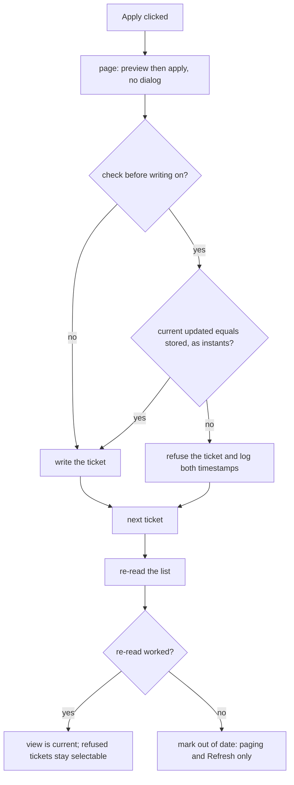

# Cleanup Board Apply Flow - Plan

## Goal Capsule

- **Objective:** On the ticket list, the cleanup board and the import board, a person applies a change with one click and then either sees it written or is told plainly why a ticket was not. Closing tickets is no longer blocked by "changed in Jira" refusals when nothing changed.
- **Means:** A tolerant and logged write check with a board-level off switch, and removal of the plan dialog, the native confirmation, the conflicts banner and the Close button on the ticket list and cleanup board (KTD1, KTD3, KTD4).
- **Product authority:** The Product Contract below wins on behavior, the Key Technical Decisions win on mechanism, and `CLAUDE.md` wins on repo conventions (vscode-free modules, tests and docs in the same change).
- **Execution profile:** One pull request, eight units. The parts share the board client, the session manager and the board pages, so they ship together; nothing needs a separate approver or a production step. `ce-work` or a developer finishes and ships it.
- **Stop conditions:** Stop and ask if the import board's Already ticketed apply cannot tell whether its tab was re-read after a refusal (KTD5), or if a stored session of the old format fails to load once the conflicts field is gone (KTD6).

---

## Product Contract

Product Contract preservation: changed, no other scope change. R1, R2, R5 now cover the import board's Already ticketed check; R6 gains a qualifier (merge and add-to-ticket keep one preview); R11 marks a view out of date only when it was not re-read; R14 and R15 are replaced (a list opens fresh; a restored tab keeps its session); AE2 is reworded and R17 and AE7 to AE10 are new. These follow the requester's answers while planning.

### Summary

The ticket list and cleanup board get one action line holding the change controls, one Apply button that names its action, Refresh, and a checkbox that turns off the per-ticket "changed in Jira" check. Apply writes at once on those two boards and on the import board, with no plan dialog and no native confirmation. Merge and add-to-ticket on the import board keep one preview for their warnings. The conflicts banner is removed from every board, and a ticket list or cleanup board always opens fresh.

### Problem Frame

On a Data Center Jira, a cleanup of 50 tickets refused every ticket with "changed in Jira since the board read it", including tickets nobody had touched, and repeated attempts gave the same result. The cause is not known. Retrying piled up conflict entries until the banner counted 100 for 50 tickets, and its Drop button only removed a line of text.

Around that failure the Apply flow adds friction. The board already shows the selected tickets and the change, yet Apply opens a plan dialog that lists them again, and a bulk or closing write then asks for a native VS Code confirmation. A Close button duplicates closing the tab. A reopened list can also bring back an old selection and old results. The import board has the same Preview, dialog and confirmation steps. The person using the board wants to select, click once and read the result.

### Key Decisions

- **The false refusals get diagnostics and a tolerant check, not a guess at the cause.** A refusal logs both timestamps, and equal instants never count as a change. Governs R1, R2.
- **The comparison and the log also cover the import board's Already ticketed check, but not the off switch.** It compares the same pair of readings, so it would refuse the same way. Governs R1, R2, R5.
- **The check can be switched off from the board.** This gives a way to keep closing tickets while the cause is open. The default stays on because, once the dialogs are gone, the check is the only guard against overwriting someone else's change. Governs R3, R4.
- **The off switch lives on the board and is remembered across boards and restarts.** A list opens fresh (R14), so a per-session switch would reset every time. Governs R4.
- **The board is the preview.** The Apply button names the action and count, so a plan dialog and a native confirmation add nothing. This reverses decision D11 (native confirmation for risky writes) on the three boards in R6. Governs R6, R7, R16.
- **Merge and add-to-ticket keep one preview.** Their warnings come from reading Jira (tickets that will be closed, a resolved target, findings a rewrite drops), so the board cannot show them before the click. Governs R6.
- **A refusal does not raise a conflict entry, and marks the view out of date only when the list was not re-read.** Apply already re-reads the list, so the view is usually current and the refused tickets stay selectable. Governs R10, R11.
- **A ticket list opens fresh instead of discarding on tab close.** Nothing then depends on detecting why a tab closed, and a tab VS Code restores keeps its session. Governs R14, R15.
- **The email model check keeps its preview and the review board keeps its confirmation.** The first asks for consent to send email text to a language model; the second guards a write to Bitbucket that others read. Governs R8, R9.
- **"Save as pattern" writes at once and never saves a duplicate.** A pattern changes every later email import, so repeating it must be harmless. Governs R6, R17.

### Requirements

**Write check**

- R1. Before writing a ticket, the ticket list, the cleanup board and the import board's Already ticketed check compare the ticket's current `updated` time with the one they read as instants, so two spellings of the same moment are not a change.
- R2. When the check refuses a ticket, it writes the ticket key and both timestamps to the Ticket Sidekick output channel.
- R3. A checkbox on the ticket list and cleanup board, "Check each ticket before writing", is on by default; when off, Apply writes without reading each ticket first.
- R4. The checkbox's state is stored by the extension outside the board session, shared by both boards, kept across restarts, and not offered in the Settings screen; its label or tooltip says that off means a change made by someone else is overwritten unnoticed.
- R5. The import board's Already ticketed check stays always on; the checkbox in R3 does not cover it.

**Apply flow**

- R6. On the ticket list, cleanup board and import board, Apply is one click: there is no Preview step, plan dialog or native confirmation, and the write starts at once with the progress and per-row results the boards show today; merge and add-to-ticket on the import board keep one preview that shows their warnings, still with no native confirmation.
- R7. The Apply button names the action and count, such as "Move 12 tickets to Done"; it reads "Apply" and is disabled when nothing is selected or no change is chosen, and it is disabled while a write runs or the view is out of date.
- R8. The email import's boilerplate cleanup keeps its preview and consent step for the model check.
- R9. The review board's flow, including the confirmation before Post, is unchanged.

**Refusals and out-of-date**

- R10. No board shows a conflicts banner or Drop buttons; the reason a ticket was not written stays in the Apply result message and on its row.
- R11. When a write is refused because a ticket changed in Jira, the board marks the view out of date, so only paging and Refresh stay active and it says why, unless it has re-read its data since the refusal, in which case the view is current and the refused tickets stay selectable.

**Layout, header and opening (ticket list and cleanup board)**

- R12. One action line holds the change controls (the status or field inputs, or the resolution picker on a cleanup board), the Apply button, Refresh, the checkbox from R3, and the selected count at its right end.
- R13. The header has no Close button on these two boards; the other boards keep theirs.
- R14. Opening one of these boards whose tab is not open starts fresh: no selection, no earlier results, and the tickets read again.
- R15. A tab VS Code restores after a restart or reload keeps its session.

**Documentation**

- R16. Everything that describes the preview or native confirmation for these boards is updated in the same change: the architecture doc (decision D11, the threat table, the flow diagram), the boards manual page, `CONCEPTS.md` and the boards paragraph of `CLAUDE.md`.

**Email cleanup patterns**

- R17. Saving an email cleanup pattern adds nothing when an equal pattern is already in `ticketSidekick.email.boilerplatePatterns`, and the result says it was already saved.

### Key Flows

- F1. Close released bugs from a cleanup board
  - **Trigger:** The person opens a cleanup rule and selects tickets on the page in view.
  - **Steps:** The action line shows "Move 12 tickets to Done" with the resolution picker. The person clicks it. Rows show progress and then their results, and one message gives the written count and the tickets not written with reasons.
  - **Outcome:** Written tickets are done. A ticket refused for a change in Jira stays selectable once the board has re-read the list.
  - **Covered by:** R1, R6, R7, R10, R11, R12

### Acceptance Examples

- AE1. **Covers R1, R6.** Given 50 selected tickets whose current `updated` time is the same moment as the board read but spelled differently, when the person clicks Apply, all 50 are written.
- AE2. **Covers R2, R10, R11.** Given one selected ticket was really changed in Jira after the board read it and the board re-reads its list after the write, when the person clicks Apply, that ticket is refused and its key and both timestamps are logged, the other tickets are written, no conflicts banner appears, the view is current, and the refused ticket can be selected again.
- AE3. **Covers R3, R4.** Given the checkbox is off, when the person clicks Apply, tickets are written without a per-ticket read first; after a restart a reopened board still shows the checkbox off.
- AE4. **Covers R7.** Given 12 tickets are selected and the cleanup rule needs a resolution that is not chosen yet, the button is disabled; once chosen it reads "Move 12 tickets to Done".
- AE5. **Covers R13, R14.** Given a cleanup board with tickets selected, when the person closes its tab and opens the same rule again, no tickets are selected and no earlier results show.
- AE6. **Covers R5, R6.** Given a Veracode report on the import board, when the person clicks Apply on the New tab, tickets are created at once with no dialog, and Already ticketed still refuses a ticket that changed in Jira and logs both timestamps.
- AE7. **Covers R11.** Given the same refusal as AE2 but the re-read of the list fails, the view is marked out of date and only paging and Refresh stay active.
- AE8. **Covers R15.** Given a ticket list tab with a selection is open when VS Code restarts, the tab comes back with its selection and shows it is a restored session.
- AE9. **Covers R6.** Given two Waltz tickets picked on Already ticketed, when the person asks to merge, one preview lists the warnings and the tickets that will close, and its Apply writes with no VS Code dialog.
- AE10. **Covers R17.** Given a boilerplate block was saved as a pattern, when the person saves the same block again, no second entry is added and the result says it was already saved.

### Scope Boundaries

Deferred or excluded:

- Finding why the two Jira reads disagree on Data Center. This plan adds the diagnostics only.
- The check toggle on the import board's Already ticketed check.
- Any change to the review board's flow, and to the email model check's preview and consent.
- A Close button change on the import, review, sessions or security report boards.
- Renaming Refresh to "Reload".
- Other cleanup board issues the person finds later; each gets its own pass.

Considered and not built:

- A shutdown flag in `deactivate()` and discard on tab close. The VS Code source shows no panel is disposed before the extension host stops, and opening fresh (R14) makes the question moot; evidence that would change the call is a report of a lost restore.
- Near-duplicate detection for patterns. Only an exact match is skipped (R17); a reworded pattern is a different pattern.

### Dependencies / Assumptions

- The reversal of D11 is at the requester's direction; the decision table records the date and reason (R16).
- The board's own rows, counts and the Apply button's label are enough of a review on the import board; its duplicate check on New and the choices on each tab remain.
- With the check off, the board does not read a ticket after writing it, so it may see its own writes as changes and mark the view out of date after the next check. This is accepted: Refresh is one click and a cleanup's written tickets leave the list anyway.
- Done means the code and the automated tests pass. The manual checklist entries added by R16 are not part of done.

### Outstanding Questions

**Resolve Before Planning**

- None.

**Deferred to Planning**

- Why the search read and the single-ticket read return different `updated` values for every ticket on the reporter's Data Center Jira, or whether another cause applies. It needs the log lines from R2 and a real Jira; the manual checklist carries the run.

### Sources / Research

- Write check: `src/boards/ticketList/kind.ts` (`writeOne`, `differences`), `src/boards/ticketList/jiraDeps.ts` (`search`, `readTicket`), `src/boards/import/ticketedTab.ts` (the `current !== expected` check).
- Plan dialog, conflicts banner and header buttons: `board-pages/shared/board.js` (`showPlan`, `banners`, the header bar), `board-pages/ticket-list/page.js`, `board-pages/import/page.js`.
- Native confirmation and conflict accumulation: `src/sessions/sessionManager.ts` (the `risky` confirm in `apply`, `conflicts` after Apply); the review board's Post is the other user of `risky` (`src/boards/review/findings.ts`).
- Preview content only Jira can supply: `src/boards/import/mergeTab.ts` (`startLines`), `src/boards/import/newTab.ts` (the add-to-ticket warnings).
- Tab disposal and restore: `src/boards/boardPanels.ts`, `src/boards/registerBoards.ts` (panel serializer). The VS Code source (`microsoft/vscode` at `c107bd4`): closing an editor disposes it (`editorGroupView.ts`), `EditorGroupView.dispose()` does not dispose inputs, and the extension host drops incoming messages once `terminate()` disposes its RPC channel (`rpcProtocol.ts`).
- Decisions D11 and D14, the threat table and the flow diagram: `docs/architecture/boards-and-sessions.md`; user manual: `docs/manual/boards.md`.

---

## Planning Contract

### Key Technical Decisions

- KTD1. **Keep the session manager's preview and apply pair and its plan IDs; the page chains them.** A new `board.apply(action)` in the shared client previews and then applies in two requests without opening the dialog, so decision D14 and the review board's Post path stay as they are. Boards drop the native confirmation by returning `risky: false` from their plans. Chosen over one new manager operation that previews and applies together, which would add a second write entry point the review board does not need. Governs R6, R7.
- KTD2. **Merge and add-to-ticket keep `board.preview` and its dialog, with `risky: false`.** The dialog's Apply then writes with no native confirmation. Governs R6.
- KTD3. **One vscode-free helper compares `updated` values as instants.** It parses Jira's offset with and without the colon, compares epoch milliseconds, and falls back to exact string equality when either value does not parse, so it is never looser than today for odd input. Refusals log through the injected `onDiag`. It replaces every `updated` comparison the boards make: the pre-write check in the ticket list, the "changed" difference between the shown and fresh rows (where a value read after a write is compared with a search value), and the import board's Already ticketed check. Governs R1, R2, R5.
- KTD4. **The checkbox is a board preference stored outside the session.** The ticket list's deps gain `checkBeforeWrite()` and `setCheckBeforeWrite(on)`, bound in `registerBoards.ts` over `context.globalState`. The kind puts the value in its view. The page changes it through one new narrow board request, `preference`, which the manager forwards to an optional kind hook that accepts only the names that kind declares. With the check off, the write skips both the read before and the read after the write. Governs R3, R4.
- KTD5. **A refusal marks the view out of date only when the post-Apply read failed.** On the ticket list the existing end-of-Apply `read` is the re-read; if it throws, the refused keys go into `working.outOfDate`. The import board's Already ticketed apply follows the same rule once its post-Apply behavior is read (Stop conditions). Governs R11.
- KTD6. **The conflicts concept is removed, not emptied.** `Conflict`, `BoardState.conflicts`, `Session.conflicts`, the `conflict/drop` action and the banner go. The stored-session check in `src/sessions/sessionStore.ts` stops requiring a `conflicts` array, so existing stored files still load and the extra key is ignored, with no format bump. Governs R10.
- KTD7. **A board kind can ask to open fresh.** `BoardKind` gains an optional `freshOnOpen`; the ticket list kind sets it. `boardPanels` asks the manager to open fresh only when it holds no tab for that session; the panel serializer's restore goes through state requests, which restore as today. Chosen over discarding on `onDidDispose` (see Scope Boundaries). Governs R14, R15.
- KTD8. **A board draws its own action line through a view flag.** `ownActionLine: true`, like the review board's `ownRunLine`, makes the shared header omit Refresh and Close; the ticket list page draws Refresh in its action line. Other boards keep the header unchanged. Governs R12, R13.
- KTD9. **Pattern equality is a vscode-free function next to the pattern builder.** `savePattern` in the VS Code glue skips an equal entry and reports it, and the import board's handler words the result. Governs R17.

### High-Level Technical Design

Apply on the ticket list and cleanup board after this change. The diamonds are the three decisions that change what the person sees.

---

## Implementation Units

### U1. Compare `updated` as instants and log refusals

- **Goal:** Replace the raw string comparison of `updated` times with one tolerant helper and log the pair on refusal.
- **Requirements:** R1, R2, R5.
- **Dependencies:** none.
- **Files:** create `src/utils/updatedTime.ts` and `src/test/updatedTime.test.ts`; modify `src/boards/ticketList/kind.ts`, `src/boards/import/ticketedTab.ts`, `src/test/ticketListBoard.test.ts`, `src/test/importBoardTicketed.test.ts`.
- **Approach:**
  - The helper parses `YYYY-MM-DDTHH:mm:ss.SSS` with an offset written `+0100` or `+01:00`, returns epoch milliseconds, and exposes one function that answers whether two strings are the same instant (KTD3).
  - Use it in `writeOne`, in `differences` for both comparisons, and in the Already ticketed check; each refusal logs the key and both strings through `onDiag`.
  - The import deps already expose `onDiag`. The ticket list's deps type does not: add an optional `onDiag` to it and to what `ticketListJiraDeps` returns, from the option it already receives.
- **Execution note:** Start with the helper's tests, using the offset spellings Jira Data Center and Cloud produce.
- **Patterns to follow:** `src/utils/calendarDate.ts` (pure parsing helper) and its test.
- **Test scenarios:**
  - Covers AE1. `2026-05-01T10:00:00.000+0100` and `2026-05-01T10:00:00.000+01:00` are the same instant.
  - The same wall time with a different offset (`+0200`) is not the same instant.
  - Two values that differ by one millisecond are different.
  - A value that does not parse equals only an identical string, and differs from a parsable one.
  - An empty string equals an empty string and nothing else.
  - Covers AE2. `writeOne` with a changed ticket refuses it, and the log call carries the key and both timestamps; with no logger given it still refuses.
  - `differences` does not report a ticket this board wrote when the after-write value and the search value are the same instant spelled differently.
  - The Already ticketed apply refuses a changed ticket with the same logged pair, and writes one whose spelling differs only.
- **Verification:** The ticket list and Already ticketed checks treat equal instants as unchanged, and every refusal leaves a log line with both values.

### U2. The "Check each ticket before writing" checkbox

- **Goal:** Add the stored preference and have the ticket list's write path honor it.
- **Requirements:** R3, R4, R5.
- **Dependencies:** U1.
- **Files:** modify `src/sessions/boardKind.ts`, `src/sessions/sessionManager.ts`, `src/boards/boardMessages.ts`, `src/boards/ticketList/kind.ts`, `src/boards/ticketList/jiraDeps.ts`, `src/boards/registerBoards.ts`, `board-pages/shared/board.js`; tests `src/test/boardMessages.test.ts`, `src/test/ticketListBoard.test.ts`, `src/test/ticketListJira.test.ts`, `src/test/boardClient.test.ts`.
- **Approach:**
  - Add the optional kind hook for preferences and the `preference` request (KTD4); the manager refuses names the kind does not declare.
  - `writeOne` reads `checkBeforeWrite()` once per Apply; when off it skips the read before the write and the read after it.
  - The view carries the current value for the page. The checkbox itself is drawn in U4.
  - `registerBoards.ts` binds the deps over `context.globalState` with one key, default on.
- **Patterns to follow:** `TokenUsageService` over `globalState` in `src/utils/tokenUsage.ts` for the stored value.
- **Test scenarios:**
  - Covers AE3. With the preference off, `writeOne` calls move once and `readTicket` zero times.
  - With the preference on, `readTicket` is called before and after the write.
  - The preference request with an unknown name is refused with a 400.
  - The preference request with the known name stores the value and the next state shows it.
  - The stored value survives a new manager (restart) because it lives in the deps' store, not the session.
  - A request from the import board for this preference is refused, since that kind declares none (R5).
- **Verification:** The value changes only through the request, survives a new session, and switches both reads off.

### U3. Remove the conflicts concept and mark out of date after a failed re-read

- **Goal:** Delete the banner, the Drop action and the conflict plumbing, and apply R11 on both boards.
- **Requirements:** R10, R11.
- **Dependencies:** U1.
- **Files:** modify `board-pages/shared/board.js`, `src/sessions/sessionManager.ts`, `src/sessions/boardKind.ts`, `src/sessions/sessionTypes.ts`, `src/sessions/sessionStore.ts`, `src/boards/ticketList/kind.ts`, `src/boards/import/ticketedTab.ts`, `src/boards/import/kind.ts`, `src/boards/review/kind.ts`, `src/boards/securityReport/kind.ts`; tests `src/test/sessionManager.test.ts`, `src/test/sessionConstraints.test.ts`, `src/test/boardClient.test.ts`, `src/test/ticketListBoard.test.ts`, `src/test/importBoardTicketed.test.ts`, `src/test/boardMessages.test.ts`.
- **Approach:**
  - Remove the type, the state field, the manager's merge of reconcile conflicts and Apply conflicts, the `conflict/drop` action, and every `conflicts: []` in the kinds' `reconcile` results (KTD6).
  - Loosen the stored-session validity check so a stored file with or without the key loads.
  - On the ticket list, when a refusal says the ticket changed and the end-of-Apply `read` throws, set `outOfDate` from the refused keys; when it succeeds, do nothing (KTD5).
  - On Already ticketed, read how the tab is re-read after an Apply and follow the same rule; this is the Stop condition.
- **Execution note:** Characterize the current stored-session load first, so the loosened check is proven against an old file that has a `conflicts` array.
- **Test scenarios:**
  - Covers AE2. A refusal followed by a successful re-read leaves `outOfDate` empty and the refused ticket selectable.
  - Covers AE7. A refusal followed by a failing re-read sets `outOfDate` with the refused key.
  - A repeated Apply that refuses the same 50 tickets leaves no accumulated entries anywhere in the state.
  - A stored session written by the old version, with a `conflicts` array, loads and works.
  - A stored session without the key loads.
  - The `conflict/drop` action is now an unknown action and is refused.
  - The shared page renders no conflicts section for any state.
- **Verification:** Nothing in the source or the pages names conflicts any more, and an old stored session still opens.

### U4. One-click Apply on the ticket list and cleanup board, one action line

- **Goal:** Add `board.apply`, drop the Preview step on these boards, build the action line and remove the header's Close button for them.
- **Requirements:** R6, R7, R12, R13.
- **Dependencies:** U2, U3.
- **Files:** modify `board-pages/shared/board.js`, `board-pages/ticket-list/page.js`, `src/boards/ticketList/kind.ts` (plans return `risky: false`, view flag `ownActionLine`, button label data); tests `src/test/boardClient.test.ts`, `src/test/ticketListBoard.test.ts`, `src/test/ticketListCleanup.test.ts`, `src/test/sessionManager.test.ts`.
- **Approach:**
  - `board.apply(action)` previews and applies without `showPlan` and shows the same progress and result message the dialog's Apply shows now (KTD1); `board.preview` stays for the boards that keep it.
  - The ticket list view exposes the button's text (action, count, resolution state) so the page only draws it. The page draws one bar: change controls or resolution picker, Apply, Refresh, the checkbox, the selected count (KTD8).
  - Plans in `kind.ts` set `risky: false`; the manager's confirmation code stays for the review board.
- **Patterns to follow:** `ownRunLine` handling in `board-pages/shared/board.js` and `src/boards/review/kind.ts`.
- **Test scenarios:**
  - Covers AE4. The cleanup view's button text and disabled state for no selection, no resolution chosen, and a chosen resolution.
  - A plain list's button reads "Apply" with no change chosen and "Move 5 tickets to Done" with one.
  - The button is disabled while `applying` is set and while the view is out of date.
  - Covers AE1. `board.apply` calls preview then apply and never opens a dialog; a declined or failed preview shows its message.
  - A ticket list plan with several tickets and one that closes both come back with `risky: false`, so the manager never asks for a native confirmation.
  - The review board's Post plan still comes back risky and still asks (R9).
  - With `ownActionLine`, the header has neither Refresh nor Close; for every other board it still has both.
- **Verification:** On the ticket list and cleanup board one click writes, the header has no Close, and nothing else about the other boards' header changed.

### U5. One-click Apply on the import board

- **Goal:** Remove the Preview step and native confirmation from the import board's actions, except the two that need their warnings.
- **Requirements:** R6, R7, R8.
- **Dependencies:** U4.
- **Files:** modify `board-pages/import/page.js`, `src/boards/import/newTab.ts`, `src/boards/import/staleTab.ts`, `src/boards/import/ticketedTab.ts`, `src/boards/import/mergeTab.ts`, `src/boards/import/acceptedTab.ts`, `src/boards/import/cleanupStage.ts`; tests `src/test/importBoardNew.test.ts`, `src/test/importBoardStale.test.ts`, `src/test/importBoardTicketed.test.ts`, `src/test/importBoardMerge.test.ts`, `src/test/importBoardAccepted.test.ts`, `src/test/importBoardPage.test.ts`, `src/test/importBoardEmailCleanup.test.ts`, `src/test/importBoardParity.test.ts`.
- **Approach:**
  - Which actions go one-click: create, Already ticketed apply, stale close, accept and unaccept, reload report, the merge steps after the first (retry, ignore, stop, close), and "Save as pattern".
  - Which keep `board.preview`: merge start and add-to-ticket onto a ticket, since both list warnings read from Jira (KTD2). Their plans return `risky: false`. The email variant of add-to-ticket keeps its preview only if its plan lists such warnings; the execution note below decides.
  - The model check keeps its preview and consent exactly (R8).
  - Button texts name the action and count: "Create 8 tickets", "Close 3 tickets", "Write 5 tickets". The result message of an action that used to preview keeps the lines the preview showed as its per-row result.
- **Execution note:** Read each tab's page code and its plan first and list, per button, whether its preview held information the tab does not show; the list above is the starting answer, and a button that fails the test keeps its preview.
- **Test scenarios:**
  - Covers AE6. The New tab's create button text, one request pair, no dialog, and the 50-ticket batch still reports how many remain.
  - Covers AE9. Merge start still returns its warning lines and no native confirmation follows.
  - Add-to-ticket onto a resolved ticket still lists the resolved warning in its preview, with `risky: false`.
  - The model check's plan is unchanged and still requires its apply step.
  - Stale close, accept, unaccept, reload and the merge follow-ups come back with `risky: false` and are driven by `board.apply`.
  - No import plan returns `risky: true` any more.
- **Verification:** Every import action either writes on one click or keeps a preview that shows what the tab cannot.

### U6. A ticket list always opens fresh

- **Goal:** Start the ticket list and cleanup board clean whenever they are opened without an open tab, and keep restore after a restart.
- **Requirements:** R14, R15.
- **Dependencies:** none.
- **Files:** modify `src/sessions/boardKind.ts`, `src/sessions/sessionManager.ts`, `src/boards/ticketList/kind.ts`, `src/boards/boardPanels.ts`; tests `src/test/sessionManager.test.ts`, `src/test/boardPanels.test.ts`, `src/test/ticketListBoard.test.ts`.
- **Approach:**
  - The kind sets `freshOnOpen` (KTD7). The manager's open path discards a stored or in-memory session of that id before opening when the caller asks for fresh; the panel layer asks only when it holds no tab for the session.
  - Restore goes through state requests from the panel serializer and is untouched.
  - The sessions board's Reopen on one of these sessions opens fresh as well, by the same rule.
- **Execution note:** Check the e2e smoke suite (`src/e2e/`) still opens a board tab after the change.
- **Test scenarios:**
  - Covers AE5. Open, select, close the tab, open the same list: no selection and no results, tickets read again.
  - Opening while the tab is already open reveals it and keeps its selection.
  - Covers AE8. A state request for a stored session of this kind restores it with its selection and the restored flag.
  - Other kinds (import, review) reopen with their stored session as before.
  - A stored session of the ticket list kind left over from an earlier run is replaced on a fresh open and not shown.
- **Verification:** Opening is the only thing that decides fresh or restored, and no code listens for a tab close.

### U7. Do not save duplicate email patterns

- **Goal:** Skip a pattern equal to one already saved and say so.
- **Requirements:** R17, R6.
- **Dependencies:** none.
- **Files:** modify `src/utils/emailBoilerplate.ts`, `src/boards/registerBoards.ts`, `src/boards/import/cleanupStage.ts`; tests `src/test/emailBoilerplate.test.ts`, `src/test/importBoardEmailCleanup.test.ts`.
- **Approach:**
  - A pure function decides equality between a built pattern and the saved entries (KTD9); the glue calls it before writing and returns whether it saved.
  - The board's handler words the result: saved, or already saved.
- **Test scenarios:**
  - Covers AE10. Saving the same pattern twice leaves one entry and the second result says it was already saved.
  - Two patterns that differ in one field are both saved.
  - A malformed existing entry in the setting is ignored by the comparison and does not stop a save.
  - The glue keeps the existing rule that an error message never echoes email text.
- **Verification:** Repeating a save never grows the setting.

### U8. Documentation and checklist

- **Goal:** Make every description of the old flow true again, and add the runs that need a real VS Code and Jira.
- **Requirements:** R16.
- **Dependencies:** U1 to U7.
- **Files:** modify `docs/architecture/boards-and-sessions.md`, `docs/manual/boards.md`, `CONCEPTS.md`, `CLAUDE.md`, `docs/architecture/manual-checklist.md`, `docs/architecture/migration-status.md`.
- **Approach:**
  - `boards-and-sessions.md`: decision D11 records the reversal with date and reason and names the boards it still holds for; D14 notes the page chaining; the state diagram, the sequence diagram, the threat table row and the shared-client line change to match; the conflicts mentions go.
  - `boards.md`, `CONCEPTS.md` ("Board", "Cleanup board") and the `CLAUDE.md` session manager and boards text drop the preview-then-confirm wording for these boards and describe the checkbox, fresh open and the merge preview.
  - `manual-checklist.md`: rewrite the entries that describe a preview and a VS Code dialog for these actions, and add runs for the false-refusal case on Data Center (apply to a few untouched tickets with the check on, read the log), the checkbox, a window close, a reload and a tab dragged to another window.
  - `migration-status.md`: update any open point this closes or adds.
- **Test expectation:** none -- documentation; `src/test/userDocsSync.test.ts` must still pass because no setting, command or tool changes.
- **Verification:** A search of the docs for the old preview-and-confirm wording finds it only where it still holds (merge preview, model check, review Post).

---

## Verification Contract

| Check | Command | Applies to |
|---|---|---|
| Type check | `npm run compile` | every unit |
| Unit tests | `npm test` (must be green before the commit) | every unit |
| Smoke in a real VS Code | `xvfb-run -a npm run test:e2e` | U4, U5, U6 (a board tab still opens and answers) |
| Docs and manifest sync | `src/test/userDocsSync.test.ts` and `src/test/toolManifest.test.ts`, run by `npm test` | U8; no tool, setting or command changes, so no `node scripts/sync-tools.mjs` |

## Definition of Done

- Every requirement R1 to R17 is covered by a unit and its test scenarios; each acceptance example AE1 to AE10 has a scenario that covers it.
- `npm run compile` and `npm test` pass, and the e2e smoke suite still opens a board tab.
- No source, page or test refers to conflicts, `conflict/drop`, or the plan dialog on the three boards; the review board's Post still asks for its confirmation.
- Only exploratory code from approaches that did not pan out is removed; nothing unused is left behind, including the old stored `conflicts` field handling beyond the tolerant check.
- Per unit: U1 the helper and its log; U2 the stored checkbox; U3 no banner and the R11 rule; U4 one-click action line; U5 the import actions as listed; U6 fresh open; U7 no duplicate patterns; U8 docs and checklist current.
- The manual checklist entries exist but are not part of done.

## System-Wide Impact

- The shared client and the session manager serve every board. The review board's Post keeps its dialog and native confirmation, and the sessions and security report boards do not write.
- Security: the native confirmation no longer guards bulk writes on three boards. The plan ID from a preview, the per-session queue and the revision check remain. The Jira write tools Copilot calls keep their own confirmations.
- Stored sessions: the format loosens (no `conflicts` key needed) and an old file still loads (KTD6).
- Agent surface: no tool, skill or manifest entry changes.

## Risks & Dependencies

- One click can close up to 50 tickets, and with the check off nothing guards an overwritten change. The default is on and the label says so (R4).
- The cause of the false refusals may not be a timestamp spelling. The helper then changes nothing, and the log (R2) is how the next step finds out.
- Moving a tab to another window might dispose its panel in one window. Fresh open (R14) keeps that harmless; the manual checklist covers it.
