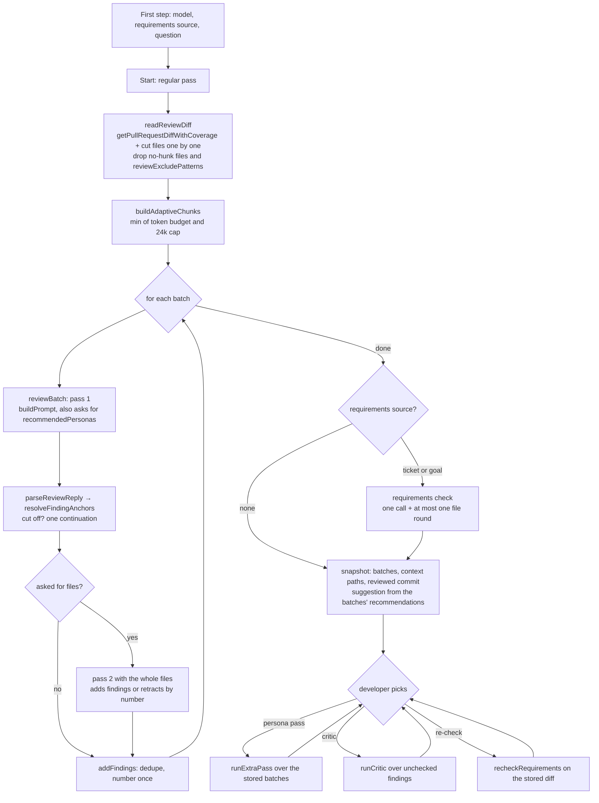
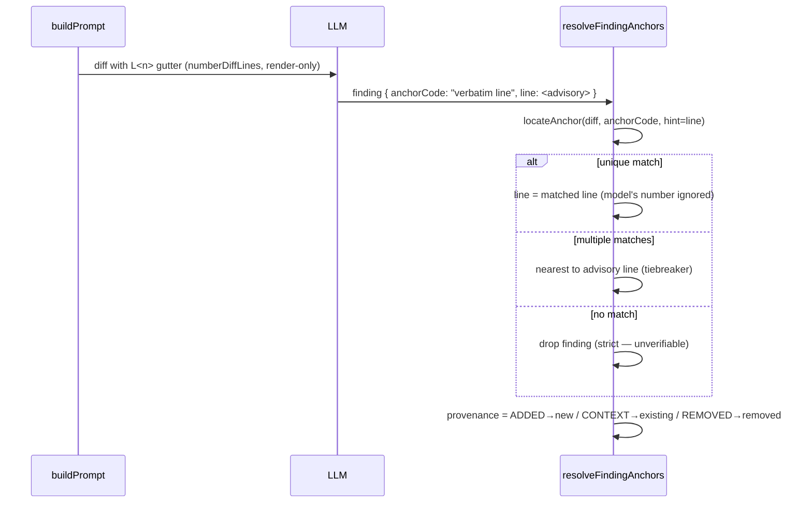

# Bitbucket PR Review Process

How the review board turns a pull request into a grounded, line-accurate
review. **Keep this document in sync whenever the review pipeline changes** — it
is the single source of truth for how the steps fit together. The user manual is
[`docs/manual/bitbucket-pr-review.md`](manual/bitbucket-pr-review.md); how a board
and its session work in general is in
[`docs/architecture/boards-and-sessions.md`](architecture/boards-and-sessions.md).

The code lives in:

- [`src/boards/review/`](../src/boards/review/) — the review board kind: start screen, first step, runs, findings, Post and Copy.
- [`src/review/engine/`](../src/review/engine/) — the staged review engine, vscode-free: `runRegularPass`, `runExtraPass`, `runCritic`, `recheckRequirements`, `rewordGoal`, the finding store and the shared pass plumbing.
- [`src/review/`](../src/review/) — the pure review core: `reviewSessionState.ts` (diff parsing, chunking, anchor locate, dedup, reply parsing, diagnostic formatters), the requirements pass, `findingCalls.ts` (Explain and Rewrite), `shareFormat.ts` (Copy), `tokenMeter.ts`, `ticketRead.ts`.
- [`src/services/PrReviewService.ts`](../src/services/PrReviewService.ts) — prompt building (regular, persona, critic, requirements), the persona catalog, comment posting.
- [`src/bitbucket/BitbucketApiClient.ts`](../src/bitbucket/BitbucketApiClient.ts) — HTTP, diff fetch (with context lines), file fetch.

## The staged review

A review is not one run with a mode chosen up front. The board stops on a
**first step** (the review model, the requirements source and an optional
question), and **Start** runs the **regular pass**. Everything after that is the
developer's choice, now or later: keep the findings, run the passes the regular
pass suggests, or pick any of the four persona passes and the critic. Each pass
is a board **run** (see "Model runs" in the architecture page): it reports each
finished batch to the session, so a restart keeps the finished part, and **Stop**
ends it with what it found so far. A new commit on the pull request never starts
a run; the board marks the review out of date and **Run again** reviews it at the
new commit.

**Later passes work on the snapshot.** The regular pass stores its batches, the
context files each batch read and the commit it reviewed. A persona pass and the
critic run over those batches and read the same context files again **at the
reviewed commit**, so they see what the regular pass saw even after the pull
request moved on.

**Finding numbers never change.** `addFindings` (`engine/findingStore.ts`) dedupes
a pass's findings among themselves, then merges each into the first numbered
finding it duplicates (stronger severity, combined sources, the corroboration
bump, the better provenance; the numbered finding keeps its number and text) or
gives it the next unused number. A removed finding leaves a gap.

**The suggestion.** Pass 1's prompt asks each batch which persona passes are worth
a dedicated look (`recommendedPersonas`, ids from the fixed catalog only).
`suggestionOf` unions them with `aggregateRecommendedPersonas`: a batch with no
readable trailer gives no signal, an explicit empty list does. No signal from any
batch means the board says it has no usable recommendation; a union that came
back empty means it suggests no extra pass. Either way the developer can pick
any pass.

## Diff intake and chunk budgeting

`parseDiff(raw)` builds `FileDiff[]` from the `---`/`+++` header lines (falling
back to the `diff --git` header); a deletion (`+++ /dev/null`) keeps the source
path and sets `deleted: true` so removed code is still reviewed. `reviewExcludePatterns`
are matched via `minimatch` with `matchBase: true`, and excluded files are
listed under **Not reviewed and dropped**; when every file is excluded the board says the pull request has nothing to review.

The token budget resolves in order: the `modelContextTokens` setting, then
the review model's `maxInputTokens` (VS Code LM API), then a `60 000` fallback —
multiplied by `contextBudgetRatio` (default `0.7`). `buildAdaptiveChunks`
packs files into chunks against the smaller of that budget and a fixed
`REVIEW_CHUNK_TOKEN_CAP` of 24 000 estimated tokens, estimating each file's
cost as `1500 + 50×files + ceil(diff.length/4)` tokens. The cap exists
because the model's *reply* is what gets divided across a chunk's files: a
window-sized chunk on a large-window model left each file only a sliver of
the answer. The room the cap frees up is what Pass 2 and the critic use for
context files. A single file whose diff exceeds the per-file budget is first
split along `@@` hunk boundaries (each sub-diff keeping the file header) so
an oversized file is reviewed across several calls instead of blowing the
context; a file with one giant hunk can't be subdivided and is sent as-is.

### Data Center truncated diffs

Bitbucket Data Center stops sending a PR diff past a server limit (about
10 000 lines by default). `getPullRequestDiffWithCoverage` reports which
files that cut: entries with a `truncated` flag on the file, a hunk or a
segment, plus — when the response itself is marked truncated — every path in
the PR's paged `changes` list that the response left out entirely. If the
changes list can't be fetched, the review goes ahead with the cut files it
already knows about. The review then fetches each cut file on its own with
`getPullRequestFileDiff` (passing the source path for a moved file), skipping
files that `reviewExcludePatterns` would drop anyway, and reviews it with the
rest. A file the server still cuts is named as *reviewed partially*; one that
can't be fetched is named as *not reviewed*. Cloud never reports cut files.

Every Data Center diff, changes-list and per-file response writes a one-line,
content-free shape summary to the output channel (`Data Center response
shape — …`: top-level keys, each `truncated` flag and its level, file/hunk/
segment/line counts, source/destination presence). It never includes code.
The response shape was built from documentation rather than a captured
response (`docs/known-limitations.md`, KL10), so this line is what shows a
mismatch in a user's log.

## The line-number trust boundary

The original failure mode: the model was handed a plain unified diff and had to
*count* lines from each `@@` header to state a line number — arithmetic it gets
wrong. The fix removes the model from that path entirely.

Key invariant: **`FileDiff.diff` is never mutated.** Line numbering is applied
only when rendering the prompt string (`numberDiffLines`). All code-side line
math — `parseDiff`, `resolveLineType`, `locateAnchor`, `splitFileDiff` — walks the
raw diff with its own `@@`-anchored counters, so the visible gutter cannot break
parsing.

## Filtering: what can remove a finding

A finding leaves the review only as a duplicate, for naming a file outside
the PR, by an explicit Pass 2 retraction, or by the critic. Every other
doubt keeps the finding visible. This protects recall: a review never looks
empty because filters stacked up, and every dropped finding is listed under
**Not reviewed and dropped**.

| Step | When | Effect |
| --- | --- | --- |
| Dedup (`dedupeFindings`, `addFindings`) | every pass | **merge** two findings on the same file + verified line with the same meaning (the stronger severity survives); a location-unverified finding is also dropped when another pass located a finding with the same title in the same file |
| Path resolution (`resolveFindingAnchors`) | every pass | **drop and count** a finding whose file names nothing in the diff, after trying `./`, `a/`, `b/`, leading `/` and a unique suffix match |
| Anchor locate (`resolveFindingAnchors`) | every pass | locate `anchorCode` in tiers — exact, whitespace-collapsed, then with a copied `L<n>` gutter or diff marker removed; when nothing matches, **keep** the finding as *location unverified*: no line, activity feed only when posted |
| Confidence (`confidenceThreshold`) | always | **mark** *low confidence* if `confidence < threshold` — never deleted |
| Pass 2 retraction (`mergePass2Findings`) | a batch that asked for files | **drop** a Pass 1 finding only when Pass 2 names its number in the meta line's `retract` list |
| Critic (`buildCriticPrompt` + `parseCriticKeep`, `applyCriticVerdicts`) | when the developer runs it | **drop** a finding the critic can't confirm, unless the developer explained it or drafted a comment for it: then it stays, labelled *probably a false alarm*. An unreadable verdict keeps the batch's findings unchecked, with a notice |

Persona-pass findings are not a separate filtering stage: they go through the
same anchor locate and dedup as regular-pass findings and join the same numbered
list. The critic checks only findings it has not checked yet
(`uncheckedFindings`), so running it again after a persona pass checks only the
new ones.

## Resilience & debugging

Every model call in a pass gets three tries: the original request, one
identical retry (short exponential backoff), and, for a batch's first call and
the critic call, a third try that is easier for the model instead of a third
identical one: the batch of files (or findings) is split in half once and each
half gets one final attempt (`callBatchWithSplit`). A file or finding that still
fails after its tries is skipped and reported; it never aborts the rest of the
pass. A stop the developer asked for ends the pass at once, with no retry and no
split, and keeps the finished batches.

| Regular pass | Board | Session | `firstReviewCompleted` |
| --- | --- | --- | --- |
| All batches readable | Findings, or "No issues found." | Stored | Set |
| Some batches failed | Findings under the partial-results banner; the failed batch parts listed with their files | Stored | Set |
| No batch readable | A failure banner, no findings, **Run again** | Stored, marked failed | Not set |
| Stopped | The findings so far | Stored | Not set |

A failed batch's notice says "after retrying" only when the error is a class the
retry layer retries (`isTransientLmError`); a non-transient error ends after one
attempt and logs why.

### Reading replies

Every review reply goes through `parseReviewReply`, which accepts one object
per line (the requested NDJSON), pretty-printed multi-line objects, a JSON
array, a `{"findings":[…]}` wrapper (its sibling meta keys included), and
any of those inside a code fence. A reply is *truncated* only when it stops
inside an unbalanced object or array; a reply that ends cleanly without its
trailing meta line is complete, not truncated, and stays eligible for Pass 2.

Parsing runs inside the retried call: a reply with nothing review-shaped
(empty, or prose with no usable JSON) throws `UnparseableReplyError`
(`assertReadableReply`), which the retry layer treats as transient. So a bad
reply is retried and split like a provider error, and after its tries only that
batch's files are reported as not reviewed.

### Truncation continuation

A cut-off reply, from Pass 1 or a persona pass, gets one continuation call.
Findings arrive ordered by severity, not by file, so no file can be proven
finished: the continuation re-reviews the whole batch, lists the findings
already reported, and asks only for new ones. Duplicates are merged by the
dedup.

### Pass 2 refines Pass 1

When the model asks for files outside the diff, Pass 2 re-reviews the batch
with those files rendered in a *Context files (not part of this diff)*
section and with Pass 1's findings as a numbered list. It may add findings,
and it retracts a Pass 1 finding only by naming its number in the meta
line's `retract` list; to correct a finding's severity or wording it retracts
the number and reports the corrected version. These instructions sit outside
the untrusted-content fence; only the numbered list sits inside it. Every Pass 1
finding it doesn't retract is kept (`mergePass2Findings`), so a Pass 2 reply cut
off before its meta line, or a failed Pass 2, can never lose a Pass 1 finding.
A persona pass may ask for more files the same way. The critic judges each
batch with the context files that batch read. A context file that doesn't fit
the remaining budget is skipped and logged, never admitted over budget
(`fetchAndBudgetContextFiles`).

### Always-on diagnostic timeline

Every pass logs to the shared `"Ticket Sidekick"` output channel (`View →
Output`) under `bitbucket.review`. It opens with one line recording its
configuration: the pass, model identity, resolved token budget, context budget
ratio, whether it is the critic, and context lines, together with `metering`
(`on`, or `off` when the token meter fell back to the raw model) and `frozen`
(whether the host's model object is frozen).

Every model call then logs one compact line: pass (`pass1`, `pass2`, a persona
id such as `security`, `critic` or `requirements`), batch, attempt, a short run
tag (`pr=PROJ/repo#42`, so two reviews in one window stay apart), prompt size
with estimated tokens, response size, duration, and status (`ok`, `truncated`,
or `error` with its code). Every failed attempt, including ones that succeed on
retry, names the error class (`errorName`); for an error with no provider code
it carries `stackHead`, the top three frames reduced to function plus file and
line. Recovery decisions (an identical retry, a split into halves, a
continuation, a give-up with `not retrying: <class> is not a transient provider
error`) are logged as their own lines. A truncated response gets its own event:
response size, complete-vs-cut-off line counts, whether the meta line was
present, which files were covered, and a short raw preview (bounded length,
key-based redaction).

At the end of every pass one findings-funnel line reports counts at each stage
of the table above (raw findings, deduped, dropped as outside the PR, retracted
by Pass 2, dropped by the critic) down to the final count, with how many are
location unverified. A pass that ends with no readable batch logs `no file could
be reviewed` at error level with the reviewed and failed file counts and the
first cause; a pass that is stopped or throws logs the last stage it reached
(`logAborted`).

### Detailed diagnostics (opt-in)

`ticketSidekick.bitbucket.detailedDiagnostics` (boolean, default `false`)
additionally buffers every line above during the pass and, when it ends, writes
one fenced structured record to the output channel (`writeRunRecord`):
configuration, every per-call and event line, and the findings funnel, as one
copy-pasteable block for comparing two runs or filing a provider bug report.

## Provenance (new vs. existing code)

Every located finding is tagged from the line type it anchored to:

- **new** — anchored to an added (`+`) line; introduced by this PR.
- **existing** — anchored to an unchanged context line; a real issue, but
  pre-existing. Shown and clearly marked, never confused with new work.
- **removed** — anchored to a removed (`-`) line; kept and tagged (rare).

Wider context (`reviewContextLines`, default 12) deliberately surfaces *more*
existing findings; they are labelled, not introduced by the PR.

## Multi-line findings

A finding carries a primary anchor (where the bug manifests, and where an inline
comment lands) plus optional `relatedCode` resolved to `relatedLines` (the other
lines in a build-up). The board shows `L19 (also L12, L15)`; **Explain** walks
through them.

## Persona passes

`PERSONAS` (`src/services/PrReviewService.ts`) is a fixed catalog of four
single-lens personas: **security**, **performance**, **reliability**,
**maintainability**. Each is its own pass (`runExtraPass`) over the stored
batches with `buildPersonaPrompt`: the same grounding rules, severity rubric and
NDJSON output contract as `buildPrompt`, with the generalist "Review the changes
for:" section replaced by the persona's focus paragraph, which tells the model
not to report findings outside its lens. A persona pass runs only when the
developer picks it, the suggestion included; a pass already run is refused. Its
findings carry the persona as their source and join the numbered list.

## Upfront question

The question from the first step (or from `/ts-bitbucket review <url>
<question>`, or the agent's `question` input to `bitbucket_open_review`) is
composed with any configured `reviewInstructions` into one trusted `ADDITIONAL
INSTRUCTIONS` block and goes into **every** review call: Pass 1, the
continuation, Pass 2, every persona pass and the critic. Reaching the critic
matters: without it, the verification step would judge findings against a
generic rubric and could drop question-driven findings. Explain also gets the
question. Without a question and without `reviewInstructions`, no `ADDITIONAL
INSTRUCTIONS` block is added.

## Requirements check

An isolated call that checks the diff against a Jira ticket or a goal the
developer typed. It adds the **Requirements coverage** block above the findings
and adds no findings. **Only this call ever receives ticket or goal text**: the
Pass 1, Pass 2, persona and critic prompts are untouched.

**Choosing the source.** On the first step: a Jira key typed by the developer
wins over the key in the PR title (`findJiraKeyInText`, which skips well-known
non-ticket shapes such as `UTF-8`, `SHA-256`, `CVE-…` and `RFC-…`); the title's
key is offered with **Use KEY**. While Jira is not configured the ticket source
is unavailable, with the reason. A goal is reworded only when the developer
presses **Reword** (`rewordGoal`: one call that sorts the goal into in-scope and
out-of-scope points in the developer's own terms, adds nothing they did not
state, and lists open points); the developer corrects the text, and the check
reads that text.

**Reading the ticket.** `TicketService.getRequirementsSource` returns the
summary, description and comments or a failure classified by HTTP status (404
not found, 401/403 auth, anything else other). The read is guarded by
`readTicketGuarded` (`src/review/ticketRead.ts`): it times out after 20 seconds
and a throw becomes an `error` failure, so a slow or broken Jira never holds up or
fails the review; the findings stand and the coverage names the failed read.
When the key in use is not found and the PR title names another, the failure
says so and offers **Use** with that key. Sizes are capped in
`utils/requirementsSource.ts` (description 6,000 characters, comments 8,000
newest first and 1,500 each); a failed comment fetch still returns the ticket.
The review reaches Jira through the shared `TicketService`/`JiraApiClient`.

**The call.** One call over the whole PR at the end of the regular pass
(`runRequirementsPass`, `src/review/requirementsPass.ts`). `packDiffFiles` fits as
many files as the token budget allows, smallest first; files left out are listed
by path and the prompt tells the model to mark a requirement *unclear*, never
*not evident*, when its evidence could sit in an unseen file (KL14). The reply may
ask for extra files; one round goes through `fetchAndBudgetContextFiles`, never a
second, and a failed or unreadable second round keeps the first answer. The reply
is one JSON object read by `parseRequirementsReply`; an unreadable reply is
retried like a provider error, and if every try fails the findings stand and the
coverage says the check failed. The call logs with pass id `requirements`.

**Re-check.** After a new choice or an edited goal, **Re-check** runs only the
check again on the stored diff (`recheckRequirements`), reading extra files at the
reviewed commit, and replaces only the coverage; the findings are untouched. A
failed or stopped re-check keeps the old coverage; the choice "none" removes it
without a call.

**Output and safety.** `renderCoverageText` renders the coverage as plain text:
the board shows it as text, and Copy puts it between the header and the findings
for a whole-review copy (a copy of some findings leaves it out). It is not made of
numbered findings, so Explain, Post and Copy of a finding do not target it.

## Explain, comments, Post and Copy

- **Explain** (`explainFinding`, `src/review/findingCalls.ts`) is one call with the
  finding, its code, the PR title and description and the upfront question.
  Explaining again replaces the answer; a failed Explain keeps the earlier one,
  with an error line.
- **Draft comments** start from the finding and are edited by hand. **Rewrite**
  (`rewriteComment`) revises the draft with the developer's instruction; **Undo**
  restores the text before it. A failed Rewrite keeps the hand-edited draft.
- **Post** is the board's one write: the selected drafts as they are, after the
  native confirmation. A finding with a verified line is posted inline on that
  line; one without goes to
  the pull request's activity. Each comment is reported, and only the failed ones
  are offered again.
- **Copy** builds the text in the extension from the stored review
  (`formatShare`, `src/review/shareFormat.ts`), never from the page: `teams` is
  plain text grouped by severity with no Markdown a Teams chat would show as
  symbols, `markdown` is the same as Markdown. Both carry the PR title, author,
  target branch and link, and mark a finding below `confidenceThreshold` "(low
  confidence)".

Explain and Rewrite use the review model and count toward the token usage.

## The agent's side

`bitbucket_open_review` opens the board and answers as soon as it is open; it
never waits for the review. The agent reads a stored review with
`bitbucket_read_findings`: the summary (findings by severity, passes run, the
requirements coverage), the findings list (each marked when its comment is
drafted, posted or failed to post), or one finding with its code, explanation and
draft. It matches a free-text question to a finding itself and reads the diff
with `bitbucket_getPullRequestDiff`.

## Token usage

Every model call of a review (the passes, the requirements check, the goal
rewording, Explain and Rewrite) goes through a token meter (`createTokenMeter`,
`src/review/tokenMeter.ts`): a proxy over the model that replaces only
`sendRequest`. The proxy targets an empty object and reads the real model itself,
because the host may freeze its model: a `get` trap may not return a different
value for a read-only, non-configurable property of its target. If the model
cannot be wrapped (checked once at creation) the meter fails open: the raw model
is used, the call goes uncounted and a warning is logged (KL12 in
[`known-limitations.md`](known-limitations.md)). Input is counted with
`model.countTokens` once the provider accepts the request; output is counted on
the streamed text when the stream ends, breaks, or is abandoned. Every accepted
attempt counts, retries included. When `countTokens` throws, that figure falls
back to `ceil(chars / 4)` and the call is flagged estimated. Cache reads, cache
writes, and reasoning tokens are not exposed by the VS Code API.

Each counted call is added to a per-month, per-model counter in
`ExtensionContext.globalState` (`TokenUsageService`, `src/utils/tokenUsage.ts`,
key `bitbucket.tokenUsage`). Months older than the current one plus the two
before it are deleted on write. Writes inside one window are queued; two windows
writing at the same instant can lose an update (KL11). The board shows the usage
per pass and of Explain and Rewrite; `bitbucket_token_usage` (`/ts-bitbucket
usage`) prints the stored months as a table, needs no Bitbucket credentials, and
the extension holds no prices.

## Settings that shape the run

| Setting | Default | Effect |
| --- | --- | --- |
| `ticketSidekick.bitbucket.reviewModel` | `""` | the model every call uses; asked for on the first step when empty or unavailable |
| `ticketSidekick.bitbucket.reviewInstructions` | `""` | added to every review call, the persona passes and the critic |
| `ticketSidekick.bitbucket.reviewContextLines` | 12 | context lines around each hunk |
| `ticketSidekick.bitbucket.confidenceThreshold` | 0.7 | below → marked *low confidence*, never removed |
| `ticketSidekick.bitbucket.contextBudgetRatio` | 0.7 | fraction of the context window for a review call's prompt; chunks are further capped at 24 000 estimated tokens |
| `ticketSidekick.bitbucket.modelContextTokens` | (model API) | token budget override |
| `ticketSidekick.bitbucket.reviewExcludePatterns` | `[]` | globs skipped before review |
| `ticketSidekick.bitbucket.detailedDiagnostics` | `false` | one structured run record per pass in the output channel |
